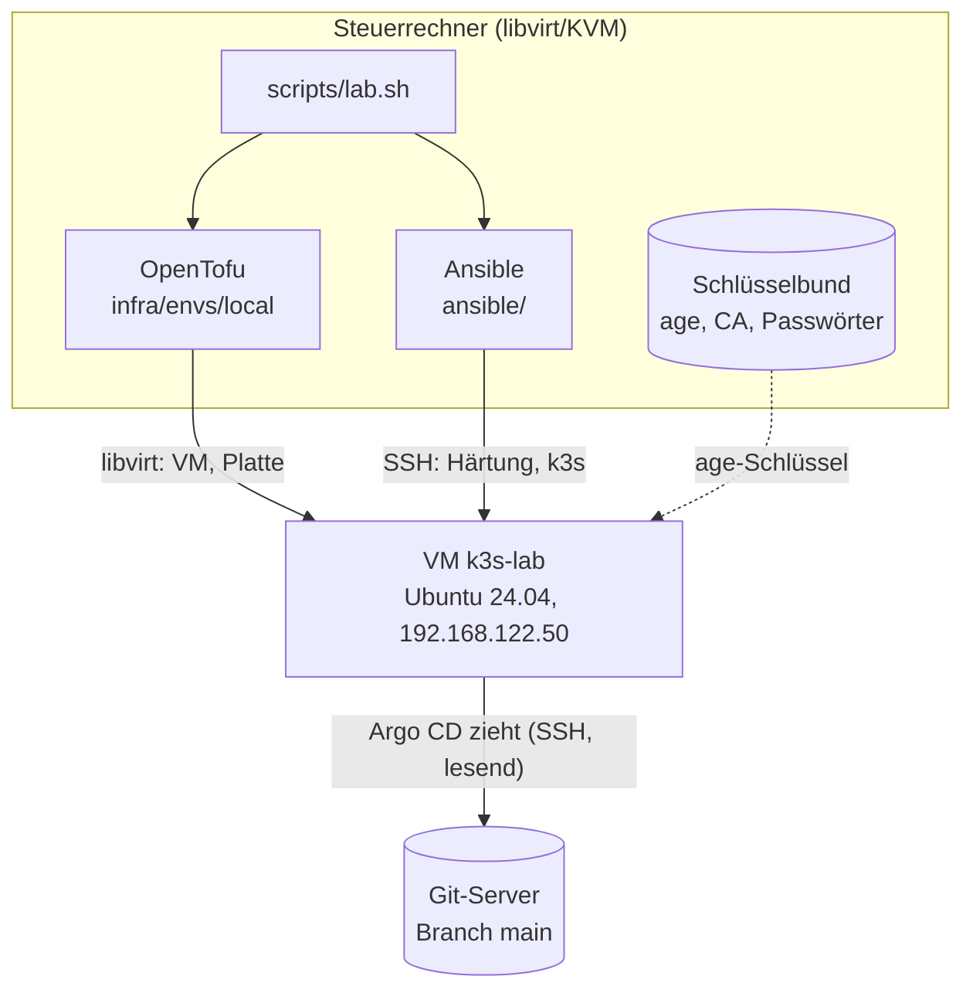
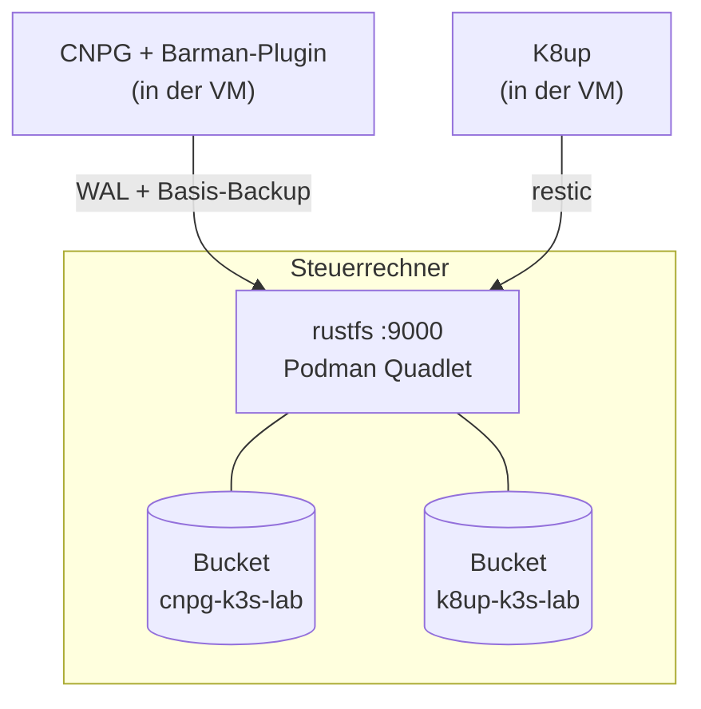
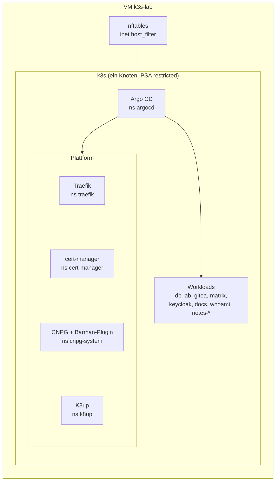

# Architektur

Das Lab ist ein **Ein-Knoten-Kubernetes** (k3s) in einer libvirt-VM auf dem
Steuerrechner. Es entsteht aus Code: OpenTofu baut die VM, Ansible richtet
Betriebssystem und k3s ein und startet Argo CD, ab dann liefert Git alle
Dienste. Das Backup-Ziel (rustfs) läuft bewusst **ausserhalb** der VM auf dem
Steuerrechner.

## Gesamtbild

Zuerst die Orte und die Wege vom Steuerrechner in die VM:

Die Backups gehen an das S3-Ziel `rustfs`. Es läuft auf dem Steuerrechner,
bewusst **ausserhalb** der VM:

Dann der Blick in die VM: Argo CD verteilt alles weitere.

Gelesen aus: `infra/envs/local/main.tf`, `ansible/site.yml`,
`ansible/argocd.yml`, `ansible/backup-host.yml`, `gitops/apps/*.yaml`.

## Bausteine

| Baustein | Aufgabe | Wo im Repo | Lernpfad |
|---|---|---|---|
| libvirt-VM `k3s-lab` | Hardware des Labs, 4 vCPU, 8 GiB RAM, 60 GB Platte (Standardwerte) | `infra/modules/libvirt-vm/` | [Rebuild](../how-to/rebuild.md) |
| OpenTofu | baut und zerstört **nur** die VM | `infra/envs/local/` | [Bootstrap](bootstrap-and-gitops.md) |
| Ansible | Härtung, Firewall, k3s, Argo-CD-Bootstrap, Backup-Host | `ansible/` | [Stufe 3](../learning-path/stage-3-hardening.md) |
| k3s | Kubernetes, Version gepinnt, `secrets-encryption` secretbox, PSA restricted | `ansible/inventory/group_vars/k3s/main.yml` | [Stufe 3](../learning-path/stage-3-hardening.md) |
| Argo CD | GitOps-Controller, App-of-Apps | `gitops/apps/` | [Stufe 4](../learning-path/stage-4-argocd.md) |
| Traefik | Ingress mit TLS-Optionen, Security-Headern, zwei Entrypoints | `gitops/platform/traefik/` | [Stufe 5](../learning-path/stage-5-traefik.md) |
| cert-manager | Lab-CA, ein Zertifikat je App | `gitops/platform/cert-manager/` | [Stufe 6](../learning-path/stage-6-certmanager.md) |
| SOPS, age, KSOPS | Geheimnisse verschlüsselt im Git | `secrets/`, `.sops.yaml` | [Stufe 7](../learning-path/stage-7-ksops.md) |
| rustfs | S3-Ziel für alle Backups, auf dem Steuerrechner | `ansible/roles/backup_s3/` | [Stufe 8a](../learning-path/stage-8a-backup-target.md) |
| CloudNativePG + Barman | Postgres, WAL-Archiv und Basis-Backup nach rustfs | `gitops/platform/cnpg/`, `gitops/workloads/db-lab/` | [Stufe 8b](../learning-path/stage-8b-cnpg.md) |
| K8up | restic-Backup der Dateien von Gitea und Matrix nach rustfs | `gitops/platform/k8up/` | [Stufe 8c](../learning-path/stage-8c-gitea.md), [Matrix](../how-to/matrix.md) |
| Gitea | Übungs- und Ziel-System im Cluster | `gitops/workloads/gitea/` | [Stufe 8c](../learning-path/stage-8c-gitea.md) |
| Matrix | Synapse und Element Web, Föderation aus | `gitops/workloads/matrix/`, `gitops/charts/matrix/` | [Matrix](../how-to/matrix.md), [ADR-0016](decisions/0016-matrix-federation-off.md) |
| Keycloak | Single Sign-on (OIDC) für Gitea und Matrix, Realm als Code | `gitops/workloads/keycloak/`, `gitops/charts/keycloak/` | [Keycloak](../how-to/keycloak.md), [ADR-0019](decisions/0019-keycloak-sso.md) |
| Doku-Site, Notiz-Sites | diese Site und beliebig viele Notizbücher, im Cluster gebaut; die Notiz-Sites hinter Keycloak (oauth2-proxy, [ADR-0021](decisions/0021-notes-sso.md)) | `gitops/workloads/docs/`, `gitops/charts/notes-site/` | [Doku-Site](../how-to/docs-site.md), [Notiz-Sites](../how-to/notes-sites.md) |

## Namespaces und Argo-CD-Projekte

| Namespace | Inhalt | Projekt | Angelegt von |
|---|---|---|---|
| `argocd` | Argo CD, UI-Route | `lab` | Ansible (`argocd_bootstrap`) |
| `traefik` | Ingress-Controller | `platform` | Argo CD (`CreateNamespace`) |
| `cert-manager` | cert-manager, `lab-ca`, Default-Zertifikat | `platform` | Ansible (Rolle `lab_ca`) |
| `cnpg-system` | CNPG-Operator, Barman-Plugin | `platform` | Argo CD (`CreateNamespace`) |
| `k8up` | K8up-Operator | `platform` | Argo CD (`CreateNamespace`) |
| `db-lab` | Übungs-Datenbank `pg-lab` | `lab` | Argo CD (Manifest, Sync-Wave -1) |
| `gitea` | Gitea, `gitea-db`, K8up-Schedule | `lab` | Argo CD (Manifest, Sync-Wave -1) |
| `matrix` | Synapse, Element Web, `matrix-db`, K8up-Schedule | `lab` | Argo CD (Manifest) |
| `keycloak` | Keycloak, `keycloak-db`, Realm-Job | `lab` | Argo CD (Manifest) |
| `docs` | diese Doku-Site | `lab` | Ansible (Rolle `docs_site`) |
| `whoami` | Test-Dienst | `lab` | Argo CD |
| `notes-<site>` | je ein Notizbuch | `notes` | Ansible (Rolle `notes_sites`) |

Alle Workload-Namespaces tragen PSA `restricted` und haben NetworkPolicies
mit Default-Deny für Ingress.

## Die drei Regeln

1. **Eine Quelle für Werte.** `infra/envs/local/lab.yaml` plus
   `lab.local.yaml` lesen OpenTofu, Ansible und `lab.sh`. Argo CD liest nur
   Git und kennt diese Datei nicht; deshalb schreibt `lab.sh customize` die
   wenigen Werte, die im Git stehen müssen, dorthin.
   Siehe [Konfiguration](../reference/configuration.md).
2. **Änderungen via Git.** Nach dem Bootstrap ist `gitops/` die Steuerung.
   `kubectl` ist zum Schauen da; Self-Heal setzt von Hand Geändertes zurück.
3. **Abreissen darf nur das Haus, nie der Werkzeugschuppen.** `down` und
   `rebuild` zerstören die VM. Schlüssel, Backups, rustfs und das Repo
   bleiben. Siehe [Neuaufbau](../how-to/rebuild.md).

## Grenzen der Architektur

- **Ein Knoten.** Fällt die VM aus, ist alles weg, bis sie neu gebaut oder
  aus Backups wiederhergestellt ist. Mehrere Postgres-Instanzen auf einem
  Knoten üben Failover, sie bringen keine Hochverfügbarkeit gegen
  Knotenausfall.
- **Lokaler Speicher.** StorageClass `local-path`; die Backups liegen auf
  dem gleichen Datenträger wie die VM-Platte, solange `backup_s3_data_dir`
  nicht auf ein anderes Gerät zeigt (siehe [Issue 3](https://github.com/tabee/k8s-lab-template/issues/3)).
- **Nur Linux mit libvirt/KVM** als Steuerrechner.
- **Ein Git-Server als Abhängigkeit.** Argo CD braucht beim Bootstrap Zugriff
  auf das Repo (Deploy-Key, Host-Keys, gegebenenfalls VPN).
