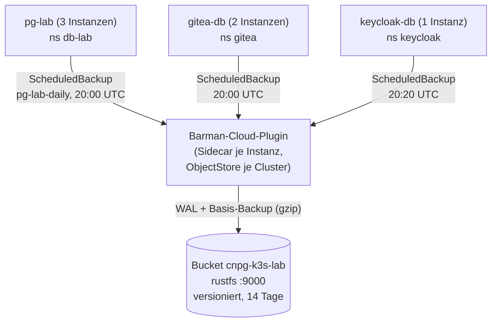
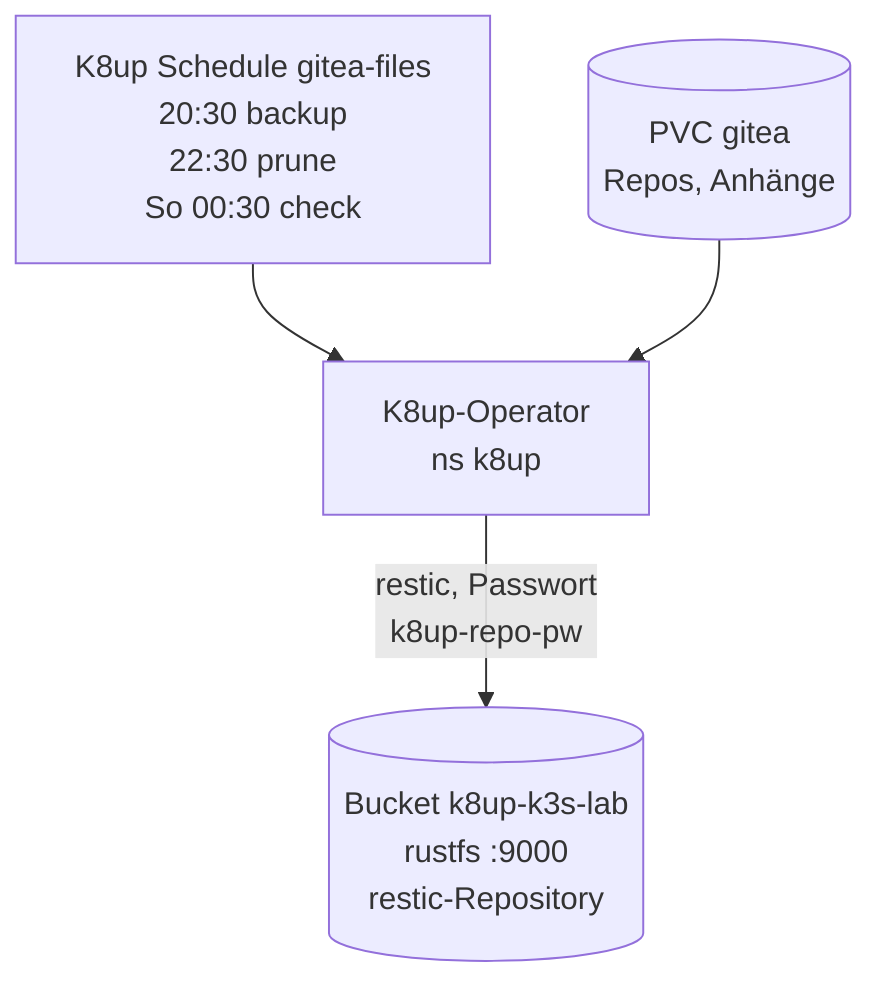
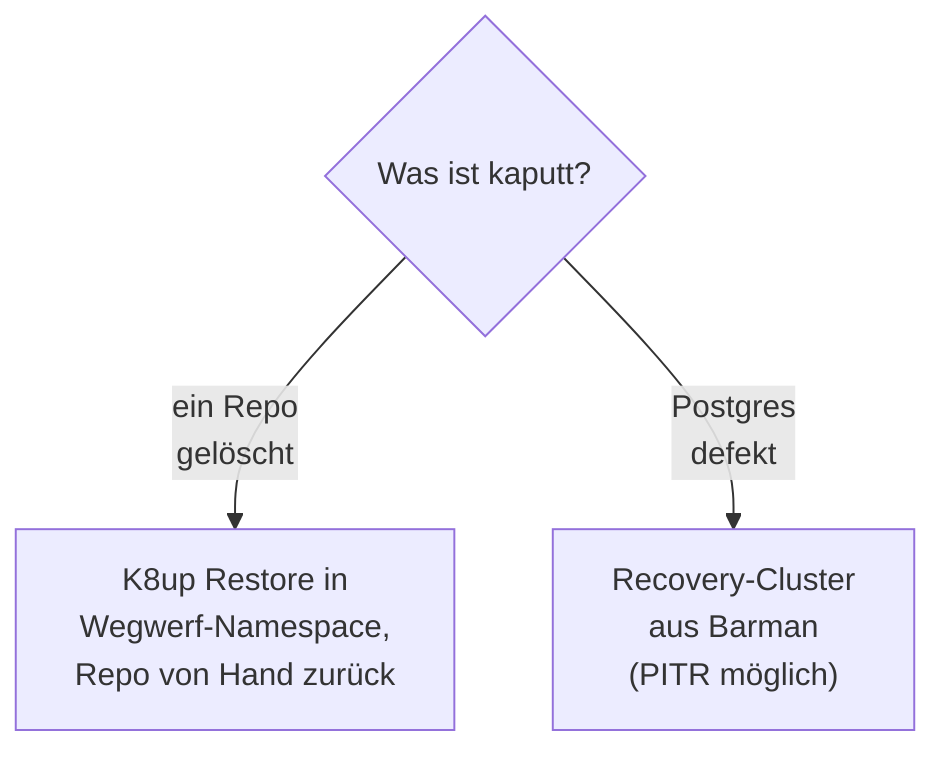
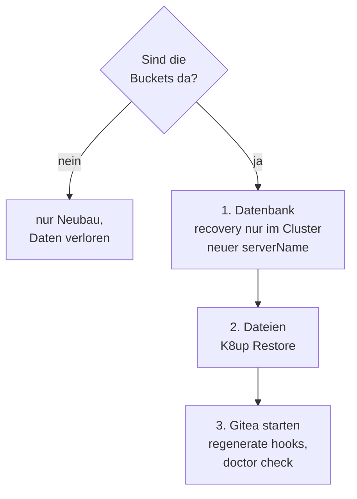

# Backup und Restore

Das Lab sichert **zwei Arten von Daten** mit **zwei Werkzeugen** in **einen
Objektspeicher**:

| Daten | Werkzeug | Verfahren | Bucket |
|---|---|---|---|
| Postgres (`pg-lab`, `gitea-db`, `keycloak-db`) | CloudNativePG mit Barman-Cloud-Plugin | laufendes WAL-Archiv plus tägliches Basis-Backup, Wiederherstellung zu einem Zeitpunkt (PITR) | `cnpg-k3s-lab` |
| Gitea-Dateien (PVC `gitea`) | K8up (restic) | täglicher verschlüsselter, deduplizierter Snapshot | `k8up-k3s-lab` |

Der Objektspeicher ist **rustfs** (S3-kompatibel) auf dem Steuerrechner, als
rootless Podman-Quadlet. Er liegt ausserhalb der VM, damit ein
VM-Verlust das Backup nicht mitnimmt.

## Datenfluss

Der Postgres-Pfad: Jede Instanz hat einen Sidecar des Barman-Cloud-Plugins,
das WAL und Basis-Backup in den Bucket schreibt.

Der Dateien-Pfad: Der K8up-Operator sichert das PVC von Gitea mit restic.

rustfs nimmt Verbindungen nur aus `192.168.122.0/24` an.

Quellen: `gitops/workloads/db-lab/{cluster,objectstore,scheduledbackup}.yaml`,
`gitops/workloads/gitea/manifests/{objectstore,k8up-schedule}.yaml`.

!!! warning "Der Transport ist HTTP"
    CNPG und K8up sprechen `http://192.168.122.1:9000` (das ist das virtuelle
    Netz `virbr0` zwischen VM und Steuerrechner). Der Verkehr ist nicht
    TLS-verschlüsselt. Er verlässt den Steuerrechner nie, wird aber vom
    Steuerrechner und der VM gesehen. Restic verschlüsselt seine Daten
    zusätzlich selbst; die WAL- und Basis-Backups von Barman liegen **nicht**
    clientseitig verschlüsselt im Bucket. Das gehört in das
    [Sicherheitsmodell](security-model.md#restrisiken).

## Zeitplan und Aufbewahrung

| Aufgabe | Zeit (UTC) | Aufbewahrung |
|---|---|---|
| CNPG Basis-Backup (`pg-lab-daily` und das ScheduledBackup von `gitea-db`, `immediate: true`) | täglich 20:00 | `retentionPolicy: 14d` im ObjectStore; zusätzlich 14 Tage Bucket-Lifecycle |
| CNPG Basis-Backup von `keycloak-db` (`immediate: true`; kein K8up, Keycloak hat kein Volume) | täglich 20:20 | wie oben |
| WAL-Archiv | laufend | wie Basis-Backup |
| K8up `backup` | täglich 20:30 | restic-Snapshots |
| K8up `prune` | täglich 22:30 | 14 täglich, 8 wöchentlich, 6 monatlich |
| K8up `check` | sonntags 00:30 | Prüfung des Repositories |

Alle Zeiten sind UTC; Europe/Zurich liegt im Winter eine Stunde, im Sommer zwei Stunden darüber.
Die vollständige Staffelung für Gitea und Matrix samt Zeitumrechnung und Sync-Sperre steht im
[Memory-Budget](../reference/memory-budget.md#staffelung-ab-08112026).

## Wiederherstellung: Reihenfolge

Die Reihenfolge folgt den Abhängigkeiten: Gitea braucht seine Datenbank und
seine Dateien.

Läuft der Cluster noch und ist nur etwas kaputt:

VM oder Platte sind weg:

| Anleitung | Fall |
|---|---|
| [Datenbank wiederherstellen](../how-to/restore-database.md) | Desaster-Neuaufbau und PITR von `pg-lab` |
| [Gitea wiederherstellen](../how-to/restore-gitea.md) | Desaster (VM weg, Buckets da) und ein Repo aus Versehen gelöscht |
| [Keycloak wiederherstellen](../how-to/restore-keycloak.md) | Desaster mit `rebuild --restore`; nur Datenbank, kein Volume |
| [Gitea-Backup prüfen](../how-to/verify-gitea-backup.md) | Restore-Test von `verify-gitea.yml` |
| [Failover üben](../how-to/failover-drill.md) | Primärwechsel von `pg-lab` unter Last |
| [Restore-Test](../how-to/restore-drill.md) | Gitea nur aus den Backups wiederherstellen, gemessen |
| [Backup-Replikat](../how-to/backup-replica.md) | Kopie der Backups auf einem zweiten Rechner |
| [Alarm](../how-to/alerts.md) | Meldung bei Backup- oder Kantenausfall |

## Wann ein Backup wiederherstellbar ist

Ein CNPG-Backup mit Phase `completed` heisst nur: das Basis-Backup liegt im
Bucket. Postgres kann es erst abspielen, wenn auch das WAL-Segment aus
`status.endWal` archiviert ist. Das Segment bleibt offen, bis es voll ist
oder `pg_switch_wal()` läuft. Fährt die VM vorher herunter, fehlt genau
dieses Segment, und die Recovery endet mit
`WAL ends before consistent recovery point`.

`lab.sh down`, `lab.sh export` und `lab.sh rebuild --restore` rufen `scripts/lab-wal-ready.py` auf,
schreiben einen winzigen WAL-Eintrag (`pg_logical_emit_message`, keine Tabelle, keine Daten),
schalten das WAL um und warten, bis
`pg_stat_archiver.last_archived_wal` mindestens das `endWal` des letzten
abgeschlossenen Backups jedes Clusters ist. Sonst bleiben VM und Platte
unangetastet. Ein Cluster ohne abgeschlossenes Backup ist ein Abbruch, kein
Überspringen. Eine leere Cluster-Liste bleibt in Ordnung. Einen Schalter dafür gibt es nicht.
Der Eintrag ist nötig, weil `pg_switch_wal()` auf einem ruhenden Cluster ein leeres Segment nicht abschliesst: das
`endWal` würde nie archiviert und die Prüfung scheiterte, obwohl alles gesund ist (2026-11-02 bei `pg-lab` und `gitea-db`).
Läuft die VM noch, legt `rebuild --restore` vorher ein neues Basis-Backup und ein neues
K8up-Backup an (`scripts/lab-backup-fresh.py`, auch für `keycloak-db`, das kein K8up-Volume hat) und reisst erst danach ab.
Der Restore-Planer (`scripts/lab-restore-render.py`) bleibt streng: Er nimmt nur eine Generation, deren
`endWal` im Archiv liegt. Damit ruhende Datenbanken ihn nicht blockieren (#111, 2026-11-07), versiegelt
`rebuild --restore` auf einer laufenden VM zuerst das WAL (`lab-wal-ready.py`) und plant erst dann. Nach den
frischen Backups plant es nochmals (Phase «Restore plan reads the fresh backups», höchstens
`LAB_RESTORE_PLAN_ATTEMPTS` × `LAB_RESTORE_PLAN_INTERVAL` Sekunden, Standard 12 × 5). Scheitert das, bleibt
die VM stehen. Von Hand hilft dasselbe wie am 2026-11-07: pro Cluster `checkpoint`, dann `select pg_switch_wal();`.
`purge` löscht die Buckets absichtlich und wartet nicht.
Entscheidung: [ADR-0017](decisions/0017-wal-before-vm-stop.md).

## Was `rebuild` damit macht

`lab.sh rebuild` ist ein **sauberer Neuanfang, keine Wiederherstellung**. Es
leert den Postgres-Bucket `cnpg-k3s-lab`, weil CNPG nie in ein Archiv
schreibt, das schon Dateien hat (Fehler `Expected empty archive`). Der
K8up-Bucket bleibt bei `down` und `rebuild` unberührt. `purge` leert **und
löscht** beide Buckets. Die Matrix steht in der
[Anleitung: Neuaufbau](../how-to/rebuild.md#was-bleibt-was-geht). Wann
`rebuild --restore` die Daten zurückholt und wann `purge` mit `up` leer
startet: [dieselbe Anleitung](../how-to/rebuild.md#restore-oder-leer).

## Was wird bewiesen, was nicht

Die Abnahme beweist, dass die Bytes im Bucket stimmen:
`verify-cnpg.yml` stellt per PITR in einen zweiten Cluster wieder her
(Vergleich Tabelle A mit Anzahl und md5, Tabelle B muss leer sein, Alter des
Backups unter 26 Stunden). `verify-gitea.yml` löscht ein Test-Repository und
holt es per K8up in einen Wegwerf-Namespace zurück.

Sie beweist den Weg aus dem Objektspeicher, nicht den Ausfall der VM-Platte.
`lab.sh restore-drill` macht denselben Beweis im Wegwerf-Namespace und löscht
nichts Echtes ([Restore-Test](../how-to/restore-drill.md),
[ADR-0014](decisions/0014-restore-drill-throwaway-namespace.md)).
`rebuild --restore` ist der Ausfall selbst: VM weg, Buckets bleiben, Git bleibt
`initdb`, der `serverName` nur im Cluster, Dateien aus dem neuesten K8up-Snapshot dieses PVC
([ADR-0018](decisions/0018-recover-from-backup.md)).
Den ersten Lauf mit Datum und Prüfsumme trägt die Anleitung ein, sobald er durch ist.
Ausserdem liegen VM-Platte und rustfs standardmässig auf demselben Datenträger des
Steuerrechners; ein [Backup-Replikat](../how-to/backup-replica.md) auf einem zweiten Rechner schliesst das,
sobald es installiert ist ([ADR-0013](decisions/0013-replica-rsync-rrsync.md)).
