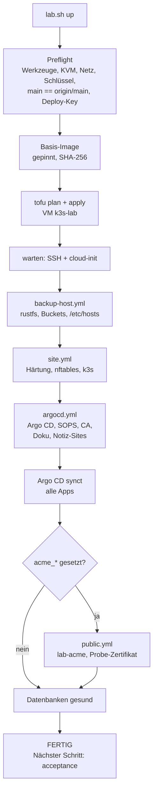
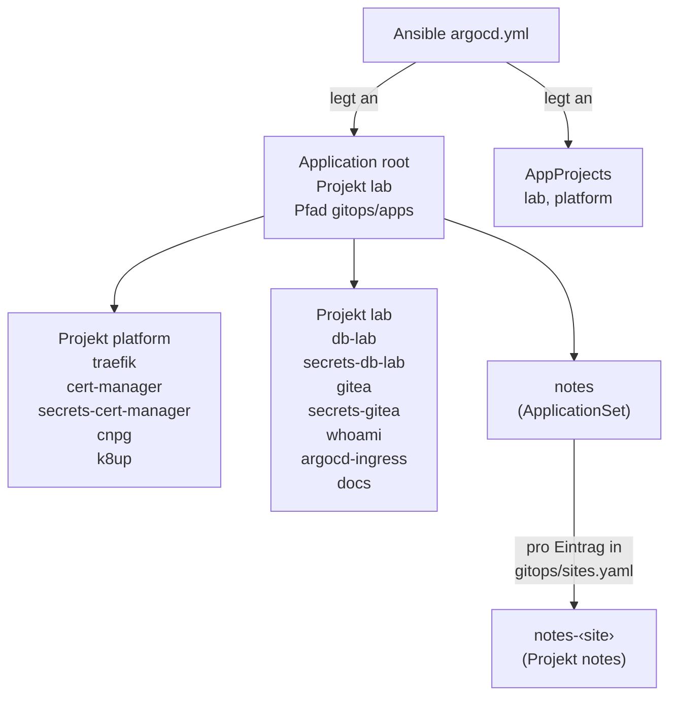
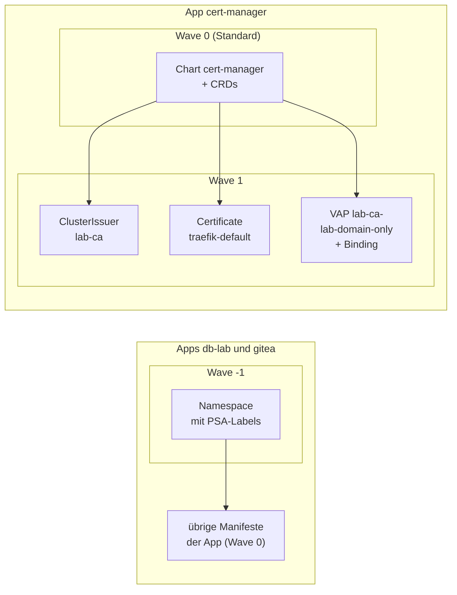

# Bootstrap und GitOps

Das Lab entsteht in drei Schichten. Jede Schicht hat **ein** Werkzeug und
eine klare Grenze:

| Schicht | Werkzeug | Zuständig für | Grenze |
|---|---|---|---|
| Haus | OpenTofu | VM, Platte, cloud-init, Netzanbindung | baut und zerstört nur die VM |
| Einrichtung | Ansible | Betriebssystem, Firewall, k3s, Argo-CD-Bootstrap, Backup-Host auf dem Steuerrechner | richtet ein, prüft den Ist-Zustand, idempotent |
| Dienste | Argo CD (GitOps) | alles in `gitops/` und `secrets/` | liest nur Git, kennt `lab.yaml` nicht |

*Eselsbrücke:* „Tofu baut das Haus, Ansible richtet es ein.“

## Warum Tofu **und** Ansible

| | OpenTofu | Ansible |
|---|---|---|
| Modell | Gedächtnis (tfstate): was gebaut wurde | prüft den tatsächlichen Zustand |
| `destroy` | gehört zum Kern | gibt es nicht |
| Zweiter Lauf | Plan: nichts zu tun | `changed=0` |
| Provisioner | nur ein Notbehelf, hier nicht benutzt | Kernaufgabe |

Das Zusammenspiel ist so gewählt, weil `lab.sh down` die VM verlässlich
entfernen muss (Tofu), die Einrichtung aber bei jedem Lauf den echten Zustand
prüfen soll (Ansible).

## Die Kette

Die Reihenfolge steht in `aufbauen_phasen()` in `scripts/lab.sh`. Jede Phase
läuft mit Stoppuhr; am Ende steht eine Tabelle und die Summe der
`changed`-Zähler der Ansible-Läufe (Ziel beim zweiten `up`: `changed=0`).

### Was welcher Ansible-Lauf tut

| Playbook | Ziel | Inhalt |
|---|---|---|
| `backup-host.yml` | Steuerrechner (lokal, mit `sudo`) | Rolle `backup_s3` (rustfs als Quadlet, Buckets, Benutzer, Policies, ufw), Rolle `lab_hosts` (verwalteter Block in `/etc/hosts`) |
| `site.yml` | VM | Rollen `base` (Pakete, sysctl, SSH, auditd, AppArmor), `firewall` (nftables), `k3s`; danach Audit-Regeln nachziehen |
| `argocd.yml` | Steuerrechner → Cluster | Rollen `argocd_bootstrap` (Helm, `sops-age`, Repo-Secret, Projekte, Root-App), `lab_ca`, `docs_site`, `notes_sites` |
| `public.yml` | Steuerrechner → Cluster | Rolle `lab_acme` (nur mit `acme_*` Werten) |

## App-of-Apps

Ansible legt genau **eine** Application an: `root`. Sie liest `gitops/apps/`
auf `main`. Jede Datei dort ist eine Application im Namespace `argocd` mit
automatischem Sync, Prune und Self-Heal.

Dreizehn Dateien liegen in `gitops/apps/`, davon ist `notes.yaml` ein
ApplicationSet. Das Projekt `notes` legt Ansible an (Rolle `notes_sites`).

### Zwei Projekte, zwei Vertrauensstufen

| Projekt | Namespaces | Cluster-weite Arten | Zweck |
|---|---|---|---|
| `lab` | `argocd`, `whoami`, `docs`, `db-lab`, `gitea` | nur `Namespace` | Workloads |
| `platform` | `traefik`, `cert-manager`, `cnpg-system`, `k8up` | Namespace, CRD, ClusterRole, ClusterRoleBinding, IngressClass, Validating-/MutatingWebhookConfiguration, ClusterIssuer, ValidatingAdmissionPolicy und Binding | Plattformdienste |

Die Projekte kommen **nicht** aus dem Git, sondern von Ansible
(`ansible/inventory/group_vars/all/argocd.yml`): Sie sind der Vertrauensanker.
Ehrlich gesagt verhindern sie Fehler, keinen Angreifer mit Schreibrecht auf
`main`. Siehe [Sicherheitsmodell](security-model.md#vertrauensgrenzen).

### Sync-Waves und Reihenfolge: was wirklich gilt

Zwischen den Apps gibt es **keine** Sync-Waves. Die Reihenfolge entsteht aus
Wiederholungen:

- Jede App hat eine `retry`-Strategie (Limit 5 bis 10, exponentieller
  Backoff, bei `cnpg` Start 10 s, Faktor 2, Maximum 3 min).
- Apps, die Objekte einer CRD aus einer anderen App brauchen (`db-lab`,
  `gitea`), setzen `SkipDryRunOnMissingResource=true` und warten so, bis die
  CRD da ist.
- `ServerSideApply=true` bei Apps mit grossen CRDs (`cert-manager`, `cnpg`,
  `k8up`, `traefik`) und bei allen `secrets-*`.

Sync-Waves gibt es nur **innerhalb** einzelner Apps:

VAP steht für `ValidatingAdmissionPolicy` (`lab-ca-lab-domain-only`).
Quelle: Annotationen `argocd.argoproj.io/sync-wave` in
`gitops/platform/cert-manager/manifests/` und den `namespace.yaml` von
`db-lab` und `gitea`. Zusätzlich liegt das Deployment des barman-cloud-Plugins
in der App `cnpg` in Wave 1 (`gitops/platform/cnpg/values-plugin.yaml`), hinter
seinem Issuer und den Zertifikaten in Wave 0. Die gemessenen Zeiten für einen frischen Cluster stehen
in [Stufe 6c](../learning-path/stage-6c-argocd-ingress.md) (damals `argocd.yml`
in 35 s, fünf Apps Synced/Healthy nach 66 s) und im [Neuaufbau](../how-to/rebuild.md) (Gesamtlauf).

### Lehren aus dem Zusammenspiel

!!! warning "Operator-Defaults machen Apps dauerhaft OutOfSync"
    Argo CD vergleicht Listen in CRD-Objekten als Ganzes. Setzt eine CRD oder
    ein Webhook in einem Listeneintrag einen Standardwert, den das Git nicht
    hat, bleibt die App `OutOfSync` (erlebt mit `plugins[].enabled: true` bei
    `pg-lab`, Fix `3140de8`). Die Abhilfe steht in der
    [Fehlersuche](../how-to/troubleshooting.md#argo-outofsync-durch-operator-defaults).

!!! warning "Post-Delete-Finalizer von k8up"
    Das k8up-Chart hat einen PostDelete-Hook. Argo CD setzt dafür zwei
    Finalizer (`post-delete-finalizer.argocd.argoproj.io` und `…/cleanup`).
    Stehen sie nicht im Git, meldet `root` dauerhaft `OutOfSync`. Sie stehen
    seit Commit `9e0a0bf` in `gitops/apps/k8up.yaml`.

## Was bei Ansible bleibt

Drei Dinge können nicht aus dem Git kommen, weil sie das Git erst lesbar
machen (das Henne-Ei-Problem):

1. das Secret `sops-age` (der age-Schlüssel für KSOPS),
2. das Repo-Secret mit dem Deploy-Key,
3. die Secrets von Doku- und Notiz-Sites (`docs-repo`, Deploy-Keys, Passwörter).

Details und Begründung: [Stufe 7](../learning-path/stage-7-ksops.md) und
[Geheimnisfluss](secret-flow.md).

## Weiterlesen

- [Ordner `gitops/`](../reference/gitops-layout.md): Aufbau und neue App
- [Neue App hinzufügen](../how-to/add-app.md)
- [Versionen und Pins](../reference/versions.md)
