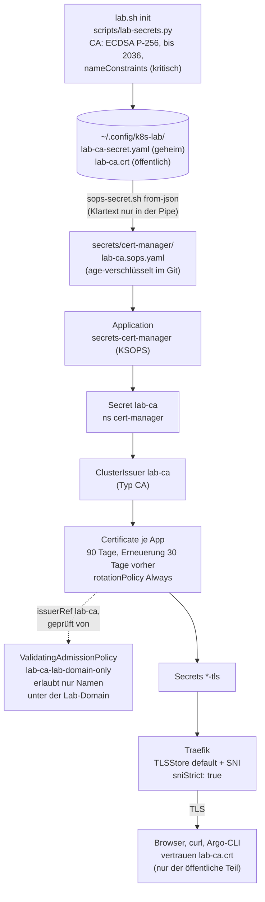
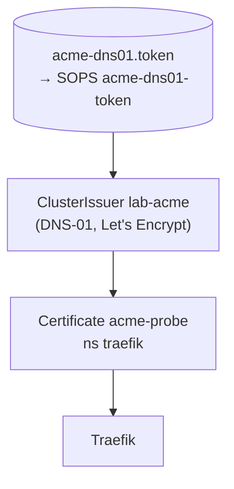
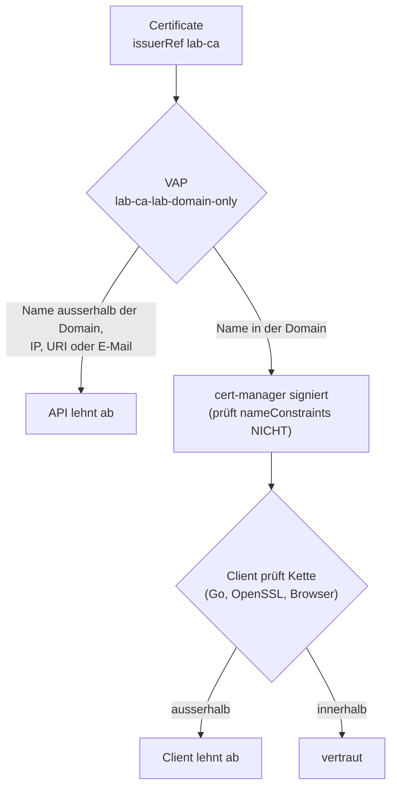

# Zertifikate

Das Lab hat eine **eigene Zertifizierungsstelle** (Lab-CA). cert-manager stellt
mit ihr für jede App ein eigenes Zertifikat aus, Traefik liefert es aus. Für
einen echten öffentlichen Namen gibt es optional einen zweiten Aussteller
(`lab-acme`, DNS-01).

## Die Kette



Optional stellt ein zweiter Aussteller echte öffentliche Zertifikate aus
(`lab.local.yaml` setzt `acme_*`):



Quellen: `ansible/roles/lab_ca/`, `ansible/roles/lab_acme/`,
`gitops/platform/cert-manager/manifests/`, `ansible/inventory/group_vars/all/lab_ca.yml`
und `lab_acme.yml`.

## Entscheidungen

| Punkt | Wahl | Grund |
|---|---|---|
| CA-Schlüssel | ECDSA P-256, Laufzeit bis 2036 | klein, schnell, überall unterstützt; lange Laufzeit, weil die Verteilung des Vertrauens mühsam ist |
| Blattzertifikate | 90 Tage, Erneuerung 30 Tage vorher, `rotationPolicy: Always` | neuer Schlüssel bei jeder Erneuerung |
| Ein Zertifikat je App | kein Wildcard, kein gemeinsames Default | ein gestohlener Schlüssel gilt für einen Namen |
| Default-Zertifikat | `traefik-default.<domain>`, nur für unbekannte Namen | `sniStrict: true` lehnt alles andere ab |
| `ingress-shim` | aus | Zertifikate stehen explizit im Git |
| `crds.keep` | an | Löschen der App löscht keine Zertifikatsobjekte |
| `startupapicheck` | aus | sonst ein Hook-Job bei jedem Sync; die Gesundheit prüfen Argo CD und `verify-certmanager.yml` |
| NetworkPolicy | Default-Deny, Webhook-Port 10250 offen | der Webhook muss von der API erreichbar sein |

Die Herleitung steht in [Stufe 6](../learning-path/stage-6-certmanager.md).

## Namenseinschränkung der Lab-CA {#namenseinschraenkung-der-lab-ca}

Die Lab-CA wird mit einer **kritischen** X.509-Erweiterung `nameConstraints`
erzeugt (`lab.sh init`, `scripts/lab-secrets.py`, Funktion
`ca_namenseinschraenkung`):

```text
X509v3 Name Constraints: critical
    Permitted:  DNS:lab.example            (domain from lab.yaml and all subnames)
    Excluded:   IP:0.0.0.0/0.0.0.0, IP:0:0:0:0:0:0:0:0/0:0:0:0:0:0:0:0
```

- **Erlaubt: DNS = Lab-Domain.** Das gilt für `lab.example` und jeden
  Unternamen, nicht für `argocd.lab.example.evil.com` (anderer Baum).
- **Alle IPs ausgeschlossen.** Eine erlaubte DNS-Liste allein lässt IP-SANs
  unbeschränkt (RFC 5280: ein Typ ohne Eintrag ist unbeschränkt). Das Lab
  braucht keine IP-Zertifikate, `sniStrict` lehnt IPs ohnehin ab.
- **Wirkung.** Wer den CA-Schlüssel stiehlt, kann nur Namen unter der
  Lab-Domain signieren. Ein Zertifikat für `bank.example` oder `192.0.2.1`
  lehnen die Clients ab (OpenSSL Fehler 47 „permitted subtree violation“,
  Fehler 48 „excluded subtree violation“; getestet in
  `tests/ca-nameconstraints-tests.sh`).

### Wer erzwingt die Einschränkung?



- **Clients erzwingen sie.** Go `crypto/x509` (seit Go 1.10, kritisch oder nicht),
  Traefik als Client, die argocd-CLI, curl/OpenSSL und Browser lehnen Blätter
  ausserhalb ab, auch IP-SANs gegen ausgeschlossene Bereiche. Belegt im Test
  (`go-signiert … true`, danach `leaf.Verify` mit Fehler).
- **cert-manager nicht.** Der `CA`-Issuer lädt die CA ohne Probleme, erzwingt die
  Einschränkung beim Ausstellen aber **nicht** (er ruft `x509.CreateCertificate`
  mit der CA als Eltern-Zertifikat). Ein `Certificate` für einen fremden Namen
  würde also „Ready“, aber nie vertraut.
- **Darum eine zweite Sperre auf der API:** die ValidatingAdmissionPolicy
  `lab-ca-lab-domain-only`
  (`gitops/platform/cert-manager/manifests/policy-lab-ca-names.yaml`, Binding
  daneben) lehnt jedes `Certificate` ab, das `lab-ca` nennt und einen Namen
  ausserhalb der Lab-Domain (oder eine IP, URI oder E-Mail) enthält. Sie greift
  nur bei `issuerRef.name == lab-ca` (kleiner Wirkungsbereich), mit
  `failurePolicy: Fail`. Nicht abgedeckt: von Hand angelegte
  `CertificateRequest`-Objekte; dort bleibt die CA-Einschränkung bei den
  Clients die letzte Sperre.
- **Voraussetzung:** K3s ab 1.30 (VAP ist GA). Die Regeln stehen mit 14 Fällen
  in `tests/ca-vap-cel-tests.py` (CEL ausserhalb des Clusters).
- **Reihenfolge bei einem bestehenden Cluster:** zuerst `ansible-playbook argocd.yml`
  (das AppProject `platform` muss `ValidatingAdmissionPolicy` und `…Binding`
  erlauben, siehe `argocd_platform_cluster_resources`), dann pushen. Sonst bleibt der
  Sync von cert-manager auf „not permitted“ (heilt, sobald `argocd.yml` lief).
- **Rückweg:** `kubectl delete validatingadmissionpolicybinding lab-ca-lab-domain-only`
  und im Git beide Dateien entfernen.

`ansible/verify-certmanager.yml` prüft: kritische Einschränkung an der CA;
Policy da und Zone stimmt, CEL ohne Typ-Warnungen; ein Wegwerf-Zertifikat
(`verify-nc-*`) in der Zone wird ausgestellt und besteht `openssl verify`;
ausserhalb der Zone und mit IP lehnt die Policy ab; alles Wegwerf-Material
wird immer gelöscht.

## Öffentliches Zertifikat (optional)

Die Lab-CA ist **nicht** für öffentliche Namen gedacht. Für diese gibt es den
Aussteller `lab-acme` (ACME DNS-01), der nur läuft, wenn in `lab.local.yaml`
`acme_solver`, `acme_zone`, `acme_probe_name` und `acme_email` gesetzt sind.
Der Token liegt als SOPS-Secret `acme-dns01-token` und im Klartext nur in
`~/.config/k8s-lab/acme-dns01.token` (Modus 0600). Ohne diese Werte bleibt `up`
grün und stellt nur Lab-Zertifikate aus; die Phase `public.yml` meldet SKIP.
Die Anleitung steht unter [Öffentliches Zertifikat](../how-to/public-certificate.md).

## Vertrauen und seine Grenzen

- Die Lab-CA muss jedes Gerät, das Lab-Namen benutzt, bewusst vertrauen:
  [Anleitung: Lab-CA vertrauen](../how-to/trust-lab-ca.md).
- **Android-Apps** vertrauen vom Benutzer installierten CAs standardmässig nicht.
- **HSTS** (ein Jahr) bleibt im Browser, auch nach Entfernen der App.
- Eine neue App ohne eigenes `Certificate` erhält den Fehler `unrecognized name`
  (wegen `sniStrict`).
- Rotation der CA: [Anleitung](../how-to/ca-rotation.md).
