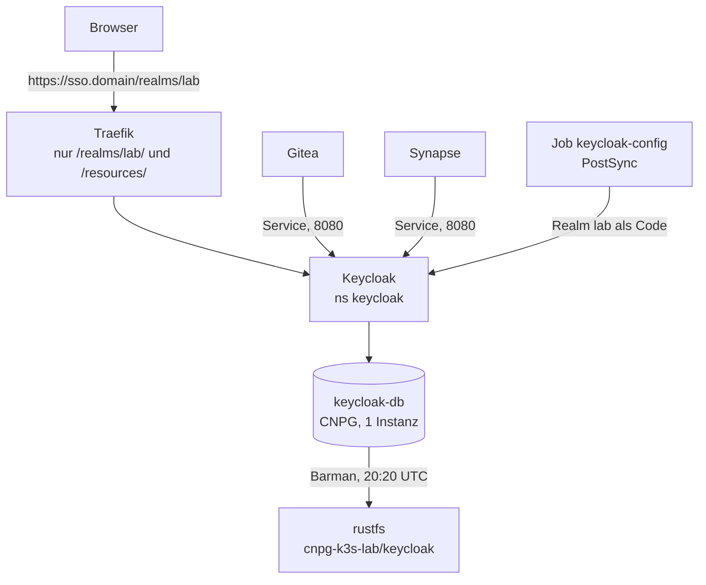

# ADR-0019: Keycloak als Single Sign-on für Gitea und Matrix

**Status:** angenommen

## Kontext

Gitea und Matrix haben je ihre eigenen Benutzer und Passwörter. Das Lab bekommt einen zentralen Anmeldedienst
(OpenID Connect, OIDC): Keycloak. Gitea und Synapse melden Benutzer dort an. Die lokalen Admin-Konten beider Dienste
bleiben als Notzugang (Break-glass), falls Keycloak ausfällt oder falsch eingestellt ist.

Keycloak wird wie Gitea über den ganzen Lebenslauf behandelt: Argo CD, eigene CNPG-Datenbank mit
`bootstrap.initdb` in Git, Barman-Backups nach rustfs, `rebuild --restore`, Alarm bei veralteten Backups,
eigenes Verify-Playbook, Abnahme, WAL-Sperre, Export und Dokumentation.

## Entscheidung

1. **Eigener Namespace `keycloak`** in der AppProject-Grenze (`argocd_project_namespaces`), Pod Security
   `restricted`, `LimitRange` wie in den anderen Arbeits-Namespaces, Egress standardmässig gesperrt
   (DNS, eigener Namespace, CNPG-Operator, Kubernetes-API und S3 für den Barman-Sidecar). Kein Zugang zum Internet.
   Gitea und Synapse dürfen Keycloak auf Port 8080 erreichen; die Erlaubnis liegt als eigene Datei im Namespace
   des Clients (`networkpolicy-keycloak.yaml`), die bestehenden Richtlinien bleiben unverändert.
2. **Eigene Datenbank `keycloak-db`**, eine Instanz, ohne Pooler, `bootstrap.initdb` in Git. Eine Instanz, weil das
   Lab auf einem Knoten läuft und das Speicherbudget überbucht ist ([Memory-Budget](../../reference/memory-budget.md)).
   Keycloak hat einen eigenen Verbindungspool, ein PgBouncer bringt hier nichts. Die Datensicherheit kommt aus dem
   täglichen Basis-Backup (20:20 UTC, ausserhalb von Gitea 20:00 und Matrix 20:15, `immediate: true`), dem laufenden
   WAL-Archiv und der Aufbewahrung von 14 Tagen im Bucket `cnpg-k3s-lab`, Präfix `keycloak`.
3. **Realm, Clients und Gruppen als Code, per `keycloak-config-cli`.** Die Realm-Datei liegt als ConfigMap im
   Chart `gitops/charts/keycloak`. Ein Argo-CD-PostSync-Job wendet sie nach jedem Sync an. Das ist idempotent: gleiche
   Datei, keine Änderung; geänderte Datei, aktualisierter Realm. Die Betriebsart `no-delete` löscht nichts, was von
   Hand entstanden ist. Benutzer stehen nicht in der Datei. Die Client-Geheimnisse kommen aus einem SOPS-Secret
   und werden nur im Speicher des Jobs eingesetzt.
   - **Verworfen: `--import-realm`.** Keycloak importiert damit nur einen **fehlenden** Realm und aktualisiert nie.
     Eine spätere Änderung an Clients oder Gruppen würde stillschweigend nicht ankommen.
   - **Verworfen: Terraform-Provider.** Ein weiteres Werkzeug, das Zugang zur Admin-API von aussen bräuchte.
   - Das Image des Jobs (`26.5.5`) ist älter als der Server (`26.8.1`): `keycloak-config-cli`
     hat noch keine Version für 26.8. Die Admin-API dieser Linie ist kompatibel; die Abnahme prüft das
     Ergebnis (Discovery, Client, Anmeldeseite). Wird ein Image gehoben, ändert man beide Pins und die
     Tabelle in [Versionen](../../reference/versions.md).
4. **Admin-Konsole nicht öffentlich.** Traefik leitet nur `/realms/lab/` und `/resources/` an Keycloak weiter. Die
   Konsole, der Realm `master`, die Admin-API, `/metrics` und `/health` sind über den öffentlichen Namen nicht
   erreichbar (404 von Traefik). Zugriff zur Verwaltung: `kubectl -n keycloak port-forward svc/keycloak 8080:8080`.
   Das Start-Admin-Konto stammt aus einem SOPS-Secret und gilt nur beim ersten Start.
5. **Selbstregistrierung aus**, Brute-Force-Schutz an, Passwort-Richtlinie `length(14) and notUsername`. Zugang hat,
   wer im Realm in der Gruppe `lab-users` steht. Die Gruppe `lab-admins` ist vorbereitet, aber nirgends
   auf eine Administratorrolle abgebildet.
6. **Gitea:** die Anmeldequelle `keycloak` entsteht in einem eigenen Init-Container (`postExtraInitContainers`,
   `gitea admin auth add-oauth`, beim zweiten Lauf `update-oauth`), also idempotent und ohne eigenen Job. Bewusst nicht
   der Chart-Wert `gitea.oauth`: dessen Skript prüft die Discovery und bricht hart ab, solange Keycloak nicht
   antwortet. Gitea startete dann nicht mehr, und mit ihm fiele der lokale Break-Glass-Admin genau dann aus, wenn
   Keycloak kaputt ist (im Clustertest so gemessen). Der eigene Container wartet höchstens 180 Sekunden auf Keycloak,
   meldet danach eine Warnung und lässt Gitea trotzdem starten. Die Discovery liest er über den Service. Ein Benutzer
   wird beim ersten Login angelegt (`ENABLE_AUTO_REGISTRATION`). Passt sein `preferred_username` (sonst die E-Mail) auf
   ein bestehendes lokales Konto, hängt Gitea die Keycloak-Identität beim ersten Login daran
   (`ACCOUNT_LINKING: auto`): so bleiben die Konten eines `gitea-import` (oder nach einem neu aufgebauten Realm)
   nutzbar, ohne zweites Konto und ohne Namenskonflikt. Das ist nur vertretbar, weil der Realm geschlossen ist
   (keine Selbstregistrierung, Konten legt der Admin an). Kein Admin über Gruppen. Das lokale Admin-Konto
   (Break-Glass) behält sein Passwort.
7. **Synapse:** `oidc_providers` mit `discover: false` und festen Endpunkten, weil Keycloak mit
   `KC_HOSTNAME_BACKCHANNEL_DYNAMIC` in der Discovery über den Service dieselben Adressen liefert, der Browser aber
   die öffentliche Adresse für die Anmeldung braucht und Synapse die Token-Endpunkte über den Service ruft.
   `allow_existing_users: false`, Voraussetzung `groups` enthält `lab-users`. Die Registrierung bleibt aus, das
   Passwort-Login des lokalen Admins bleibt an.
8. **Föderation bleibt aus und unberührt.** `federation_domain_whitelist` und `trusted_key_servers` bleiben leer, es gibt
   keinen Föderations-Listener und keine `.well-known`-Datei für Server ([ADR-0016](0016-matrix-federation-off.md)).
9. **Geheimnisse nur per SOPS/age.** Fünf neue Einträge in `secrets.yml`; `lab.sh init` erzeugt sie. Die echten
   `*.sops.yaml` entstehen auf dem Host des Betreibers und werden vor dem Push eingecheckt; im Git (und im
   öffentlichen Export) liegen nur die `*.example`-Vorlagen.
10. **Kein K8up, kein Restore-Test.** Keycloak hat kein Volume, der gesamte Zustand liegt in `keycloak-db`.
    Es gibt darum keinen K8up-Zeitplan, keinen Eintrag in `recover-files.yml` und keine K8up-Prüfung im Alarm.
    Einen eigenen Wegwerf-Restore-Test (`restore-drill`) gibt es für Keycloak nicht: Gitea und Matrix haben
    einen, weil Dateien und Datenbank zusammenpassen müssen; bei Keycloak deckt die Wiederherstellung
    der Datenbank im `rebuild --restore` und die Abnahme alles ab. Ob ein eigener Test sinnvoll wäre,
    steht in [Issue 42](https://github.com/tabee/k8s-lab-template/issues/42).

## Folgen

- **Reihenfolge beim ersten Einführen.** Die Gitea- und Matrix-Pods lesen neue Secrets (`gitea-oidc`,
  `matrix-oidc`). Fehlen die SOPS-Dateien, bleiben diese Apps hängen. Darum: erst `bash scripts/lab.sh init`,
  dann `secrets/keycloak/*.sops.yaml`, `secrets/gitea/gitea-oidc.sops.yaml` und
  `secrets/matrix/matrix-oidc.sops.yaml` einchecken, **dann** pushen.
- **`rebuild --restore` braucht ein fertiges Basis-Backup von `keycloak-db`.** `lab-restore-render.py` bricht mit
  Exit 1 ab, wenn für einen gelisteten Cluster kein Basis-Backup auf der Platte liegt
  ([ADR-0018](0018-recover-from-backup.md)). `immediate: true` löst das erste Backup beim Anlegen aus; die Abnahme
  (Phase 19) wartet darauf. Vor dem ersten `rebuild --restore` nach der Einführung muss es also einmal gelaufen sein.
  ADR-0018 nennt die vier Cluster (`pg-lab`, `gitea-db`, `matrix-db`, `keycloak-db`); die Wiederherstellung ist in
  [Keycloak wiederherstellen](../../how-to/restore-keycloak.md) beschrieben.
- **Startreihenfolge.** Gitea startet auch dann, wenn Keycloak nicht erreichbar ist (Init-Container mit Warnung statt
  Abbruch). Eine schon eingetragene Anmeldequelle bleibt in der Datenbank und läuft weiter, sobald Keycloak wieder da
  ist. Fehlt sie noch (erster Start vor Keycloak), legt der nächste Pod-Start sie an:
  `kubectl -n gitea rollout restart deploy/gitea`. Die Abnahme meldet sie als fehlend. Details und Messung stehen in
  [Keycloak](../../how-to/keycloak.md).
- **Speicher.** Keycloak (896 MiB), die Datenbank (384 MiB), der Barman-Sidecar (512 MiB) und der Realm-Job
  (384 MiB, nur während er läuft) kommen auf ein ohnehin überbuchtes Budget. `memory_budget_enforce` bleibt `false`.
  Fällt der Knoten aus, ist der nächste Schritt weniger Instanzen, nicht die harte Prüfung.
- **Ausfall von Keycloak** sperrt die Anmeldung über SSO, nicht die lokalen Admin-Konten und nicht schon
  angemeldete Sitzungen.
- **Zugriffe von aussen** auf die Konsole gibt es nicht. Wer sie braucht, nutzt den Port-Forward.

## Siehe auch

- [Keycloak im Lab](../../how-to/keycloak.md)
- [ADR-0016](0016-matrix-federation-off.md), [ADR-0018](0018-recover-from-backup.md)
