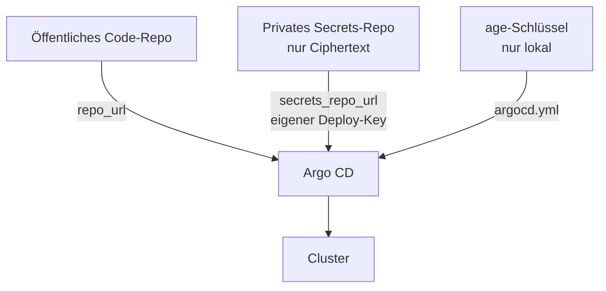

# ADR-0022: Privates Secrets-Repo neben dem öffentlichen Code-Repo

**Status:** angenommen (Option A aus Issue #51); der Git-Host ist noch offen (siehe unten)

## Kontext

Der Code des Labs soll öffentlich werden ([Öffentliche Fassung](../../how-to/public-release.md)). Die
verschlüsselten Secrets (`secrets/**/*.sops.yaml`, KSOPS, [ADR-0004](0004-sops-age-ksops.md)) liegen heute im selben privaten
Repo wie der Code, und Argo CD liest beides von dort. Ein Neuaufbau braucht deshalb heute den privaten Git-Server.
Ziel: ein Neuaufbau aus einem frischen Klon der öffentlichen Fassung, dem privaten Secrets-Repo und dem lokalen
age-Schlüssel, ohne den heutigen Git-Server.

SOPS-Ciphertext ist mit age sicher verschlüsselt, verrät aber Metadaten: Namen der Secrets, Namespaces,
Schlüsselnamen, Zeitpunkte von Änderungen, die age-Empfänger. Das gehört nicht in ein öffentliches Repo.

## Entscheidung

1. **Zwei Repos.** Der Code kommt aus dem öffentlichen Repo (`repo_url`), der Ciphertext aus einem eigenen,
   **privaten** Secrets-Repo (`secrets_repo_url`). Beide stehen pro Umgebung in `infra/envs/<env>/lab.yaml`.
   `secrets_repo_url: ""` heisst: dasselbe Repo wie `repo_url` (heutiger Stand, nichts ändert sich).
2. **Gleiches Layout.** Das Secrets-Repo hat dieselbe Struktur wie der Ordner im Code-Repo: `.sops.yaml` und
   `secrets/<namespace>/...`. Die Argo-CD-Apps `secrets-*` behalten `path: secrets/<namespace>`, nur ihr
   `repoURL` wechselt. `lab.sh customize` schreibt ihn, `lab.sh preflight` prüft ihn.
3. **Eigener Deploy-Key, nur lesend.** Argo CD liest das Secrets-Repo mit einem zweiten SSH-Schlüssel
   (`argocd-secrets-deploy-key`, `~/.ssh/argocd-k8s-lab-secrets`), den `lab.sh init` nur bei getrenntem Repo
   erzeugt. Er liegt nur lokal, Ansible legt daraus das Repo-Secret `argocd/repo-k8s-lab-secrets` an. Neue
   Secrets in Git gibt es dafür nicht.
4. **Gleicher Host und Port.** Die Egress-Regeln (NetworkPolicy, Firewall) lassen genau einen Git-Server zu,
   abgeleitet aus `repo_url`. `lab-customize.py` bricht ab, wenn `secrets_repo_url` einen anderen Host oder Port hat.
5. **Befüllen ohne Entschlüsseln.** `bash scripts/lab.sh secrets-repo export DIR` kopiert die SOPS-Dateien in
   einen Klon des Secrets-Repos, `secrets-repo import DIR` in die andere Richtung. Das Skript ruft nie `sops` auf,
   bricht bei jedem Wert ab, der nicht `ENC[...]` ist, idempotent (SKIP), mit `--dry-run` und `--prune`.
   Commit und Push macht der Betreiber selbst.
6. **Der Export lässt `secrets/` ganz weg**, auch die `.example`-Vorlagen. Der Wächter (`lab-guard.py`), die
   Baumprüfung (`check-public-tree.py`) und der Security-Scan lehnen jeden Pfad unter `secrets/` ab. Die
   öffentliche `.gitignore` ignoriert `/secrets/` vollständig.

## Offene Entscheidung: der Git-Host

Das Repo legt keinen echten Host fest; die öffentliche Fassung trägt `git.example.org` als Platzhalter.

| Option | Vorteil | Nachteil |
|---|---|---|
| **A1: privates Repo beim selben Anbieter wie das öffentliche Code-Repo** (Empfehlung) | gleicher Host und Port, also keine Änderung an Egress und Host-Keys; Neuaufbau ohne eigenen Server; Deploy-Keys pro Repo | Ciphertext liegt bei einem Dritten (mit age geschützt, Metadaten sichtbar für den Anbieter) |
| A2: weiter auf dem eigenen Git-Server | nichts verlässt die eigene Infrastruktur | der Neuaufbau braucht wieder den eigenen Server, genau das soll wegfallen |
| A3: zweiter Anbieter (anderer Host) | Code und Ciphertext getrennt beim Anbieter | braucht zwei Git-Ziele in Egress, Host-Keys und Preflight (heute nicht unterstützt, Punkt 4) |

**Empfehlung:** A1. Der Ciphertext ist ohne den lokalen age-Schlüssel wertlos; Repo privat, Deploy-Key nur lesend,
2FA am Konto.

## Folgen

- Neuaufbau: [Privates Secrets-Repo](../../how-to/private-secrets-repo.md).
- Wer Secrets ändert (`lab.sh init`, CA-Rotation, Break-Glass), committet im Code-Repo wie bisher und spiegelt mit
  `secrets-repo export` ins Secrets-Repo, solange beide existieren.
- Die öffentliche Fassung hat keine SOPS-Vorlagen mehr. Tests, die Vorlagen lesen, überspringen sich dort (SKIP).
- Ein anderer Host für das Secrets-Repo (A3) bleibt ein eigenes Issue.
