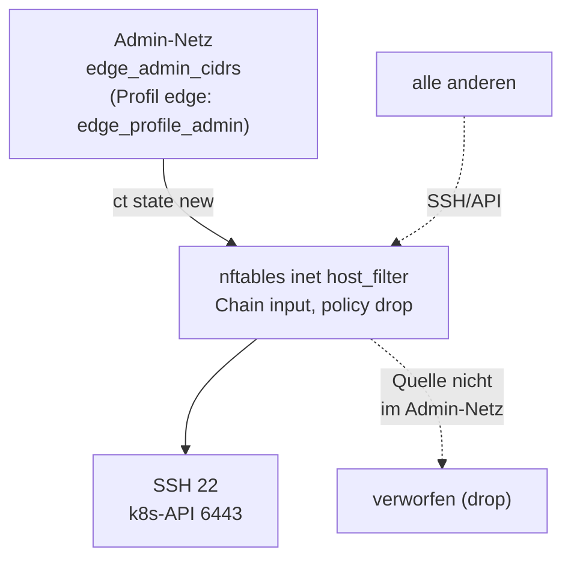
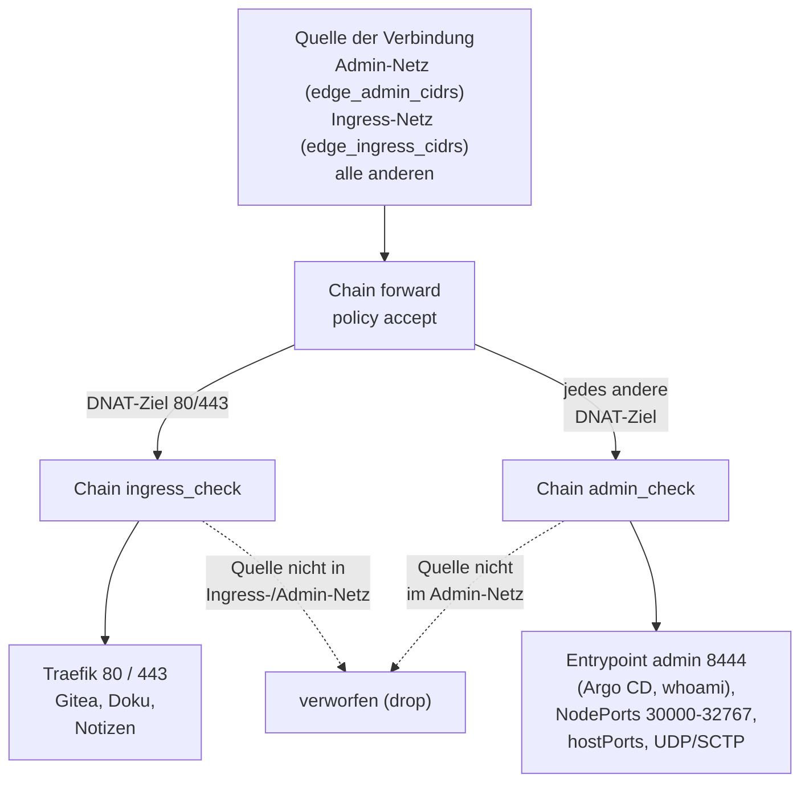
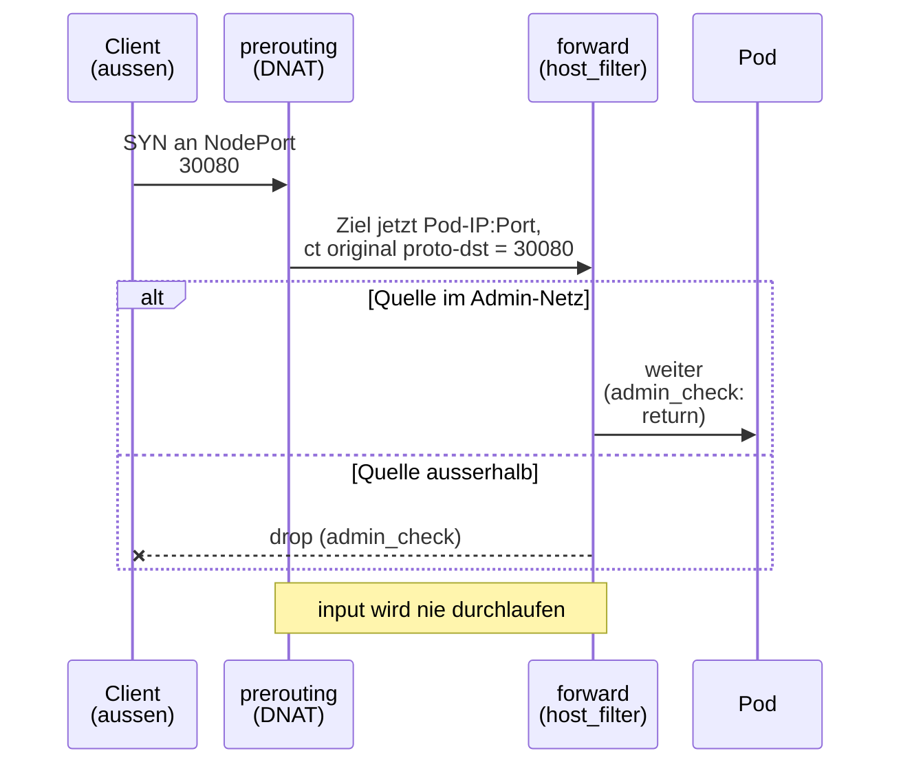

# Netz-Kante

Die Kante ist die Grenze zwischen dem Netz der VM und allem, was sie erreichen
darf. Sie besteht aus **einem** Regelwerk (nftables, Tabelle
`inet host_filter`), das aus **einer** Quelle gespeist wird
(`infra/envs/local/lab.yaml`). Das Regelwerk ist zweistufig: Ein
Admin-Netz darf verwalten, ein Ingress-Netz darf Apps benutzen.

## Zwei Netze, drei Pfade

Zuerst der Weg zur VM selbst (Chain `input`, SSH und API):

Dann der Weg zu den Diensten im Cluster (Chain `forward`, DNAT-Ziele):

Gelesen aus `ansible/roles/firewall/templates/host_filter.nft.j2`.
Das Netz `edge_ingress_cidrs` darf auch das Admin-Netz erreichen, weil
`ingress_check` beide Listen zulässt.

| Verkehr | Regel |
|---|---|
| 22 (SSH), 6443 (API) von aussen | nur Admin-Netze (Chain `input`) |
| Pods an die API (6443) und kubelet (10250) | `input`, nur Interface `cni0`/`flannel.1` und Pod-/Service-Netz |
| 80/443 von aussen (Traefik) | Chain `ingress_check`: Ingress- und Admin-Netze, sonst `drop` |
| Admin-Oberfläche (Port 8444: Argo CD, whoami) | Chain `admin_check`: nur Admin-Netze |
| NodePorts 30000-32767, hostPorts, UDP/SCTP-DNAT von aussen | Chain `admin_check`: nur Admin-Netze |
| Pod zu Pod, Pod nach aussen, Antworten, Dienste im Cluster | unberührt (`policy accept`) |

## Warum der Input-Filter allein nicht reicht

Das DNAT auf die Pod-IP steht in `prerouting`, **vor** jedem Filter. Danach
laufen die Pakete durch `forward` und nie durch `input`. Eine Input-Kette, die
alles ausser SSH verwirft, lässt einen NodePort also trotzdem durch.
Darum filtert die Chain `forward` am **ursprünglichen** Zielport
(`ct original proto-dst`), nur für `ct status dnat`, nur für neue
Verbindungen, nur von ausserhalb der CNI-Interfaces.

## Was die Kante bewusst **nicht** tut

- Es gibt **kein** `flush ruleset`. Die Tabelle wird atomar ersetzt (anlegen,
  löschen, neu definieren, eine Transaktion). Die Tabellen von k3s, kube-proxy
  und flannel bleiben unberührt.
- Der Totmannschalter gilt für jede Regeldatei: Kann der Lauf nach dem Anwenden
  keine **neue** SSH-Verbindung aufbauen, rollt die Firewall nach
  `firewall_rollback_seconds` (120 s) zurück und der Lauf **gilt als
  Fehlschlag**.
- `externalTrafficPolicy: Cluster` und `allocateLoadBalancerNodePorts: false`
  bleiben am Traefik-Service. Dadurch gibt es für Traefik gar keine NodePorts.
  Preis: Traefik sieht die Client-IP nicht, nur eine Knoten-Adresse.
- UFW ist in der VM aus; die Kante ist nftables. (UFW wird nur auf dem
  Steuerrechner für rustfs benutzt, siehe [Stufe 8a](../learning-path/stage-8a-backup-target.md).)

## Warum die Oberfläche auf Port 8444 liegt

Hinter `externalTrafficPolicy: Cluster` sieht Traefik nicht die Client-IP.
Auf Port 443 kann Traefik daher nicht zwischen „Gitea für das Ingress-Netz“
und „Argo CD nur für Admin“ unterscheiden. Argo CD und whoami haben deshalb
einen eigenen Entrypoint `admin` (Port 8444, gleiche TLS-Optionen, gleiche
Security-Header), und die Firewall prüft diesen Port am Absender.
Adresse: `https://argocd.lab.example:8444`. Im Profil `default` ist der Port
im LAN (`vm_cidr`) erreichbar; dort ändert sich nur die URL.

## Profile

| Profil | Admin-Netz | Wofür |
|---|---|---|
| `default` | `edge_admin_cidrs` (Standard `vm_cidr`) | Lab im LAN |
| `edge` | nur `edge_profile_admin` (eine Adresse, Standard `gateway`) | Probe für einen VPS: SSH, API und Admin-Oberfläche nur von einer Adresse |

Die Werte stehen in der [Konfigurationsreferenz](../reference/configuration.md#netz-kante).
Das Umschalten, die Probe und der Rückweg stehen in
[Anleitung: Edge-Profil](../how-to/edge-profile.md).

## Zusammenspiel mit `loadBalancerSourceRanges`

Die Liste `edge_ingress_cidrs` steht zweimal: in der Firewall (Ansible liest
sie direkt) und als `loadBalancerSourceRanges` am Traefik-Service in
`gitops/platform/traefik/values.yaml`, zwischen den Marken
`lab-customize:edge-ingress-cidrs`. Argo CD kennt keine Ansible-Variablen,
darum schreibt `lab.sh customize` die Liste dort hinein und `gitops/values-state.yaml`
merkt sich den Stand. `ansible/verify-traefik.yml` vergleicht `lab.yaml`, Git und
den lebenden Service und meldet jede Abweichung.

!!! warning "Der Steuerrechner muss im Ingress-Netz liegen"
    `loadBalancerSourceRanges` hängt am **ganzen** Traefik-Service, also auch
    am Admin-Port 8444. Der Steuerrechner (im Profil `edge` das Admin-Netz)
    muss deshalb in `edge_ingress_cidrs` liegen.

## NetworkPolicies im Cluster

Innerhalb des Clusters gilt Default-Deny für Ingress in den
Workload-Namespaces (kube-router in k3s). Default-Deny für Egress gilt in
`gitea`, `db-lab`, `docs`, `notes-*` und für den repo-server ([Issue 5](https://github.com/tabee/k8s-lab-template/issues/5)); die
übrigen Namespaces sind offen, das ist ein bekanntes Restrisiko
([Issue 37](https://github.com/tabee/k8s-lab-template/issues/37)). Beachte die
[kube-router-Verzögerung](../how-to/troubleshooting.md#kube-router-erste-verbindung)
bei neuen Pods.

!!! warning "Gitea im Cluster darf nicht nach aussen"
    In `gitea` sind ausgehende **Webhooks, Mail und Push-/Pull-Mirrors
    gesperrt**. Erlaubt sind nur DNS, der eigene Namespace und für die Backup-Pods
    API und S3. Grund und Ausnahmen: [Sicherheitsmodell](security-model.md#egress-gitea).
    k3s mit kube-router kennt keine Namen, nur Adressbereiche (`ipBlock`); darum
    bleibt Port 443 ins Internet für repo-server, `docs` und `notes-*` offen, und
    die Regeln hängen an der Adresse des Git-Servers
    (`bash scripts/lab.sh repo-egress --resolve` nach einer Änderung).

Notiz-Sites haben zusätzlich eine eigene Freigabe zum Inhalt-Repo:
`repo_egress_cidrs` pro Eintrag in `gitops/sites.yaml`, SSH-Port aus dessen
`repo`-URL. Diese Regel bleibt bei `source: github` unverändert; die
Quellen-Regeln aus `repo-egress` gelten weiterhin für k8s-lab und Plugins.
Private HTTPS-Ziele werden dadurch nicht pauschal geöffnet.
Siehe [Notiz-Sites](../how-to/notes-sites.md#egress-zum-inhalt-repo).

Siehe auch [Ports und Netze](../reference/ports-and-networks.md) und das
[Sicherheitsmodell](security-model.md).
