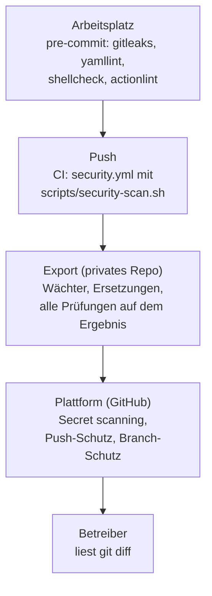

# Öffentliches Repo und besonders schützenswerte Personendaten

Diese Seite erklärt, **warum** dieses Repo so geprüft wird, bevor etwas öffentlich wird,
**welche Werkzeuge** es dafür gibt und **welche davon** hier laufen. Die Bedienung
steht in [Sicherheitsprüfung](../how-to/security-scan.md). Sie ist keine
Rechtsberatung: Sie fasst zusammen, was die Gesetzestexte sagen (Links unten, am
Originaltext gelesen), und leitet daraus technische Regeln ab.

!!! abstract "Kurzfassung"
    - Ein öffentliches Repo ist **Bekanntgabe an alle**, für immer: Git-Historie, Forks
      und Suchmaschinen vergessen nicht. Darum gilt **Verhindern vor Aufräumen**.
    - Chat-Inhalte, Gesundheitsbezug, Namen und Kennungen von Menschen gehören nie ins
      Repo, auch nicht verschlüsselt und nicht als „nur ein Beispiel“.
    - Die Prüfung ist **mehrstufig**: Pre-commit-Hook, CI bei jedem Push, Export-Wächter,
      Einstellungen der Plattform. Eine Stufe allein reicht nicht, jede hat blinde Flecken.
    - Alle Regeln stehen **einmal** in `scripts/security-scan.sh`. GitHub Actions,
      Gitea Actions, der Hook und der lokale Lauf rufen dieses Skript auf.
    - Werkzeuge finden **Muster**, keine Absicht. Der Betreiber liest vor der
      Veröffentlichung trotzdem den Unterschied (`git diff`).

## Rechtlicher Rahmen {#recht}

### Schweiz: Datenschutzgesetz (DSG)

Das revidierte Bundesgesetz über den Datenschutz gilt seit dem 31. August 2023
([Fedlex, SR 235.1](https://www.fedlex.admin.ch/eli/cc/2022/491/de)). Für ein Lab, in dem
Chats von Familie und Freunden liegen, sind diese Stellen wichtig:

| Stelle | Inhalt (sinngemäss) | Folge für das Repo |
|---|---|---|
| Art. 2 Abs. 2 Bst. a | Das Gesetz gilt nicht für Daten, die eine Person **ausschliesslich zum persönlichen Gebrauch** bearbeitet. | Wer das Lab nur für sich betreibt, fällt eher darunter. Sobald andere Menschen es mitnutzen (Familie, Freunde), ist das nicht mehr sicher. Im Zweifel so handeln, als gälte das Gesetz. |
| Art. 5 Bst. c | **Besonders schützenswerte Personendaten** sind unter anderem Daten über religiöse, weltanschauliche, politische oder gewerkschaftliche Ansichten und Tätigkeiten, über die **Gesundheit**, die Intimsphäre, Rasse oder Ethnie, genetische und biometrische Daten, Daten über Strafverfolgung und über Sozialhilfe. | Chats können all das enthalten, ohne dass man es merkt. Für Chat-Inhalte gilt darum der strengste Massstab. |
| Art. 6 Abs. 7 Bst. a | Die Einwilligung muss für besonders schützenswerte Daten **ausdrücklich** sein. | Eine Veröffentlichung im Repo hätte nie eine solche Einwilligung. |
| Art. 7 | **Datenschutz durch Technik** und datenschutzfreundliche Voreinstellungen, ab der Planung, nach dem Stand der Technik. | Die Prüfung ist automatisch und standardmässig an, nicht eine Checkliste, die man vergessen kann. |
| Art. 8 | Der Verantwortliche gewährleistet durch technische und organisatorische Massnahmen eine dem Risiko angemessene **Datensicherheit** und vermeidet Verletzungen. | Secret-Scan, Personendaten-Prüfung und Berechtigungen der CI sind genau solche Massnahmen. |
| Art. 22 Abs. 2 Bst. a | Bei umfangreicher Bearbeitung besonders schützenswerter Daten liegt ein hohes Risiko vor und eine Datenschutz-Folgenabschätzung ist nötig. | Betrifft ein Lab im Familienkreis meist nicht, ein Betrieb für viele Menschen schon. |
| Art. 24 | Verletzungen der Datensicherheit mit voraussichtlich hohem Risiko sind dem EDÖB **so rasch als möglich** zu melden. | Ein Leck im öffentlichen Repo wäre so ein Fall. Das ist der Grund für die Notfallschritte in [Sicherheitsprüfung](../how-to/security-scan.md#fund). |
| Art. 30 Abs. 2 Bst. c | Eine Persönlichkeitsverletzung liegt insbesondere vor, wenn Dritten **besonders schützenswerte Personendaten bekanntgegeben** werden. | Ein öffentliches Repo macht Daten für alle zugänglich (Art. 5 Bst. e: „Bekanntgeben“ ist auch das Zugänglichmachen). |
| Art. 61 Bst. c | Wer vorsätzlich die vom Bundesrat festgelegten **Mindestanforderungen an die Datensicherheit** nicht einhält, wird auf Antrag mit Busse bestraft. | Zeigt, dass Datensicherheit mehr ist als guter Wille. Die Mindestanforderungen stehen in der Datenschutzverordnung (DSV), sie ist hier nicht ausgewertet. |

### Europäische Union: DSGVO

Die Verordnung (EU) 2016/679 gilt nach Art. 3 Abs. 2 auch für Betreiber ausserhalb der EU,
wenn sie Menschen in der EU Waren oder Dienste anbieten oder deren Verhalten beobachten.
Ob das auf ein Lab zutrifft, hängt vom Einzelfall ab und ist hier nicht beurteilt. Die
Stellen, die dem DSG entsprechen
([EUR-Lex, amtlicher Text](https://eur-lex.europa.eu/eli/reg/2016/679/oj/deu); die
Aussagen unten sind am amtlichen englischen Text der Publikationsstelle gelesen,
[Veröffentlichung im Amtsblatt](https://publications.europa.eu/resource/cellar/3e485e15-11bd-11e6-ba9a-01aa75ed71a1.0006.03/DOC_1)):

| Stelle | Inhalt (sinngemäss) |
|---|---|
| Art. 2 Abs. 2 Bst. c, Erwägungsgrund 18 | Keine Anwendung bei **rein persönlicher oder familiärer Tätigkeit** ohne Bezug zu einer beruflichen oder wirtschaftlichen Tätigkeit. Wer die Mittel dafür **bereitstellt**, bleibt aber erfasst. |
| Art. 9 Abs. 1 | Die Verarbeitung von Daten über rassische und ethnische Herkunft, politische Meinungen, religiöse oder weltanschauliche Überzeugungen, Gewerkschaftszugehörigkeit, genetische und biometrische Daten, **Gesundheitsdaten** und Daten zum Sexualleben ist **untersagt**. |
| Art. 9 Abs. 2 Bst. a | Ausnahme unter anderem mit **ausdrücklicher Einwilligung** für festgelegte Zwecke. |
| Art. 25 | **Datenschutz durch Technikgestaltung** und datenschutzfreundliche Voreinstellungen. |
| Art. 32 | Sicherheit der Verarbeitung: unter anderem Pseudonymisierung und Verschlüsselung, Vertraulichkeit, Integrität, Verfügbarkeit, Wiederherstellbarkeit, regelmässige Überprüfung der Wirksamkeit. |
| Art. 33 | Meldung einer Verletzung an die Aufsichtsbehörde **ohne unangemessene Verzögerung, möglichst binnen 72 Stunden**. |
| Art. 35 | Datenschutz-Folgenabschätzung bei voraussichtlich hohem Risiko. |

Der Vergleich in einem Satz: Schweiz und EU verlangen beide **Technik, die den Datenschutz
von Anfang an einbaut**, und beide stufen Gesundheits-, Weltanschauungs- und ähnliche
Daten höher ein. Das DSG spricht von „besonders schützenswerten Personendaten“, die
DSGVO von „besonderen Kategorien“.

## Was das für dieses Repo heisst {#folgen}

Das Repo enthält Infrastruktur als Code. Personendaten gehören nicht hinein, aber
sie kommen auf Umwegen:

| Weg ins Repo | Beispiel | Gegenmassnahme |
|---|---|---|
| Testdaten aus dem echten Betrieb | Export eines Chat-Raums für einen Test, Dump einer Datenbank | Tests nutzen erfundene Daten; die Personendaten-Regeln und die Positivliste schlagen an |
| Konfiguration mit echten Namen | Raumnamen, Benutzernamen, Domänen, interne Adressen | Export mit Ersetzungen, Positivliste der erlaubten Hosts, private Deny-Liste |
| Verschlüsselte Geheimnisse | `*.sops.yaml` mit echtem Chiffretext | Nie in die öffentliche Fassung; der Wächter und die Baumprüfung lehnen sie ab |
| Metadaten von Git | Name und E-Mail-Adresse in jedem Commit | Prüfung der Commit-Identität; der Export erzeugt einen einzigen neutralen Commit |
| Unvorsichtiger Commit | Schlüssel oder Token im Klartext | Pre-commit-Hook, Secret-Scan in der CI, Push-Schutz der Plattform |

!!! warning "Entfernen reicht nicht"
    Ein Fund, der einmal öffentlich war, gilt als bekannt: Forks, Klone, Caches und
    Suchmaschinen behalten ihn. Ein Passwort wird **rotiert**, die Historie
    umzuschreiben ersetzt das nicht. Bei Personendaten bleibt nur melden, löschen lassen
    und den Vorfall bewerten (Art. 24 DSG, Art. 33 DSGVO). Darum prüft die CI **vor**
    dem Veröffentlichen und nicht erst danach.

## Die Stufen der Prüfung {#stufen}

Jede Stufe fängt etwas, das die vorige übersieht:

- Der **Hook** ist schnell, aber umgehbar (`--no-verify`), darum gibt es die CI.
- Die **CI** läuft für alle gleich, kennt aber die private Deny-Liste nur, wenn sie als
  Secret hinterlegt ist.
- Der **Export** baut die öffentliche Fassung nach und prüft **sie** (nicht das
  private Repo), mit der privaten Deny-Liste. Er ist die einzige Stufe, die weiss,
  was wirklich veröffentlicht würde.
- Die **Plattform** schützt vor dem Fall, dass jemand die eigene CI abschaltet, und
  kennt die Muster der grossen Anbieter (Tokens), die kein eigenes Werkzeug pflegt.

## Werkzeuge im Vergleich {#werkzeuge}

Die Wahl unten ist meine Einschätzung für **dieses** Repo (Shell, YAML, Helm,
Kubernetes-Manifeste, etwas Python, kleine Gruppe). „Hier“ heisst: läuft in
`scripts/security-scan.sh`.

### Geheimnisse

| Werkzeug | Stärke | Schwäche | Hier |
|---|---|---|---|
| gitleaks | Schnell, eine Binärdatei, eigene Regeln in TOML, prüft Arbeitsordner und Historie | Nur Muster und Entropie, keine Prüfung, ob ein Fund noch gültig ist | **ja**, mit eigenen Regeln für Personendaten |
| trufflehog | Viele Detektoren, kann Funde beim Dienst **verifizieren** | Verifikation schickt gefundene Werte an Dritte; langsamer | **ja**, mit `--no-verification`: Es geht nichts ins Netz |
| GitHub secret scanning und Push-Schutz | Kennt die Muster der Anbieter, benachrichtigt den Anbieter bei einem Treffer, blockiert den Push | Nur auf GitHub; Push-Schutz auf Repo-Ebene muss eingeschaltet werden | **ja, per Einstellung** (Checkliste: Issue zu den GitHub-Einstellungen) |

Zwei Werkzeuge nebeneinander sind kein Luxus: Sie haben unterschiedliche Regeln und
finden unterschiedliche Dinge. Das kostet unter einer Minute.

### Konfiguration von Kubernetes, Helm und Terraform

| Werkzeug | Stärke | Schwäche | Hier |
|---|---|---|---|
| kubeconform | Prüft gegen die Schemas der Kubernetes-Version, auch CRDs; schnell | Findet keine Sicherheitsmängel, nur falsche Felder | **ja**, strikt, auf das Ergebnis von `helm template` und die einfachen Manifeste |
| trivy `config` | Sicherheitsregeln für Kubernetes, Helm, Dockerfile, Terraform in einem Werkzeug | Eigene Regelsprache; einzelne Fehlalarme | **ja**, Teil von `trivy fs` |
| checkov | Sehr viele Richtlinien | Schwer, viele Regeln für Clouds, die hier fehlen | nein: überschneidet sich mit trivy |
| kube-linter, polaris | Gute Kubernetes-Best-Practices | Überschneiden sich mit trivy; Helm nur gerendert | nein: eine Regelquelle reicht |

### Schwachstellen und Stückliste

| Werkzeug | Stärke | Schwäche | Hier |
|---|---|---|---|
| trivy `fs` | Schwachstellen in Lockfiles, Geheimnisse und Konfiguration in **einem** Lauf; kann SBOM erzeugen | Datenbank kommt aus einer Registry (Netz nötig) | **ja**, Schwelle HIGH und CRITICAL |
| grype und syft | Gutes Paar: syft erzeugt die SBOM, grype findet Schwachstellen | Überschneidet sich mit trivy | nein; sinnvoll, sobald Images mit Stückliste ausgeliefert werden |

### Skripte, YAML, Workflows

| Werkzeug | Zweck | Hier |
|---|---|---|
| shellcheck | Fehler und Fallen in Shell-Skripten | **ja** (`scripts/ci-lint.sh`) |
| yamllint | Stil und Syntax von YAML | **ja** (`scripts/ci-lint.sh`) |
| actionlint | Syntax und Typen von Workflow-Dateien, ruft shellcheck auf | **ja** |
| zizmor | Sicherheit von Workflows: Skript-Einschleusung, zu weite Rechte, nicht festgenagelte Aktionen | **ja** |
| Festnageln per SHA | Aktionen und Images unveränderlich machen | Images mit Digest; **keine Fremd-Aktionen**, also nichts festzunageln. Kommt eine hinzu, ist SHA-Pinning Pflicht (zizmor meldet es) |

### Quellcode-Analyse und Reife

| Werkzeug | Zweck | Hier |
|---|---|---|
| semgrep, CodeQL | Statische Analyse von Code (SAST) | nein: Das Repo hat kaum Anwendungscode; CodeQL ist auf GitHub für öffentliche Repos gratis und kann später dazukommen |
| OpenSSF Scorecard | Bewertet Praktiken des Repos (Branch-Schutz, festgenagelte Abhängigkeiten, Token-Rechte) | optional, nach der Veröffentlichung, als Rückmeldung |
| REUSE | Prüft Lizenz- und Urheberhinweise je Datei | nein: Der Export setzt SPDX-Zeilen, die Lizenz liegt im Repo |

### Abhängigkeiten aktuell halten

| Werkzeug | Stärke | Schwäche |
|---|---|---|
| Dependabot | Auf GitHub eingebaut: Aktionen, Docker, pip | Kennt Helm-Chart-Versionen in Manifesten und Versionen in eigenen Dateien nicht |
| Renovate | Viele „Manager“ (Helm, Kustomize, Argo CD, eigene reguläre Ausdrücke), läuft auch selbst gehostet | Mehr Konfiguration |

**Empfehlung:** Renovate, weil die Versionen dieses Repos grossteils in YAML und
eigenen Dateien stehen. Die Entscheidung liegt beim Betreiber und ist nicht Teil
dieser Änderung.

### Personendaten finden

Das ist der Teil, für den es **kein** fertiges „Standardwerkzeug“ gibt:

| Ansatz | Urteil |
|---|---|
| Microsoft Presidio (NLP, erkennt Namen, Adressen in Freitext) | Gedacht für Freitext und Datensätze. Für Konfiguration und Doku liefert es viele Fehlalarme, bringt Sprachmodelle als Abhängigkeit mit und ist nicht deterministisch. **Nicht empfohlen** für dieses Repo. |
| Eigene gitleaks-Regeln für feste Formate (AHV-Nummer, IBAN, Telefonnummer, E-Mail, Matrix-ID, Geburtsdatum) | Deterministisch, schnell, wenige Fehlalarme. **Ja**: `scripts/security/gitleaks-pii.toml` |
| **Positivliste** der erlaubten Hosts und E-Mail-Domänen | Dreht die Frage um: nicht „was ist verboten“, sondern „was ist erlaubt“. Findet auch Namen, die niemand auf einer Liste hatte. **Ja**: `scripts/security/allowed-hosts.txt` |
| Private **Deny-Liste** der echten Namen und Kennungen | Findet genau die Werte, um die es geht. Muss privat bleiben, in der CI als Secret `PII_DENYLIST`; Funde werden anonym gemeldet (`pii-007`), nie mit Wert. **Ja** |

Die Kombination aus Positivliste (sperrt Unbekanntes) und Deny-Liste (kennt das
Bekannte) ist stärker als jedes einzelne Verfahren.

## Der empfohlene Satz {#empfehlung}

Minimal, aber stark, und alles ohne Fremd-Aktionen und ohne Kosten:

1. **gitleaks und trufflehog** (Geheimnisse, Arbeitsordner und Historie)
2. **Personendaten-Regeln, Positivliste, Deny-Liste** (`pii`, `tree`, `export`)
3. **trivy fs** (Geheimnisse, Konfiguration, Schwachstellen), **kubeconform**
4. **actionlint und zizmor** (Workflows), **shellcheck und yamllint**
5. **Export-Prüfung**: baut die öffentliche Fassung nach und prüft sie komplett
6. **Prüfung der Commit-Identität** (keine private E-Mail-Adresse in der Historie)
7. **pre-commit** (lokale Hooks, dieselben Werkzeuge wie die CI)
8. **Plattform-Einstellungen**: secret scanning, Push-Schutz, Branch-Schutz, Pflicht-Check
9. Danach, optional: Renovate, Scorecard, CodeQL

Die Werkzeuge sind mit Version und SHA-256 in `ci/security-tools.env` festgenagelt, die
Python-Werkzeuge mit Hashes in `ci/requirements-security.txt`. Ein Wechsel ist ein
Commit, den die Tests prüfen.

## Grenzen {#grenzen}

- **Muster, keine Absicht.** Ein Satz wie „Frau Muster hat Diabetes“ in einer Doku
  findet kein Werkzeug sicher. Es hilft nur, solche Daten nie ins Repo zu lassen.
- **Die Deny-Liste ist nur so gut wie ihre Pflege.** Neue Namen und Kennungen
  gehören sofort hinein.
- **Regeln mit Look-around** (zum Beispiel „nicht, wenn danach …“) kann gitleaks (RE2)
  nicht. Sie prüft nur der Export-Wächter. Die CI meldet das beim Lauf.
- **Die Historie des privaten Repos** enthält die echte Commit-Identität und
  Chiffretexte. Sie wird **nie** veröffentlicht; die öffentliche Fassung entsteht als
  neuer, einzelner Commit.
- **Netz.** trivy lädt seine Datenbank aus einer Registry; ohne Netz ist der Lauf
  rot und nicht still grün.

## Quellen {#quellen}

Alle am Originaltext gelesen (Stand dieser Seite):

- [Bundesgesetz über den Datenschutz (DSG), SR 235.1, Fedlex](https://www.fedlex.admin.ch/eli/cc/2022/491/de): Art. 2, 5, 6, 7, 8, 22, 24, 30, 61.
- [Verordnung (EU) 2016/679 (DSGVO), EUR-Lex](https://eur-lex.europa.eu/eli/reg/2016/679/oj/deu): Art. 2, 9, 25, 32, 33, 35, Erwägungsgrund 18. Die EUR-Lex-Seite selbst blockiert automatische Abrufe; gelesen wurde dieselbe Verordnung bei der [Publikationsstelle der EU](https://publications.europa.eu/resource/cellar/3e485e15-11bd-11e6-ba9a-01aa75ed71a1.0006.03/DOC_1) (englische Fassung).
- [GitHub: Secret scanning](https://docs.github.com/en/code-security/secret-scanning/introduction/about-secret-scanning): läuft für öffentliche Repos automatisch und kostenlos.
- [GitHub: Push protection](https://docs.github.com/en/code-security/secret-scanning/introduction/about-push-protection): Push-Schutz für Benutzer ist standardmässig an; für ein Repo muss er eingeschaltet werden.
