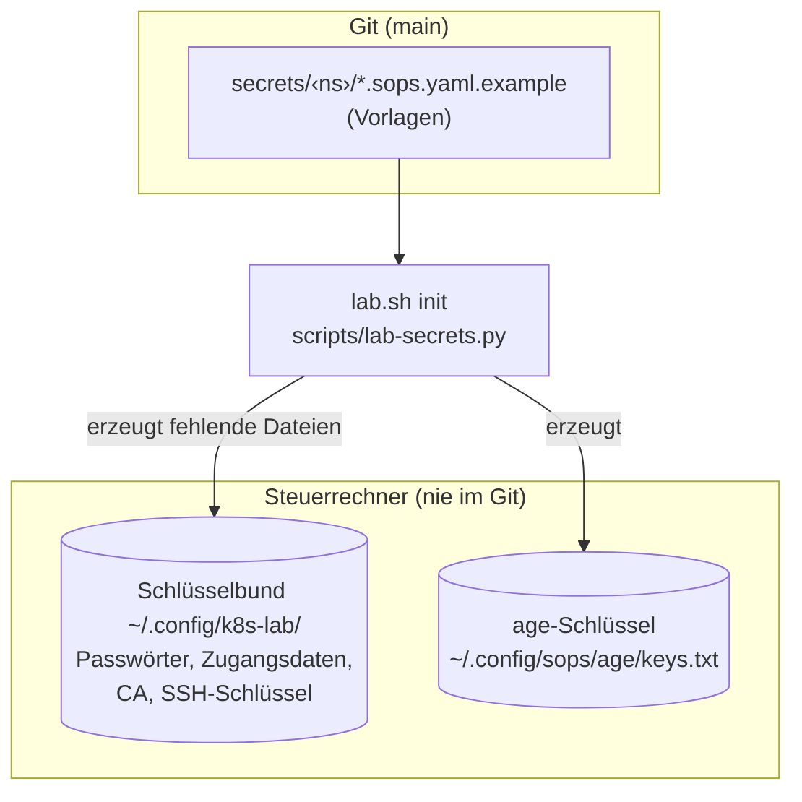
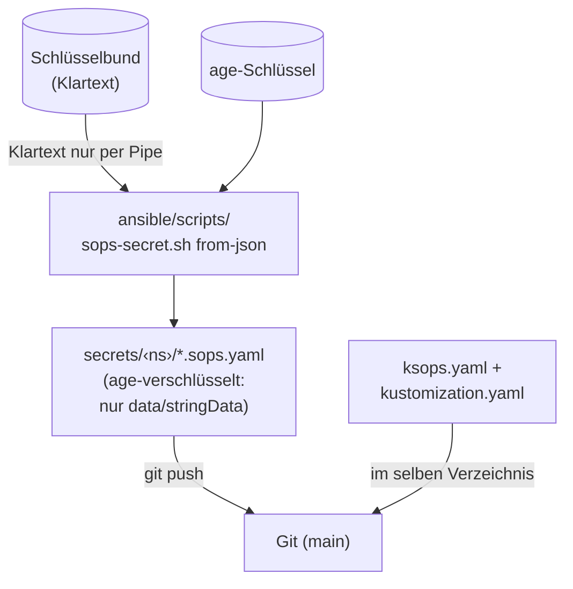
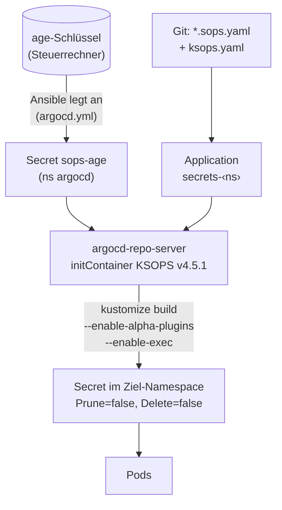
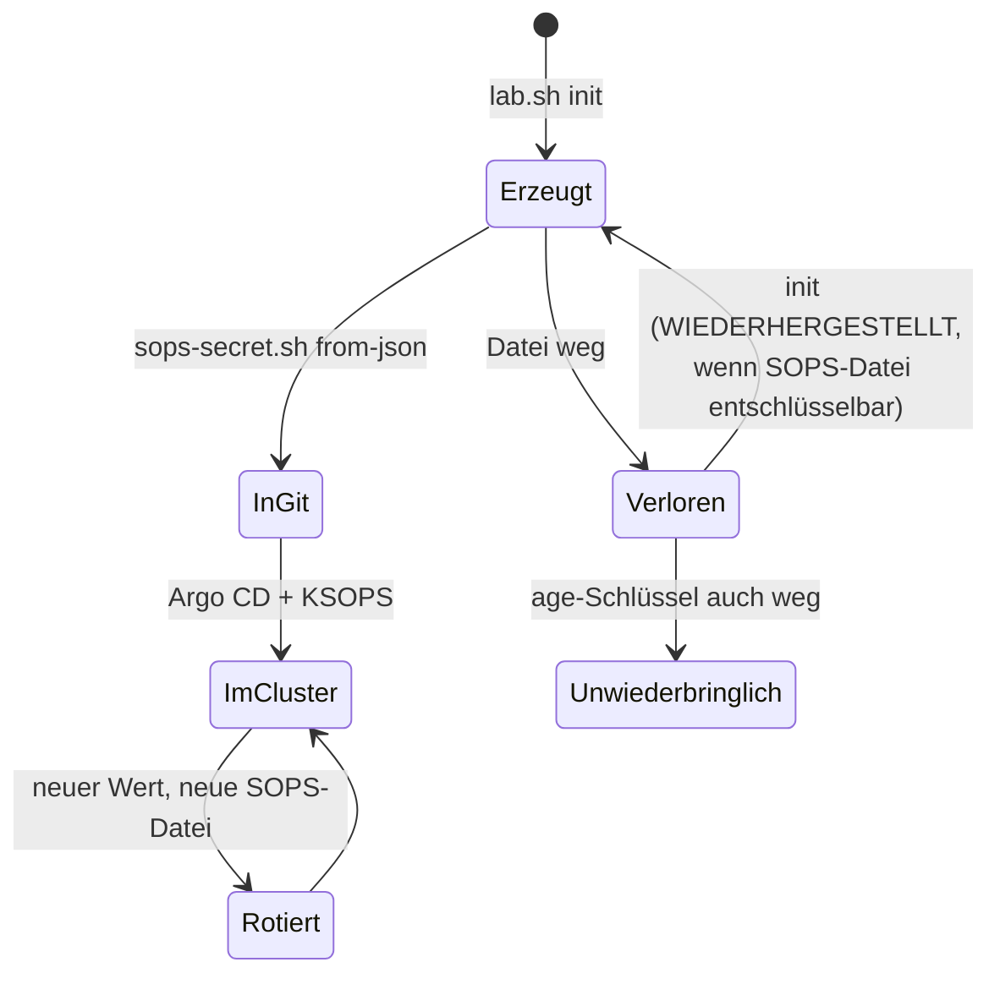

# Geheimnisfluss

Geheimnisse haben im Lab **drei Orte**: Dateien auf dem Steuerrechner
(Quelle der Wahrheit), verschlüsselte Dateien im Git und Secrets im Cluster.
Klartext berührt keine Platte ausser den Dateien in `~/.config/k8s-lab/`
(Modus 0600, Ordner 0700). Nirgends stehen Werte in dieser Doku, nur Pfade und
Zwecke ([Karte der Geheimnisse](../reference/secrets-map.md)).

## Vom Schlüssel zum Secret

Schritt 1: Beim Erzeugen entstehen die Schlüssel und Passwörter. Sie bleiben
auf dem Steuerrechner und kommen nie ins Git.

Schritt 2: Verschlüsseln. Der Klartext läuft nur durch eine Pipe, ins Git
geht nur die verschlüsselte Datei.

Schritt 3: Im Cluster entschlüsselt der Repo-Server mit dem Schlüssel aus
dem Secret `sops-age` und legt das Secret im Ziel-Namespace an.

### Was das Diagramm sagt

1. `lab.sh init` ist der **einzige** Ort, der Geheimnis-Dateien erzeugt
   (`scripts/lab-secrets.py`; die Ansible-Rollen `backup_s3` und
   `notes_sites` rufen es über `ansible/tasks/secrets-generate.yml`).
2. Regeln von `init`: eine vorhandene Datei wird **nie** überschrieben (`SKIP`);
   neue Dateien entstehen exklusiv (`O_EXCL`, Modus 0600); Werte werden nie
   ausgegeben; fehlt eine lokale Datei, aber die SOPS-Datei im Git ist
   entschlüsselbar, wird sie **wiederhergestellt** (`WIEDERHERGESTELLT`).
   Bei Konflikten steht `ABBRUCH`. Nur `--new-age-key` fasst die
   Empfänger in `.sops.yaml` an.
3. `.sops.yaml` verschlüsselt nur `data` und `stringData` (Regex
   `^(data|stringData)$`). Name, Namespace, Labels und Annotationen bleiben
   lesbar, damit Argo CD, Reviews und `verify-ksops.yml` damit arbeiten können.
4. Argo CD entschlüsselt beim Rendern: KSOPS läuft als initContainer im
   `argocd-repo-server`; der Schlüssel liegt als `/sops-age/keys.txt` (Modus
   0440, Gruppe 999). Argo CD ruft `kustomize build` mit
   `--enable-alpha-plugins --enable-exec`.
5. Jedes entschlüsselte Secret trägt `argocd.argoproj.io/sync-options:
   Prune=false,Delete=false`: Argo CD legt an und aktualisiert, **löscht nie**.
   Das Löschen eines Secrets ist so immer eine bewusste Handlung.

## Pro Namespace ein Ordner, eine App

| Ordner | Application | Inhalt |
|---|---|---|
| `secrets/cert-manager/` | `secrets-cert-manager` | CA-Secret `lab-ca`, `acme-dns01-token` (optional) |
| `secrets/db-lab/` | `secrets-db-lab` | `backup-s3-creds` |
| `secrets/gitea/` | `secrets-gitea` | `backup-s3-creds`, `gitea-admin`, `gitea-db-owner`, `k8up-repo`, `k8up-s3-creds` |
| `secrets/matrix/` | `secrets-matrix` | `backup-s3-creds`, `matrix-admin`, `matrix-db-owner`, `matrix-oidc`, `matrix-registration`, `matrix-signing-key`, `k8up-repo`, `k8up-s3-creds` |
| `secrets/keycloak/` | `secrets-keycloak` | `backup-s3-creds`, `keycloak-admin`, `keycloak-db-owner`, `keycloak-notes-client`, `keycloak-oidc-clients` |

Anleitung für ein neues Secret: [Geheimnisse erzeugen und rotieren](../how-to/secrets.md).

## Was bei Ansible bleibt (und warum)

Alles, was Argo CD braucht, um das Git überhaupt zu lesen, kann nicht aus dem
Git kommen:

| Secret | Warum bei Ansible | Rolle |
|---|---|---|
| `sops-age` (ns `argocd`) | ohne Schlüssel kein Entschlüsseln | `argocd_bootstrap` |
| Repo-Secret `repo-k8s-lab` (Deploy-Key, nur lesend) | ohne Schlüssel kein Klonen | `argocd_bootstrap` |
| `docs-repo` (ns `docs`) | Builder klont das Repo | `docs_site` |
| `<ns>-deploy`, `<ns>-cookie` je Notiz-Site (Passwort `<ns>-pw` nur bei `auth: basic`) | je Site eigener Deploy-Key und Cookie-Schlüssel des Login-Proxys | `notes_sites` |
| `notes-oidc` (Client-Geheimnis + Cookie-Schlüssel) je Notiz-Site mit `auth: sso` | die Namespaces der Notiz-Sites gehören Ansible (Argo CD legt dort keine Secrets an); der Client-Wert kommt aus derselben Datei wie die SOPS-Datei `keycloak-notes-client` | `notes_sites` |

## Schlüssel-Lebenszyklus

Die drei **★-Geheimnisse** (age-Schlüssel, Lab-CA, `k8up-repo-pw`) sind die,
deren Verlust sich nicht automatisch heilt: Ohne age-Schlüssel sind alle
SOPS-Dateien unlesbar, ohne restic-Passwort sind die Gitea-Datei-Backups
wertlos, ohne CA muss jedes Gerät neu vertrauen. Sie gehören zusätzlich in den
Passwort-Manager (Spalte `passwort_manager` der Karte).

- [age-Schlüssel rotieren](../how-to/secrets.md#age-schluessel-rotieren)
- [age-Schlüssel verloren](../how-to/secrets.md#age-schluessel-verloren)

## Restrisiken

- **Der age-Schlüssel liegt im Cluster** (`sops-age`) und entschlüsselt jede
  SOPS-Datei im Repo. Wer das Secret lesen kann (Cluster-Admin, Zugriff auf die
  VM-Platte oder ein Backup der VM), liest alle Geheimnisse. Ein zweiter,
  nur offline gehaltener Empfänger steht als [Issue 11](https://github.com/tabee/k8s-lab-template/issues/11)
  offen.
- **Secrets in etcd** sind per `secretbox` verschlüsselt (k3s
  `secrets-encryption`); der Schlüssel liegt aber auf derselben VM.
- Das Entfernen eines Secrets aus dem Git löscht es nie im Cluster
  (`Prune=false`).
