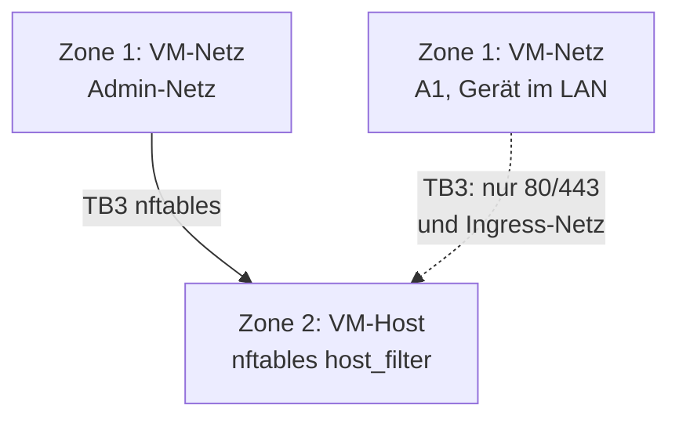
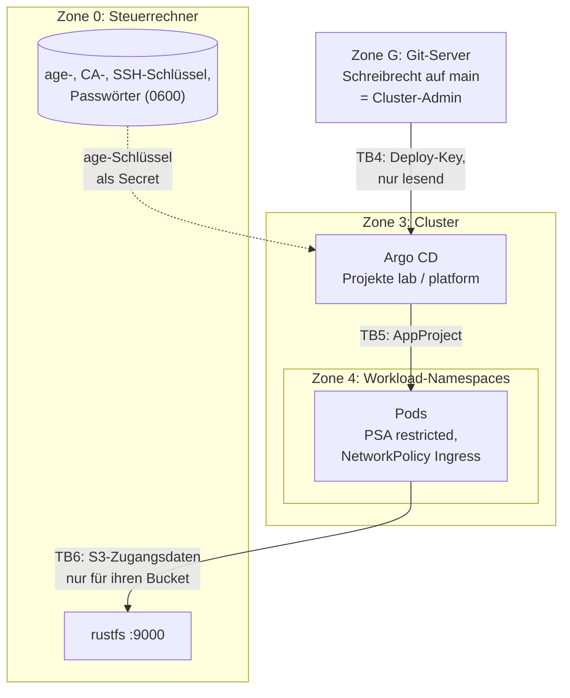
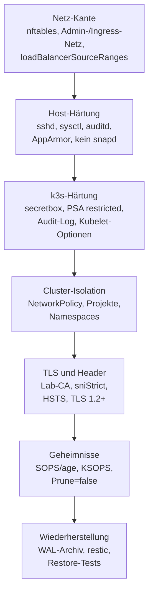

# Sicherheitsmodell

Diese Seite beschreibt, **was das Lab schützt, vor wem, womit und was
bewusst offen bleibt**. Sie richtet sich an Betreiber, an Freunde, die das Lab
mit eigenen Schlüsseln nachbauen, und an Prüfer (Pentester, Security-Fachleute,
Kubernetes-Trainer). Die Aussagen wurden beim Schreiben aus dem Code des Repos
abgeleitet, Stand Code-Commit `703dbd3`, und danach von einer unabhängigen
Prüfung gegen den Code gelesen; sie fand Abweichungen, die korrigiert sind. Das
ist **keine** vollständige Verifikation: Nicht jede Zeile hat einen Test, und wo
bei „Nachweis“ nichts steht, ist die Aussage nur aus dem Code gelesen.
Weicht etwas vom Code ab, melde es (Weg siehe [Hinweise für Prüfer](#hinweise-fuer-pruefer)).
Wo ein Nachweis existiert, steht er daneben.

!!! abstract "Kurzfassung"
    - Das Lab ist eine **Übungs- und Entwicklungsumgebung** auf einem Rechner
      hinter NAT, keine Produktion.
    - Die Kante (SSH, API, Admin-Oberfläche) ist auf ein **Admin-Netz**
      beschränkt, Apps auf ein **Ingress-Netz**. Beides steuert eine Quelle.
    - Geheimnisse liegen nie im Klartext im Git. Der Schlüssel dazu liegt im
      Cluster, das ist das **grösste bekannte Restrisiko** (neben „Schreibrecht
      auf `main` ist Cluster-Admin“).
    - Der **Steuerrechner** ist der wertvollste Punkt: Er hält alle Schlüssel.

## Geltungsbereich

| Im Geltungsbereich | Ausserhalb |
|---|---|
| die VM `k3s-lab` mit Betriebssystem, k3s, nftables | Härtung des Steuerrechners (Betriebssystem, Festplattenverschlüsselung, Browser) |
| alle Dienste in `gitops/` (Argo CD, Traefik, cert-manager, CNPG, K8up, Gitea, Doku, Notiz-Sites) | der Git-Server, auf dem das Repo liegt |
| das Backup-Ziel rustfs (Dienst, Zugangsdaten, Firewall) | Cloud-Betrieb: das Lab läuft heute **nicht** öffentlich; die Kante ist dafür vorbereitet, nicht bewiesen |
| die Werkzeugkette (`lab.sh`, OpenTofu, Ansible, `scripts/`) | Hochverfügbarkeit, Mandantentrennung, Compliance-Nachweise |

## Schutzgüter

| Schutzgut | Wert | Wo | Verlust bedeutet |
|---|---|---|---|
| age-Schlüssel | entschlüsselt jedes Geheimnis im Repo | Steuerrechner, Secret `sops-age` | Vertraulichkeit aller Geheimnisse |
| Lab-CA-Schlüssel | Vertrauen auf allen Geräten | Steuerrechner, Secret im Cluster | Fälschung von Namen unter der Lab-Domain |
| restic-Passwort `k8up-repo-pw` | Datei-Backups | Steuerrechner, Secret im Cluster | Backups unlesbar (bei Verlust) oder lesbar (bei Diebstahl) |
| Schreibrecht auf `main` | Cluster-Konfiguration | Git-Server | Kontrolle über den Cluster |
| Kubernetes-API | Cluster-Admin | VM, Port 6443 | alles im Cluster |
| Daten in Postgres und Gitea | Inhalte | PVCs, Backups | Vertraulichkeit, Integrität, Verfügbarkeit |
| SSH-Schlüssel der VM | Root-nahe Verwaltung | Steuerrechner | Zugang zur VM |

## Akteure

| ID | Akteur | Annahme |
|---|---|---|
| A1 | Gerät im LAN, aber nicht im Admin-Netz | kann Pakete an die VM schicken |
| A2 | übernommener Pod (Anwendung mit Schwachstelle) | führt Code in einem Workload-Namespace aus |
| A3 | Angreifer mit Schreibrecht auf `main` (gestohlener Zugang, kompromittierter Git-Server) | kann Manifeste und Skripte ändern |
| A4 | Dieb des Steuerrechners oder eines Backup-Datenträgers | liest Dateien auf Platte |
| A5 | Lieferkette (Images, Helm-Charts, Pakete, CDN) | liefert veränderte Artefakte |
| A6 | Betreiber mit einem Fehler | löscht oder überschreibt etwas |

## Vertrauensgrenzen {#vertrauensgrenzen}

Teil 1: Vom Steuerrechner und aus dem Netz in die VM (TB1 bis TB3).

```mermaid
flowchart TD
  OP["Zone 0: Steuerrechner<br/>Betreiber, lab.sh"]
  subgraph Z2["Zone 2: VM-Host"]
    direction TB
    SSH["sshd<br/>(nur Schlüssel)"]
    API["k3s API :6443"]
  end
  OP -- "SSH-Schlüssel (TB1)" --> SSH
  OP -- "kubeconfig (TB2)" --> API
```

Teil 2: Von Git in den Cluster und weiter zum Backup-Ziel (TB4 bis TB6).

| Grenze | Was sie trennt | Mechanismus | Nachweis |
|---|---|---|---|
| TB1 | Steuerrechner → VM | SSH nur mit Schlüssel, `AllowUsers`, `ListenAddress` auf die VM-Adresse | `verify.yml` (sshd-Werte) |
| TB2 | Steuerrechner → API | kubeconfig, API nur aus dem Admin-Netz | `verify.yml` (Kubelet-Port zu, API offen) |
| TB3 | Netz → VM | nftables, Admin-/Ingress-Netz, DNAT-Prüfung | `verify.yml --tags nodeport`, `verify-traefik.yml` |
| TB4 | Git → Cluster | Deploy-Key nur lesend, Host-Keys gepinnt | `verify-argocd.yml` |
| TB5 | Argo CD → Namespaces | AppProjects `lab` und `platform`, PSA `restricted` | `verify-argocd.yml` (PSA-Probe) |
| TB6 | Cluster → Backup-Ziel | Bucket-Benutzer mit Policy nur für den eigenen Bucket, ufw nur aus `192.168.122.0/24` | `verify-backup-s3.yml` |

## Schichten der Verteidigung

### Host-Härtung (Rolle `base`, Stufe 3)

- **SSH:** Anmeldung nur mit Schlüssel (`AuthenticationMethods publickey`),
  kein Root, kein Passwort, `MaxAuthTries 3`, `LoginGraceTime 30`,
  Weiterleitungen aus, nur moderne Algorithmen (`sntrup761x25519-sha512`,
  `curve25519`, `chacha20-poly1305`, `aes-gcm`, ETM-MACs), `LogLevel VERBOSE`,
  `ListenAddress` nur die VM-Adresse.
- **Kernel (`sysctl`):** unter anderem `kernel.kptr_restrict=2`,
  `kernel.dmesg_restrict=1`, `kernel.unprivileged_bpf_disabled=1`,
  `net.core.bpf_jit_harden=2`, `kernel.yama.ptrace_scope=2`, `kernel.sysrq=0`,
  `fs.suid_dumpable=0`, `fs.protected_*`, Redirect-/Source-Route-Schutz,
  `tcp_syncookies`, `tcp_rfc1337`. Die Werte überleben den Neustart (Datei
  `99-zz-hardening.conf`, apport maskiert, damit `fs.suid_dumpable` nicht auf 2
  zurückfällt).
- **auditd:** Basisregeln für Konten, `sudoers`, `sshd`, nftables, die
  k3s-Konfiguration und die k3s-Zugangsdaten und -Zertifikate.
- **AppArmor** aktiv, **snapd entfernt** und per Apt-Pin gesperrt,
  **unattended-upgrades** nur für Sicherheitsupdates (kein automatischer Neustart).
- **Firewall:** nftables `inet host_filter`, Policy `drop` für `input`
  ([Netz-Kante](network-edge.md)). UFW ist in der VM aus.

### k3s-Härtung

- `secrets-encryption: true` mit `secretbox` (XSalsa20-Poly1305).
- Pod Security Admission `restricted` als Standard im ganzen Cluster
  (ausgenommen `kube-system`), zusätzlich pro Namespace als Label.
- API-Audit-Log (30 Tage, 10 Dateien, 100 MB), Verzeichnis nur für root.
- `protect-kernel-defaults`, kubelet nur mit ECDHE+AEAD-Suites, anonymer Zugriff
  verweigert, `pod-max-pids=4096`, `streaming-connection-idle-timeout=5m`,
  `service-account-extend-token-expiration=false`.
- k3s und das Install-Skript sind per SHA-256 gepinnt, das eingebaute Traefik
  ist abgeschaltet.

### Cluster-Isolation

- **PSA `restricted`** in den Workload-Namespaces; `kube-system` ist ausgenommen.
  Fünf Playbooks (`verify.yml`, `verify-argocd.yml`, `verify-certmanager.yml`,
  `verify-docs.yml`, `verify-traefik.yml`) schicken eine unsichere Probe-Pod-Spec
  per Server-Dry-Run und erwarten die Ablehnung. Die anderen Playbooks prüfen
  PSA nicht ablehnend ([Einzelheiten](../reference/verify-playbooks.md#psa-nachweis)).
- **NetworkPolicies:** Default-Deny für Ingress, nur benannte Quellen (zum
  Beispiel nur Traefik auf Port 8080 vor `whoami`). In
  `gitea`, `db-lab`, `docs`, `notes-*` und für den repo-server gilt zusätzlich
  Default-Deny für Egress, mit Folgen für Gitea (siehe
  [Egress von Gitea](#egress-gitea)); die übrigen Namespaces sind offen
  (Restrisiko R3).
- **AppProjects** begrenzen Quell-Repos, Ziel-Namespaces und cluster-weite
  Arten ([Bootstrap und GitOps](bootstrap-and-gitops.md#zwei-projekte-zwei-vertrauensstufen)).
- **Traefik:** `allowCrossNamespace: false`, `allowExternalNameServices:
  false`, Dashboard aus, `core.strictTLSOptions: true`, `safeNaming: true`,
  keine Telemetrie, Gateway-API aus.

### TLS und Header

TLS 1.2 und höher, ECDHE mit AEAD, `sniStrict: true`; Security-Header
(HSTS ein Jahr, `nosniff`, `frameDeny`, `no-referrer`, Permissions-Policy,
`Server`-Header entfernt). Ein Zertifikat pro App, keine Wildcards
([Zertifikate](certificates.md)).

## Bedrohungen und Gegenmassnahmen

**So liest du die Tabellen.** *STRIDE* ordnet jede Bedrohung einer Klasse zu:
**S** Identität vortäuschen (Spoofing), **T** Daten verändern (Tampering), **R**
Handlung abstreiten oder Spuren verwischen (Repudiation), **I** Informationen
preisgeben (Information Disclosure), **D** Verfügbarkeit stören (Denial of
Service), **E** Rechte ausweiten (Elevation of Privilege). In der Spalte „STRIDE, Risiko“ ist der
**letzte** Buchstabe das *Risiko* (z. B. „E, T, H“): das
**verbleibende** Risiko nach den genannten Gegenmassnahmen, in drei Stufen:
**H** hoch (Übernahme oder Datenverlust ist plausibel und fällt spät auf),
**M** mittel (braucht eine Vorbedingung oder der Schaden ist begrenzt), **N**
niedrig (braucht mehrere Vorbedingungen). Die Stufen sind die **Einschätzung des
Autors**, nicht gemessen und nicht extern geprüft. Der Akteur in Klammern
verweist auf die [Angreifer](#akteure) oben.

| # | STRIDE, Risiko | Bedrohung (Akteur) | Gegenmassnahme | Restrisiko und Nachweis |
|---|---|---|---|---|
| T1 | S, E, N | Zugriff auf SSH, API oder Admin-Oberfläche aus dem LAN (A1) | nftables: nur Admin-Netz | Quelladresse ist im gleichen L2-Segment fälschbar Nachweis: `verify.yml` |
| T2 | E, N | NodePort oder hostPort wird von aussen erreichbar, DNAT umgeht `input` (A1) | Chain `forward` prüft am Original-Zielport | nur TCP/UDP/SCTP-DNAT durch k3s betrachtet Nachweis: `verify.yml --tags nodeport` |
| T3 | E, M | Ausbruch aus einem Pod: privilegierter Container, hostPath (A2) | PSA `restricted` in den Workload-Namespaces (`kube-system` ist ausgenommen) | Kernel-Schwachstellen; alle Pods teilen einen Kernel Nachweis: ablehnende PSA-Probe nur in fünf Playbooks, siehe [PSA-Nachweis](../reference/verify-playbooks.md#psa-nachweis) |
| T4 | E, I, M | Seitwärtsbewegung zwischen Pods (A2) | NetworkPolicy Ingress | Egress in den Daten-Namespaces zu, sonst offen (R3) Nachweis: Policies je App |
| T5 | I, M | Geheimnisse im Git lesen (A3, A4) | SOPS/age, nur `data` verschlüsselt, Wächter und gitleaks | Schlüssel im Cluster (R2) Nachweis: `verify-ksops.yml`, `scripts/gitleaks-local.sh` |
| T6 | S, N | Fremde Zertifikate mit der Lab-CA ausstellen (A4, CA-Schlüssel) | nameConstraints (kritisch), VAP | gültig bleiben Namen unter der Lab-Domain Nachweis: `verify-certmanager.yml` |
| T7 | T, I, N | Unsichere TLS-Parameter, Downgrade (A1) | TLSOption `default`, HSTS | Browser-HSTS-Cache bleibt; kein CSP-Header Nachweis: `verify-traefik.yml` |
| T8 | I, T, D, M | Backup lesen oder zerstören (A1, A2, A4) | Bucket-Policy, ufw, restic-Verschlüsselung | Barman-Daten nicht clientseitig verschlüsselt, Transport per HTTP (R4, R20) Nachweis: `verify-backup-s3.yml` |
| T9 | D, M | Datenverlust durch Betreiberfehler (A6) | Export-Fallschirm, doppelte Rückfrage bei `purge`, Wegwerf-Restore | Backups auf demselben Datenträger (R4) Nachweis: `lab.sh acceptance` |
| T10 | T, E, M | Versionsdrift bei Charts oder Images (A5) | Chart-Versionen gepinnt, eigene Images per Digest, `verify-consistency.yml` vergleicht die Kopien | Chart-Standard-Images nur per Chart-Version (R9) Nachweis: `ansible/verify-*.yml` vergleichen Versionen |
| T11 | T, E, M | Manipulierte Bibliothek in der Doku-Site, im Browser der Leser (A5) | Diagramme sind optional; ohne CDN bleibt der Quelltext sichtbar | Mermaid wird selbst ausgeliefert, mit SRI-Hash im Skript-Tag; die CSP ist nur meldend (R8) Nachweis: [Phase 8 (`verify-docs.yml`)](../reference/acceptance-checks.md#phase-8) |
| T12 | D, R, M | Unbemerkter Ausfall von Backup oder Kante (A6) | `verify-*.yml`, Watchdog für rustfs | kein Alarm (R6) Nachweis: `lab.sh acceptance` |
| T13 | S, N | Beim ersten SSH-Aufbau zu einem falschen Host verbinden (A1) | `lab.sh` nutzt `StrictHostKeyChecking=accept-new`: ein später geänderter Hostschlüssel wird abgelehnt | der **erste** Schlüssel wird ohne Vergleich übernommen (R19) Nachweis: `scripts/lab.sh` (SSH-Optionen) |
| T14 | E, S, M | Gestohlener Admin-Zugang: kubeconfig, Argo-CD-Admin-Passwort (A4) | Dateien mit Modus 0600; Zugriff nur aus dem Admin-Netz | ein einziges Cluster-Admin-Konto, keine Personen-Rechte, keine Rotation (R15) Nachweis: [Geheimnis-Karte](../reference/secrets-map.md) |
| T15 | R, T, M | Spuren verwischen: Audit-Log verändern oder löschen (A2, A3) | Audit-Log mit Rotation (30 Tage, 10 Dateien, 100 MB) | das Log liegt auf dem Knoten selbst, wer dort Root hat, kann es ändern; es wird nirgends hin kopiert (R17) Nachweis: `ansible/roles/k3s` (Härtung) |
| T16 | I, M | Verschlüsselte Secrets in etcd entschlüsseln, wenn die VM-Platte in falsche Hände gerät (A3, A4) | `secrets-encryption` mit secretbox | der Schlüssel liegt auf derselben Platte wie die Daten (R18) Nachweis: `ansible/roles/k3s/tasks/hardening.yml` |
| T17 | I, T, D, M | Direkter Zugriff auf rustfs (S3-Port, Konsole) über den Host (A1) | ufw begrenzt die Quellen; Bucket-Policy; Zugang je Bucket | rustfs lauscht auf `0.0.0.0`, ufw ist die **einzige** Netzkontrolle, Transport per HTTP (R20) Nachweis: `verify-backup-s3.yml` |
| T18 | S, I, N | Anmeldung an Gitea oder einer Notiz-Site erraten oder umgehen (A1) | Gitea: `DISABLE_REGISTRATION`, `REQUIRE_SIGNIN_VIEW`, kein SSH-Dienst; Notiz-Sites: Anmeldung über Keycloak (oauth2-proxy, nur Gruppe `lab-users`, PKCE, Abmelden beendet die Keycloak-Sitzung; [ADR-0021](decisions/0021-notes-sso.md)), Notausgang Basic-Auth mit erzeugtem Passwort; alle nur über Traefik mit TLS | kein 2FA; kein Schutz vor wiederholtem Raten ausser der Netzkante (R21) Nachweis: `verify-gitea.yml`, `verify-notes.yml` |
| T19 | T, E, M | Kompromittierter Upstream: Image, Chart, Ansible-Collection, Paket oder CDN-Skript (A5) | Versionen und teils Digests gepinnt; k3s per SHA-256 | keine Signaturprüfung, keine SBOM, kein CVE-Scan, kein Renovate (R14) Nachweis: – |
| T20 | I, S, M | Ein altes oder abgeflossenes Geheimnis bleibt gültig (A3, A4) | pro Geheimnis ein Wechselweg in der [Karte](../reference/secrets-map.md) | kein Zeitplan, keine Alterskontrolle (R16) Nachweis: – |

## Restrisiken {#restrisiken}

Die folgenden Punkte sind **bekannt und bewusst offen**. Sie sind keine
Fehler, die man übersehen hat. Wo es ein Issue im
[Tracker](https://github.com/tabee/k8s-lab-template/issues) gibt, ist es verlinkt.

| # | STRIDE, Risiko | Restrisiko | Auswirkung | Status |
|---|---|---|---|---|
| R1 | E, T, H | **Schreibrecht auf `main` ist Cluster-Admin.** Das Projekt `platform` darf ClusterRoleBindings und Webhooks anlegen. Das Projekt `lab` darf namespacierte Arten im Namespace `argocd` schreiben. Das Projekt `default` ist nicht eingeschränkt. `kubernetesCRD.namespaces` ist nicht begrenzt. Signierte Commits auf `main` (SSH, [ADR-0023](decisions/0023-signed-main-and-source-trust.md)) schliessen den unsignierten Push aus; beim Neuaufbau aus einer Kopie prüft `lab.sh` die Signatur ([Quellvertrauen](source-trust.md)). Während `up` und `rebuild` ist Argo CD an den geprüften Commit gebunden (Pin). Argo CD selbst prüft nur GnuPG. Wer signiert pushen darf, kann weiter alles anlegen. Projekte verhindern Fehler, keinen Angreifer mit Schreibrecht. | vollständige Übernahme | [Issue 6](https://github.com/tabee/k8s-lab-template/issues/6) |
| R2 | I, H | **Der age-Schlüssel liegt im Cluster** (`sops-age`) und entschlüsselt jede SOPS-Datei. Es gibt nur einen Empfänger. Ein Backup der VM-Platte enthält ihn. | alle Geheimnisse | [Issue 11](https://github.com/tabee/k8s-lab-template/issues/11) |
| R3 | I, M | **Egress ist nur teilweise zu.** Ein übernommener Pod ausserhalb der geschützten Namespaces kann jede Adresse erreichen (das Lab liegt hinter NAT; auf einer öffentlichen Maschine ist das ein offener Ausgang). Default-Deny für Egress gilt in `gitea`, `db-lab`, `docs`, `notes-*` und für den repo-server in `argocd`. **Restgrenzen:** Port 443 ins Internet bleibt für repo-server, `docs` und `notes-*` offen, weil kube-router keine Namen (kein FQDN), nur Adressbereiche kennt; Controller, server und applicationSet von Argo CD haben weiter nur Ingress-Policies; `kube-system`, Traefik und cert-manager sind nicht erfasst. | Datenabfluss | [Issue 5](https://github.com/tabee/k8s-lab-template/issues/5), Rest: [Issue 37](https://github.com/tabee/k8s-lab-template/issues/37) |
| R4 | I, D, T, M | **Backup-Ziel:** Transport per HTTP; Barman-Daten liegen ohne clientseitige Verschlüsselung im Bucket; VM-Platte und rustfs teilen standardmässig denselben Datenträger (ein [Replikat](../how-to/backup-replica.md) auf einem zweiten Rechner ist möglich, schützt aber nicht vor einem übernommenen Steuerrechner); die Abnahme beweist die Bytes im Bucket, nicht den Ausfall der VM-Platte. | Verlust oder Lesbarkeit der Backups | [Issue 3](https://github.com/tabee/k8s-lab-template/issues/3), [Issue 4](https://github.com/tabee/k8s-lab-template/issues/4) |
| R5 | S, E, M | **Argo-CD-UI** ist praktisch Cluster-Admin; Anmeldung nur mit dem Admin-Passwort, kein 2FA. Sie ist auf das Admin-Netz beschränkt. | Übernahme bei gestohlenem Passwort | Dokumentiert in [Stufe 6c](../learning-path/stage-6c-argocd-ingress.md) |
| R6 | D, M | **Alarm nur teilweise.** Ein Ausfall von rustfs blieb am 2026-10-28 zwei Tage still. Heute meldet `lab-alert.py` veraltete Backups, ausgefallenes rustfs, ein altes Replikat und die Kante per Desktop-Meldung und Journal; die Matrix-Senke ist noch nicht eingeschaltet ([Issue 41](https://github.com/tabee/k8s-lab-template/issues/41)). Nicht geprüft: Certificates, Platte, Argo-Apps, API/SSH. Wer den Steuerrechner abschaltet, bekommt keinen Alarm. | stiller Backup-Ausfall | [Issue 8](https://github.com/tabee/k8s-lab-template/issues/8) |
| R7 | R, N | **Client-IP unsichtbar:** `externalTrafficPolicy: Cluster` verbirgt die Quelladresse vor Traefik. Access-Logs enthalten keine echten Client-Adressen. Die Allow-List sitzt in der Host-Firewall. | eingeschränkte Forensik | bewusst |
| R8 | T, E, M | **Skript im Browser der Leser.** Mermaid kommt nicht mehr von einem CDN, sondern aus der Site selbst (fest gepinnt, Tarball per SHA-512, im Browser per SRI-Hash geprüft). Restrisiken: Die Content-Security-Policy der Doku-Site ist `Report-Only` und blockiert nichts; sie enthält `'unsafe-inline'`, weil das Theme Inline-Skripte setzt; die Notiz-Sites haben keine CSP. Eine kompromittierte Mermaid-Version wäre nur über den gepinnten Hash beim Bauen möglich. | Skriptausführung im Browser | [Entscheidung ADR-0010](decisions/0010-mermaid-cdn.md), [Issue 38](https://github.com/tabee/k8s-lab-template/issues/38) |
| R9 | T, M | **Pins nicht überall per Digest.** Traefik, whoami, python, static-web-server und die Prüf-Pods sind per Digest gepinnt; `verify-traefik.yml` prüft, dass der laufende Traefik der gepinnte ist. Nicht per Digest gepinnt sind Images, die ein Chart selbst festlegt (Argo CD, cert-manager, CloudNativePG, Gitea-Chart-Standard), Charts nur per Version, Ansible-Collections nur per Version. | stille Lieferkettenänderung | [Issue 10](https://github.com/tabee/k8s-lab-template/issues/10), [Versionen und Pins](../reference/versions.md) |
| R10 | E, I, H | **Der Steuerrechner ist die Wurzel des Vertrauens.** Alle Schlüssel liegen als Dateien (Modus 0600) dort. Plattenverschlüsselung und Rechnerhärtung sind nicht Teil des Labs. | totale Kompromittierung | ausserhalb des Geltungsbereichs |
| R11 | D, M | **Ein Knoten, lokaler Speicher.** Kein Schutz gegen Knoten- oder Plattenausfall ausser Backup. | Verfügbarkeit | bewusst |
| R12 | D, M | **Speicher knapp.** `verify-budget.yml` addiert die echten Limits aller Arbeits-Pods und bricht ab, wenn Summe plus Reserve über `memory_mib` liegt oder ein Container kein Limit hat. Restrisiko: `vm.overcommit_memory=1` bleibt, die Limits sind nur so gut wie die Messung, und ein seltener Lastfall kann einen Pod per OOM beenden. | Verfügbarkeit | [Memory-Budget](../reference/memory-budget.md), [Issue 9](https://github.com/tabee/k8s-lab-template/issues/9) |
| R13 | D, N | **Android-Apps vertrauen Benutzer-CAs nicht**, das Lab-Vertrauen muss auf jedem Gerät bewusst eingerichtet werden. | Verfügbarkeit des Zugangs | dokumentiert |
| R14 | T, E, M | **Lieferkette ohne Nachweis.** Images, Charts und Pakete haben keine Signaturprüfung (kein cosign, keine Admission-Policy dafür); es gibt keine SBOM, keinen CVE-Scan der laufenden Images und kein Renovate oder Ähnliches, das neue Versionen meldet. Pins halten den Stand fest, sagen aber nichts über seine Sicherheit. | kompromittierter oder veralteter Upstream läuft unbemerkt | [Issue 31](https://github.com/tabee/k8s-lab-template/issues/31); teilweise [Issue 10](https://github.com/tabee/k8s-lab-template/issues/10) |
| R15 | E, S, M | **Menschlicher Zugang ist ein einziges Admin-Konto.** Die kubeconfig (`~/.kube/k3s-lab.kubeconfig`) und das Argo-CD-Admin-Konto sind Cluster-Admin. Es gibt kein RBAC pro Person, kein OIDC, keine nur lesende Rolle, und keine Regel, wann die Zugänge erneuert werden. | wer die Datei hat, hat alles | [Issue 32](https://github.com/tabee/k8s-lab-template/issues/32) |
| R16 | I, S, M | **Kein Rotationskonzept.** Pro Geheimnis steht in der [Karte](../reference/secrets-map.md), wie man es wechselt. Es gibt keinen Zeitplan, keine Erinnerung und keine Prüfung des Alters. Nur die CA hat ein Runbook ([CA-Rotation](../how-to/ca-rotation.md)). | lange gültige Geheimnisse | [Issue 33](https://github.com/tabee/k8s-lab-template/issues/33); [Issue 11](https://github.com/tabee/k8s-lab-template/issues/11) deckt nur den zweiten age-Empfänger |
| R17 | R, T, M | **Das Audit-Log bleibt auf dem Knoten** (`<k3s_server_data_dir>/logs/audit.log` in der VM, Rotation 30 Tage, 10 Dateien, 100 MB). Es wird nicht exportiert, nicht gegen Veränderung geschützt und nicht ausgewertet. Wer die VM übernimmt, kann es löschen. | Vorfälle lassen sich nicht belegen | [Issue 34](https://github.com/tabee/k8s-lab-template/issues/34); verwandt mit [Issue 8](https://github.com/tabee/k8s-lab-template/issues/8) |
| R18 | I, M | **Der secretbox-Schlüssel liegt auf der VM-Platte**, neben den verschlüsselten Daten. Die Verschlüsselung der Secrets in etcd schützt vor dem Lesen der Datenbank allein, nicht vor dem Zugriff auf die ganze Platte oder ein Platten-Backup. | Secrets lesbar bei Plattenzugriff | kein Issue; dieselbe Wirkung wie R2 |
| R19 | S, N | **SSH-Hostschlüssel wird beim ersten Aufbau nicht verglichen.** `lab.sh` setzt `StrictHostKeyChecking=accept-new`; spätere Änderungen werden abgelehnt, die erste Verbindung nicht geprüft. Das Risiko ist klein, weil die VM lokal auf dem eigenen Rechner läuft. | Täuschung bei der Erstverbindung | bewusst |
| R20 | I, T, D, M | **rustfs lauscht auf `0.0.0.0:9000`**, ufw auf dem Steuerrechner ist die einzige Netzkontrolle; der S3-Verkehr läuft unverschlüsselt per HTTP. Der Preflight der Rolle `backup_s3` bricht ab, wenn ufw fehlt oder nicht aktiv ist, danach wird das nicht mehr überwacht; `verify-backup-s3.yml` prüft ufw nur beim Lauf. Die Konsole (Port 9001) ist nur veröffentlicht, wenn eine Adresse gesetzt ist. | Backups lesbar oder löschbar aus dem LAN, wenn ufw ausfällt | [Issue 35](https://github.com/tabee/k8s-lab-template/issues/35) ([Issue 3](https://github.com/tabee/k8s-lab-template/issues/3) betrifft Replikate, nicht die Bindung oder TLS) |
| R21 | S, I, N | **Gitea und Notiz-Sites haben einfache Anmeldung.** Gitea: Registrierung aus, Ansicht nur mit Anmeldung, kein SSH-Dienst, ein Admin-Konto, kein 2FA. Notiz-Sites: Keycloak mit der Passwort-Richtlinie und dem Brute-Force-Schutz des Realms (kein 2FA); nur bei `auth: basic` HTTP-Basic-Auth ohne Sperren nach Fehlversuchen. Beides liegt hinter dem Admin-Netz oder dem Ingress-Netz. | Zugriff auf Notizen oder Repos bei erratenem oder geleaktem Passwort | [Issue 36](https://github.com/tabee/k8s-lab-template/issues/36) |

### Abwägung: Egress von Gitea {#egress-gitea}

!!! warning "Gitea darf nicht nach aussen"
    Im Namespace `gitea` gilt Default-Deny für Egress ([Issue 5](https://github.com/tabee/k8s-lab-template/issues/5)); erlaubt sind nur DNS (zu den kube-dns-Pods), der
    eigene Namespace (Gitea zu Pooler und Postgres) und für die Backup-Pods die
    K8s-API und das S3 des Backup-Ziels. Für Gitea im Cluster heisst das:

    - **keine Webhooks** an andere Dienste,
    - **keine E-Mail** (SMTP, Benachrichtigungen),
    - **keine Push- und keine Pull-Mirrors** zu anderen Git-Servern.

    Diese Funktionen schlagen dann **still oder mit einem Timeout** fehl, nicht
    mit einer Policy-Meldung. Das ist gewollt: ein übernommenes Gitea soll keinen
    freien Ausgang haben. Willst du ein einzelnes Ziel erlauben, steht der Weg in
    der [Fehlersuche](../how-to/troubleshooting.md#egress-gitea).

Notiz-Sites trennen die Quelle des k8s-lab-Codes vom Inhalt-Repo. Eine zusätzliche
Regel erlaubt die `repo_egress_cidrs` der jeweiligen Site auf dem SSH-Port ihrer
`repo`-URL (`gitops/sites.yaml`). Sie bleibt beim Wechsel auf den GitHub-Spiegel
erhalten und öffnet weder andere private Ziele noch pauschal Port 443 ins VPN.
Die Adress-Pins der Inhalte müssen separat aktuell gehalten werden;
`repo-egress --resolve` bearbeitet nur die k8s-lab-Quelle.

Weitere Grenzen der Egress-Regeln, damit niemand mehr daraus liest, als drinsteht:

- **443 ins Internet bleibt offen** für repo-server, `docs` und `notes-*` (Helm-,
  OCI-Quellen, Pakete), weil kube-router keine Namen kennt. Das ist ein
  bewusster Kompromiss, kein Versehen.
- **Die Regeln hängen an Adressen.** Ändert sich die Adresse des Git-Servers,
  schreibt `bash scripts/lab.sh repo-egress --resolve` sie neu in die Policies;
  danach committen und pushen. Bis dahin kann der repo-server den Git-Server nicht
  mehr erreichen.
- **Der repo-server erreicht die K8s-API nicht.** Controller, server und
  applicationSet von Argo CD haben nur ihre Ingress-Policies ([Issue 37](https://github.com/tabee/k8s-lab-template/issues/37)).

## Hinweise für Prüfer {#hinweise-fuer-pruefer}

- **Was man ohne Zugang prüfen kann:** Ports und Zertifikate der VM aus dem
  LAN. Von einer Adresse ausserhalb des Admin-Netzes sollen 22, 6443,
  10250, NodePorts und 8444 nicht antworten; 80 und 443 antworten nur aus dem
  Ingress-Netz. `sniStrict` lässt Handshakes ohne oder mit unbekanntem SNI
  scheitern.
- **Was die Abnahme selbst prüft:** [Abnahmeprüfungen](../reference/acceptance-checks.md).
  Alle Prüfungen sind lesend oder legen Wegwerf-Objekte an und räumen sie ab.
- **Bekannte Befunde, die kein Fund sind:** die Punkte R1 bis R21 oben.
- **Meldung von Schwachstellen:** Bitte **nicht** als öffentliches Issue.
  Das Vorgehen für eine private Meldung steht in `SECURITY.md` im Repo-Root
  der öffentlichen Kopie (Englisch, mit kurzem deutschem Hinweis; die Datei
  kommt aus dem Export-Overlay `scripts/public/overlay/`). Fehlt sie, schreibst
  du den Betreiber direkt an. Das Lab ist ein privates Übungsprojekt ohne
  Reaktionszeit-Zusage.

## Was dieses Modell nicht behauptet

- Es gibt **keine Sicherheitszertifizierung** und keinen externen Penetrationstest.
- „Gehärtet“ heisst hier: nach den im Repo benannten Massnahmen und mit den
  benannten Prüfungen. Es heisst nicht „sicher gegen jeden Angreifer“.
- Die Kante ist auf einem öffentlichen Server **nicht** erprobt ([Issue 12](https://github.com/tabee/k8s-lab-template/issues/12)); die
  Probe im [Edge-Profil](../how-to/edge-profile.md) zeigt nur das Verhalten im LAN.
- Die Einstufungen H/M/N sind Urteile, keine Messwerte.
