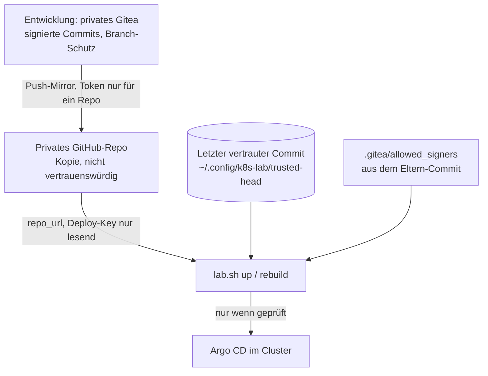

# Quellvertrauen und signierte Commits

Wer auf `main` des Repos schreiben darf, steuert das Lab: Argo CD wendet jeden Stand von `main` an
([Sicherheitsmodell, R1](security-model.md)). Diese Seite beschreibt, **wem** das Lab beim Neuaufbau vertraut,
was Argo CD selbst prüfen kann und was `lab.sh` und die CI übernehmen. Die Entscheidung dahinter:
[ADR-0023](decisions/0023-signed-main-and-source-trust.md).

## Die Vertrauensgrenze

- **Vertraut** wird dem Schlüssel, der in `.gitea/allowed_signers` steht, und dem lokalen Eintrag
  `trusted-head` (der letzte Commit, den du selbst bestätigt hast). Beides liegt ausserhalb von `repo_url`:
  der Eintrag in deinem Home-Verzeichnis, die Schlüsselliste im Stand, den du schon vertraust.
- **Nicht vertraut** wird jede Kopie: das GitHub-Repo, sein Konto, das Token, der Mirror. Wer das Konto
  übernimmt, kann dort Commits setzen, aber nicht mit deinem Signierschlüssel signieren.

## Was `lab.sh` prüft

Vor jedem `up`, `rebuild` und `preflight` (siehe [`source_trust`](../reference/configuration.md#git-server)):

1. Welcher Commit liegt jetzt an `repo_url` als `main`? (Abruf mit dem Deploy-Key und den festen Host-Keys.)
2. Ist es der vertraute Commit oder ein **Nachfahre**? Ein älterer Stand (Rollback) oder umgeschriebene
   Historie fällt durch.
3. Ist **jeder** Commit dazwischen SSH-signiert, von einem Schlüssel aus `.gitea/allowed_signers` **seines
   Eltern-Commits**? Ein Commit kann seinen eigenen Schlüssel nicht freigeben.
4. Bestanden: der Commit wird der neue vertraute Commit. Nicht bestanden: Abbruch mit einer englischen
   Meldung, es ändert sich nichts. Einziger Ausweg: `--trust-override` mit getippter Bestätigung der ersten
   7 Zeichen der Commit-ID.
5. **Argo CD wird an den geprüften Commit gebunden** (Pin, [siehe unten](#pin-waehrend-des-neuaufbaus)).
6. Am Ende von `up` und `rebuild` noch einmal: hat sich `main` während des Laufs bewegt? Besteht der neue Stand die
   Prüfung, wird der Pin gelöst. Besteht er sie nicht, bleibt der Pin und es gibt einen Alarm.

Das ist ein **Vorabtest** und kein Dauerschutz: Nach dem Lösen des Pins folgt Argo CD wieder `main`, und ab da
schützen nur der Push (Gitea-Branch-Schutz, Workflow) und der nächste Neuaufbau.

## Modus `source: github`

Mit dem Schalter `source: github` ([ADR-0024](decisions/0024-github-as-switchable-source.md)) liest Argo CD den
GitHub-Spiegel, und die Prüfung ist **immer an**. Sie ist dann strenger: Der Commit auf GitHub muss derselbe sein wie
`origin/main` des Git-Servers. Steht der Spiegel dahinter, hat er noch nicht synchronisiert; steht er woanders, wurde
er verändert. Beides bricht ab. Den Anker rückt die Prüfung nur auf einen Commit vor, den auch der Git-Server hat;
ein Spiegel mit anderem Stand wird geprüft, aber nie aufgezeichnet. Anleitung: [Neuaufbau aus GitHub](../how-to/neuaufbau-github.md).

**Gitea nicht erreichbar.** Der Spiegel ist gerade für diesen Fall da. Lässt sich `origin` nicht abrufen, warnt der
Preflight und vergleicht GitHub mit dem **letzten lokal bekannten Stand** (lokaler `main`, `origin/main` wie zuletzt geholt)
statt mit dem Git-Server. Gleich: in Ordnung. Ein Vorfahre: `BEHIND`, Fehler. Ein Commit, den dieser Rechner nie von
Gitea gesehen hat (GitHub vorn oder daneben): Fehler; weiter nur nach `git log HEAD..<Commit>` und mit
`--trust-override` und getippter Bestätigung, und der Anker wird nie auf so einen Commit gesetzt. Signaturen, Anker und
lokaler Stand zusammen ersetzen die Rückfrage bei Gitea; der Klon muss deshalb aktuell sein
([Anleitung](../how-to/neuaufbau-github.md#wenn-gitea-nicht-erreichbar-ist)).

## Pin während des Neuaufbaus {#pin-waehrend-des-neuaufbaus}

Ohne Pin läge zwischen der Prüfung und dem Sync von Argo CD ein Fenster von mehreren Minuten: Würde `main` in der
Kopie in dieser Zeit verschoben, läse Argo CD Commits, die niemand geprüft hat. Deshalb liest Argo CD während
`up` und `rebuild` **genau den geprüften Commit**:

- Die Root-Anwendung (`root`) bekommt als `targetRevision` die 40-stellige Commit-ID statt `main`.
- Die Root-Anwendung baut `gitops/apps` mit Kustomize (`gitops/apps/kustomization.yaml`). Kustomize-Patches
  (`scripts/pin-revision.py`, JSON6902) setzen in **jeder** Anwendung und jedem ApplicationSet, die dieses Repo lesen,
  die Revision auf denselben Commit. Die Patches entstehen aus dem geprüften Commit, nicht aus dem Arbeitsverzeichnis:
  ungespeicherte Änderungen können keine Anwendung verstecken.
- Nach der bestandenen Zweitprüfung löst `ansible/argocd-release-pin.yml` den Pin: `root` folgt wieder `main`, die
  Patches entfallen. Bei einem Alarm bleibt der Pin. Dann prüfst du die neuen Commits und löst ihn selbst mit
  `bash scripts/lab.sh trust release` (prüft vorher noch einmal).
- Ein Lauf von `argocd.yml` ohne Pin (zum Beispiel `sync-host`) lässt einen bestehenden Pin unverändert.
- `verify-argocd.yml` meldet einen noch gesetzten Pin als «Wrong branch» und nennt den Befehl zum Lösen.
- Ist das Quellvertrauen aus (`source_trust: off`, privater Git-Server ohne Anker), gibt es keinen Pin.

Grenzen des Pins:

- Er gilt für Quellen, die `repoURL` des Code-Repos lesen. Ein **getrenntes Secrets-Repo**
  (`secrets_repo_url`, [ADR-0022](decisions/0022-private-secrets-repo.md)) liegt ausserhalb des Quellvertrauens und
  ist nicht gepinnt. Helm-Charts sind über ihre Version fixiert.
- Das Repo-Secret für die Doku-Site liest weiterhin `main` und ist nicht gepinnt.
- Der Pin ist **keine** Signaturprüfung in Argo CD. Er sorgt nur dafür, dass Argo CD den Commit liest, den `lab.sh`
  geprüft hat.

## Was Argo CD selbst prüfen kann

| Prüfung | Argo CD 3.5 (Chart 10.11) | `lab.sh` / CI |
|---|---|---|
| GnuPG-Signatur (`sourceIntegrity.git.policies[].gpg`, Schlüsselbund `argocd-gpg-keys-cm`) | ja | nein |
| **SSH**-Signatur | **nein** (Upstream-Wunsch [argo-cd#8733](https://github.com/argoproj/argo-cd/issues/8733) offen) | ja (`lab-trust.sh`, `check-commit-signatures.sh`) |
| Rollback und umgeschriebene Historie vor dem Neuaufbau | nein | ja (Nachfahren-Prüfung gegen `trusted-head`) |
| laufender Betrieb (jeder Sync nach dem Neuaufbau) | nur mit GnuPG | nur der Push (Gitea-Workflow und Branch-Schutz) |

Der Gegenentwurf wäre GnuPG statt SSH: Argo CD verifiziert dann jeden Sync selbst, aber das Lab bräuchte einen
zweiten Schlüsseltyp, und zwei Signaturformate auf einem Commit gibt es nicht. SSH ist hier die robustere Wahl,
weil ein ed25519-Schlüssel genügt und es nur **eine** Quelle der Wahrheit für die Signer gibt. Der
Vergleich steht im [ADR](decisions/0023-signed-main-and-source-trust.md); die Neubewertung bei jedem
Argo-CD-Update ist [Issue 70](https://github.com/tabee/k8s-lab-template/issues/70).

## Die Schichten

| Schicht | Wo | Schützt vor |
|---|---|---|
| Branch-Schutz in Gitea (signierte Commits verlangen, kein Force-Push) | Gitea | unsigniertem Push auf `main` |
| Workflow `signature-check.yml` | Gitea Actions | zweite Linie, roter Haken bei einem Push |
| Quellvertrauen und Pin | `lab.sh up`, `rebuild`, `preflight` | übernommenem GitHub-Konto, Rollback, Fälschung beim Neuaufbau, `main`, das sich während des Laufs bewegt |
| AppProjects (`root`, `platform`, `lab`, `default`) | Argo CD | Fehlern und Workloads, die mehr anlegen wollen als erlaubt |

## Bedrohungsmodell in Kürze {#bedrohungsmodell}

Angenommen, jemand übernimmt das GitHub-Konto des Spiegels:

- **Unsignierte Pushes** auf `main` werden abgewiesen: in Gitea durch den Branch-Schutz, beim Neuaufbau durch die
  Signaturprüfung gegen `.gitea/allowed_signers`.
- **Rollbacks und fremde Historien** fallen bei der Nachfahren-Prüfung gegen `~/.config/k8s-lab/trusted-head` durch.
- **Der Bootstrap ist gepinnt:** Argo CD liest während `up` und `rebuild` genau den geprüften Commit
  (`targetRevision` der Root-Anwendung auf der Commit-ID).

Der Anker entsteht mit `bash scripts/lab.sh trust init <COMMIT>` (der erste Anker ist der erste signierte Commit) und
gilt mit `source_trust: on` in `lab.local.yaml`. Bekannte Lücken stehen in den Issues
[70](https://github.com/tabee/k8s-lab-template/issues/70) (Argo CD prüft nur GnuPG),
[72](https://github.com/tabee/k8s-lab-template/issues/72) (Egress zu GitHub),
[73](https://github.com/tabee/k8s-lab-template/issues/73) (Web-Merges),
[76](https://github.com/tabee/k8s-lab-template/issues/76) (Secrets-Repo und Doku-Site nicht gepinnt) und
[77](https://github.com/tabee/k8s-lab-template/issues/77) (Schlüsselprüfung von «Signierte Commits verlangen» in Gitea).
Der tägliche Ablauf: [Alltag mit signierten Commits](../how-to/alltag-signierte-commits.md).

## Restgrenzen

!!! warning "Wer signiert pushen darf, kann weiter alles anlegen"
    Ein gültig signierter Commit von dir kann eine Platform-App anlegen. Die Signatur beweist die Herkunft,
    nicht die Absicht. Der Signierschlüssel (`~/.ssh/k8s-lab-signing`, nicht der Anmeldeschlüssel `~/.ssh/id_ed25519`) ist damit so
    wichtig wie der age-Schlüssel;
    eine Passphrase und ein Agent sind Pflicht ([SSH-Commit-Signatur einrichten](../how-to/signed-commits.md)).

- Die **erste** Bestätigung (`trust init`) ist Vertrauen auf einen Blick: du prüfst die Commit-ID auf dem
  privaten Gitea, nicht im GitHub-Konto.
- Web-Merges in Gitea erzeugen unsignierte Commits ([Issue 73](https://github.com/tabee/k8s-lab-template/issues/73)).
- Fällt der Signierschlüssel aus, gilt der Weg in
  [Schlüsselwechsel](../how-to/signed-commits.md#schluesselwechsel).
