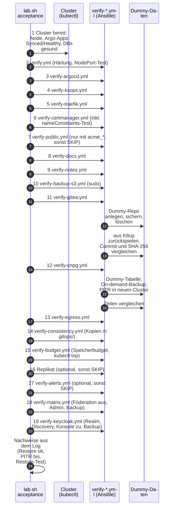

# Abnahme: messen und beweisen

**Ziel:** nach `up` oder `rebuild` beweisen, dass das Lab trägt und dass die
Backups sich wirklich zurückspielen lassen.

```bash
bash scripts/lab.sh acceptance
```

Die Abnahme startet nur, wenn die VM läuft. Sie führt die Phasen nacheinander
aus (jede mit Stoppuhr; ein Fehler stoppt die anderen **nicht**) und endet mit
**ABNAHME BESTANDEN** oder **ABNAHME NICHT BESTANDEN**.

## Ablauf



| Phase | Playbook | Beweist | Dauer-Hinweis |
|---|---|---|---|
| 1 | (kubectl) | Node bereit, alle Applications `Synced/Healthy`, Postgres-Cluster gesund | – |
| 2 | `verify.yml` | Härtung von Host und k3s, nur lesend (`kubectl --dry-run=server`), dazu der NodePort-Test (`--tags nodeport`) | – |
| 3 | `verify-argocd.yml` | Argo CD (Apps, Test-Pod nur per Server-Dry-Run gegen PSA), Oberfläche über Traefik per `curl --cacert` | – |
| 4 | `verify-ksops.yml` | KSOPS: Secrets, die Argo CD selbst entschlüsselt; vom age-Secret nur Metadaten, Werte werden nie gelesen | – |
| 5 | `verify-traefik.yml` | Traefik: HTTP/HTTPS-Anfragen von aussen, Test-Pod per Dry-Run | – |
| 6 | `verify-certmanager.yml` | cert-manager, Lab-CA, TLS von aussen, Namenseinschränkung (Wegwerf-Zertifikate `verify-nc-*`) | – |
| 7 | `verify-public.yml` | öffentliche Probe (Issuer `lab-acme`, Zertifikat `acme-probe`); **SKIP** ohne `acme_*` | – |
| 8 | `verify-docs.yml` | Doku-Site im Cluster (`https://docs.<Domain>`) | – |
| 9 | `verify-notes.yml` | pro Site Application, Pod, Certificate, NetworkPolicy, Anmeldung (SSO: 302 zu Keycloak ohne Sitzung, optional voller Login und Abmelden; Basic: 401 ohne, 200 mit Passwort), Wissensgraph | – |
| 10 | `verify-backup-s3.yml` | rustfs: Dienst, Port, ufw, Buckets, Testobjekte, Pod-Test aus dem Cluster | braucht `sudo` |
| 11 | `verify-gitea.yml` | **Restore** der Gitea-Dateien (Dummy-Repo) | – |
| 12 | `verify-cnpg.yml` | **Restore** mit PITR (Dummy-Tabelle) | rund 10 Minuten |
| 13 | `verify-egress.yml` | Egress-Policies erlauben nur das Vorgesehene | – |
| 14 | `verify-consistency.yml` | Kopien in `gitops/` gleich `lab.yaml` und `group_vars` | Sekunden |
| 15 | `verify-budget.yml` | Summe der Memory-Limits plus Reserve passt in die VM, kein Speicherdruck | – |
| 16 | `lab.sh replica verify` (optional) | Backup-Replikat frisch und per Prüfsumme gleich | Sekunden; `SKIP` ohne Replikat |
| 17 | `verify-alerts.yml` (optional) | Prüfungen grün, nachgebauter Fehler alarmiert genau einmal | `SKIP` ohne Alarme |
| 18 | `verify-matrix.yml` | Föderation aus, Admin-Anmeldung, CNPG-Backup, K8up-Restore einer Markierung, Egress | – |
| 19 | `verify-keycloak.yml` | Realm und OIDC-Discovery, Admin-Konsole von aussen zu, Gitea-Anmeldequelle, CNPG-Backup, Egress | wartet auf das erste Backup |

Einzelheiten zu jedem Prüfpunkt: [Referenz Abnahme-Prüfpunkte](../reference/acceptance-checks.md).

!!! note "Wie viele Phasen?"
    Die Abnahme hat neunzehn Phasen. Phase 7 (öffentliches Zertifikat) ist ein `SKIP`, solange kein `acme_*` gesetzt ist;
    die Phasen 16 (Replikat) und 17 (Alarme) melden `SKIP`, solange sie nicht installiert sind. Matrix (18) und
    Keycloak (19) laufen immer mit. Die Messung vom 2026-10-30 (15:50, Europe/Zurich) nennt **11 von 11** Phasen;
    neuere Läufe von `rebuild --restore` stehen unter [Neuaufbau](rebuild.md).
    Während der Abnahme misst ein Hintergrundprozess
    mit `kubectl top` die Speicher-Spitzen jedes Containers; sie liegen als `memory-peaks.json` im Log-Ordner
    und sind die Grundlage von [Memory-Budget](../reference/memory-budget.md).

## Was am Ende im Log steht

Die Nachweise werden per `grep` aus dem Log gesammelt (Muster
`Restore ok: |PITR bis |Restore-Test`), dazu die Zeitentabelle:

- `Restore ok: Commit ...`: Commit-SHA und SHA-256 der Datei stimmen nach dem
  Restore aus K8up überein (Phase 11).
- `PITR bis ...: A = ..., B = 0 Zeilen`: die Tabelle A ist komplett, die Tabelle B,
  die nach dem Zielzeitpunkt entstand, fehlt (Phase 12).

Die Test-Objekte räumen die Playbooks selbst wieder weg.

## Was die Abnahme nicht beweist

- Sie stellt **nicht** aus einem Backup ohne die alte VM-Platte wieder her. Ihr
  Restore-Test läuft in einem Wegwerf-Namespace desselben Clusters. Den Beweis ohne
  die Volumes der laufenden VM liefert der eigene Befehl `lab.sh restore-drill`
  ([Restore-Test](restore-drill.md)); er gehört nicht zur Abnahme (doppelte Rückfrage, Export).
- Das Primärziel der Backups liegt auf demselben Rechner wie die VM-Platte; die
  Prüfung zeigt, dass die Kopie lesbar ist, nicht dass sie unabhängig ist
  ([Issue 3](https://github.com/tabee/k8s-lab-template/issues/3)).
- Ein Ausfall von Sicherung oder Kante wird nicht gemeldet
  ([Issue 8](https://github.com/tabee/k8s-lab-template/issues/8)).

## Einzelne Prüfungen

```bash
cd ansible
ansible-playbook verify.yml --tags nodeport
ansible-playbook verify-cnpg.yml --tags repo,cluster
ansible-playbook verify-notes.yml -e verify_notes_only=notes2
ansible-playbook verify-backup-s3.yml -K --skip-tags pod
```

Tags je Playbook: [Referenz Prüf-Playbooks](../reference/verify-playbooks.md).
Läuft etwas rot: [Fehlersuche](troubleshooting.md#abnahme).
