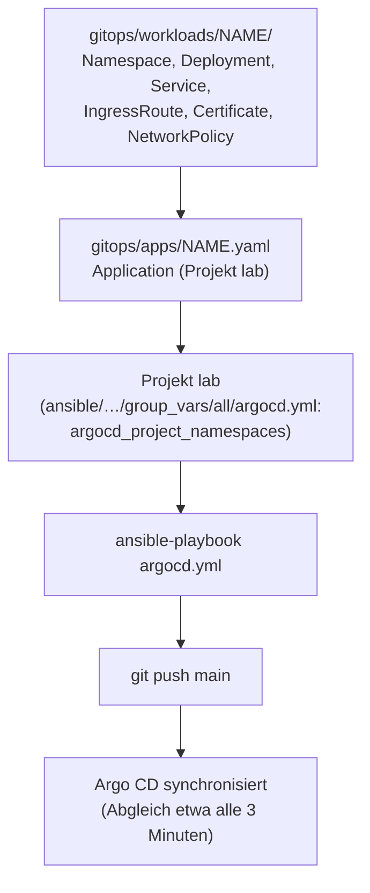

# Neue App hinzufügen

**Ziel:** einen eigenen Dienst per GitOps in den Cluster bringen, mit eigenem
Namespace, Pod-Security `restricted` und Zugriffsregel. Muster: `whoami`
(`gitops/workloads/whoami/`, `gitops/apps/whoami.yaml`).

## Schritte

1. **Manifeste** nach `gitops/workloads/<name>/`: Namespace mit
   Pod-Security-Labels (`enforce`, `audit`, `warn` je `restricted`), Deployment
   mit demselben Security-Context wie `whoami`, Service, bei Bedarf IngressRoute
   und Certificate.
2. **NetworkPolicy:** jeder Namespace hat Default-Deny für eingehenden Verkehr
   plus eine Freigabe für Traefik auf dem Container-Port (Muster:
   `workloads/whoami/networkpolicy.yaml`). Ausgehend sperren nur
   die Daten-Namespaces, `docs` und `notes-*` per Default-Deny für Egress
   ([Issue 5](https://github.com/tabee/k8s-lab-template/issues/5)); in einem neuen Namespace ist Egress offen, und wer eine neue App mit
   Ausgang braucht, legt die erlaubten Ziele selbst an
   ([Fehlersuche](troubleshooting.md#egress-gitea)).
3. **Application** `gitops/apps/<name>.yaml` nach dem Muster von
   `apps/whoami.yaml`. `repoURL`, `targetRevision` und `project` müssen zu
   `ansible/inventory/group_vars/all/argocd.yml` passen. Setze `retry`, wenn die
   App eine CRD aus einer anderen App braucht (`IngressRoute`, `Certificate`,
   CNPG): Es gibt bewusst keine Sync-Waves zwischen den Apps
   ([ADR-0003](../concepts/decisions/0003-retries-instead-of-sync-waves.md)).
4. **Namespace im Projekt `lab` erlauben:** in `argocd_project_namespaces`
   (`ansible/inventory/group_vars/all/argocd.yml`) eintragen und
   `ansible-playbook argocd.yml` laufen lassen. Projekte sind Vertrauensanker und
   kommen nicht aus `gitops/`.
5. **Geheimnisse:** nie als Klartext. Neue Secrets legt `lab.sh` aus der Karte an
   ([Geheimnisse](secrets.md)); je Namespace gibt es `secrets/<namespace>/` und
   eine Application `apps/secrets-<namespace>.yaml`.
6. Committen, pushen. Argo CD holt den Stand innerhalb von etwa 3 Minuten.

**App entfernen:** Datei aus `apps/` löschen und pushen. `prune` entfernt die
Application, der Finalizer räumt ihre Ressourcen weg.

!!! info "Nur Git ändert"
    Von Hand geänderte Objekte setzt Argo CD (Self-Heal) auf den Git-Stand
    zurück. `kubectl` dient nur zum Schauen.

Struktur und Sync-Verhalten: [Bootstrap und GitOps](../concepts/bootstrap-and-gitops.md),
[Layout von `gitops/`](../reference/gitops-layout.md).
