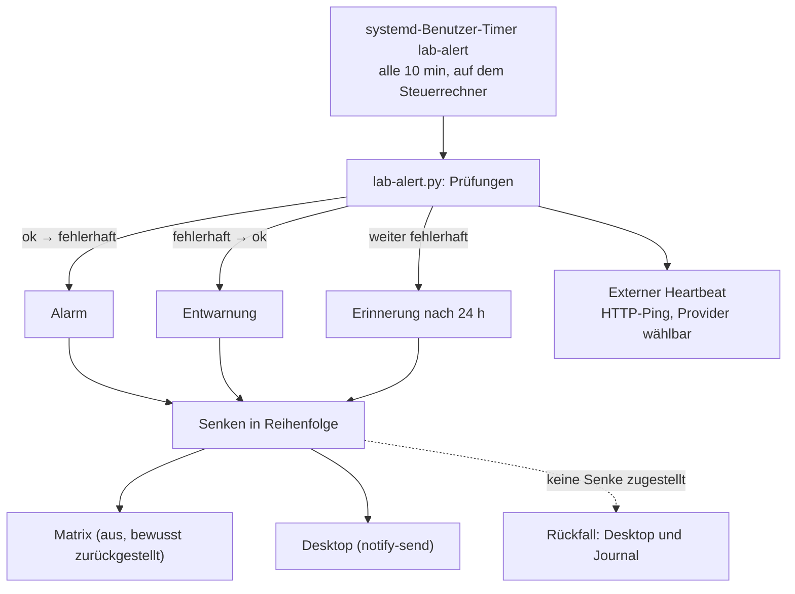

# Alarm bei Backup- oder Kantenausfall

**Ziel:** ein Ausfall der Sicherung oder der Kante ist **ausserhalb des Clusters** sichtbar, auch wenn die VM weg
ist. Umsetzung des Kerns von [Issue 8](https://github.com/tabee/k8s-lab-template/issues/8). Der rustfs-Ausfall vom 2026-10-28 blieb zwei Tage
still; der Watchdog heilt, der Alarm **meldet**. Beide bleiben getrennt.



## Prüfungen

| Name | Prüft | Rot, wenn |
|---|---|---|
| `rustfs` | HTTP `/health` der Adresse, unter der die VM rustfs erreicht | keine Antwort |
| `cnpg` | jüngstes **fertiges** Backup je Cluster (`gitea-db`, `pg-lab`, `matrix-db`, `keycloak-db`) | älter als 30 h oder keines |
| `k8up` | jüngster **erfolgreicher** K8up-Lauf je Namespace (`gitea`, `matrix`; Keycloak hat kein Volume) | älter als 30 h oder keiner |
| `replica` | Frische des Replikats ([Backup-Replikat](backup-replica.md)) | älter als `backup_replica_max_age_min` |
| `edge` | HTTPS-Anfrage an Traefik/whoami mit der Lab-CA | kein Treffer, Zertifikat falsch |

Eine Meldung enthält nur den Namen der Prüfung und einen kurzen Grund, nie ein Geheimnis.
Ein Alarm kommt **einmal** beim Wechsel auf rot, eine Entwarnung beim Wechsel auf grün, und alle
`backup_alert_repeat_hours` (24 h) eine Erinnerung, solange es rot bleibt. Die Werte stehen in
`ansible/inventory/group_vars/all/alert.yml` (die eine Stelle).

## Senken

Eine Senke ist eine Klasse in `scripts/lab-alert.py` (`matrix`, `desktop`, `journal`, `exec`, `file`). Eine neue Senke
ist eine neue Klasse. Zugestellt wird an **jede** eingeschaltete Senke; ist keine eingeschaltet oder scheitert eine,
greifen zusätzlich die Rückfall-Senken (`desktop`, `journal`). Das Journal schreibt die Unit immer.

### Externer Heartbeat (vor Go-live die Alarmkette)

**Was / Warum.** Desktop und Journal erreichen dich nur, wenn der Steuerrechner läuft und du
davor sitzt. Der Heartbeat meldet einem **externen** Dienst «ich lebe»: nach jedem
`lab-alert.py run` geht ein HTTP-GET an eine Ping-URL. Bleibt der Ping aus, alarmiert der
Dienst selbst (typisch per E-Mail). Das ist die Überwachung vor dem Go-live
([ADR 0028](../concepts/decisions/0028-external-heartbeat.md)).

**Eselsbrücke:** «Der Wecker steht draussen, nicht im eigenen Keller.»

!!! warning "Sicherungen nur bei laufendem Steuerrechner"
    Das Backup-Ziel (rustfs) steht auf dem Steuerrechner. Ist der aus, laufen keine Sicherungen,
    und der Heartbeat bleibt aus — der externe Dienst alarmiert. Das ist Absicht, kein Defekt.
    Ein dauerhafter Heim-Gegenpunkt nur für die Überwachung ist vor dem Go-live nicht vorgesehen.

Provider ist, was die URL beantwortet (healthchecks.io, Better Stack Heartbeat, Uptime Kuma Push, …).
Die URL steht **nie** im Git:

1. Beim Anbieter einen Check anlegen (Intervall z. B. 15–20 min, etwas über dem Timer von 10 min).
2. Datei mit `ping_url: https://…` und optional `fail_url: https://…/fail` schreiben, mit `sops`
   verschlüsseln nach `~/.config/k8s-lab/alert-heartbeat.sops.yaml`
   ([Geheimnis-Karte](../reference/secrets-map.md), Eintrag `alert-heartbeat-url`).
3. In `alert.yml` setzen: `backup_alert_heartbeat_enabled: true`.
4. `bash scripts/lab.sh alert install`, dann `bash scripts/lab.sh alert heartbeat`.

### Matrix (aus: bewusst zurückgestellt)

Ziel bleibt Matrix/Synapse: **ein** Bot-Benutzer, **ein** Raum. Vor dem Go-live bleibt die Senke
aus (`backup_alert_matrix_enabled: false`); der externe Heartbeat deckt die Meldekette ab.
Einschalten bewusst später ([Issue 41](https://github.com/tabee/k8s-lab-template/issues/41)):

1. Bot-Benutzer und Raum anlegen, den Bot einladen.
2. Zugriffstoken des Bots in eine Datei `token: …` schreiben und mit `sops` verschlüsseln nach
   `~/.config/k8s-lab/alert-matrix.sops.yaml` ([Geheimnis-Karte](../reference/secrets-map.md), Eintrag `alert-matrix-token`).
   Das Token steht nie im Repo und nie in einem Log; `lab-alert.py` entschlüsselt es erst beim Senden.
3. In `alert.yml` setzen: `backup_alert_matrix_enabled: true`, `backup_alert_matrix_homeserver`,
   `backup_alert_matrix_room_id`.
4. `bash scripts/lab.sh alert install`, dann `bash scripts/lab.sh alert test`.

## Einrichten und bedienen

```bash
bash scripts/lab.sh alert install     # config, script, user timer (linger is already set by the rustfs install)
bash scripts/lab.sh alert test        # a test message through every sink, shows what arrived
bash scripts/lab.sh alert run         # run the checks now and alert on changes; pings the heartbeat when enabled
bash scripts/lab.sh alert heartbeat   # ping the external heartbeat once (URL and SOPS file check)
bash scripts/lab.sh alert status      # which check fails since when
bash scripts/lab.sh alert verify      # verify-alerts.yml: timer active, checks green, fault injection alarms exactly once
```

`verify-alerts.yml` baut einen Fehler nach (eine Wegwerf-Kopie der Konfiguration zeigt eine Prüfung auf einen
geschlossenen Port; der echte Zustand bleibt unberührt) und prüft, dass genau **ein** Alarm und danach **eine** Entwarnung entsteht. Die Abnahme führt das als Phase 17 aus
und meldet `SKIP`, solange die Alarme nicht installiert sind.

!!! warning "Desktop-Benachrichtigung aus dem Timer"
    `notify-send` braucht die grafische Sitzung des Benutzers. Ob die Meldung aus der systemd-Benutzer-Unit
    erscheint, hängt von der Sitzung ab (`lab.sh alert test`; ein echter Lauf steht noch aus, [Issue 125](https://github.com/tabee/k8s-lab-template/issues/125)). Das Journal ist immer der sichere Rückfall:
    `journalctl --user -u lab-alert.service`.

## Wartungsmarker {#wartungsmarker}

Baut oder zerstört `lab.sh` die VM absichtlich (`up`, `rebuild`, `down`, `purge`), wäre jede Prüfung rot
(`kubectl failed ... no route to host 192.168.122.50:6443`). Das war der Fehlalarm beim ersten `rebuild --restore`
(Issue 21). Darum legt `lab.sh` zu Beginn eine kleine Datei an und löscht sie am Ende, auch nach einem Abbruch:

| Was | Wert |
|---|---|
| Datei | `backup_alert_maintenance_file` (Standard `~/.cache/k8s-lab/alert-maintenance.json`) |
| Inhalt | `pid` von `lab.sh`, `started` (Unix-Zeit), `command` |
| Solange sie gilt | `lab-alert.py run` meldet `MAINTENANCE: ...`, prüft nichts, alarmiert nicht und ändert den Zustand nicht |
| Sie gilt nicht mehr | wenn der Prozess nicht mehr lebt, wenn sie älter ist als `backup_alert_maintenance_max_hours` (3), wenn `started` in der Zukunft liegt oder die Datei unlesbar ist |

Der Marker kann einen echten Ausfall also höchstens bis zum Ende des Laufs oder 3 Stunden verdecken, nie dauerhaft.
`alert check`, `alert test` und `alert status` ignorieren den Marker (`status` zeigt ihn an). Mit `alert_enabled: false`
schreibt `lab.sh` keinen Marker.

Auf dem Steuerrechner einmal ausführen, damit die neue Konfiguration (mit dem Pfad) ankommt:

```bash
bash scripts/lab.sh alert install
bash scripts/lab.sh alert status   # zeigt «maintenance: ACTIVE ...» nur während eines Laufs
```

**Eselsbrücke:** «Baustelle mit Schild: das Schild hängt nur, solange der Bauarbeiter lebt.»

## Weitere Prüfungen

Certificates `Ready`, Plattenfüllstand, Argo-Apps `Synced` und `Healthy`, API und SSH der VM sowie «die Abnahme ist
rot, wenn `alert.env` fehlt» prüft der Alarm nicht ([Issue 8](https://github.com/tabee/k8s-lab-template/issues/8)). Eine weitere Prüfung braucht nur eine Funktion
in `lab-alert.py` und einen Eintrag in `alert.yml`.
