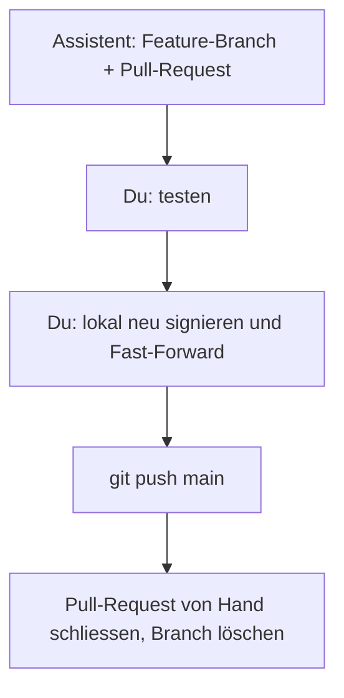

# Mein Alltag mit signierten Commits

Auf `main` kommen nur Commits, die mit dem Signierschlüssel `~/.ssh/k8s-lab-signing` signiert sind. Diese Seite
zeigt den täglichen Ablauf von der Änderung bis zum Stand auf `main`. Einrichtung und Hintergrund:
[SSH-Commit-Signatur](signed-commits.md), [Quellvertrauen](../concepts/source-trust.md).

!!! tip "Eselsbrücke: jede Seite unterschreiben, nicht nur den Umschlag"
    Gitea verlangt eine gültige Signatur auf **jedem** Commit, der auf `main` landet. Ein signierter Merge-Commit
    über unsignierten Commits ist ein unterschriebener Umschlag um ungeprüfte Seiten und wird abgewiesen.
    Darum werden die Commits eines Branches einzeln neu signiert und `main` per Fast-Forward vorgerückt.

## Der Ablauf



1. **Branch und Pull-Request.** Der Assistent (`grok`) pusht einen Feature-Branch und öffnet einen Pull-Request.
   Seine Commits sind nicht signiert; auf `main` darf er nicht pushen.
2. **Testen.** Branch auschecken und die Tests laufen lassen:

    ```bash
    git fetch origin && git switch <branch>
    sudo -v && bash scripts/ci-tests.sh
    ```

3. **Lokal signiert übernehmen.**

    ```bash
    ssh-add ~/.ssh/k8s-lab-signing
    git switch main && git pull --ff-only
    bash scripts/setup-signing.sh
    bash scripts/merge-signed.sh <branch> --push
    ```

    `setup-signing.sh` stellt sicher, dass dieser Klon mit dem richtigen Schlüssel signiert (zweimal ausführen ist
    unschädlich). `merge-signed.sh` spielt die Commits auf `origin/main` neu ab, signiert jeden einzeln, prüft sie
    wie die CI und rückt `main` nur per Fast-Forward vor.
4. **Aufräumen.** Den Pull-Request in Gitea von Hand schliessen und den Branch löschen. Durch das Neusignieren
   bekommen die Commits neue IDs; Gitea erkennt den manuellen Merge deshalb nicht immer selbst.

## Warum nicht die Schaltfläche «Mergen»

- Der Branch-Schutz erlaubt nur **Fast-Forward**. Ein Fast-Forward übernimmt die Commits des Branches unverändert,
  also unsigniert, und «Signierte Commits verlangen» weist sie ab.
- Ein Merge-Stil, der neue Commits erzeugt, ist ausgeschaltet; solche Commits wären von Gitea signiert oder gar
  nicht, also nicht von einem Schlüssel aus `.gitea/allowed_signers`.
- Nur du hast den Signierschlüssel. Darum geschieht der Merge auf deinem Rechner.

## Wenn es hakt

| Symptom | Was tun |
|---|---|
| `incorrect passphrase supplied` oder Git fragt bei jedem Commit nach der Passphrase | Schlüssel nicht im Agent: `ssh-add ~/.ssh/k8s-lab-signing` |
| `merge-signed.sh` meldet eine fehlgeschlagene Signaturprüfung | `bash scripts/setup-signing.sh` erneut ausführen; prüfen, dass `user.signingkey` auf `~/.ssh/k8s-lab-signing.pub` zeigt und der Schlüssel in `.gitea/allowed_signers` steht |
| Konflikt beim Neuabspielen | den Branch zuerst auf den aktuellen `main` nachziehen lassen, dann erneut |
| Gitea weist den Push auf `main` ab | der öffentliche Schlüssel fehlt im Gitea-Konto oder die Commit-E-Mail gehört nicht zum Konto |
| pre-receive: `Internal Server Error (no message for end users)` | im Gitea-Log nach `Unverified commit` suchen (`grep -E 'verifyCommits\|Unverified'`); Signaturschlüssel im Konto hinzufügen und verifizieren, Committer-E-Mail aktivieren, siehe [Voraussetzungen in Gitea](signed-commits.md#voraussetzungen-gitea) |
| Push abgewiesen, weil eine geschützte Datei geändert wurde (`.gitea/workflows/*`, `.gitea/allowed_signers`) | das Muster im Branch-Schutz vorübergehend entfernen, pushen, danach sofort wieder eintragen |
| `lab.sh up`, `rebuild` oder `preflight` bricht mit `Source trust FAILED` ab | `bash scripts/lab.sh trust check` zeigt den Grund; Commits im privaten Gitea mit `git log --show-signature` prüfen |
| Argo CD bleibt nach einem Lauf auf einer Commit-ID gepinnt | neue Commits prüfen, dann `bash scripts/lab.sh trust release` |
| du kennst den abgewiesenen Commit sicher selbst | `--trust-override` beim Befehl; er verlangt die ersten 7 Zeichen der Commit-ID als getippte Bestätigung |
