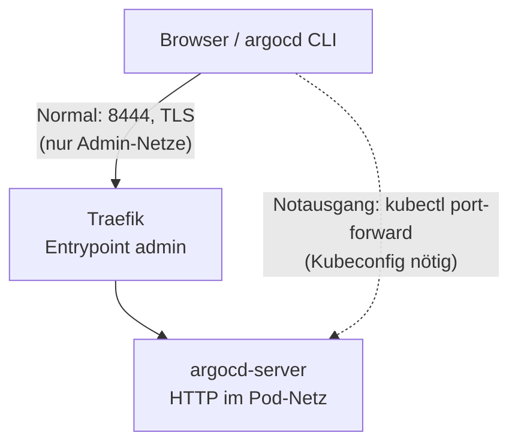

# Argo CD bedienen: Zugang und Notausgang

**Ziel:** die Oberfläche und die CLI von Argo CD erreichen, das Initial-Passwort
holen und, wenn Traefik oder DNS nicht gehen, den Notausgang nehmen. Argo CD ist
die Steuerung des Clusters ([Bootstrap und GitOps](../concepts/bootstrap-and-gitops.md)):
Änderungen laufen über Git, `kubectl` dient nur zum Schauen.

## CLI installieren (optional) {#argocd-cli}

!!! info "Die CLI ist optional"
    Für den Alltag genügt die Oberfläche (`https://argocd.<domain>:8444`). Die `argocd`-CLI brauchst du
    nur für die Befehle weiter unten (`argocd login`, `argocd app list`). Meldet die Shell
    `argocd: command not found`, ist sie nicht installiert: Sie kommt weder mit dem Cluster noch aus apt.

Die CLI soll zur Version des Servers passen. Die Zahl steht an einer Stelle, nämlich im Chart
([Versionen](../reference/versions.md), Zeile Argo CD). Tippe sie nicht ab, sondern lies sie aus dem
laufenden Server (Tag des Images von `argocd-server`) und lade genau diese Version:

```bash
# version of the running server, e.g. v3.5.6 (tag of the argocd-server image)
ARGOCD_VERSION=$(kubectl -n argocd get deploy argocd-server \
  -o jsonpath='{.spec.template.spec.containers[0].image}' | sed -E 's/@.*//; s/.*://')
BASE_URL=https://github.com/argoproj/argo-cd/releases/download/$ARGOCD_VERSION
curl -fsSL -o /tmp/argocd "$BASE_URL/argocd-linux-amd64"
# checksum of the release (the file lists all platforms; check only ours)
curl -fsSL "$BASE_URL/cli_checksums.txt" | grep ' argocd-linux-amd64$' \
  | sed 's#argocd-linux-amd64#/tmp/argocd#' | sha256sum -c -
install -m 755 /tmp/argocd ~/.local/bin/argocd
argocd version --client
```

`~/.local/bin` liegt im `PATH`, wenn der Ordner schon beim Anmelden existierte; sonst einmal neu anmelden
oder `export PATH="$HOME/.local/bin:$PATH"`. `argocd version --client` zeigt die installierte Version
und muss dieselbe Zahl nennen wie `$ARGOCD_VERSION`.

!!! warning "Prüfsumme prüft nur den Download"
    Die Prüfsumme kommt von derselben Release-Seite wie die Datei. Sie fängt einen kaputten oder
    abgebrochenen Download ab, nicht ein manipuliertes Release. Bewusst so gelassen: Das Lab
    installiert nur ein Werkzeug auf deinem Rechner, das ohnehin nur mit deinem Cluster spricht.
    Wer mehr will, prüft die Signatur des Releases (cosign) selbst.

## Normalweg

```bash
# browser (admin entrypoint, port 8444, only from the admin networks)
xdg-open https://argocd.<domain>:8444
# CLI (the password is prompted, never on the command line)
argocd login argocd.<domain>:8444 --grpc-web --username admin
argocd app list
```

Die CLI vertraut der Lab-CA über den System-Speicher
(`ansible/scripts/lab-ca-trust.sh add ...`, siehe
[Lab-CA vertrauen](trust-lab-ca.md)). Ohne den:
`SSL_CERT_FILE=~/.config/k8s-lab/lab-ca.crt argocd login ...`.

**Admin-Passwort** (nach jedem Neuaufbau neu): einmal aus dem Secret holen, nie in
das Terminal-Log:

```bash
kubectl -n argocd get secret argocd-initial-admin-secret \
  -o jsonpath='{.data.password}' | base64 -d | wl-copy   # or xclip
```

Danach in der Oberfläche ändern und `argocd-initial-admin-secret` löschen.

## Notausgang: Port-Forward {#notausgang}

Wenn Traefik, cert-manager oder DNS/hosts nicht gehen:

```bash
export KUBECONFIG=~/.kube/k3s-lab.kubeconfig
kubectl -n argocd port-forward svc/argocd-server 8080:80
# browser: http://localhost:8080
```

CLI im Notfall (baut ihren eigenen Tunnel, ohne den kubectl-Befehl oben):

```bash
argocd login --port-forward --port-forward-namespace argocd --plaintext --username admin
argocd app list --port-forward --port-forward-namespace argocd --plaintext
```

`argocd login localhost:8080 --plaintext` über den kubectl-Tunnel geht **nicht**:
Der Server setzt die gRPC-Verbindung zurück, und `kubectl port-forward` bricht
ab. Für den Browser ist der kubectl-Tunnel gut. HTTP ist hier in Ordnung: Der
Tunnel läuft verschlüsselt über die Kubernetes-API und ist nur auf `127.0.0.1`
offen. Die NetworkPolicy blockiert ihn nicht (`kubectl` geht über das Kubelet
direkt in den Pod).



## Risiken, die du kennen solltest

- **Die Oberfläche ist fast Cluster-Admin.** Wer als `admin` drin ist, kann über
  Argo CD alles anlegen, was die Projekte erlauben (Projekt `platform`: cluster-weite
  Objekte), Secrets in Manifesten sehen und Apps löschen. Darum nur aus den
  Admin-Netzen erreichbar ([Netz-Kante](../concepts/network-edge.md)), nie ins
  Internet freigeben.
- **Admin-Login mit Passwort**, keine 2FA, bis Argo CD an Keycloak (OIDC)
  hängt ([Issue 32](https://github.com/tabee/k8s-lab-template/issues/32)). Argo CD hat eine eingebaute Bremse gegen Passwort-Raten.
- **Intern HTTP:** Zwischen Traefik und `argocd-server` läuft Klartext im
  Pod-Netz (gleicher Knoten). Die NetworkPolicy `argocd-server-allow-traefik`
  lässt nur Traefik zu. Wer einen Pod im Namespace `argocd` oder `traefik`
  kontrolliert, sieht den Verkehr.
- **Port-Forward umgeht Traefik und Firewall.** Wer die Kubeconfig hat, braucht
  die Oberfläche ohnehin nicht (er ist schon Cluster-Admin).
- Die Grenze von Argo CD zum Cluster ist weit offen
  ([Issue 6](https://github.com/tabee/k8s-lab-template/issues/6), [Sicherheitsmodell](../concepts/security-model.md)).

Hintergrund der TLS-Terminierung und der Messwerte (35 s / 66 s):
[Stufe 6c](../learning-path/stage-6c-argocd-ingress.md).
