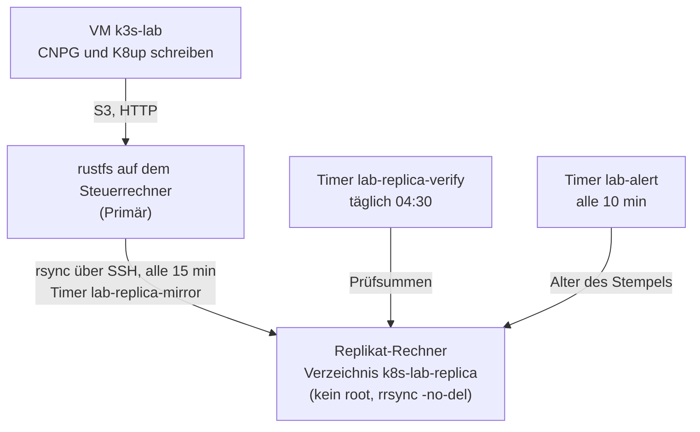

# Backup-Replikat auf einem zweiten Rechner

**Ziel:** die Backups ([Primärziel rustfs](../concepts/backup-and-restore.md)) liegen zusätzlich auf einem
**anderen Rechner** im Heimnetz. Fällt der Datenträger des Steuerrechners aus, sind VM-Platte **und** Backups nicht
beide weg. Umsetzung von [Issue 3](https://github.com/tabee/k8s-lab-template/issues/3); Begründung der Technik:
[ADR-0013](../concepts/decisions/0013-replica-rsync-rrsync.md).

!!! warning "Vertrauensgrenze: das Replikat schützt nicht vor einem übernommenen Steuerrechner"
    Der Spiegel läuft **auf dem Steuerrechner** und hält dort einen SSH-Schlüssel (`~/.ssh/k8s-lab-replica`). Wer den
    Steuerrechner übernimmt, kann mit diesem Schlüssel das tun, was der Schlüssel darf, und nichts darüber hinaus:

    - Der Schlüssel ist per `restrict`, `from=` und `rrsync` auf **ein Verzeichnis** des Replikats und auf das
      Heimnetz beschränkt: keine Shell, kein Port-Forwarding, kein Zugriff auf andere Dateien.
    - Standardmässig steht `backup_replica_allow_delete: false`: `rrsync -no-del` verbietet dem Schlüssel das Löschen.
      Ein Erpresser-Programm auf dem PC kann das Replikat **füllen**, aber nicht leeren. Er kann Dateien
      **überschreiben**; die tägliche Prüfsummen-Prüfung merkt das an der Abweichung von der Quelle nur, solange die
      Quelle selbst noch stimmt. Gegen eine Manipulation **vor** dem Spiegeln hilft das Replikat nicht.
    - Das Replikat ist **nicht verschlüsselt** über das hinaus, was die Daten schon sind (Barman-Daten liegen im Klartext im
      Bucket, [R4](../concepts/security-model.md)). Wer den Replikat-Rechner hat, hat die Backups.
    - Ein zweiter Rechner im selben Heimnetz schützt nicht vor Feuer, Einbruch oder Wasser im selben Haus.

    Mit `allow_delete: false` wächst das Replikat mit jedem Barman-/K8up-Aufräumen weiter; den Platz prüfst du
    selbst (`lab.sh replica status`, Preflight beim Installieren).

## Was läuft wo



| Teil | Wo | Wert |
|---|---|---|
| Host, Benutzer, Verzeichnis, Intervalle | `ansible/inventory/group_vars/all/backup_replica.yml` | **die eine** Stelle |
| Spiegel-Skript | `scripts/lab-replica.py` | Unterbefehle `preflight`, `authline`, `mirror`, `verify`, `status`, `restore`, `hostkey` |
| Rolle und Playbook | `ansible/roles/backup_replica/`, `ansible/backup-replica.yml` | Konfiguration, Installation, Timer |
| Schlüssel | `~/.ssh/k8s-lab-replica` (nur dafür) | [Geheimnis-Karte](../reference/secrets-map.md) |

## Einrichten

In der öffentlichen Fassung ist das Replikat **ausgeschaltet** (`backup_replica_enabled: false`): `lab.sh replica`
sagt das und tut nichts, die Alarmprüfung `replica` wird übersprungen. Trage zuerst Host, Benutzer und Netz ein
(Schritt 1) und setze den Wert dann auf `true`.

Voraussetzung: der Replikat-Rechner ist per `ssh` erreichbar, `rsync` ist installiert (Ubuntu 24.04: Paket `rsync`,
darin liegt `/usr/bin/rrsync`) und hat Platz für die Daten des Primärziels.

1. In `backup_replica.yml` Host, Benutzer und `from_cidr` prüfen (Standard: `replica-pc.home`, `replica-user`,
   `192.0.2.0/24`).
2. Konfiguration schreiben und den Host-Schlüssel des Replikats holen:

    ```bash
    bash scripts/lab.sh replica config
    bash scripts/lab.sh replica hostkey
    ```

    `hostkey` zeigt Schlüsselzeile und Fingerabdruck (öffentliche Daten). **Vergleiche den Fingerabdruck am Replikat**
    (`ssh-keygen -lf /etc/ssh/ssh_host_ed25519_key.pub`) und trage die Zeile in `backup_replica_host_key` ein. Ohne
    gepinnten Schlüssel bricht jeder SSH-Aufruf ab; es gibt kein `StrictHostKeyChecking=no`.
3. Installieren:

    ```bash
    bash scripts/lab.sh replica install
    ```

    Das Playbook macht der Reihe nach: Preflight (SSH erreichbar mit `BatchMode`, Platz, Pakete, mit klaren Meldungen),
    Schlüsselpaar erzeugen (nur wenn es fehlt), die `authorized_keys`-Zeile eintragen, Timer anlegen und starten.
    Dein **persönlicher** Schlüssel (`backup_replica_install_key`) wird **nur in diesem Schritt** benutzt und
    danach nirgends mehr. Auf dem Replikat läuft alles ohne root.
4. Kontrolle:

    ```bash
    bash scripts/lab.sh replica mirror     # sofort einmal spiegeln
    bash scripts/lab.sh replica verify     # Alter und Prüfsummen
    bash scripts/lab.sh replica status
    ```

Der Eintrag in `authorized_keys` sieht so aus (die Zeile druckt `lab.sh replica authline`):

```text
restrict,from="192.0.2.0/24",command="/usr/bin/rrsync -no-del k8s-lab-replica" ssh-ed25519 AAAA… k8s-lab-replica
```

## Frisch und gleich: was geprüft wird

| Prüfung | Wann | Rot, wenn |
|---|---|---|
| Frische (`status`) | im Alarm alle 10 min, in der Abnahme | der letzte erfolgreiche Lauf älter ist als `backup_replica_max_age_min` (180 min; der Replikat-Rechner darf schlafen) |
| Prüfsummen (`verify`) | täglich 04:30, in der Abnahme (Phase 16) | eine Datei, die älter als der Start des letzten Spiegels ist, auf dem Replikat fehlt oder anders ist |

Die Abnahme meldet `SKIP` (kein Nachweis), solange das Replikat nicht installiert oder abgeschaltet
(`backup_replica_enabled: false`) ist.

## Aus dem Replikat zurückholen

Fällt der Steuerrechner (oder nur sein Datenträger) aus, ist das Replikat die Quelle:

```bash
# on the new PC (key and config in place, or the personal key):
bash scripts/lab.sh replica restore ~/rustfs-aus-replikat
```

Der Befehl zieht die Kopie in ein **neues oder leeres** Verzeichnis (nie in das laufende Datenverzeichnis, er
verweigert das) und vergleicht danach per Prüfsumme. Dieses Verzeichnis dient als Datenverzeichnis eines
(Wegwerf-)rustfs; mit dem [Restore-Test](restore-drill.md) beweist du, dass sich Gitea daraus herstellen lässt.

!!! note "Nur live prüfbar"
    Dass rustfs das gespiegelte Datenverzeichnis (inklusive `.rustfs.sys` mit Benutzern und Richtlinien) wirklich wieder
    ausliefert, beweist erst der Lauf mit dem echten rustfs. Die Tests der Sandbox prüfen den Spiegel mit
    Attrappen. Ein echter Lauf steht noch aus ([Issue 125](https://github.com/tabee/k8s-lab-template/issues/125), [Restore-Test](restore-drill.md#replikat)).

## Schlüssel drehen

Schlüsselpaar `~/.ssh/k8s-lab-replica` löschen, `lab.sh replica install` (neues Paar, die Zeile in
`authorized_keys` wird ersetzt), dann `lab.sh replica verify`. Der persönliche Schlüssel wird dafür wieder einmal
benutzt. Die Karte steht in der [Geheimnis-Karte](../reference/secrets-map.md).

## Rückbau

```bash
systemctl --user disable --now lab-replica-mirror.timer lab-replica-verify.timer
# on the replica: remove the line "k8s-lab-replica" from ~/.ssh/authorized_keys and the directory k8s-lab-replica
```

Danach `backup_replica_enabled: false`.
