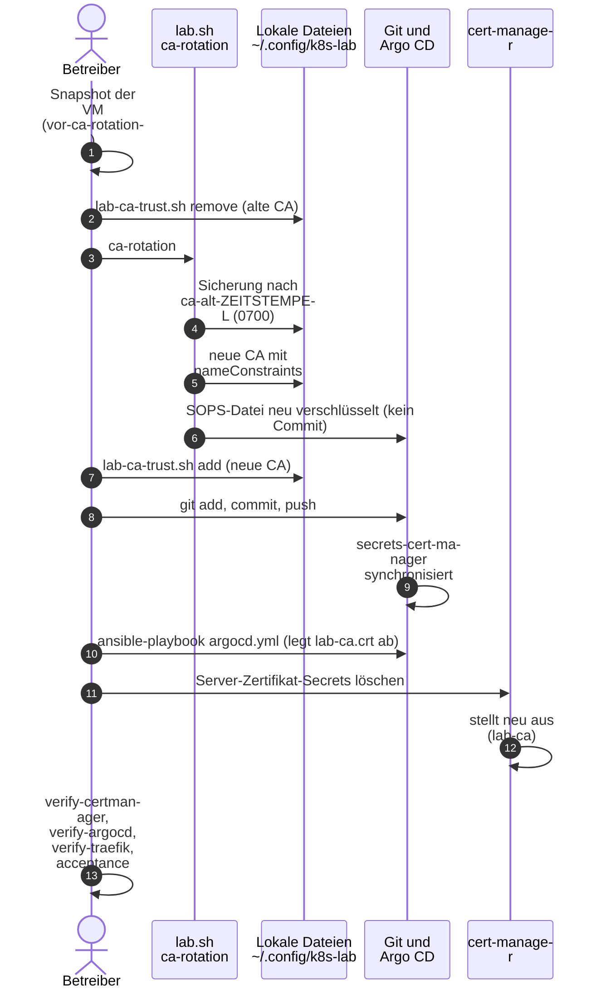

# Lab-CA rotieren

**Ziel:** eine bestehende Lab-CA ohne Namenseinschränkung durch eine CA mit
kritischen `nameConstraints` ersetzen, oder die CA aus einem anderen Grund
wechseln.

**Wann:** Neu aufgebaute Labs (`lab.sh init` ohne alte CA) bekommen die
Einschränkung von selbst. Eine **bestehende** CA ersetzt `lab.sh ca-rotation`.
Das ist ein bewusster, getrennter Schritt, kein Teil von `up` oder `acceptance`.

!!! danger "Auswirkung"
    Danach sind alle Zertifikate der alten CA ungültig, bis Argo CD die neue CA
    hat und alle Server-Zertifikate neu ausgestellt sind (etwa 1 bis 3
    Minuten). Alle Geräte, die der alten CA vertrauen, müssen die neue
    übernehmen ([CA vertrauen](trust-lab-ca.md)).

## Ablauf



```bash
# preview only
bash scripts/lab.sh ca-rotation --dry-run
```

Der Befehl ist idempotent: Hat die CA schon kritische `nameConstraints`,
meldet er `SKIP` und ändert nichts. Sonst fragt er `[j/N]`, sichert die alte CA
in `~/.config/k8s-lab/ca-alt-<Zeitstempel>/` (Modus 700; Host-Secret,
`lab-ca.crt`, alte SOPS-Datei), schreibt die neue CA, verschlüsselt
`secrets/cert-manager/lab-ca.sops.yaml` neu und bricht bei einem
Fehler vollständig zurück. Er macht **nie** einen Commit oder Push.

!!! info "Hilfsskript des Autors"
    Beim ersten Durchlauf führte ein Einmal-Skript des Autors
    (`welle1-ca-rotation.sh`) die Schritte in dieser Reihenfolge aus, jeden mit
    `[j/N]`. Es ist **nicht** Teil des Repos. Die Schritte unten sind die
    Vorlage.

## Schritte von Hand

1. Snapshot der VM:

    ```bash
    virsh -c qemu:///system snapshot-create-as k3s-lab vor-ca-rotation --atomic
    ```

2. Alte CA aus den Vertrauensspeichern nehmen, **solange `lab-ca.crt` noch
   die alte ist**. (Der NSS-Befehl `add` meldet „schon vorhanden“, wenn der
   Spitzname `lab-ca` existiert; darum erst `remove`, dann `add`.)

    ```bash
    ansible/scripts/lab-ca-trust.sh remove ~/.config/k8s-lab/lab-ca.crt
    ```

3. `bash scripts/lab.sh ca-rotation` (Fragen mit `j` beantworten).
4. Neue CA eintragen:

    ```bash
    ansible/scripts/lab-ca-trust.sh add ~/.config/k8s-lab/lab-ca.crt
    ```

5. Die verschlüsselte Datei committen und pushen:

    ```bash
    git add secrets/cert-manager/lab-ca.sops.yaml
    git commit -m "Lab-CA mit nameConstraints rotieren"
    git push origin main
    ```

6. Warten, bis `secrets-cert-manager` `Synced` ist, dann die neue öffentliche
   Datei ablegen (die Rolle wartet auf das neue Secret):

    ```bash
    cd ansible && ansible-playbook argocd.yml
    ```

7. Server-Zertifikate der `lab-ca`-Certificates neu ausstellen lassen. Die
   Secrets heissen wie `secretName` des Certificates
   (`kubectl get certificate -A` listet sie):

    ```bash
    kubectl delete secret -n whoami whoami-tls
    kubectl delete secret -n traefik traefik-default-tls
    # same for argocd, gitea, docs and the notes sites
    ```

8. Prüfen:

    ```bash
    ansible-playbook verify-certmanager.yml verify-argocd.yml verify-traefik.yml
    bash scripts/lab.sh acceptance
    ```

9. Erst wenn alles grün ist: `~/.config/k8s-lab/ca-alt-*` löschen
   (`shred -u` je Datei, dann den Ordner).

## Prüfen, dass es gewirkt hat

- Die neue CA ist für `argocd` und `git` vertraut (`curl` mit System-Store,
  ohne `--cacert`).
- Ein Name ausserhalb der Zone wird nicht ausgestellt (Wegwerf-Certificate in
  `verify-certmanager.yml`).
- `openssl x509 -in ~/.config/k8s-lab/lab-ca.crt -noout -text` zeigt
  `Name Constraints: critical`.

## Rückweg

Snapshot zurückspielen, oder die Dateien aus `ca-alt-<Zeitstempel>` an ihre
Orte kopieren (Host-Secret, `lab-ca.crt`, alte SOPS-Datei),
`lab-ca-trust.sh add` ausführen und pushen.
