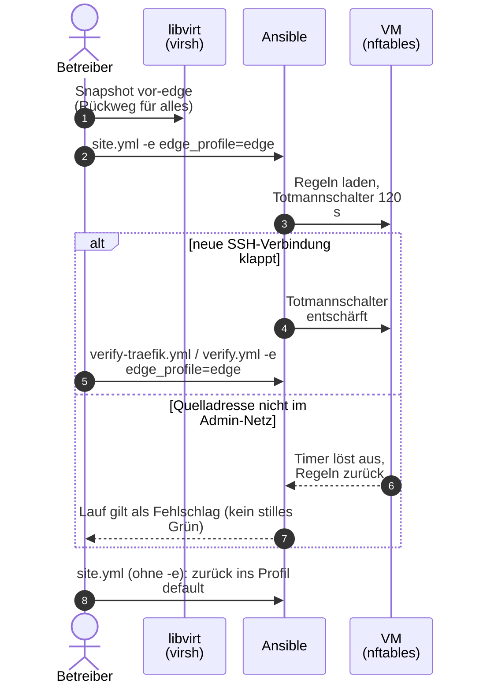

# Netz-Kante einstellen und das Profil `edge` ausprobieren

**Ziel:** festlegen, wer SSH, API, Admin-Oberfläche und Apps erreicht, und das
Profil `edge` auf der VM prüfen, ohne den Zugang zu verlieren. Das Warum steht
in [Netz-Kante](../concepts/network-edge.md); hier stehen die Handgriffe
([Issue 1](https://github.com/tabee/k8s-lab-template/issues/1), [Issue 2](https://github.com/tabee/k8s-lab-template/issues/2)).

## Die Regeln auf einen Blick {#was-die-kante-tut}

| Verkehr | Regel |
|---|---|
| 22 (SSH), 6443 (API) von aussen | nur Admin-Netze (Chain `input`) |
| Pods an die API (6443) und kubelet (10250) | `input`, nur Interface `cni0`/`flannel.1` und Pod-/Service-Netz |
| 80/443 von aussen (Traefik) | Chain `ingress_check`: Ingress- und Admin-Netze, sonst `drop` |
| Admin-Oberfläche (Port 8444: Argo CD, whoami) | Chain `admin_check`: nur Admin-Netze |
| NodePorts 30000–32767, hostPorts, UDP/SCTP-DNAT von aussen | Chain `admin_check`: nur Admin-Netze |
| Pod zu Pod, Pod nach aussen, Antworten, Dienste im Cluster | unberührt (`policy accept`) |

Der Schalter `firewall_dnat_admin_only` (Standard `true`,
`ansible/inventory/group_vars/k3s/main.yml`) nimmt die `admin_check`-Regeln
heraus, falls ein Dienst absichtlich von aussen am NodePort erreichbar sein soll.
Es gibt kein `flush ruleset`. Zusätzlich bleiben `allocateLoadBalancerNodePorts:
false` und `externalTrafficPolicy: Cluster` am Traefik-Service
(`gitops/platform/traefik/values.yaml`), damit es für Traefik gar keine
NodePorts gibt.

## Die Werte {#die-werte}

In `infra/envs/local/lab.yaml`, eigene Werte in `lab.local.yaml`:

| Schlüssel | Bedeutung | Standard |
|---|---|---|
| `edge_profile` | `default` oder `edge` | `default` |
| `edge_admin_cidrs` | Admin-Netze im Profil `default` (SSH, API, Admin-Oberfläche, NodePorts) | `vm_cidr` |
| `edge_ingress_cidrs` | Netze, die Apps über Traefik (80/443) erreichen; auch `loadBalancerSourceRanges` | `vm_cidr` |
| `edge_profile_admin` | das einzige Admin-Netz im Profil `edge` | `gateway` |

Listen sind Komma-Text. Die Wörter `vm_cidr`, `gateway` und `vm_ip` stehen für
die Werte der Datei; eine einzelne Adresse wird `/32` (IPv6 `/128`).

Die Netze für die Firewall liest Ansible direkt. Die Liste für
`loadBalancerSourceRanges` steht in `gitops/platform/traefik/values.yaml`
zwischen den Marken `lab-customize:edge-ingress-cidrs`: GitOps kennt keine
Ansible-Variablen, darum schreibt `bash scripts/lab.sh customize` sie dort hinein
(`gitops/values-state.yaml` merkt sich den Stand). `verify-traefik.yml` vergleicht
`lab.yaml`, Git und den lebenden Service und meldet Abweichungen.

**Ingress-Netze ändern:**

```bash
$EDITOR infra/envs/local/lab.local.yaml    # edge_ingress_cidrs
bash scripts/lab.sh customize
git add gitops && git commit && git push   # Argo CD syncs from Git only
```

!!! warning "Der Steuerrechner muss im Ingress-Netz liegen"
    `loadBalancerSourceRanges` hängt am ganzen Traefik-Service, also auch am
    Admin-Port 8444. Der Steuerrechner (und im Profil `edge` das Admin-Netz)
    muss deshalb in `edge_ingress_cidrs` liegen.

## Warum die Oberfläche auf Port 8444 liegt {#port-8444}

Traefik sieht hinter `externalTrafficPolicy: Cluster` nicht die Client-IP, nur
eine Knoten-Adresse. Auf Port 443 kann es darum nicht zwischen „Gitea für das
Ingress-Netz“ und „Argo CD nur für Admin“ unterscheiden. Argo CD und whoami haben
deshalb einen eigenen Entrypoint `admin` (Port 8444, gleiche TLS-Optionen, gleiche
Sicherheits-Header), und die Firewall prüft diesen Port am Absender. Adresse:
`https://argocd.<domain>:8444`. Im Profil `default` ist der Port im LAN
(`vm_cidr`) erreichbar; es ändert sich dort nur die URL.

**Rückweg auf Port 443:** in `gitops/workloads/argocd/ingressroute.yaml` und
`gitops/workloads/whoami/ingressroute.yaml` `entryPoints: [websecure]` setzen
(dann ist die Oberfläche wieder für das ganze Ingress-Netz offen).

## Profil `edge` ausprobieren und zurück {#profil-edge-ausprobieren}

Das Profil schaltet nur das Admin-Netz um (SSH, API, Admin-Oberfläche und
NodePorts nur aus `edge_profile_admin`), ohne eine Datei anzufassen.



```bash
cd ansible
# 1) snapshot (the way back for everything)
virsh snapshot-create-as k3s-lab vor-edge --atomic
# 2) the control PC must own the address edge_profile_admin, otherwise the role
#    aborts. Default is the gateway; check the SSH source address to the VM with:
#    ip -4 route get 192.168.122.50
ansible-playbook site.yml -e edge_profile=edge
ansible-playbook verify-traefik.yml -e edge_profile=edge
ansible-playbook verify.yml -e edge_profile=edge
# 3) back: the same runs without -e
ansible-playbook site.yml
```

Kann ein Edge-Lauf keine **neue** SSH-Verbindung aufbauen, löst der
Totmannschalter nach `firewall_rollback_seconds` (120) aus, die Tabelle
verschwindet und der Lauf **gilt als Fehlschlag**. Ein zweiter Lauf im Profil
`default` zeigt `changed=0`.

!!! note "Ein Snapshot blockiert `tofu destroy`"
    Vor `down` oder `rebuild` den Snapshot löschen
    (`virsh snapshot-delete k3s-lab vor-edge --metadata`). `lab.sh down` macht
    das selbst, siehe [Fehlersuche](troubleshooting.md#aufbau).

## Abnahme der Kante {#abnahme-der-kante}

- `verify-traefik.yml` und `verify.yml` sind grün im Profil `default`.
- Im Edge-Lauf klappen vom Admin-Netz aus SSH, die API und
  `https://argocd.<domain>:8444`.
- Von einer **zweiten** Adresse in `vm_cidr` (nicht die Admin-Adresse) scheitern
  22 und 6443, und HTTPS einer freigegebenen App (Doku, Notizen oder Gitea auf
  443) klappt. Dafür hat der Autor ein Hilfsskript benutzt (`welle1-vm.sh`: eine
  Zusatzadresse auf `virbr0` und ein `python3`-Socket); es liegt **nicht** im Repo.
- `verify.yml --tags nodeport` legt einen Wegwerf-NodePort an, prüft von einer
  Nicht-Admin-Adresse, dass er zu ist (vom Admin-Netz offen), und räumt auf. Der
  negative Befund zählt nur zusammen mit den Gegenproben im selben Test
  (Admin-Quelle offen, Pod-zu-Pod ok).
- whoami hat eine NetworkPolicy (`gitops/workloads/whoami`): nur Traefik darf an
  Port 8080. Von aussen ist whoami nur über den Admin-Port erreichbar.

Hintergründe und Grenzen: [Netz-Kante](../concepts/network-edge.md),
[ADR-0005](../concepts/decisions/0005-nftables-forward-check.md),
[ADR-0006](../concepts/decisions/0006-traefik-traffic-policy-cluster.md).
