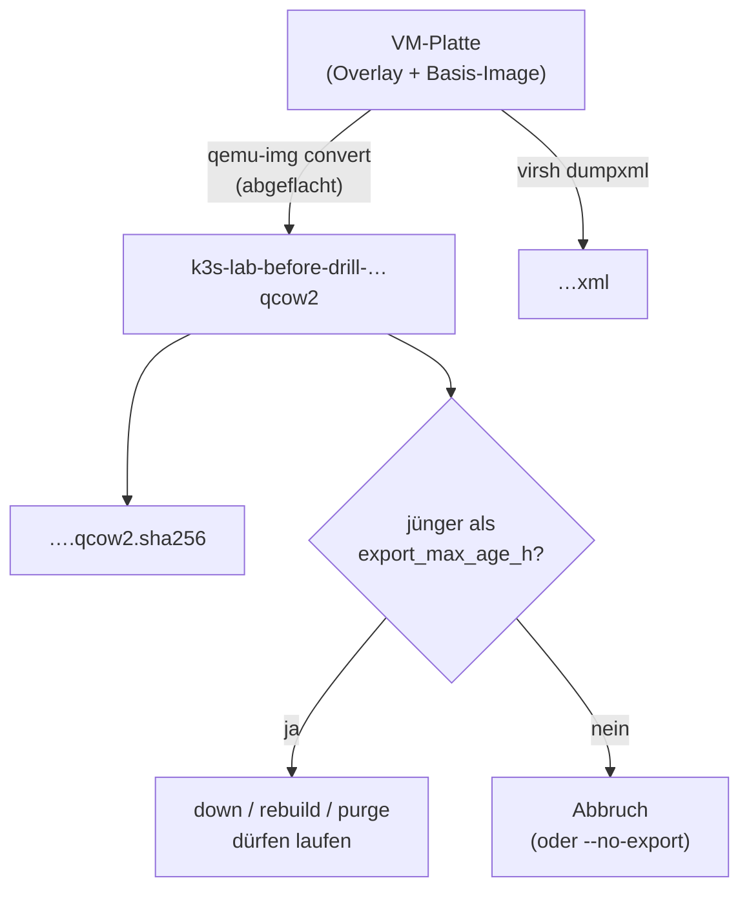

# VM exportieren und zurückspielen (Fallschirm)

**Ziel:** vor jedem Abriss eine Kopie der VM-Platte haben, die **ausserhalb**
der VM liegt, und im Notfall zurückspielen können.

```bash
bash scripts/lab.sh export          # shuts the VM down cleanly, copies, restarts
bash scripts/lab.sh export --live   # reads without shutting down (crash-consistent only)
```

Vor dem Herunterfahren wartet `export`, bis das End-WAL jedes
abgeschlossenen CNPG-Backups im Archiv liegt. Sonst bleibt die VM laufen.
Dieselbe Prüfung macht `down`
([ADR-0017](../concepts/decisions/0017-wal-before-vm-stop.md)).

`export` kopiert die Platte mit `qemu-img convert` nach
`~/k8s-lab-data/vm-export/k3s-lab-before-drill-<datum>-<zeit>.qcow2` (das flacht
die Kette aus Basis-Image und Overlay zu **einer** Datei ab), legt die
Domain-XML und eine SHA-256-Datei daneben und startet die VM wieder.

**Warum ein Export und kein libvirt-Snapshot:** Interne Snapshots hängen an der
VM und sterben mit ihr. Ausserdem blockieren sie `tofu destroy`; `down` entfernt
sie deshalb vorher. Der Export liegt ausserhalb.

**Export-Wache:** `down`, `rebuild` und `purge` brechen ab, wenn es keinen
vollständigen Export gibt, der jünger als 24 Stunden ist (`export_max_age_h` in
`lab.yaml`). Ausnahme: `--no-export`, dann sind die VM-Daten weg.



## Zurückspielen

VM ist weg, Export da. `DATUM-ZEIT` aus dem Dateinamen einsetzen:

```bash
cd ~/k8s-lab-data/vm-export
E=k3s-lab-before-drill-DATUM-ZEIT
sha256sum -c "$E.qcow2.sha256"
virsh -c qemu:///system pool-dumpxml default | grep '<path>'
# use the path from the last line as POOL, for example /var/lib/libvirt/images
POOL=/var/lib/libvirt/images
sudo cp "$E.qcow2" "$POOL/k3s-lab-restore.qcow2"
sudo chown libvirt-qemu:kvm "$POOL/k3s-lab-restore.qcow2"
sed -e "s#<source file='[^']*k3s-lab[.]qcow2'/>#<source file='$POOL/k3s-lab-restore.qcow2'/>#" \
    -e '/<backingStore/,/<\/backingStore>/d' \
    -e "/<disk type='file' device='cdrom'>/,/<\/disk>/d" \
    "$E.xml" > /tmp/k3s-lab-restore.xml
virsh -c qemu:///system define /tmp/k3s-lab-restore.xml
virsh -c qemu:///system start k3s-lab
```

Besitzer und Gruppe der Platte heissen je nach Distribution anders (Ubuntu:
`libvirt-qemu:kvm`). Die cloud-init-ISO braucht die wiederhergestellte VM nicht
mehr (cloud-init lief schon). Danach läuft sie mit ihrer alten IP;
`bash scripts/lab.sh status` zeigt es.

!!! warning "OpenTofu kennt diese VM nicht"
    Für den normalen Betrieb danach erst `bash scripts/lab.sh purge` (räumt die
    von Hand angelegte VM weg), dann `up`. Oder du behältst die VM von Hand und
    lässt nur Ansible gegen sie laufen.

Ein Export enthält **alles**, was auf der VM-Platte war, auch den age-Schlüssel
im Secret `sops-age` und die Cluster-Secrets. Behandle ihn wie ein Geheimnis
(Dateirechte, verschlüsselter Datenträger).
