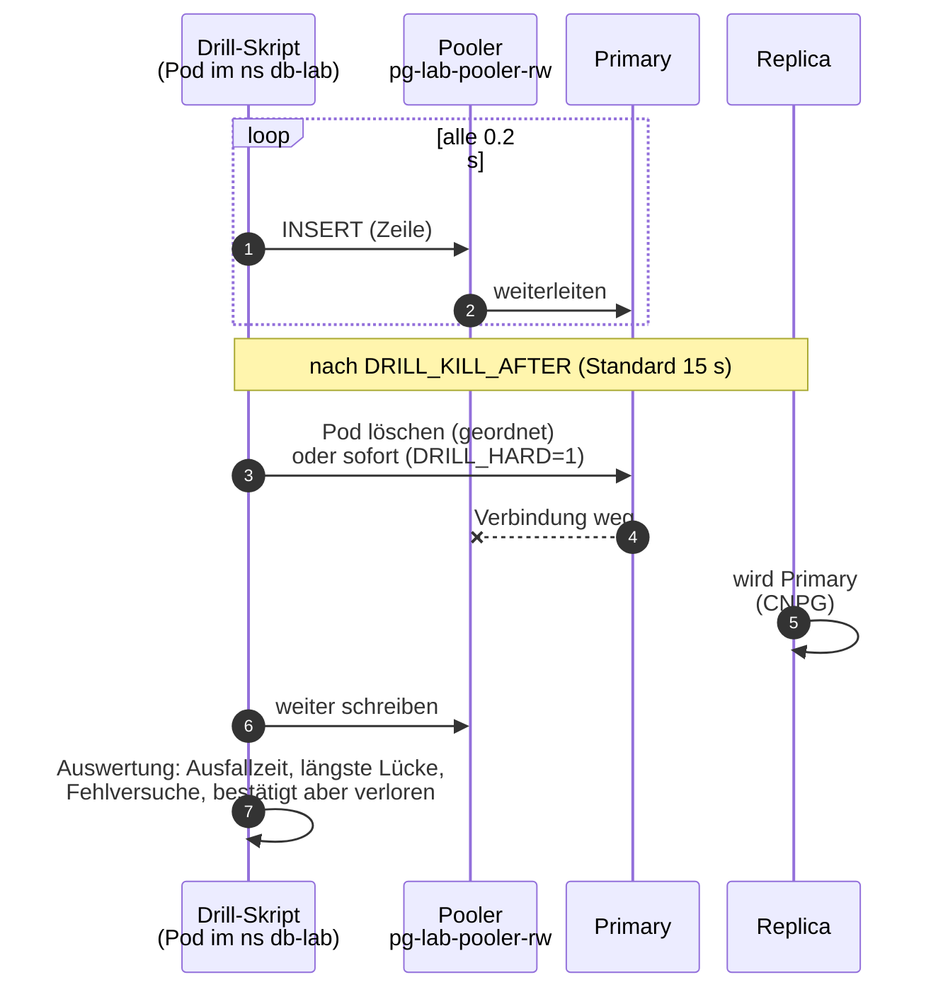

# Failover üben

**Ziel:** messen, was ein Primärwechsel von `pg-lab` für einen Client bedeutet
(Ausfallzeit, Fehlversuche, verlorene Zeilen).



## Ausführen

```bash
# default run
ansible/scripts/cnpg-failover-drill.sh
# longer run
DRILL_SECONDS=120 DRILL_KILL_AFTER=30 ansible/scripts/cnpg-failover-drill.sh
# crash instead of an orderly stop (pod gone immediately)
DRILL_HARD=1 ansible/scripts/cnpg-failover-drill.sh
```

| Variable | Bedeutung |
|---|---|
| `DRILL_SECONDS` | Gesamtdauer der Schreiblast |
| `DRILL_KILL_AFTER` | Sekunden bis zum Löschen des Primary-Pods (Standard 15) |
| `DRILL_HARD` | `1` = Absturz statt geordnetem Stopp |

Ein Pod schreibt alle 0.2 s eine Zeile über den Pooler. Ausgabe:
Ausfallzeit (letzter OK vor dem ersten Fehler bis erster OK nach dem letzten
Fehler), längste Lücke zwischen zwei OK, Fehlversuche, neuer Primary und
„bestätigt, aber verloren“.

!!! note "Erste Verbindung des Schreib-Pods"
    Der Pod bekommt einen initContainer `warten`, weil kube-router neue Pods
    in der ersten Sekunde noch nicht kennt
    ([Troubleshooting](troubleshooting.md#kube-router-erste-verbindung)).

## Gemessen (2026-10-27, k3s auf einem Knoten, 2 Instanzen)

| Art | Fehlversuche | Ausfallzeit | längste Lücke | verloren |
|---|---|---|---|---|
| geordnet (`kubectl delete pod`) | 0 | 0 ms | 272 ms | 0 |
| hart (`DRILL_HARD=1`) | 121 von 244 | 30.6 s | 30.6 s | 0 |

**Geordnet:** CNPG macht vor dem Stopp einen sauberen Wechsel, der Pooler merkt
fast nichts. **Hart:** CNPG erkennt den Ausfall und befördert die Replica (im
Test rund 30 s). Ein harter Absturz kann wegen der asynchronen Replikation die
letzten bestätigten Zeilen kosten (im Test 0). Wer das nicht will, stellt
synchrone Replikation ein; sie kostet Schreib-Latenz.

!!! info "Alte Aufrufe"
    Früher rief ein Einmal-Skript des Autors (`stufe8b-block-c.sh`) denselben
    Drill auf. Es ist nicht Teil des Repos; das Skript oben ist die Quelle.
