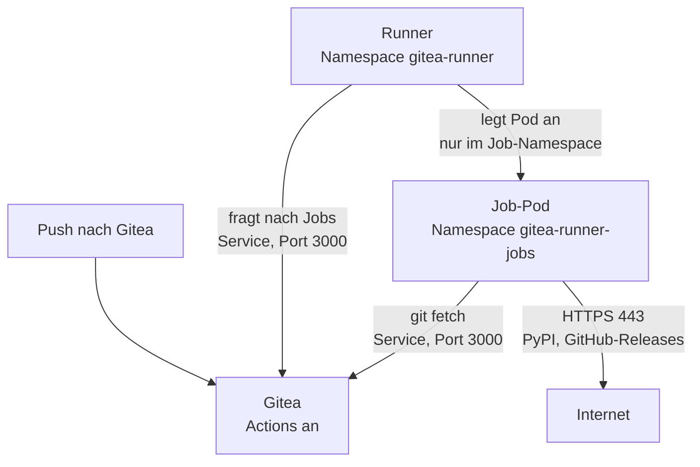

# Gitea Actions und der Runner im Cluster

**Ziel:** Die Gitea im Cluster führt die Workflows aus `.gitea/workflows/` selbst aus (`lint`, `gitleaks`, `security`,
`signature-check`). Nach einem Push erscheint der Reiter «Actions» mit grünen oder roten Haken. Das ist die zweite
Verteidigungslinie neben `scripts/merge-signed.sh` und `lab.sh trust check`, und sie muss vor dem Umzug auf den Produktionsserver
laufen ([Issue 115](https://github.com/tabee/k8s-lab-template/issues/115)). Warum Job-Pods und kein Docker:
[ADR 0030](../concepts/decisions/0030-gitea-actions-runner.md).



## Aufbau

| Teil | Wo | Was |
|---|---|---|
| Actions an | `gitops/workloads/gitea/values-gitea.yaml` | `actions: ENABLED: true`, `DEFAULT_ACTIONS_URL: self` (kein stilles `uses:` von github.com) |
| Runner | `gitops/workloads/gitea-runner/deployment.yaml` | `gitea/runner` 5.4.1 (gepinnt per Digest), eine Instanz, `capacity: 1` |
| Konfiguration | `gitops/workloads/gitea-runner/configmap.yaml` | Label `ubuntu-latest:kubernetes://…`, Pod-Vorlage der Jobs, 45 Minuten pro Job, Sperre im Backup-Fenster (`backup-window.sh`) |
| Rechte des Runners | `gitops/workloads/gitea-runner/rbac.yaml` | eine Role **nur** im Namespace `gitea-runner-jobs`: Pods anlegen, `exec`, Logs, Job-Secrets anlegen und löschen |
| Grenzen der Jobs | `gitops/workloads/gitea-runner/jobs-limits.yaml` | `ResourceQuota`: ein Pod, 512 MiB, keine Services, keine PVCs |
| Netz | `gitops/workloads/gitea-runner/networkpolicy.yaml`, `gitops/workloads/gitea/manifests/networkpolicy-runner.yaml` | default-deny, siehe unten |
| Token | `secrets/gitea/gitea-runner-token.sops.yaml`, `secrets/gitea-runner/gitea-runner-registration.sops.yaml` | derselbe Wert zweimal, erzeugt von `lab.sh init` |
| Argo-CD-Apps | `gitops/apps/gitea-runner.yaml`, `gitops/apps/secrets-gitea-runner.yaml` | im Projekt `lab` |

Jeder Job ist ein eigener Pod im Namespace `gitea-runner-jobs`. Er läuft mit dem Image, das der Workflow unter
`container: image:` nennt. Es gibt keinen Docker-Daemon und keinen privilegierten Container. Der Pod hat PSA `restricted`,
läuft als uid 1000, bekommt kein ServiceAccount-Token und wird nach dem Job gelöscht.

### Netz

| Von | Nach | Port |
|---|---|---|
| Runner | DNS, Gitea (`gitea-http.gitea.svc`), API-Server (Knoten-IP) | 53, 3000, 6443 |
| Job-Pod | DNS, Gitea (`gitea-http.gitea.svc`) | 53, 3000 |
| Job-Pod | öffentliches Internet (ohne private Bereiche, Link-Local und Knotennetz) | 443 |
| alle anderen | Runner oder Job-Pod | nichts (kein Ingress) |

Die Workflows holen den Code von `${{ github.server_url }}`, also von der öffentlichen Adresse `https://git.<domain>/`.
Diese Adresse hat ein Zertifikat der Lab-CA und steht nur in `/etc/hosts` des Steuerrechners. Darum schreibt die Pod-Vorlage eine
System-Git-Konfiguration (`GIT_CONFIG_SYSTEM`, `gitops/workloads/gitea-runner/jobs-configmap.yaml`): `insteadOf`
leitet den Clone auf den Service `http://gitea-http.gitea.svc:3000/` um. Der Hostname ist eine Kopie von `DOMAIN` in
`values-gitea.yaml`. `bash scripts/lab.sh customize` schreibt beide, und `tests/gitea-runner-tests.sh` vergleicht sie.

!!! warning "Jobs führen Code aus jedem Push aus"
    Jeder Push auf irgendeinen Branch startet `lint`, `gitleaks` und `security`, und zwar mit den Workflow-Dateien
    **aus diesem Push**. Wer pushen darf (du und deine Bots), führt damit beliebigen Code im Job-Pod aus. Die Grenzen
    dagegen: kein Token und kein Weg zur Cluster-API, kein privilegierter Container, PSA `restricted`, ein Pod mit
    512 MiB (Quota), 45 Minuten und kein Zugriff auf andere Pods oder S3. Offen bleibt: **HTTPS ins ganze Internet**
    (kube-router kennt keine Namensregeln), also kann ein bösartiger Job Daten aus dem Repo hinaustragen, die er
    ohnehin lesen darf. Secrets der Workflows (zum Beispiel `PII_DENYLIST`) sieht jeder Job dieses Repos.

!!! warning "Der Runner hat API-Rechte im Job-Namespace"
    Der Runner braucht ein ServiceAccount-Token, um Job-Pods anzulegen. Wer den Runner-Pod übernimmt, kann im
    Namespace `gitea-runner-jobs` Pods mit beliebigem Image starten. Diese Pods unterliegen aber derselben PSA, Quota
    und NetworkPolicy. Secrets lesen kann der Runner nicht (die Role hat kein `get` und kein `list` auf Secrets).
    Das Registrierungs-Token ist **instanzweit**: Jedes Repo der Gitea kann diesen Runner benutzen. Das passt, solange
    nur du und deine Bots Repos haben. Für fremde Nutzer oder Apps braucht es Runner pro Organisation
    ([Issue 87](https://github.com/tabee/k8s-lab-template/issues/87)).

!!! warning "Klartext im Pod-Netz"
    Runner und Job-Pods sprechen HTTP mit Gitea, auch das Job-Token im Header. Der Verkehr bleibt auf dem einen Knoten
    und verlässt die VM nicht. Mit einem zweiten Knoten muss das neu bewertet werden.

## Einschalten (einmalig, du)

1. Branch mergen wie gewohnt (`scripts/merge-signed.sh … --push`, danach `bash scripts/lab.sh trust check`).
2. Token erzeugen und die beiden SOPS-Dateien rendern. Vorhandene Dateien bleiben unverändert (`SKIP`):

    ```bash
    bash scripts/lab.sh init
    git add secrets/gitea/gitea-runner-token.sops.yaml secrets/gitea-runner/gitea-runner-registration.sops.yaml
    git commit -S -m "Add the Gitea Actions runner token (SOPS)"
    git push
    ```

    Das Token liegt danach in `~/.config/k8s-lab/gitea-k3s-lab-runner.token` (Modus 0600). Es wird nie angezeigt.
3. Das AppProject kennt die zwei neuen Namespaces erst nach `ansible/argocd.yml`:

    ```bash
    sudo -v && cd ~/projects/k8s-lab/ansible && ansible-playbook argocd.yml
    ```

4. Argo CD synchronisiert danach von selbst: `secrets-gitea`, `gitea` (Neustart, Strategie `Recreate`, also eine kurze Pause),
   `gitea-runner` und `secrets-gitea-runner`. Ohne Secret wartet der Runner-Pod (`CreateContainerConfigError`). Das ist
   harmlos, und Gitea startet trotzdem (das Secret ist für Gitea `optional`).
5. Prüfen:

    ```bash
    kubectl -n gitea-runner logs deploy/gitea-runner | grep -E 'registered|declared'
    kubectl get applications -n argocd gitea gitea-runner secrets-gitea secrets-gitea-runner
    cd ~/projects/k8s-lab/ansible && ansible-playbook verify-budget.yml
    ```

    In Gitea steht der Runner unter «Administration › Actions › Runners» als `k8s-lab-gitea-runner-…`. Ein Push auf
    einen Branch zeigt danach im Reiter «Actions» die Läufe.

Die Abnahme ist erst erfüllt, wenn `lint`, `gitleaks` und `security` nach einem echten Push im Cluster grün laufen.
Offline lässt sich das nicht beweisen.

## Backup-Fenster

Die Sicherungen laufen täglich **20:00–02:30 UTC** (Europe/Zurich: 21:00–03:30 im Winter, 22:00–04:30 im Sommer):
CNPG ab 20:00, K8up bis zum Sonntagscheck um 01:30 mit 30 Minuten Frist. Der Runner nimmt in dieser Zeit keinen neuen
Job an. Sein `health_check.script` (`backup-window.sh` in der ConfigMap) meldet von **19:00 bis 02:30 UTC**
«nicht bereit». Die Stunde vor 20:00 reicht, damit ein Job, der um 18:59 beginnt, vor dem ersten Backup endet
(Timeout 45 Minuten, `activeDeadlineSeconds` 50 Minuten). Ein Push in dieser Zeit wartet in der Warteschlange
und läuft ab 02:30 UTC. Im Log steht dann `runner temporarily unavailable: … backup window`.

`tests/gitea-runner-tests.sh` prüft, dass jede Zeile der CNPG- und K8up-Kalender in das Fenster passt. Wer einen
Backup-Zeitpunkt verschiebt, muss das Fenster in `backup-window.sh` mitziehen.

## Speicher und Budget

Die CI-Jobgrenze bleibt **512 MiB**. `scripts/ci-lint.sh` prüft Shell-Dateien einzeln und nacheinander,
wertet aber weiterhin alle Fehler aus. Grosse Testdateien müssen in zusammengehörige Suiten aufgeteilt werden,
nicht von Shellcheck ausgeschlossen: `lab-sh`, `lab-sh-secrets` und `lab-sh-restore` teilen sich eine Sandbox-Vorlage.
`scripts/ci-tests.sh` entdeckt alle drei automatisch und führt sie mit jeweils eigener Sandbox aus.

| Teil | Limit | Gezählt |
|---|---:|---|
| Runner (`gitea-runner/gitea-runner/runner`) | 64 MiB | immer |
| ein Job-Pod (`gitea-runner-jobs/*/job`) | 512 MiB | immer, zusätzlich zum grössten periodischen Job |

Der Job-Pod ist **kein** Teil des Backup-Kalenders. Die Sperre im Backup-Fenster ist eine Einstellung des Runners,
Kubernetes erzwingt sie nicht. Darum rechnet `python3 scripts/prod-budget-check.py --repo .` den Job trotzdem immer
voll dazu. Für Prod ergibt das 6624 von 6656 MiB, also
32 MiB Luft. Die Quota im Job-Namespace sorgt dafür, dass es wirklich nie mehr als ein Pod mit 512 MiB ist. Details:
[Memory-Budget](../reference/memory-budget.md#gitea-actions).

## Token wechseln

1. In Gitea unter «Administration › Actions › Runners» das Registrierungs-Token zurücksetzen. Das alte gilt dann nicht mehr.
2. `~/.config/k8s-lab/gitea-k3s-lab-runner.token` löschen, die zwei SOPS-Dateien löschen, `bash scripts/lab.sh init`,
   committen, pushen.
3. Gitea und den Runner neu starten (`kubectl -n gitea rollout restart deploy/gitea`,
   `kubectl -n gitea-runner rollout restart deploy/gitea-runner`). Den alten Runner-Eintrag in Gitea löschen.

## Fehlersuche

| Zeichen | Ursache | Abhilfe |
|---|---|---|
| Runner-Pod `CreateContainerConfigError` | Secret `gitea-runner-registration` fehlt | Schritt 2 oben |
| Runner-Log `register` schlägt fehl | Gitea hat das Token nicht (Secret `gitea-runner-token` fehlte beim Start) | Gitea neu starten |
| Job wartet, Log `exceeded quota` | ein alter Job-Pod hängt noch | `kubectl -n gitea-runner-jobs get pods`, den alten löschen |
| Job endet mit `OOMKilled` | 512 MiB reichen für diesen Job nicht | messen (`kubectl top pod -n gitea-runner-jobs`), grosse Testdateien aufteilen und Shellcheck einzeln ausführen; Limits nur nach erneuter Budgetprüfung ändern |
| `git fetch` scheitert mit TLS- oder DNS-Fehler | `insteadOf` passt nicht zu `DOMAIN` | `bash tests/gitea-runner-tests.sh` |
| Nach jedem neuen Runner-Pod ein weiterer Eintrag «offline» | Die Registrierung liegt auf einem `emptyDir` | alten Eintrag in Gitea löschen |

## Grenzen

- Ein Job nach dem anderen. Ein Push startet drei Workflows, die nacheinander laufen.
- Von 19:00 bis 02:30 UTC startet kein neuer Job (siehe oben).
- Docker-Actions, `docker://`-Schritte sowie `options` und `volumes` des Job-Containers gehen mit Job-Pods nicht.
  Die Workflows hier brauchen nichts davon. Image-Builds gehören zu [Issue 87](https://github.com/tabee/k8s-lab-template/issues/87).
- Ein Job läuft als uid 1000, nicht als root wie auf einem Docker-Runner. `/etc/passwd` und `/etc/group` kommen aus der
  ConfigMap, `HOME` ist `/tmp`.
