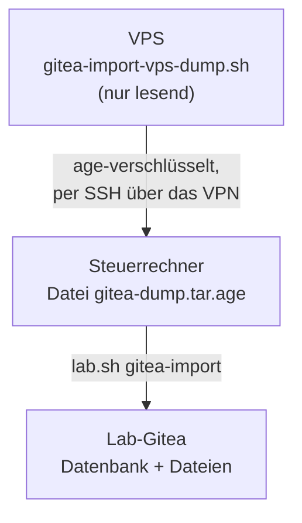

# Gitea-Import

`lab.sh gitea-import` spielt einen `gitea dump` der Produktions-Forge (Gitea auf dem VPS) in das Lab-Gitea ein. Der
Ablauf ist wiederholbar und gleich für drei Zwecke: Probelauf für den Umzug der Produktion, Einspielen eines Dumps nach
einem Neuaufbau und Test von Dump und Restore. Die Begründung steht in
[ADR-0015](../concepts/decisions/0015-gitea-import-dump.md).



## Was importiert wird

| Importiert | Nicht importiert (bewusst) |
|---|---|
| Benutzer (mit Passwort-Hash), Organisationen, Teams, Zugriff und Mitarbeit | Webhooks (samt Zustellprotokoll) |
| Repos mit Git-Daten, Wiki, LFS-Objekten, Anhängen, Avataren | Vorlagen-Repos (`is_template`) und eine eigene Vorlagen-Ablage |
| Issues, Pull Requests, Releases der importierten Repos | Spiegel, Tokens, Sitzungen, 2FA und WebAuthn |
| | SSH-, GPG- und Deploy-Schlüssel, Secrets, OAuth2-Apps, Actions, Pakete |

!!! note "Vorlagen"
    Repos mit `is_template = true` werden nach dem Start über die API gelöscht und zählen nicht zur Abnahme. Die
    Zeile steht in `delete_templates` in `scripts/gitea-import.sh`; ob das zu streng ist, steht in [Issue 44](https://github.com/tabee/k8s-lab-template/issues/44).

## Voraussetzungen

- Das Lab läuft (`lab.sh status`), Gitea ist bereit, `gitea-db` und die Sicherungen (K8up, CNPG) laufen.
- Die Version des Lab-Gitea ist **grösser oder gleich** der des Dumps. Sonst bricht der Import ab (`ABORT`): erst die
  Chart-Version in Git anheben.
- Auf dem Steuerrechner: `kubectl`, `python3`, `curl`, `git`, `age` und der **private age-Schlüssel** zu einem Empfänger
  aus `.sops.yaml` (`SOPS_AGE_KEY_FILE` oder `~/.config/sops/age/keys.txt`, oder `--age-key DATEI`).
- Auf dem VPS: ein Benutzer, der `docker` aufrufen darf, und `age` (`apt install age`). Sonst `--format sops`
  (nur für kleine Forges: sops hält den ganzen Dump im Speicher).

## Schritt für Schritt

1. **Empfänger und Befehl ausgeben** (nur lesen, ohne Cluster):

    ```bash
    bash scripts/lab.sh gitea-import recipients
    ```

2. **Auf dem VPS prüfen** (nur lesen: Container, Version, Datenbanktyp; nichts wird gedumpt):

    ```bash
    ssh VPS 'bash -s -- --check' < scripts/gitea-import-vps-dump.sh
    ```

3. **Dump holen**, verschlüsselt, ohne Klartextdatei auf dem VPS oder dem Steuerrechner (den Befehl mit den
    Empfängern gibt Schritt 1 aus):

    ```bash
    ssh VPS 'bash -s -- --recipient age1...' < scripts/gitea-import-vps-dump.sh > gitea-dump.tar.age
    ```

    Das Skript führt nur `docker ps`, `docker inspect`, `docker exec ... gitea --version` und `gitea dump` aus. Der
    Dump geht in ein Temp-Verzeichnis **im Container**, das beim Beenden gelöscht wird. Es wird nichts gestoppt,
    geändert oder installiert. Mit mehreren Gitea-Containern: `--container NAME`.

4. **Trockenlauf** (lädt den Dump in ein Staging-Schema, filtert, zeigt Zahlen, ändert nichts Echtes):

    ```bash
    bash scripts/lab.sh gitea-import --dry-run gitea-dump.tar.age
    ```

5. **Import:**

    ```bash
    bash scripts/lab.sh gitea-import gitea-dump.tar.age
    ```

6. Das Ergebnis ist die **Abnahme** (Zeilen `PASS`/`FAIL`, am Ende `IMPORT OK`). Sie lässt sich allein wiederholen:

    ```bash
    bash scripts/lab.sh gitea-import accept
    ```

Die verschlüsselte Datei kann nach dem Import gelöscht oder im Passwortspeicher aufbewahrt werden. Sie enthält die
`app.ini` und die Passwort-Hashes: **nie unverschlüsselt ablegen, nie in Git.**

## Was bei jedem Aufruf entschieden wird

| Lage im Lab-Gitea | Ergebnis |
|---|---|
| Dieselbe Datei (gleiche SHA-256) wurde schon importiert | `SKIP`: nur die Abnahme läuft (`--reimport` erzwingt einen neuen Import) |
| Gitea ist leer (nur das Lab-Admin-Konto) | Import |
| Inhalt stammt aus einem früheren Import und ist unverändert (Fingerabdruck) | Import ersetzt ihn, ohne Rückfrage |
| Anderer Inhalt (Benutzer oder Organisationen ausser dem Lab-Admin, Repos) | **`ABORT`**, nichts wird geändert |
| Anderer Inhalt und `--replace` | Rückfrage `[y/N]` (mit `--yes` ohne), vorher K8up-Sicherung der Dateien und CNPG-Backup, dann Import |
| Der Dump enthält einen Benutzer mit dem Namen des Lab-Admins | `ABORT` (Namenskollision): Konto im Dump umbenennen oder Lab-Admin ändern |

`--replace` ist **zerstörerisch**: der vorhandene Inhalt von Gitea (Datenbank und Repos) wird ersetzt. Ohne Terminal und
ohne `--yes` bricht es ab. `--no-backup` überspringt die Sicherung (nur für Wegwerf-Labs).

## Was passiert beim Import

1. Dump entschlüsseln (nur in einem tmpfs-Verzeichnis, wird beim Beenden überschrieben und gelöscht), Versionen prüfen.
2. Die SQL-Datei in das Schema `gi_stage` laden, filtern (`scripts/gitea-import/filter.sql`), zählen: das ist der
   **Manifest** für die Abnahme.
3. Argo CD anhalten (Auto-Sync von `root` und `gitea`), Gitea auf 0 skalieren.
4. In **einer Transaktion** `public` durch `gi_stage` ersetzen; Repos, LFS, Anhänge und Avatare in das PVC schreiben.
5. `gitea migrate`, `gitea admin regenerate hooks`, `gitea doctor check --all --fix`.
6. Gitea hochfahren, Argo CD zurückstellen, Vorlagen-Repos über die API löschen, Abnahme.

Die Hilfs-Pods (`gitea-import-db`, `gitea-import-files`) laufen im Namespace `gitea` mit dem Label
`app.kubernetes.io/name: gitea-import`, ohne Service-Account-Token, nach dem Pod-Sicherheitsstandard `restricted`. Die
bestehenden Policies (`allow-egress-dns`, `allow-egress-same-namespace`, `allow-same-namespace`) genügen:
**keine neue NetworkPolicy**. Beide Pods werden am Ende gelöscht.

## Abnahme

| Prüfung | Bedeutung |
|---|---|
| Zahl der Benutzer, Organisationen, Repos | gleich dem gefilterten Manifest des Dumps |
| keine Webhooks, keine Vorlagen-Repos | Tabelle `webhook` leer, `is_template` nirgends |
| Admin-Anmeldung per API | Zugangsdaten aus dem Secret `gitea-admin` (Werte werden nie ausgegeben) |
| `git ls-remote` für jedes Repo über HTTPS | gegen `https://git.lab.example`, mit Lab-CA |
| Stichprobe: Klon und `git fsck --full` | eine Kopie in einem Wegwerf-Verzeichnis |

## Keycloak {#keycloak}

Ist Keycloak im Lab aktiv ([Keycloak](keycloak.md#gitea-import-und-keycloak)), gilt zusätzlich:

- Der Import löscht die Anmeldequelle `keycloak` mit der übrigen Datenbank. Der Neustart von Gitea am Ende des
  Imports installiert sie über den Init-Container `configure-oidc` wieder. Fehlt sie danach, startet der Import Gitea
  einmal neu. Die Abnahme prüft die Quelle (*SSO: login source keycloak present*), wenn das Secret `gitea-oidc`
  existiert.
- Importierte Konten (`alice`, `assistant`, `notizen-bot`, ...) bleiben lokale Konten mit ihrem Passwort. Legst du im
  Realm `lab` einen Benutzer mit **demselben Benutzernamen** (sonst derselben E-Mail) an, verknüpft Gitea ihn beim
  ersten Keycloak-Login mit dem importierten Konto (`ACCOUNT_LINKING: auto`): gleiche ID, gleiche Repos, kein zweites
  Konto.
- Achtung: Das gilt auch für importierte Admin-Konten. Ein Keycloak-Benutzer mit dem Namen eines Admins wird dieser
  Admin. Im geschlossenen Realm (nur du legst Benutzer an) ist das gewollt.

Nach dem Import also: Benutzer im Realm anlegen (Name wie in Gitea), `ansible-playbook verify-keycloak.yml` (im Ordner `ansible/`), im
Browser mit Keycloak anmelden.

## Passwörter

Die Passwort-Hashes bleiben, wenn der Algorithmus argon2, bcrypt, pbkdf2 oder scrypt ist: das alte Passwort gilt im Lab
weiter. Bei einem anderen Algorithmus warnt der Import, und die Benutzer brauchen einen Reset. Benutzer mit externer
Anmeldung (OAuth, LDAP) werden lokale Benutzer **ohne** Passwort: Reset über die Admin-Oberfläche.

## LFS

Das Lab liefert LFS aus (`LFS_START_SERVER: true` in `values-gitea.yaml`). Die Objekte liegen im PVC und sind damit in
der K8up-Sicherung. Ohne diese Einstellung liefert Gitea die importierten LFS-Objekte nicht aus.

## Abbruch und Aufräumen

- Fehler **vor** dem Tausch der Datenbank: der Import macht alles rückgängig (Gitea wieder hoch, Argo CD zurück). Nichts
  Echtes hat sich geändert.
- Fehler **nach** dem Tausch: Gitea bleibt absichtlich **aus**, die Meldung nennt den Stand. Der gleiche Aufruf setzt fort.
- `bash scripts/lab.sh gitea-import recover` fährt Gitea hoch, stellt Argo CD zurück und löscht die Hilfs-Pods,
  ohne neu zu importieren.
- Zustand: ConfigMap `gitea-import-state` im Namespace `gitea` (`kubectl -n gitea get cm gitea-import-state -o yaml`).

## Optionen

| Option | Wirkung |
|---|---|
| `--dry-run` | laden und prüfen, nichts Echtes ändern |
| `--replace`, `--yes` | fremden Inhalt ersetzen (Rückfrage `[y/N]`, `--yes` beantwortet sie) |
| `--reimport` | auch dieselbe Datei noch einmal einspielen |
| `--no-backup` | keine Sicherung vor dem Ersetzen |
| `--base-url`, `--cacert`, `--resolve H:P:IP` | wie die Abnahme das Lab erreicht (Standard `https://git.lab.example`) |
| `--age-key DATEI`, `--namespace NS`, `--context CTX` | Schlüssel, Namespace, kubectl-Kontext |

Die Optionen gehören dem Skript, nicht `lab.sh`: `lab.sh gitea-import` reicht sie unverändert weiter. Vollständig steht
alles im Kopf von `scripts/gitea-import.sh`.

## Test ohne Produktion

`scripts/gitea-import-e2e.sh` (manuell, braucht Docker) baut eine Wegwerf-Quelle (Postgres oder SQLite, Testbenutzer,
Vorlagen-Repo, Wiki, Organisation, Webhook, LFS) und ein Wegwerf-Lab (k3s in Docker mit den Policies und Werten dieses
Repos) und spielt den Import durch: Lauf 1, Lauf 2 (`SKIP`), fremder Inhalt (`ABORT`), `--replace`. Jeder
`kubectl`-Aufruf nutzt eine eigene Kubeconfig-Datei; `down` räumt alles weg. Die schnellen Offline-Tests stehen in
`tests/gitea-import-tests.sh` (Teil von `ci-tests.sh`).

## Grenzen

- Nur Gitea als Quelle und Ziel, Version Quelle ≤ Ziel.
- Datenbanken der Quelle: Postgres ist getestet. SQLite und MySQL sind vorgesehen, aber nicht getestet (der Dump wird
  immer in Postgres-Syntax geschrieben, `gitea dump --database postgres`). Ein Dump in anderer Syntax bricht mit Meldung ab.
- Der Wiederaufnahme-Pfad (`recover`, unterbrochener Lauf) ist nicht end-to-end getestet.
- Alles, was nach dem Import im Lab geändert wurde, zählt beim nächsten Import als fremd (`--replace`).
- Der Sicherungsschritt vor `--replace` (K8up und CNPG) ist nur gelesen und statisch geprüft, nicht gegen echte
  K8up- und CNPG-Dienste gelaufen: der Test benutzt `--no-backup`. Fehlen die Dienste, bricht `--replace` ab.

Welche dieser Lücken geschlossen werden sollen, steht in [Issue 29](https://github.com/tabee/k8s-lab-template/issues/29).

## Siehe auch

[Gitea wiederherstellen](restore-gitea.md), [Keycloak](keycloak.md#gitea-import-und-keycloak), [Restore-Test](restore-drill.md), [ADR-0015](../concepts/decisions/0015-gitea-import-dump.md)
