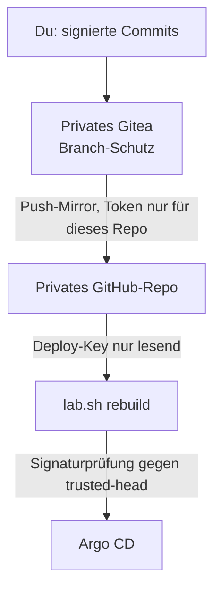

# Privater GitHub-Spiegel als Neuaufbau-Quelle

Du entwickelst nur im privaten Gitea, und im normalen Betrieb liest Argo CD aus Gitea. Ein **privates** GitHub-Repo
bekommt eine Kopie (Push-Mirror). Es ist **nicht** die Quelle des Normalbetriebs, sondern die Quelle für Migration
und Neuaufbau: daraus speist ein Neuaufbau Argo CD, auch wenn dein Gitea nicht läuft. Das GitHub-Konto gilt dabei als
**nicht vertrauenswürdig**: `lab.sh` prüft beim Neuaufbau die Signaturen
([Quellvertrauen](../concepts/source-trust.md)). Das Repo enthält die SOPS-Secrets und die Historie, deshalb
bleibt es privat.



## 1. Das GitHub-Konto absichern

Das Konto ist das schwächste Glied der Kette. Diese Punkte brauchst du vor dem ersten Push:

1. **Passkey** als Anmeldung: GitHub → **Settings → Password and authentication → Passkeys → Add a passkey**.
   Wiederherstellungscodes ausdrucken oder im Passwortmanager ablegen. Firefox unter Ubuntu kann keinen Passkey
   anlegen (kein Plattform-Authentifikator); es geht zum Beispiel mit Chrome auf einem Android-Telefon.
2. Weitere Faktoren prüfen: nicht benötigte SMS-Nummern und alte Sicherheitsschlüssel entfernen.
3. **Sessions und Token** unter Settings durchsehen, nicht benutzte löschen. Keine klassischen Token (`ghp_...`).
4. Ein leeres Repo anlegen: **privat**, ohne README, ohne `.gitignore`, ohne Lizenz.

## 2. Das Token (nur dieses Repo)

GitHub → **Settings → Developer settings → Personal access tokens → Fine-grained tokens → Generate new token**:

| Feld | Wert |
|---|---|
| Resource owner | dein Konto |
| Expiration | höchstens 1 Jahr, Erinnerung im Kalender |
| Repository access | **Only select repositories**, genau das eine Spiegel-Repo |
| Permissions → Repository → Contents | **Read and write** (Metadata: Read-only kommt von selbst) |
| alles andere | **No access** |

Das Token liegt nur in Gitea (Schritt 3) und im Passwortmanager. Nie in Git, nie in einer Datei im Repo.

## 3. Push-Mirror in Gitea

Gitea bietet hier **nur HTTPS mit Benutzername und Passwort** an, keine SSH-Variante für den Push-Mirror. Das
Token aus Schritt 2 kommt deshalb in das Feld **Passwort**. Im Gitea-Repo **Einstellungen → Repository →
Spiegel (Mirror) → Push-Spiegel**:

| Feld | Wert |
|---|---|
| Git-Remote-Repository-URL | `https://github.com/KONTO/k8s-lab-mirror.git` |
| Benutzername | dein GitHub-Benutzername |
| Passwort | das Token aus Schritt 2 (nur in diesem Feld, nie in einen Chat, ein Ticket oder eine Datei) |
| Synchronisieren, wenn Commits gepusht werden | **an** (Sync on push) |
| Intervall | `8h` (Rückfall, falls der Push-Auslöser ausfällt) |

„Jetzt synchronisieren“ drücken und im GitHub-Repo prüfen, dass `main` und die Historie da sind.
Gitea schiebt im Spiegelmodus mit Force: ein Commit, den jemand auf GitHub setzt, wird beim nächsten Abgleich
überschrieben. Die Signaturen bleiben unverändert, der Spiegel schreibt keine Commits neu.

Das Token liegt danach nur in Gitea (Datenbank) und im Passwortmanager. Wird es je irgendwo sichtbar (Chat,
Protokoll, Bildschirmfoto), gilt es als verbrannt: bei GitHub löschen und neu erzeugen ([Token erneuern](#token-erneuern)).

### Branch-Schutz im privaten Gitea

Der Spiegel schiebt, was in Gitea auf `main` steht. Deshalb gehört der Schutz dorthin
(Einstellungen → Branches → Regel für `main`; Einzelheiten und Begründung in
[SSH-Commit-Signatur](signed-commits.md#branch-schutz)):

| Einstellung | Wert |
|---|---|
| Push und Merge | nur Whitelist: du allein |
| Signierte Commits verlangen | an |
| Merge-Stil | nur „Fast-Forward only“, manuellen Merge automatisch erkennen |
| Geschützte Dateien | `.gitea/allowed_signers`, `.gitea/workflows/*` |

## 4. Deploy-Key für Argo CD (nur lesend)

```bash
bash scripts/lab.sh init                     # legt ~/.ssh/argocd-k8s-lab an, falls es fehlt
cat ~/.ssh/argocd-k8s-lab.pub
```

GitHub-Repo → **Settings → Deploy keys → Add deploy key**: Titel `argocd-k8s-lab`, den Inhalt der `.pub`
einfügen, **„Allow write access“ nicht ankreuzen**. Der Schlüssel gehört nur zu diesem Repo.

## 5. Das Lab auf den Spiegel zeigen lassen

**Empfohlen: der Schalter `source`.** `bash scripts/lab.sh source github` setzt Adresse, feste GitHub-Host-Keys und
Egress-Bereiche in einem Schritt, erzwingt das Quellvertrauen und vergleicht den Spiegel mit Gitea. Den vollständigen
Ablauf, auch den Rückweg, beschreibt [Neuaufbau aus GitHub statt Gitea](neuaufbau-github.md)
([ADR-0024](../concepts/decisions/0024-github-as-switchable-source.md)).

**Von Hand** (ein anderes Repo oder ein anderer Anbieter) in `infra/envs/local/lab.local.yaml` (nie in `lab.yaml`):

```yaml
repo_url: ssh://git@github.com/KONTO/k8s-lab-mirror.git
source_trust: on                              # bei github.com ohnehin an (auto)
```

```bash
bash scripts/lab.sh customize --fetch-host-keys   # Fingerabdruck mit der Liste von GitHub vergleichen
bash scripts/lab.sh repo-egress --resolve         # Egress-Adressen, dann committen und pushen
```

Den Fingerabdruck vergleichst du mit der offiziellen Liste unter
<https://docs.github.com/de/authentication/keeping-your-account-and-data-secure/githubs-ssh-key-fingerprints>.
Offen: die Egress-Bereiche von GitHub wechseln ([Issue 72](https://github.com/tabee/k8s-lab-template/issues/72)).

## 6. Vertrauten Commit festlegen {#vertrauten-commit-festlegen}

Den Commit, ab dem deine Signatur gilt (siehe [SSH-Commit-Signatur](signed-commits.md#schluessel-freigeben)),
**im privaten Gitea** nachsehen und bestätigen:

```bash
git log -1 --show-signature <COMMIT>              # Good "git" signature, Schlüssel erkannt
bash scripts/lab.sh trust init <COMMIT>           # tippe die ersten 7 Zeichen
bash scripts/lab.sh trust status
bash scripts/lab.sh trust check                   # prüft jetzt main von repo_url
```

Das Ergebnis liegt in `~/.config/k8s-lab/trusted-head` (nur du, Modus 0600, ausserhalb von Git). Danach rückt der Anker
bei jedem bestandenen `preflight`, `up` und `rebuild` selbst vor.

## Wenn die Prüfung anschlägt

`lab.sh` bricht mit `Source trust FAILED` ab und ändert nichts. Prüfe im **privaten Gitea**, ob der Commit dort
existiert und signiert ist (`git log --show-signature`). Fehlt er dort: das GitHub-Konto wurde verändert. Dann
Token und Deploy-Key widerrufen, Passkey erneuern und den Spiegel neu synchronisieren.
Nur wenn du den Commit selbst kennst: `bash scripts/lab.sh rebuild --trust-override`; das verlangt eine getippte Bestätigung.

## Token erneuern {#token-erneuern}

Das Token läuft nach höchstens einem Jahr ab; erneuere es jährlich vor dem Ablauf. Das neue Token gehört nur in
Gitea und den Passwortmanager, nie in einen Chat, ein Ticket oder eine Datei.

1. Neues Token erzeugen (Schritt 2), in Gitea beim Push-Mirror im Feld „Passwort“ eintragen, „Jetzt synchronisieren“.
2. Das alte Token bei GitHub löschen.
