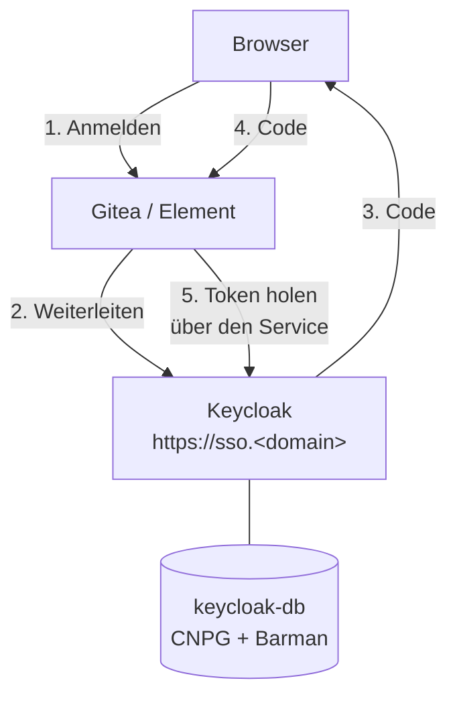

# Keycloak im Lab (einmal anmelden für Gitea und Matrix)

**Ziel:** ein Anmeldedienst im Lab. Gitea und Synapse (Matrix) fragen Keycloak, wer jemand ist. Die Konten liegen an
einer Stelle, die Rechte ebenfalls. Die lokalen Admin-Konten von Gitea und Matrix bleiben als Notzugang (Break-Glass).
Warum Keycloak, warum der Realm als Code und warum kein Admin über Gruppen entsteht:
[ADR-0019](../concepts/decisions/0019-keycloak-sso.md).



## Adressen

| Was | Wert | Quelle |
|---|---|---|
| Anmeldeseite | `https://sso.<domain>/realms/lab/` | `domain` in `lab.yaml`; das Zertifikat heisst `sso.<domain>` |
| Verwaltung (Admin-Konsole) | **nicht** öffentlich, nur Port-Forward | siehe unten |
| Realm | `lab` | `realm` in `gitops/charts/keycloak/values.yaml`, die einzige Kopie |
| Clients | `gitea`, `synapse`, `notes` (die Notiz-Sites, [ADR-0021](../concepts/decisions/0021-notes-sso.md)) | `gitops/charts/keycloak/templates/configmap-realm.yaml` |
| Gruppen | `lab-users` (darf sich anmelden), `lab-admins` (vorbereitet, nirgends zugeordnet) | dasselbe |

Der öffentliche Name über Traefik leitet nur `/realms/lab/` und `/resources/` durch. Die Konsole, der Realm `master`,
die Admin-API, `/metrics` und `/health` antworten dort mit 404.

## Verwaltung per Port-Forward

```bash
kubectl -n keycloak port-forward svc/keycloak 8080:8080
# dann im Browser: http://localhost:8080/admin/master/console/
```

Benutzername und Passwort stehen auf dem Steuerrechner in `~/.config/k8s-lab/keycloak-k3s-lab-admin.user` und
`keycloak-k3s-lab-admin.pw` (Modus 0600, nie im Log). Das Start-Admin-Konto gilt nur beim ersten Start des
leeren Keycloak: eine spätere Passwortänderung geschieht in der Konsole, nicht in der Datei.

!!! info "Admin-Konsole: `frontendUrl` des Realms `master` steht im Code"
    Keycloak kennt zwei Namen: öffentlich `https://sso.<domain>` (`KC_HOSTNAME`) und für die Verwaltung
    `http://localhost:8080` (`KC_HOSTNAME_ADMIN`). Der Realm `master` zeigt der Konsole aber den **öffentlichen** Namen,
    solange sein Attribut `frontendUrl` nicht gesetzt ist. Die Konsole prüft dann per unsichtbarem iframe
    `/realms/master/protocol/openid-connect/login-status-iframe.html` auf `https://sso.<domain>`, und Traefik lässt
    `/realms/master/` bewusst nicht durch. Folge: die Konsole bleibt hängen mit *"Timeout when waiting for 3rd party check
    iframe message"*. Seit dieser Änderung setzt der Job `keycloak-config` (`realm-master.json`, Wert `adminUrl` in
    `gitops/charts/keycloak/values.yaml`) `attributes.frontendUrl=http://localhost:8080` für `master`. Von Hand
    (`kcadm.sh update realms/master -s attributes.frontendUrl=...`) ist nichts mehr nötig, und `verify-keycloak.yml`
    prüft den Wert.

    Beim **ersten** Lauf nach der Änderung endet ein Pod des Jobs mit HTTP 401 und `Exit 1`: der Aussteller des Realms
    `master` wechselt, und das alte Admin-Token passt nicht mehr. Der Job versucht es von selbst noch einmal (bis zu
    6 Versuche) und ist dann grün. Das ist kein Fehler. Zwei Grenzen: `keycloak-config-cli` überspringt unveränderte
    Dateien (Prüfsumme) und repariert darum **keine** Handänderung am Attribut; die Prüfung von `verify-keycloak.yml` meldet
    sie. Und weitere Attribute von `master`, die nicht in `realm-master.json` stehen, entfernt der Job, sobald sich die Datei
    ändert: Attribute von `master` gehören der Datei.

## Konten anlegen

Die Selbstregistrierung ist aus. Konten legt der Admin im Realm `lab` an (Konsole, Menü *Users*), setzt ein Passwort
(mindestens 14 Zeichen, nicht gleich dem Namen) und nimmt das Konto in die Gruppe `lab-users` auf. Nur Mitglieder
dieser Gruppe kommen in Gitea und Matrix hinein. Wer in keiner Gruppe steht, wird am Ziel abgewiesen.

!!! info "Gleicher Name, gleiche E-Mail: das Konto wird verknüpft"
    Gitea steht auf `ACCOUNT_LINKING: auto` mit `USERNAME: preferred_username`. Meldet sich ein Keycloak-Benutzer zum
    ersten Mal an und gibt es in Gitea schon ein lokales Konto mit **demselben Benutzernamen** (sonst derselben
    E-Mail), hängt Gitea die Identität an dieses Konto: gleiche Benutzer-ID, gleiche Repos, kein Duplikat und kein
    Fehler. Das gilt auch für Konten aus dem [Gitea-Import](gitea-import.md) und für einen neu aufgebauten Realm.
    Darum beim Anlegen im Realm den Benutzernamen (und die E-Mail) **wie in Gitea** wählen.

!!! warning "Sicherheit: der Name entscheidet"
    Wer in Keycloak einen Benutzer mit dem Namen eines Gitea-Kontos anlegt, bekommt dieses Konto, auch ein
    Admin-Konto. Das ist nur sicher, weil der Realm geschlossen ist und nur du Benutzer anlegst. Lege nie einen
    Keycloak-Benutzer an, dessen Name zu einem Gitea-Konto mit mehr Rechten gehört, als er haben soll. Der lokale
    Gitea-Admin (Name im Secret `gitea-admin`) hat im Realm keinen gleichnamigen Benutzer, darum ist er so nicht
    erreichbar. Wer die Verknüpfung lieber
    bestätigt haben will, setzt `ACCOUNT_LINKING: login` (dann fragt Gitea beim ersten Mal nach dem lokalen Passwort,
    das geht für Bot-Konten ohne bekanntes Passwort nicht).

### Stolpersteine beim Konto {#konto-stolpersteine}

| Zeichen | Ursache | Abhilfe |
|---|---|---|
| Anmeldung klappt, Gitea oder Element weist ab | Konto ist in `lab-admins` statt in `lab-users`. Nur `lab-users` darf sich anmelden; `lab-admins` ist vorbereitet, aber nirgends zugeordnet | Konsole, Realm `lab`, *Users*, Reiter *Groups*, `lab-users` hinzufügen |
| "Invalid username or password" trotz richtigem Passwort | beim Einfügen des Passworts hängt ein Zeilenumbruch am Ende (zum Beispiel aus `cat datei \| pbcopy`), oder die Datei hat ein Newline | Passwort ohne Zeilenumbruch einfügen (`printf '%s' ...`, nicht `echo`) und in der Konsole neu setzen |
| Nach der ersten Anmeldung kommt *"Update password"* | beim Setzen des Passworts stand *Temporary* auf **On** (das ist der Standard der Konsole) | beim Passwort setzen *Temporary* auf **Off** stellen; bei einem schon betroffenen Konto das Passwort noch einmal setzen |
| Passwort wird abgelehnt | Passwortregel: mindestens 14 Zeichen und nicht gleich dem Benutzernamen | längeres Passwort wählen |
| Konto nach mehreren Fehlversuchen gesperrt | Schutz gegen Ausprobieren (`bruteForceProtected`) | in der Konsole beim Benutzer entsperren, oder einige Minuten warten |

### Eine Anmeldung für alles (Sitzung wiederverwenden) {#sso-sitzung}

Nach der ersten Anmeldung setzt Keycloak ein Sitzungs-Cookie für `sso.<domain>`. Gitea und Element (Synapse) sind nur
*Clients*: sie leiten zu Keycloak weiter, und Keycloak erkennt die laufende Sitzung. Der zweite Dienst fragt darum **kein
Passwort**, die Anmeldung dort ist ein Klick auf *Keycloak* und eine Weiterleitung, die man kaum sieht. Die Sitzung endet
nach 30 Minuten ohne Aktivität oder spätestens nach 10 Stunden (`ssoSessionIdleTimeout`, `ssoSessionMaxLifespan` im
Realm-Code); das Zugriffstoken lebt nur 5 Minuten. Zwei Folgen:

- Wer sich in Gitea abmeldet, ist damit **nicht** aus Keycloak abgemeldet. Ein erneutes *Keycloak* in Gitea oder Element
  meldet ohne Passwort wieder an. Sicher abmelden heisst: auch bei Keycloak abmelden,
  zum Beispiel über die Konto-Seite des Realms `lab` unter `https://sso.<domain>/realms/lab/account/`, oder die Cookies der Seite löschen.
- Wer das Konto in `lab-users` verliert, bleibt in schon angemeldeten Diensten bis zum Ende von deren eigener Sitzung
  drin. Neue Anmeldungen weist Keycloak sofort ab.

Die Schaltfläche heisst überall **Keycloak**, in Gitea und in Element. Der Text in Element steht an einer Stelle
(`oidcDisplayName` in `gitops/charts/matrix/values.yaml`). Den **Namen der Quelle** in Gitea (`keycloak`) nie ändern: er
steckt in der Rückruf-Adresse `.../user/oauth2/keycloak/callback`. Synapse liest die Konfiguration nur beim Start: nach einer
Änderung des Namens `kubectl -n matrix rollout restart deploy/synapse`.

## Neuer Dienst auf der laufenden VM {#neuer-dienst}

Für einen neuen Dienst hinter Keycloak (neuer Client im Realm, neuer Namespace, neuer Hostname) gilt, was für jeden
neuen Dienst auf einer laufenden VM gilt: erst Geheimnisse (`bash scripts/lab.sh init`, neue SOPS-Dateien einchecken),
dann pushen, dann `bash scripts/lab.sh sync-host`. Es gleicht die AppProject-Ziele (`argocd.yml`) und den Block in
`/etc/hosts` (`backup-host.yml`, Rolle `lab_hosts`) an Git an; beides ist idempotent. Ohne diesen Schritt meldet Argo CD
*"not permitted in project"*, oder der Browser findet den neuen Namen nicht. Einzelheiten, Reihenfolge und der Hinweis,
den Befehl **nicht während** eines laufenden `rebuild --restore` zu verwenden:
[Neuer Dienst auf der laufenden VM](rebuild.md#neuer-dienst-auf-der-laufenden-vm).

### Notiz-Sites hinter Keycloak {#notiz-sites}

`https://notes.<domain>` (und jede weitere Site in `gitops/sites.yaml`) verlangt dieselbe Anmeldung: ein kleiner
oauth2-proxy pro Site, der Client `notes` im Realm, nur die Gruppe `lab-users`. Abmelden unter `/oauth2/sign_out`
beendet auch die Keycloak-Sitzung. Fällt Keycloak aus, setzt man bei der Site `auth: basic` (Notausgang). Alles
Weitere: [Notiz-Sites](notes-sites.md#anmeldung-mit-keycloak-auth-sso).

## Realm als Code

Der Realm (Gruppen, Clients, Regeln) steht im Git unter `gitops/charts/keycloak/`. Nach jedem Sync von Argo CD läuft
der Job `keycloak-config` (PostSync, `keycloak-config-cli`) und gleicht den Realm an. Er ist idempotent: ein zweiter
Lauf ändert nichts. Änderungen in der Konsole an Dingen, die im Git stehen, überschreibt der nächste Lauf. Benutzer
und ihre Passwörter gehören **nicht** zum Realm-Code und bleiben unberührt.

Ablauf einer Änderung: Datei ändern, committen, pushen, Argo CD synchronisiert, der Job läuft, `verify-keycloak.yml`
prüft. Die Client-Geheimnisse kommen aus SOPS (`keycloak-oidc-clients` für Gitea und Synapse, `keycloak-notes-client` für
die Notiz-Sites), nie aus dem Git im Klartext. Die Rücksprung-Adressen des Clients `notes` erzeugt das Chart aus
`gitops/sites.yaml`.

## Erste Einführung (Reihenfolge)

1. `bash scripts/lab.sh init` auf dem Steuerrechner. Es legt die fehlenden Geheimnisdateien an und rendert
   `secrets/keycloak/*.sops.yaml`, `secrets/gitea/gitea-oidc.sops.yaml` und `secrets/matrix/matrix-oidc.sops.yaml`.
2. Diese Dateien einchecken. Ohne sie bleiben die Pods von Keycloak, Gitea und Matrix hängen, weil ihr Secret fehlt.
3. Pushen. Argo CD legt Namespace, Datenbank, Keycloak und den Realm an.
4. Abnahme: `ansible-playbook verify-keycloak.yml` (Teil von Phase 19 der Abnahme).

## Wenn Keycloak ausfällt

- Die Anmeldung über SSO geht nicht, schon angemeldete Sitzungen laufen weiter. Die Notiz-Sites erneuern ihre
  Sitzung alle 4 Minuten bei Keycloak und sperren darum nach Ablauf; Notausgang: `auth: basic` in `sites.yaml`,
  pushen, `bash scripts/lab.sh sync-host`.
- Der lokale Admin von Gitea und Matrix meldet sich weiter mit Passwort an (siehe [Matrix](matrix.md) und
  [Argo CD](argocd-access.md) für die Zugänge).
- Gitea startet auch ohne Keycloak: der Init-Container `configure-oidc` wartet höchstens 180 Sekunden, meldet eine
  Warnung und lässt den Pod hochkommen. Ist die Anmeldequelle schon in der Datenbank, bleibt sie. Fehlt sie noch,
  prüft `lab.sh up` nach dem Argo-Warten die Quelle und startet Gitea bei Bedarf genau einmal neu.
  Das gilt auch für `rebuild` und `rebuild --restore` (nach dem Wiederherstellen der Dateien).
  Bleibt die Quelle danach weg, bricht der Aufbau mit einer klaren Meldung ab; der lokale Admin bleibt verfügbar.
  Nach einem späteren Keycloak-Ausfall bleibt der manuelle Neustart als Reparatur möglich:
  `kubectl -n gitea rollout restart deploy/gitea`. Die Abnahme meldet eine fehlende Quelle.

## Sicherung und Wiederherstellung

Keycloak hat **kein** Volume. Aller Zustand liegt in der Datenbank `keycloak-db` (CNPG, eine Instanz, `initdb` im Git).
Darum gibt es keine K8up-Sicherung für Keycloak, nur die Datenbanksicherung:

| Was | Wie | Wann |
|---|---|---|
| Basis-Backup | CNPG `ScheduledBackup` `keycloak-db-daily` über das Barman-Plugin nach `s3://cnpg-k3s-lab/keycloak` | täglich 20:20 UTC, dazu `immediate: true` beim Anlegen |
| WAL-Archiv | Barman-Plugin, laufend | Aufbewahrung 14 Tage |
| Alarm | `backup_alert` kennt `keycloak-db` (Basis-Backup älter als `backup_alert_cnpg_max_age_hours` (30 Stunden)) | Prüfung der Meldung: [Alarme](alerts.md) |

Wiederherstellen heisst bei Keycloak: `lab.sh rebuild --restore`. Der Cluster `keycloak-db` ist in der Liste der
Cluster ([ADR-0018](../concepts/decisions/0018-recover-from-backup.md)). Der Renderer zieht die Datenbank aus dem
Basis-Backup mit Wiederholung der WAL bis zum Ende ein. Realm und Benutzer sind danach wieder da, weil sie in der
Datenbank liegen.

!!! warning "Vor dem ersten `rebuild --restore` muss ein Basis-Backup laufen"
    `lab-restore-render.py` bricht mit Exit 1 ab, wenn für einen gelisteten Cluster kein Basis-Backup auf der Platte
    liegt. Für Keycloak entsteht es durch `immediate: true` kurz nach dem Anlegen. Die Abnahme (Phase 19) wartet
    darauf. Wer die Einführung gerade erst gepusht hat, wartet, bis `kubectl -n keycloak get backup` ein `completed`
    zeigt, bevor er einen Neuaufbau mit `--restore` macht.

Der Login-Proxy der Notiz-Sites (`notes-oauth2-proxy`) hat keinen Zustand (kein Volume, Sitzung im Cookie) und braucht
darum **keine** Sicherung. Das Client-Geheimnis `keycloak-notes-client` liegt in SOPS (Git), der Cookie-Schlüssel je
Site in `~/.config/k8s-lab/`; nach `rebuild`, `rebuild --restore`, `purge` und `up` entsteht alles aus Git und Ansible.

Einen Restore-Drill ausschliesslich für Keycloak gibt es nicht ([Issue 42](https://github.com/tabee/k8s-lab-template/issues/42), Begründung in
[ADR-0019](../concepts/decisions/0019-keycloak-sso.md)). Das Muster aus [Restore-Drill](restore-drill.md) gilt sinngemäss.

## Gitea-Import und Keycloak {#gitea-import-und-keycloak}

`lab.sh gitea-import` ersetzt die ganze Gitea-Datenbank durch den Dump vom alten Server. Damit verschwindet auch die
Anmeldequelle `keycloak` (Tabelle `login_source`). Das Setup fängt das so auf:

1. **Quelle kommt von selbst zurück.** Am Ende startet der Import Gitea neu, und der Init-Container `configure-oidc`
   legt die Quelle wieder an (idempotent, wartet bis zu 180 s auf Keycloak). Fehlt sie danach trotzdem, startet der
   Import Gitea einmal neu. Die Abnahme enthält die Prüfung *SSO: login source keycloak present*. Ohne Secret
   `gitea-oidc` (Lab ohne Keycloak) entfällt sie.
2. **Importierte Konten werden verknüpft.** Der Filter des Imports macht aus allen Konten lokale Konten
   (`login_type 0`, ohne `login_source`). Beim ersten Keycloak-Login verknüpft `ACCOUNT_LINKING: auto` den Benutzer
   mit dem Konto gleichen Namens (sonst gleicher E-Mail): gleiche ID, gleiche Repos.
3. **Break-Glass bleibt.** Die lokalen Passwörter der importierten Konten und das Passwort des Lab-Admins gelten
   weiter.

Vorgehen nach dem Import (die Reihenfolge ist egal, beides ist idempotent):

```bash
# Benutzer im Realm anlegen: Konsole -> Realm lab -> Users, Name und E-Mail wie in Gitea, Gruppe lab-users
(cd ansible && ansible-playbook verify-keycloak.yml)   # prüft unter anderem: Gitea kennt die Quelle keycloak
```

Dann im Browser *Anmelden mit Keycloak*. Konten, die im Realm fehlen (zum Beispiel Bot-Konten wie `assistant` oder
`notizen-bot`), brauchen keinen Keycloak-Benutzer: sie melden sich weiter lokal an (Token, Passwort).

**Gemessen** (Box, Dump aus Gitea 1.26.4 mit Postgres in das Lab mit Gitea 1.27.3 und aktivem Keycloak, Benutzer
`alice`, `assistant`, `notizen-bot`, `srcadmin`, Organisation `acme`, fünf Repos): Abnahme des Imports 10 von 10
bestanden, Quelle `keycloak` danach da, Keycloak-Login von `alice` (gleicher Name und gleiche E-Mail) und
`notizen-bot` (gleicher Name, andere E-Mail) landet im importierten Konto (ID 2 und 4 unverändert, privates Repo
sichtbar, kein Duplikat). Ein Keycloak-Benutzer mit anderem Namen, aber der E-Mail von `assistant`, wurde ebenfalls an
dieses Konto gehängt. Ein Benutzer ohne lokales Konto wird neu angelegt. Lokale Anmeldung von `alice`, `assistant` und
dem Lab-Admin funktioniert weiter.

## Funde aus dem Clustertest {#funde-clustertest}

Das Setup wurde auf der Box mit einem k3s in Docker gegen die echten Manifeste und Playbooks erprobt (Protokoll:
[Issue 47](https://github.com/tabee/k8s-lab-template/issues/47)). Drei Beobachtungen bleiben als Wissen:

**Beobachtung: Neustarts beim ersten Start.** Keycloak startet beim ersten Mal zwei- bis viermal neu, bis die Datenbank
bereit ist. Das heilt sich selbst und ist kein Fehler.

**Fund: Synapse und https-Metadaten.** Synapse prüft bei `discover: false`, dass alle Endpunkte `https` sind. Die
Endpunkte laufen im Cluster aber über `http://keycloak.keycloak.svc:8080`. Der Provider hat darum `skip_verification`
bekommen. Synapse hat keine Prüfsumme der Konfiguration: nach einer Änderung an `oidc_providers` hilft
`kubectl -n matrix rollout restart deploy/synapse`.

**Fund: Wettlauf bei `recover-files.yml --tags pause`.** Die Application von Gitea oder Matrix kann zwischen `pause` und
`restore` noch einmal synchronisieren und den Pod zurückholen. Dann hängt das Volume in `Terminating` (Schutz des PVC), und
`restore` bricht nach der Wartezeit ab ("Timed out waiting on resource"). Abhilfe: `recover-files.yml --tags resume`, warten
bis die Application synchronisiert ist, dann `--tags pause`, `restore`, `resume`. Das Muster steht in
[Gitea wiederherstellen](restore-gitea.md).

!!! note "Nachtrag zum echten Lauf (2026-11-03)"
    Die eigentliche Ursache war die App `root` (App of Apps, `selfHeal`): Sie setzt die angehaltenen Kinder zurück.
    `pause` hält jetzt zuerst `root` an und `resume` setzt es zuletzt zurück
    ([Neuaufbau](rebuild.md#restore-stolpersteine)).
