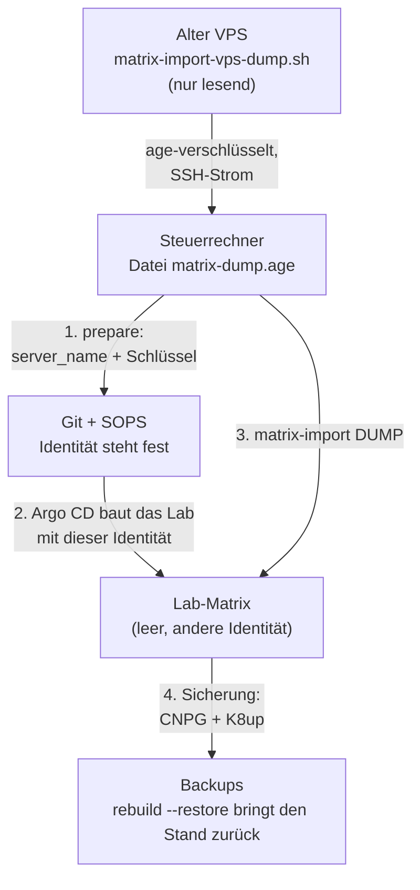

# Matrix-Import

`lab.sh matrix-import` spielt einen bestehenden Synapse-Server (die Produktion auf dem alten VPS) in das Lab-Matrix
ein: mit **`server_name`**, **Signaturschlüssel**, Konten samt Passwort-Hashes, Räumen, Verlauf, Medien und den
**Geräte- und Schlüsseldaten der Ende-zu-Ende-Verschlüsselung**. Bestehende Clients laufen nach einem späteren Umzug
weiter, ohne dass sich jemand neu anmelden oder Schlüssel neu austauschen muss. Die Begründung steht in
[ADR-0020](../concepts/decisions/0020-matrix-import.md).

**Optional und allgemein:** `server_name` und Quell-Host sind Eingaben. Ohne Import bleibt es bei der frischen Instanz
([Matrix im Lab](matrix.md)). **Die Föderation bleibt aus, immer.** Der Import ändert daran nichts.



## Entscheid: erst die Identität, dann der Inhalt

Der Import hat **einen** Weg für beide Fälle (Lab gleich mit dem Server bauen, oder in ein laufendes Lab einspielen):

1. `prepare DUMP` schreibt `server_name` und Signaturschlüssel des Dumps dorthin, wo das Lab sie ohnehin liest
   (`matrix_server_name` in `lab.yaml`, das im Git steht, dazu dieselbe Zeile in `lab.local.yaml`; Schlüsseldatei für das
   SOPS-Secret). Es braucht **kein Cluster**. Eine abweichende Zeile in `lab.local.yaml` führt zu `ABORT`, bevor etwas
   geschrieben wird.
2. Danach die übliche Reihenfolge `init`, `customize`, Commit, Push. Argo CD baut Matrix mit der Identität des Dumps.
3. `matrix-import DUMP` ersetzt Datenbank und Medien. Es **bricht ab**, wenn `server_name` oder Signaturschlüssel
   von Dump und Lab nicht übereinstimmen. Es tauscht die Identität nie selbst, denn der Schlüssel gehört in SOPS und
   nicht in einen Klartext, und die Identität soll in Git stehen, bevor Daten daran hängen.

!!! warning "Läuft das Lab schon mit einer erzeugten Identität"
    Wer erst später importiert, setzt `prepare`, `init`, `customize` und Push **vor** dem Import. Bis der Import den
    Schlüssel auf dem Volume ersetzt hat, hält Synapse an (`CrashLoopBackOff`: der Schlüssel im Secret weicht von dem
    auf dem Volume ab, das ist die gewollte Schutzprüfung). Das ist erwartet; der Import (oder `recover`) beendet es.

## Voraussetzungen

- Das Lab läuft (`lab.sh status`), Synapse ist bereit, `matrix-db` und die Sicherungen (K8up, CNPG) laufen.
- Die Synapse-Version des Labs ist **gleich oder neuer** als die des Dumps. Sonst `ABORT`: erst die Chart-Version in
  Git anheben.
- Auf dem Steuerrechner: `kubectl`, `python3`, `sha256sum`, `base64`, `age` und der **private age-Schlüssel** zu einem Empfänger aus
  `.sops.yaml` (`SOPS_AGE_KEY_FILE`, `~/.config/sops/age/keys.txt` oder `--age-key DATEI`).
- Auf dem alten VPS: ein Benutzer, der `docker` aufrufen darf, und `age`. Kein `sops`, kein privater Schlüssel.
- Ein Rechner mit **8 GB RAM** (zum Beispiel ein gemieteter Server) genügt: der Import legt **keinen** dauerhaften Dienst an (siehe
  [Speicherbedarf](#speicherbedarf)).

## Schritt für Schritt

Jeder Schritt hat einen eigenen Befehl.

1. **Empfänger und Befehle ausgeben** (nur lesen, ohne Cluster):

    ```bash
    bash scripts/lab.sh matrix-import recipients
    ```

2. **Auf dem VPS prüfen** (nur lesen: Container, Version, Datenbank, Medienpfad, Platz; nichts wird gedumpt):

    ```bash
    ssh "$MATRIX_IMPORT_SSH" 'bash -s -- --check' < scripts/matrix-import-vps-dump.sh
    ```

    Setze vorher `export MATRIX_IMPORT_SSH=benutzer@adresse` (`ansible_user` und `ansible_host` im Inventar deines
    VPS-Repositorys). Hängt der VPS nur an einem VPN, muss es oben sein; `recipients` zeigt dann denselben Zugang.

3. **Verschlüsselten Dump holen.** Der Dump wird nirgends unverschlüsselt abgelegt: `pg_dump` und `tar` gehen durch
   `age` direkt in den SSH-Strom. Der Befehl mit den Empfängern kommt aus Schritt 1:

    ```bash
    ssh "$MATRIX_IMPORT_SSH" 'bash -s -- --recipient age1...' < scripts/matrix-import-vps-dump.sh > matrix-dump.age.partial \
      && mv matrix-dump.age.partial matrix-dump.age
    ```

    Das Skript führt auf dem VPS nur `docker ps`, `docker inspect` und `docker exec` mit `pg_dump` und `tar` aus. Es
    stoppt, ändert und installiert **nichts** und schreibt **keine Datei**. Die Endung `.partial` bleibt, bis das Skript
    fehlerfrei fertig ist (die letzte Zeile sagt `done`). Mehrere Container: `--container`, `--postgres-container`.
    Der Stand der Datenbank ist der **Anfang** des Dumps, die Medien kommen danach: Medien, die während des Dumps
    entstehen, liegen ohne Datenbankeintrag im Medienspeicher und schaden nicht. Während eines späteren Umzugs soll der
    alte Server still sein (Umzugsfenster), sonst fehlt der Verlauf zwischen Dump und Umschalten.

4. **Identität vorbereiten** (ohne Cluster):

    ```bash
    bash scripts/lab.sh matrix-import prepare matrix-dump.age
    bash scripts/lab.sh init
    bash scripts/lab.sh customize
    git add -A secrets gitops infra/envs/local/lab.yaml && git commit -m 'Matrix: server_name and signing key of the imported homeserver' && git push
    ```

    `prepare` prüft auch ein vorhandenes `secrets/matrix/matrix-signing-key.sops.yaml`. Es entschlüsselt den Wert nur über
    eine Pipe (SOPS, nur der Hash wird verglichen, nie ein Wert angezeigt):

    - **Gleicher Schlüssel wie im Dump:** `SKIP`, die Datei bleibt.
    - **Anderer Schlüssel** (der eigene Schlüssel, den das Lab bei der ersten Einrichtung erzeugt hat): `prepare`
      **entfernt die Datei mit Absicht** (`git rm`, falls sie in Git steht) und meldet das mit `REMOVED`. `init` bricht
      sonst ab, weil die Datei schon einen anderen Schlüssel enthält. `init` verschlüsselt danach den Schlüssel des Dumps
      an dieselbe Stelle. Der alte Stand bleibt in der Git-Historie.
    - **Nicht entschlüsselbar** (falscher age-Schlüssel, Datei ohne `signing.key`): `ABORT`, nichts wird geändert.

    Dann warten, bis Argo CD synchronisiert hat (`kubectl -n argocd get applications`).

5. **Trockenlauf.** Lädt den Dump in einer Transaktion, prüft, zeigt Zahlen, macht die Transaktion **rückgängig**:

    ```bash
    bash scripts/lab.sh matrix-import matrix-dump.age --dry-run
    ```

6. **Import:**

    ```bash
    bash scripts/lab.sh matrix-import matrix-dump.age
    ```

    Am Ende laufen die Sicherung (CNPG-Base-Backup und K8up-Backup von Matrix) und die Abnahme.

7. **Abnahme** (jederzeit wiederholbar):

    ```bash
    MATRIX_IMPORT_VERIFY_LOGIN="alice:ALTES-PASSWORT" bash scripts/lab.sh matrix-import accept
    ```

    `MATRIX_IMPORT_VERIFY_LOGIN` ist eine Liste `benutzer:passwort` von Konten, deren altes Passwort noch gehen muss.
    Die Werte stehen nur in der Umgebung, nie in einem Befehl oder einer Ausgabe.

Die verschlüsselte Datei enthält Passwort-Hashes, Schlüssel und die Geheimnisse von Synapse: **nie unverschlüsselt
ablegen, nie in Git.** Nach dem Import kann sie gelöscht oder im Passwortspeicher aufbewahrt werden.

## Was bei jedem Aufruf entschieden wird

| Lage | Ergebnis |
|---|---|
| Derselbe Dump (gleiche SHA-256) wurde schon eingespielt | `SKIP`: nur die Abnahme läuft (`--reimport` erzwingt einen neuen Import) |
| Matrix ist leer (nur das Lab-Admin-Konto) | Import |
| Inhalt stammt aus einem früheren Import und ist unverändert (Fingerabdruck) | Import ersetzt ihn, ohne Rückfrage |
| Anderer Inhalt (Konten, Räume, Medien ausser dem Lab-Admin) | **`ABORT`**, nichts wird geändert |
| Anderer Inhalt und `--replace` | Rückfrage `[y/N]` (nur an einem Terminal, oder `--yes`), vorher K8up- und CNPG-Sicherung |
| `server_name` des Dumps ist nicht der des Labs | `ABORT`: `prepare` ausführen |
| Beide Signaturschlüssel gesetzt und verschieden | `ABORT` |
| Der Dump enthält ein Konto mit dem Namen des Lab-Admins | `ABORT` (Namenskollision): Lab-Admin umbenennen oder das Konto im Dump |
| Synapse im Lab ist älter als die im Dump | `ABORT` |
| Dump älter als `--max-age` Stunden (Standard 24) | Warnung; der Import läuft. Für den Umzug einen frischen Dump nehmen |

`--replace` ist **zerstörerisch**. `--no-backup` überspringt die Sicherungen (nur für Wegwerf-Labs).

## Was passiert beim Import

1. Den Dump **mehrfach** entschlüsseln, jedes Mal direkt in eine Pipe (keine Klartextdatei): Meta, Prüfung des ganzen
   Stroms, SQL, Medien, Geheimnisse. Quell-Host, Erstellzeit und Versionen werden angezeigt.
2. Identität, Version und Lage des Labs prüfen (Tabelle oben). Die Konfiguration der Quelle wird **gelesen und
   verglichen, nicht übernommen** (siehe [Nicht übernommen](#nicht-ubernommen)).
3. Argo CD anhalten (Auto-Sync von `root` und `matrix`), Synapse auf 0 skalieren, offene Datenbank-Sitzungen anderer Pods
   schliessen.
4. In **einer Transaktion**: das Schema `public` in `mxi_old` umbenennen, ein neues `public` anlegen, den Dump laden,
   Prüfungen (Zahlen, Fremdschlüssel, Konto des Lab-Admins), dann `mxi_old` löschen und `COMMIT`. Jeder Fehler davor
   macht `ROLLBACK`: die alte Datenbank ist unverändert.
5. Medien, Signaturschlüssel, `macaroon.secret` und `form.secret` in das Synapse-Volume schreiben.
6. Synapse hochfahren, Argo CD zurückstellen, Sicherung, Abnahme.

Der Schlüssel liegt zusätzlich im SOPS-Secret `matrix-signing-key`: ein `rebuild --restore` bringt dieselbe Identität
zurück. Der Einstiegspunkt der Chart hält an, wenn der Schlüssel auf dem Volume vom Secret abweicht.

## Abnahme

| Prüfung | Bedeutung |
|---|---|
| `server_name` des Labs, jedes Konto gehört dazu | gleich dem Dump |
| Zahl der Konten, Räume, Ereignisse, Medien, Geräteschlüssel, Einmalschlüssel, Raumschlüssel-Sicherungen | gleich dem Manifest des Dumps (ohne den Lab-Admin) |
| Geräte und Zugangstokens | mindestens so viele wie im Dump (Anmeldungen kommen dazu) |
| jede Mediendatei vorhanden, Grösse wie in der Datenbank | Medienspeicher passt zur Datenbank |
| Signaturschlüssel auf dem Volume | Hash gleich dem Schlüssel des Dumps (der Wert wird nie ausgegeben) |
| öffentlicher Schlüssel (`verify key`) des Labs | gleich dem der Quelle |
| Schlüssel im SOPS-Secret | ein Neuaufbau behält die Identität |
| Föderation aus | leere Whitelist, kein Federation- oder Key-Listener; `/_matrix/federation/v1/version`, `/_matrix/key/v2/server` und `/.well-known/matrix/server` geben 404 |
| Admin-Schnittstelle nicht erreichbar | fünf Schreibweisen von `/_synapse/admin` geben 403 |
| Registrierung offen? | muss abgelehnt werden |
| Anmeldung mit altem Passwort (Lab-Admin und `MATRIX_IMPORT_VERIFY_LOGIN`) | Kennung, `whoami`, beigetretene Räume, lesbarer Verlauf, Medium laden |
| Geräteschlüssel pro Konto | Server und Datenbank sagen dasselbe |
| Sicherung nach dem Import vorhanden | CNPG-Base-Backup und K8up-Backup |

!!! note "Anmeldegrenze"
    Synapse begrenzt Anmeldungen je Adresse (Standard: etwa 5 in 5 Minuten, im Arbeitsspeicher). Die Abnahme meldet sich
    für den Lab-Admin und jedes Konto aus `MATRIX_IMPORT_VERIFY_LOGIN` an. Wiederholte Läufe treffen deshalb auf
    `HTTP 429`; die Meldung nennt die Wartezeit. Ein Neustart von Synapse setzt die Zählung zurück.
    Dieselbe Grenze trifft Familienmitglieder hinter **einer** Adresse (NAT), die gleichzeitig Clients neu anmelden.

## Nicht übernommen

Die Konfiguration der Quelle wird **nicht** kopiert; das Chart des Labs entscheidet (Föderation aus, keine
URL-Vorschau). Der Import zeigt die Unterschiede als `INFO` und trägt sie nirgends ein. Beim Test gegen eine Quelle
mit typischer Konfiguration waren das `user_directory.search_all_users`, `extra_well_known_client_content`
(Anruf-Dienst `rtc_foci`), `rc_message`, `rc_login`, `experimental_features` und `max_event_delay_duration`.
Wer eines davon braucht, ergänzt es als Chart-Wert in Git. Ob der Import solche Werte künftig übernimmt, steht in [Issue 45](https://github.com/tabee/k8s-lab-template/issues/45).

Ebenfalls nicht importiert: der Vorschau-Cache der URLs und alles ausserhalb des Medienspeichers.

## Sicherung und `rebuild --restore`

Nach dem Import entsteht eine **frische Sicherung** (K8up-Backup der Dateien, CNPG-Base-Backup, WAL-Prüfung). Der
Befehl allein: `bash scripts/lab.sh matrix-import backup`. Zusätzlich erzwingt `rebuild --restore` selbst eine frische
Sicherung vor dem Zerstören der VM und fragt weiterhin **doppelt** nach; daran ändert der Import nichts.

Die Wiederherstellung spielt Datenbank und Medien-Volume zurück, der Schlüssel kommt aus SOPS. Auf einer frisch
gebauten VM gibt es keine Snapshot-Objekte; `ansible/tasks/recover-restore-one.yml` liest die Liste dann aus dem
restic-Repository.

## Anmeldung über Keycloak

Die Keycloak-Anmeldung ([ADR-0019](../concepts/decisions/0019-keycloak-sso.md)) gehört zum Stand des Labs. Ein
importiertes Konto `@alice:lab.dev` entspricht dem Keycloak-Benutzer `alice`
(`localpart_template: user.preferred_username`). Damit Synapse **das bestehende Konto verwendet** und kein zweites
anlegt, muss im `oidc_providers`-Eintrag `allow_existing_users: true` stehen. Der Import warnt, wenn das nicht
der Fall ist. Das lokale Admin-Konto (Notzugang) bleibt davon unberührt.

Der Schalter heisst `oidcAllowExistingUsers` (`gitops/charts/matrix/values.yaml`, Standard `false`, Teil der Reihe, kein
Zusatzpaket). Setze ihn erst **nach** dem Import auf `true`: vorher gibt es keine importierten Konten zu verknüpfen,
und auf einer frischen Instanz soll Keycloak nie ein bestehendes lokales Konto übernehmen können.

Nach dem Setzen des Schalters (Commit und Push) läuft alles von selbst weiter: Argo CD synchronisiert den Chart, die
Konfiguration `matrix-homeserver` ändert sich, und Synapse startet **von allein neu**. Das Deployment trägt dafür die
Annotation `checksum/config` (SHA-256 der gerenderten Konfiguration, Element ebenso). Ein manueller Neustart ist
nicht nötig. So prüfst du das Ergebnis:

1. Die Konfiguration enthält den Schalter:

    ```bash
    kubectl -n matrix get configmap matrix-homeserver -o yaml | grep allow_existing_users
    ```

    Erwartet: `allow_existing_users: true`.

2. Der Pod ist neu gestartet und läuft (`kubectl -n matrix get pods`, das Alter von `synapse-...` ist jung).
3. Anmeldetest in Element: über die Schaltfläche des Anbieters `Keycloak` (`oidcDisplayName`) als Benutzer `alice`. Es
   muss das **bestehende** Konto `@alice:lab.dev` mit seinen Räumen und seinem Verlauf erscheinen und kein neues,
   leeres Konto.

!!! warning "Nie einen Keycloak-Benutzer `lab-admin` anlegen"
    Mit `oidcAllowExistingUsers: true` meldet sich ein Keycloak-Benutzer mit dem Namen eines lokalen Kontos als dieses
    Konto an. Das lokale Notfall-Konto heisst `lab-admin` (Passwort-Anmeldung, `matrix.md`). Lege in Keycloak deshalb
    **nie** einen Benutzer `lab-admin` an, auch nicht deaktiviert in einer anderen Gruppe als Platzhalter. Zwei Sperren
    gelten zusätzlich: die Registrierung in Keycloak ist aus, und nur Mitglieder der Gruppe `lab-users` dürfen sich
    anmelden (`attribute_requirements`).

## Adresse des Lab-Heimservers

`server_name` ist `lab.dev` (die Identität, Teil jeder Benutzer- und Raum-ID). Die Clients sprechen aber mit
`matrix.<domain>`, und das Lab behält seine Domain `lab.example`: Element und Element X tragen nach dem Umzug einmalig
`https://matrix.lab.example` ein, Konten und Verlauf bleiben. Zieht das Lab später auf einen Rechner mit einer anderen
Domain, ist das eine Netzentscheidung (DNS, Zertifikat, `lab.sh customize`) und kein Teil des Imports; `server_name`
bleibt dabei unverändert.

## Speicherbedarf

Der Import legt zwei **kurzlebige** Pods im Namespace `matrix` an (`matrix-import-db`: 64 MiB angefordert, 512 MiB
Limit; `matrix-import-files`: 128 MiB, 768 MiB). Sie tragen das Label `app.kubernetes.io/name: matrix-import`, laufen
nach dem Pod-Sicherheitsstandard `restricted`, ohne Service-Account-Token, werden am Ende (und von `recover`) gelöscht.
Die bestehenden Policies genügen: keine neue NetworkPolicy. Es bleibt **nichts** Residentes zurück. Während des Imports
ist Synapse aus; das gleicht den Bedarf auf einem Rechner mit 8 GB aus.

## Abbruch und Aufräumen

- Fehler **vor** dem Tausch der Datenbank: alles wird rückgängig gemacht (Synapse wieder hoch, Argo CD zurück). Der
  Inhalt hat sich nicht geändert.
- Fehler **nach** dem Tausch: Synapse bleibt absichtlich **aus**; die Meldung nennt den Stand. Der gleiche Aufruf setzt
  fort.
- Ctrl-C oder ein abgebrochener Aufruf: `bash scripts/lab.sh matrix-import recover`. Es löscht die Hilfs-Pods,
  **schliesst Datenbank-Sitzungen, die ein abgebrochener Lauf zurückliess** (ein beendeter `kubectl exec` stoppt das
  `psql` im Pod nicht), fährt Synapse hoch und stellt Argo CD zurück.
- Zustand: ConfigMap `matrix-import-state` im Namespace `matrix`.

## Optionen

| Option | Wirkung |
|---|---|
| `--dry-run` | laden und prüfen, danach `ROLLBACK`; nichts Echtes ändern |
| `--replace`, `--yes` | fremden Inhalt ersetzen (Rückfrage `[y/N]`, `--yes` beantwortet sie) |
| `--reimport` | auch denselben Dump noch einmal einspielen |
| `--no-backup` | keine Sicherung vor `--replace` und keine danach |
| `--max-age STUNDEN` | Warnschwelle für das Alter des Dumps (Standard 24) |
| `--base-url`, `--cacert`, `--resolve H:P:IP` | wie die Abnahme das Lab erreicht (Standard `https://matrix.<domain>`) |
| `--age-key DATEI`, `--namespace NS`, `--context CTX` | Schlüssel, Namespace, kubectl-Kontext |

Die Optionen gehören dem Skript, nicht `lab.sh`: `lab.sh matrix-import` reicht sie unverändert weiter. Alles Weitere
steht im Kopf von `scripts/matrix-import.sh` und `scripts/matrix-import-vps-dump.sh`.

## Test ohne Produktion

Die schnellen Offline-Tests stehen in `tests/matrix-import-tests.sh` (Teil von `ci-tests.sh`): sie laufen ohne Cluster
mit Attrappen für `kubectl`, `docker` und `ssh`. Der Ablauf wurde ausserdem von Hand gegen eine Quelle (Synapse in
Docker, Postgres 16, Testkonten, ein verschlüsselter Raum, Medien) und ein Lab in k3s-in-Docker durchgespielt. Ein
Probelauf gegen den echten VPS steht aus ([Issue 46](https://github.com/tabee/k8s-lab-template/issues/46)).

## Grenzen

- Nur Synapse als Quelle und Ziel; Version Quelle ≤ Ziel; Postgres als Datenbank (SQLite wird abgelehnt).
- Medien auf einem externen Speicher (`media_storage_providers`) und ein Passwort-Pfeffer (`password_config.pepper`)
  werden nicht unterstützt; der VPS-Check meldet beides als `FAIL`.
- Der Handtest lief ohne echten VPS und ohne `svclb`: die Abnahme erreichte den Dienst über `kubectl port-forward`
  ([Issue 46](https://github.com/tabee/k8s-lab-template/issues/46)).
- `/_synapse/admin` ist für Anfragen von aussen gesperrt (Traefik, feste nie erreichbare Quelladresse). Von einer
  Adresse im Cluster selbst wurde es nicht geprüft ([Issue 46](https://github.com/tabee/k8s-lab-template/issues/46)); Grenzen insgesamt: [Issue 25](https://github.com/tabee/k8s-lab-template/issues/25).

## Siehe auch

[Matrix im Lab](matrix.md), [Gitea-Import](gitea-import.md), [Neuaufbau](rebuild.md),
[ADR-0020](../concepts/decisions/0020-matrix-import.md), [ADR-0016](../concepts/decisions/0016-matrix-federation-off.md)
