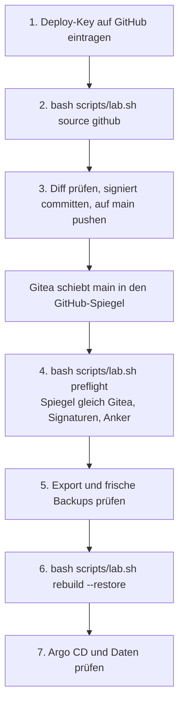

# Neuaufbau aus GitHub statt Gitea

**Ziel:** das ganze Lab abreissen, mit Tofu und Ansible neu bauen und Argo CD dabei aus dem **privaten GitHub-Spiegel**
lesen lassen statt aus Gitea. Das ist der Test, dass ein Neuaufbau auch ohne den eigenen Git-Server gelingt.
Entscheidung und Grenzen: [ADR-0024](../concepts/decisions/0024-github-as-switchable-source.md).

Die Quelle ist ein Schalter (`source`), kein zweites Lab: Gitea bleibt der Ort, an dem du entwickelst und signierst.
GitHub ist eine Kopie davon ([Privater GitHub-Spiegel](github-push-mirror.md)), und `lab.sh` prüft sie vor dem Bau
([Quellvertrauen](../concepts/source-trust.md)).



Für den Fall, dass vom Steuerrechner nur noch GitHub und ein Stick übrig sind, gilt
[Notfall-Neuaufbau](notfall-neuaufbau.md) (Notfall-Kit, Klon aus GitHub, Vorabprüfung ohne Gitea).

## Was der Schalter ändert

| | `source: gitea` (Standard) | `source: github` |
|---|---|---|
| Quelle von Argo CD | `repo_url` | `github_repo_url` (`ssh://git@github.com/YOUR-NAME/k8s-lab.git`) |
| Zugang | Deploy-Key `~/.ssh/argocd-k8s-lab` in Gitea | derselbe Schlüssel, nur lesend, als Deploy-Key des GitHub-Repos |
| Host-Keys | `repo_known_hosts` (selbst geholt) | `github_known_hosts`, fest eingetragen, Fingerabdrücke unten |
| Egress der Pods | genau die Adresse(n) des Git-Servers | die Bereiche, die GitHub für Git über SSH nennt, nur Port 22 |
| Quellvertrauen | `auto` | immer an, `source_trust: off` wird abgelehnt |
| Secrets-Repo | optional ([ADR-0022](../concepts/decisions/0022-private-secrets-repo.md)) | nicht möglich, die Secrets kommen aus dem Spiegel |

Argo CD liest nur Git. Darum steht der Schalter nicht nur in `lab.local.yaml`: `lab.sh source github` schreibt auch
die Adresse, die Egress-Regeln und den Zustand unter `gitops/`, und diese Änderung muss **signiert auf `main`** liegen,
bevor du baust. Das gilt für den Rückweg genauso.

### GitHub-Host-Keys

Die drei Schlüssel von `github.com` stehen in `infra/envs/local/lab.yaml` unter `github_known_hosts`. Ihre
Fingerabdrücke müssen mit der Liste von GitHub übereinstimmen
([GitHubs SSH-Schlüssel-Fingerabdrücke](https://docs.github.com/de/authentication/keeping-your-account-and-data-secure/githubs-ssh-key-fingerprints)):

| Typ | SHA-256-Fingerabdruck |
|---|---|
| ED25519 | `SHA256:+DiY3wvvV6TuJJhbpZisF/zLDA0zPMSvHdkr4UvCOqU` |
| ECDSA | `SHA256:p2QAMXNIC1TJYWeIOttrVc98/R1BUFWu3/LiyKgUfQM` |
| RSA | `SHA256:uNiVztksCsDhcc0u9e8BujQXVUpKZIDTMczCvj3tD2s` |

Ein Test (`tests/trust-tests.sh`) vergleicht die eingetragenen Schlüssel mit dieser Liste. Wer die Schlüssel frisch
holen will, nimmt `bash scripts/lab.sh customize --fetch-host-keys` (mit `source: github`): der Befehl bricht ab, wenn ein
Schlüssel nicht zur Liste gehört, und schreibt nichts.

## Ablauf Schritt für Schritt

### 1. Deploy-Key bei GitHub eintragen

```bash
cat ~/.ssh/argocd-k8s-lab.pub
```

GitHub → Repo `YOUR-NAME/k8s-lab` → **Settings → Deploy keys → Add deploy key**: Titel `argocd-k8s-lab`, den Inhalt der
`.pub`-Datei einfügen, **„Allow write access“ nicht ankreuzen**. Der Schlüssel gehört zu genau einem Repo; deshalb
gibt es in diesem Modus kein getrenntes Secrets-Repo.

Fehlt die Datei, legt `bash scripts/lab.sh init` sie an (bestehende Dateien bleiben).

### 2. Spiegel prüfen

Der Push-Mirror von Gitea nach `YOUR-NAME/k8s-lab` muss laufen ([Anleitung](github-push-mirror.md)). In Gitea unter
Einstellungen → Repository → Spiegel „Jetzt synchronisieren“ drücken, wenn du unsicher bist. Den Vergleich macht
Schritt 4 für dich.

Hast du in `lab.local.yaml` ein `secrets_repo_url` gesetzt, entferne es für diesen Test: `lab.sh` lehnt es im
GitHub-Modus ab.

### 3. Schalter setzen und auf `main` bringen

```bash
git switch main && git pull --ff-only
git switch -c chore/quelle-github
bash scripts/lab.sh source github
git diff --stat
```

`source github` schreibt `source: github` in `infra/envs/local/lab.local.yaml` (nicht in Git) und ruft `customize` und
`repo-egress` auf. Im Diff siehst du nur: die Repo-Adresse in den Dateien unter `gitops/`, die sie enthalten (Apps, `values-state.yaml`), und die
Egress-Bereiche und den Port in den NetworkPolicies (`gitops/workloads/argocd/`, `gitops/workloads/docs/`, `gitops/charts/notes-site/`). Dann signiert committen und `main` vorrücken
(nur Fast-Forward, wie der Branch-Schutz es verlangt):

```bash
git add gitops
git commit -S -m "Switch the Argo CD source to the GitHub mirror"
git switch main
git merge --ff-only chore/quelle-github
git push origin main
```

Gitea schiebt `main` danach in den Spiegel (Sync bei Push). `bash scripts/lab.sh source status` zeigt zwischendurch,
welche Quelle gilt und ob `gitops/` dazu passt.

### Laufende VM umstellen statt neu bauen {#laufende-vm-umstellen}

Der normale Weg ist `rebuild --restore` (Schritt 6): ein frischer Bau legt die Egress-Policy gleich passend an. Willst du
die Quelle auf einer **laufenden** VM wechseln, gibt es ein Henne-Ei-Problem: Die NetworkPolicy des `argocd-repo-server`
verteilt Argo CD selbst (App `argocd-ingress`). Argo CD liest diese App aber schon aus der neuen Quelle, und die alte
Policy lässt genau diese Quelle noch nicht durch. Argo CD kommt also nie an die Datei, die es freischalten würde.

**Was hilft:** die Policy einmal von Hand anlegen, danach den Rest per Ansible nachziehen. Erst nach dem Push auf `main`:

```bash
kubectl apply -f gitops/workloads/argocd/networkpolicy.yaml
bash scripts/lab.sh sync-host
```

`sync-host` setzt die `sourceRepos` der AppProjects, das Repo-Secret und die Root-App auf die neue Quelle. Ab dann
verwaltet Argo CD die Policy wieder selbst, die Handarbeit wird beim nächsten Sync überschrieben (mit demselben Inhalt).
`lab.sh source github` (und `source gitea`) nennt diese zwei Befehle am Ende seiner Ausgabe. Der Rückweg auf Gitea geht
genauso.

**Eselsbrücke:** Der Türsteher lässt den Boten mit dem neuen Türsteher-Ausweis nicht herein. Also hängst du den Ausweis
einmal selbst an die Tür.

### 4. Vorabprüfung

```bash
bash scripts/lab.sh preflight
```

Im GitHub-Modus prüft sie zusätzlich:

- der Deploy-Key liest das GitHub-Repo, mit den festen Host-Keys;
- `main` auf GitHub ist ein **signierter Nachfahre** des vertrauten Commits (`~/.config/k8s-lab/trusted-head`; ohne
  Anker zuerst `bash scripts/lab.sh trust init COMMIT`, siehe [Spiegel-Anleitung](github-push-mirror.md#vertrauten-commit-festlegen));
- `main` auf GitHub ist **derselbe Commit wie `origin/main` in Gitea**. Steht GitHub dahinter
  (`BEHIND`), hat der Spiegel noch nicht synchronisiert: warten oder in Gitea „Jetzt synchronisieren“, dann wiederholen.
  Steht GitHub woanders (`NOT the Git server's`), wurde der Spiegel hinter Gitea verändert: nicht bauen, im Konto nachsehen.
  Ist Gitea nicht erreichbar, vergleicht der Preflight mit dem lokalen `main` und warnt:
  [Wenn Gitea nicht erreichbar ist](#wenn-gitea-nicht-erreichbar-ist);
- `github.com` liegt jetzt noch in den erlaubten Egress-Bereichen (sonst `DRIFT`; Abhilfe:
  `bash scripts/lab.sh repo-egress --resolve`, committieren, pushen).

Alles muss `OK` sein. Dann:

### 5. Vor dem Abreissen: Sicherung und Prüfung

!!! danger "Ein einfaches `rebuild` löscht die Daten"
    `bash scripts/lab.sh rebuild` startet leer und leert sogar den Postgres-Bucket. Damit die Daten (Gitea, Matrix,
    Keycloak, `pg-lab`) aus dem GitHub-Neuaufbau wieder da sind, nimm **`rebuild --restore`**. Git bleibt dabei unverändert;
    die Quelle (GitHub) und die Daten (Backups in rustfs) sind unabhängig voneinander
    ([Neuaufbau, `--restore`](rebuild.md#restore-oder-leer), [ADR-0018](../concepts/decisions/0018-recover-from-backup.md)).

`rebuild --restore` verlangt einen frischen Export (jünger als `export_max_age_h`, 24 Stunden), eine saubere Arbeitskopie auf
`main` (also den Schalter-Commit schon gemergt) und einen gefüllten Postgres-Bucket. Auf einer laufenden VM nimmt es **selbst** noch neue CNPG-Basis-Backups
und K8up-Dateibackups, bevor es die Platte zerstört, und prüft, dass das WAL-Archiv sie deckt; schlägt das fehl, bleibt
die VM stehen. Du kannst dasselbe vorher von Hand tun und kontrollieren:

```bash
export KUBECONFIG=~/.kube/k3s-lab.kubeconfig

# 1. Fallschirm: Export der VM-Platte (fährt die VM kurz herunter und wieder hoch)
bash scripts/lab.sh export

# 2. Ist die laufende VM vollständig? (verweigert bei halb wiederhergestellter VM)
python3 scripts/lab-backup-fresh.py --guard --marker ~/k8s-lab-data/state/restore-in-progress.json

# 3. Frische Backups: je ein CNPG-Basis-Backup pro Datenbank (pg-lab, gitea-db, matrix-db, keycloak-db)
#    und je ein K8up-Dateibackup (Gitea, Matrix); wartet, bis jedes neu genug ist
python3 scripts/lab-backup-fresh.py --max-age-h 30 --force-all --prefix vor-github

# 4. Prüfen: nichts fehlt oder ist älter als 30 Stunden; das WAL-Archiv deckt das letzte Backup
python3 scripts/lab-backup-fresh.py --max-age-h 30 --check
python3 scripts/lab-wal-ready.py

# 5. Sichtprüfung
kubectl get backups.postgresql.cnpg.io -A
kubectl -n gitea get backups.k8up.io,snapshots.k8up.io
kubectl -n matrix get backups.k8up.io,snapshots.k8up.io
```

Alle Backups müssen `completed` sein, und jede Datenbank und jedes Datei-Volume hat ein Backup jünger als 30 Stunden.
`kubectl get backup` ohne Zusatz zeigt nur K8up; CNPG heisst `backups.postgresql.cnpg.io`.
Die 30 Stunden entsprechen `backup_max_age_h` (`restore_drill_max_age_h`).

Optional, aber der stärkere Beweis: `bash scripts/lab.sh restore-drill` stellt Gitea (Datenbank und Dateien) in einem
Wegwerf-Namespace allein aus den Backups her ([Restore-Test](restore-drill.md)). Eine Kopie der Backups auf einem zweiten
Rechner: [Backup-Replikat](backup-replica.md) (`bash scripts/lab.sh replica verify`).

Die Zeilen 2 bis 4 sind eine Vorabprüfung. `rebuild --restore` wiederholt sie als eigene Phasen
(`Restore guard`, `Fresh backups before the VM is destroyed`, `WAL archive covers the latest backup`).

### 6. Abreissen und neu bauen

```bash
bash scripts/lab.sh rebuild --restore
```

Der Befehl fragt zuerst nach dem Wort `restore`, dann nach dem VM-Namen `k3s-lab` (`--yes` überspringt das nicht),
dann nach dem sudo-Kennwort (Eintrag in `/etc/hosts`). Er reisst die VM ab, baut sie mit Tofu neu, richtet sie
mit Ansible ein, bindet Argo CD an den geprüften GitHub-Commit, spielt die Datenbanken (CNPG-Recovery) und die Dateien
von Gitea und Matrix (K8up-Snapshot) zurück und nimmt am Ende neue Backups des wiederhergestellten Labs. Dann prüft er
das Quellvertrauen noch einmal und löst den Pin ([Pin](../concepts/source-trust.md#pin-waehrend-des-neuaufbaus)).
Allgemein zum Ablauf: [Neuaufbau](rebuild.md). Bricht der Lauf ab: [Der Lauf blieb halb stehen](rebuild.md#restore-halb).

### 7. Danach prüfen

```bash
export KUBECONFIG=~/.kube/k3s-lab.kubeconfig
kubectl -n argocd get applications.argoproj.io \
  -o custom-columns=NAME:.metadata.name,REPO:.spec.source.repoURL,SYNC:.status.sync.status,HEALTH:.status.health.status
kubectl -n argocd get application root -o jsonpath='{.spec.source.repoURL}  {.status.sync.revision}{"\n"}'
kubectl -n argocd get secret repo-k8s-lab -o jsonpath='{.data.url}' | base64 -d; echo
git rev-parse origin/main
bash scripts/lab.sh trust status
```

| Prüfung | Soll |
|---|---|
| Alle Apps | `SYNC` ist `Synced`, `HEALTH` ist `Healthy` (Apps mit mehreren Quellen zeigen bei `REPO` nichts an) |
| Repo-Adresse | `ssh://git@github.com/YOUR-NAME/k8s-lab.git`, bei der Root-App und im Repo-Secret `repo-k8s-lab` |
| Revision | `.status.sync.revision` der Root-App ist `git rev-parse origin/main` (voller Hash) |
| Pin | In der Ausgabe von `rebuild` am Ende: `Source trust: repo_url is still at the verified commit` und `Argo CD follows the branch again (pin to … released)`; danach folgt Argo CD wieder `main` |
| Vertrauen | `trust status` nennt denselben Commit als vertraut |
| Daten | Die Zeilen, die du kennst, sind da: ein Repo in Gitea, ein Raum in Matrix, ein Benutzer in Keycloak ([Gitea wiederherstellen](restore-gitea.md), [Datenbank wiederherstellen](restore-database.md)) |

Zusätzlich die [Abnahme](acceptance.md): `bash scripts/lab.sh acceptance`. Den Export löschst du erst, wenn die Daten
geprüft sind.

## Wenn Gitea nicht erreichbar ist {#wenn-gitea-nicht-erreichbar-ist}

Der wichtigste Einsatz des Spiegels: Gitea ist nicht da (ausgefallen, kein VPN, Gitea läuft später selbst im Lab und
ist dann erst nach dem Neuaufbau wieder verfügbar), und das Lab soll trotzdem aus GitHub entstehen. Dafür fragt der
Preflight Gitea nicht zwingend. Kann `lab.sh` den Git-Server (`origin`) nicht abrufen, bricht es im GitHub-Modus **nicht**
ab, sondern warnt und vergleicht GitHub mit dem **letzten lokal bekannten Stand**:

| Was verglichen wird | Woher der Wert kommt |
|---|---|
| `main` auf GitHub (`r`) | direkt von GitHub, mit Deploy-Key und festen Host-Keys |
| lokaler `main` (`HEAD`) | dein Klon auf diesem Rechner |
| `origin/main` | der Zeiger, wie er beim letzten erfolgreichen `git fetch` oder `git pull` war |
| Anker | `~/.config/k8s-lab/trusted-head` |

Die Voraussetzungen bleiben: Branch `main`, und weil Gitea nichts mehr bestätigen kann, müssen auch alle verfolgten
Dateien sauber sein (nicht verfolgte Dateien zählen nicht). Weicht dein `main` vom zuletzt geholten `origin/main` ab,
bricht der Preflight ebenfalls ab: Der Klon ist dann in keinem bekannten Stand.

Danach gilt die übliche Prüfung: `r` muss ein **signierter Nachfahre des Ankers** sein
([Quellvertrauen](../concepts/source-trust.md)). Zusätzlich wird `r` mit dem lokalen `main` verglichen:

| Befund | Meldung | Wirkung |
|---|---|---|
| `r` ist gleich lokalem `main` | Warnung `Git server (origin) is unreachable`, dann `the mirror equals the last locally known main` | in Ordnung; Argo CD wird an `r` gebunden, der Anker rückt vor |
| `r` ist ein Vorfahre des lokalen `main` | `BEHIND the last locally known main` | Fehler: GitHub steht hinter deinem Klon (Spiegel noch nicht nachgezogen, oder lokale Commits nie gepusht) |
| `r` liegt vor dem lokalen `main` oder daneben | `GitHub is at … which has commits this PC never saw from the Git server` | Fehler, es ändert sich nichts; der Anker wird nie auf einen Commit gesetzt, den dieser Rechner nicht gesehen hat |

Der dritte Fall ist der heikle: GitHub kennt Commits, die dieser Rechner nie von Gitea erhalten hat. Das kann ein
berechtigter Push sein, den du auf einem anderen Gerät gemacht hast, oder ein manipulierter Spiegel. Lies zuerst, was
dazugekommen ist:

```bash
git log HEAD..<Commit-ID aus der Meldung>
```

Nur wenn du jeden dieser Commits kennst, wiederholst du den Befehl mit `--trust-override`. Das verlangt wie sonst die
getippten ersten 7 Zeichen der Commit-ID (`--yes` überspringt das nicht). Der Override bindet Argo CD an diesen Commit,
zeichnet ihn aber **nicht** als Anker auf: Der Anker wandert erst weiter, wenn dein Klon den Commit von Gitea erhalten
hat und `bash scripts/lab.sh trust check` ihn prüft.

!!! note "Warum das sicher ist"
    Drei Dinge zusammen: Die **Signaturen** (nur erlaubte Signierschlüssel, aus dem Elternteil jedes Commits), der **Anker**
    (nur Nachfahren des zuletzt vertrauten Commits) und der **letzte lokal bekannte Stand** (GitHub darf nichts enthalten,
    was dieser Rechner nicht von Gitea gesehen hat, es sei denn, du bestätigst es von Hand). Wer nur GitHub kontrolliert,
    kann also weder einen neuen Commit einschleusen noch den Spiegel zurückdrehen, ohne dass der Preflight abbricht.

!!! warning "Halte den lokalen Klon aktuell"
    Der Vergleich ist nur so gut wie dein Klon. Hole nach jeder Änderung an `main`, solange Gitea läuft:
    `git switch main && git pull --ff-only`. Ein veralteter Klon liefert im Notfall `BEHIND` und zwingt dich zum Warten
    oder zum Override. Ein Gitea, das nicht erreichbar ist, kann zudem nicht bestätigen, dass `main` dort nicht
    weitergegangen ist; diesen Rest deckt nur der Klon ab.

Ist Gitea erreichbar, gilt wieder der strenge Vergleich mit `origin/main`; der Override ersetzt ihn dann nicht.

## Zurück auf Gitea

Der Rückweg ist dieselbe Handlung mit dem anderen Wort, ebenfalls signiert auf `main`:

```bash
git switch main && git pull --ff-only
git switch -c chore/quelle-gitea
bash scripts/lab.sh source gitea
git add gitops
git commit -S -m "Switch the Argo CD source back to Gitea"
git switch main
git merge --ff-only chore/quelle-gitea
git push origin main
```

Danach baut `bash scripts/lab.sh rebuild --restore` wieder aus Gitea. Auf einer laufenden VM schreibt
`bash scripts/lab.sh up` das Repo-Secret und die Host-Keys von Argo CD neu (idempotent); ohne diesen Schritt kennt
Argo CD die Zugangsdaten für die neue Adresse nicht. `source gitea` setzt nur den Schalter zurück; die `github_*`-Werte in `lab.yaml` bleiben
für den nächsten Versuch stehen.

## Grenzen

- **Secrets:** Im GitHub-Modus liegt der Ciphertext (SOPS) im selben Repo wie der Code, also im Spiegel. Ein Deploy-Key
  gilt nur für ein Repo. Ein getrenntes Secrets-Repo ([ADR-0022](../concepts/decisions/0022-private-secrets-repo.md))
  ginge nur mit einem zweiten Schlüssel und einem zweiten GitHub-Repo; das ist nicht gebaut. Die age-Schlüsseldatei
  kommt nie aus Git, sie bleibt auf dem Steuerrechner.
- **Egress:** GitHub nennt Bereiche, keine festen Adressen. Die Bereiche stehen in `github_egress_cidrs`. Wechselt
  GitHub, meldet der Preflight `DRIFT`. Ein Test der Bereiche in einer laufenden Umgebung gibt es nicht
  ([Issue 72](https://github.com/tabee/k8s-lab-template/issues/72)).
- **Web-Merges:** Ein Merge über die Gitea-Oberfläche erzeugt einen unsignierten Commit und fällt beim Quellvertrauen durch
  ([Issue 73](https://github.com/tabee/k8s-lab-template/issues/73)).
- **SSH über Port 443** (`ssh.github.com`) ist nicht eingebaut. Ist Port 22 gesperrt, braucht es eine eigene Änderung.
