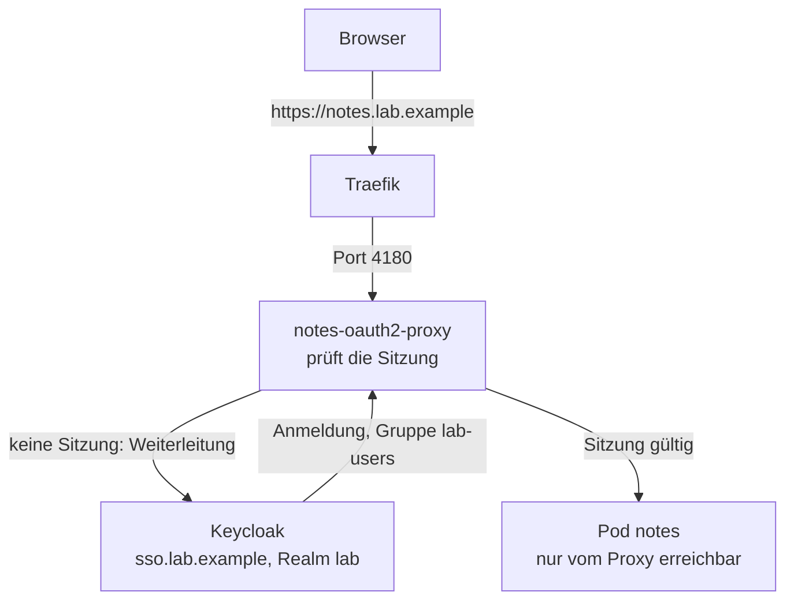

# Notiz-Sites notes.lab.example (N Sites aus einer Liste)

## Inhalt und Build-Abhängigkeiten getrennt beziehen {#inhalt-und-theme}

Der **Inhalt** bleibt im privaten Gitea-Repo und wird per SSH mit dem eigenen
Deploy-Key und gepinnten Host-Schlüsseln gelesen. Die Argo-Codequelle ist davon
unabhängig: Ein Wechsel auf GitHub ändert nicht die Herkunft des Notizbuchs.
**Theme und Plugins** kommen aus öffentlichen GitHub-Spiegeln. Jede Abhängigkeit
muss auf einen Commit zeigen, der im Spiegel tatsächlich vorhanden ist; ein alter
Gitlink aus einer neu geschriebenen Historie reicht nicht. Der Plugin-Pin steht
zentral in `docs/build.sh` (`ZG_URL`/`ZG_COMMIT`), nicht nochmals im Notizbuch.

Ein bestehendes Theme-Submodul im lokalen Inhaltsrepo umstellen (Arbeitsbaum vorher
auf ungesicherte Änderungen prüfen):

```bash
git pull --ff-only
git submodule set-url theme https://github.com/YOUR-NAME/zensical-theme.git
git submodule sync -- theme
git -C theme fetch origin main
git -C theme checkout --detach 3cc6216
git add .gitmodules theme
git diff --cached --submodule=log
git commit -m "Pin theme from GitHub mirror"
git push origin main
```

`3cc6216` ist der am 07.11.2026 verwendete, im Spiegel vorhandene Theme-Stand.
Für einen anderen Stand zuerst dessen Erreichbarkeit im Spiegel prüfen und dann
den Gitlink bewusst aktualisieren. Der losgelöste HEAD im Submodul ist für einen
festen Pin normal. Das Beispiel setzt ein bereits initialisiertes Submodul voraus;
bei einem frischen Klon nach `set-url` und `sync` zuerst
`git submodule update --init -- theme` ausführen, sofern der bisherige Gitlink im
Spiegel vorhanden ist. Fehlt er dort, den gewünschten vorhandenen Pin in einem
bestehenden Klon setzen und die Änderung zuerst im Inhaltsrepo veröffentlichen.

!!! warning "Kein pauschales HTTPS-Loch"
    Gitea-HTTPS auf Port 443 ist kein Ersatz für den freigegebenen Inhalts-SSH-Pfad.
    Die NetworkPolicy bleibt eng: Inhalts-Host und SSH-Port gezielt pinnen,
    Theme/Plugins über die vorgesehenen GitHub-/HTTPS-Regeln beziehen. Bei einem
    gesperrten Submodul zuerst URL und Commit korrigieren, nicht alle Ziele öffnen.

## WAS und WARUM

**Was:** Jedes Notiz-Repo (z. B. dein Obsidian-Vault `YOUR-NAME/notizen`) wird
eine eigene Website, geschützt durch die Anmeldung mit Keycloak: https://notes.lab.example,
später `notes2`, `notes3` ... Gebaut mit Zensical (Standard-Theme).
Alle Sites
stehen in EINER Liste, `gitops/sites.yaml`. Ein Eintrag = ein Notizbuch.

**Warum:** Notizen lesen sich im Browser besser (Suche, Menü, Graph), und
sie sind immer auf dem Stand von Git. Die Doku-Site (`docs`) kann das
schon. Hier wird dasselbe Muster zur Vorlage: einmal gebaut, beliebig oft
benutzt, ohne pro Notizbuch YAML zu kopieren. Notizen sind privat, darum
steht vor jeder Site die Anmeldung mit Keycloak (Realm `lab`, Gruppe
`lab-users`; die Doku-Site ist offen). Wer kein Keycloak will, setzt pro
Site `auth: basic` (HTTP-Basic-Auth, Notausgang).

**Eselsbrücke:** *"Eine Liste, ein Stempel, N Abzüge."* Die Liste ist
`sites.yaml`, der Stempel das Helm-Chart, das ApplicationSet drückt pro
Zeile einen Abzug.

## Wie es funktioniert

```text
gitops/sites.yaml  (name, repo, host)
   |                                  \
   v Argo CD                           v Ansible (argocd.yml, Rolle notes_sites)
ApplicationSet notes                   pro Eintrag: Namespace notes-<name> (PSA restricted),
  git-files-Generator                  Deploy-Key ~/.ssh/notes-<name>-deploy (nur wenn neu),
  -> Application notes-<name>          Cookie-Schlüssel ~/.config/k8s-lab/notes-<name>.cookie (nur wenn neu),
     Chart gitops/charts/notes-site    Secrets notes-repo + notes-oidc im Namespace
        |
        v Namespace notes-<name>
Pod notes: builder (alle 60 s git fetch, build.sh, mv --exchange) + web (static-web-server)
Pod notes-oauth2-proxy (Login, 64 MiB)  --> nur dieser darf den Pod notes erreichen
   ^ nur Traefik (NetworkPolicy notes-allow-traefik, Port 4180)
Traefik :443  TLS notes-tls (lab-ca)  Middleware notes-no-cache
   ^
Browser https://notes.lab.example  (Anmeldung bei https://sso.lab.example)
```

- **Eine Liste, zwei Leser.** Argo CD liest `gitops/sites.yaml` über den
  git-files-Generator des ApplicationSets `notes` (`gitops/apps/notes.yaml`)
  und macht pro Eintrag eine Application `notes-<name>`. Ansible liest
  dieselbe Datei für das, was nicht ins Git darf (Schlüssel, Passwort).
  Das ist eine bewusste Ausnahme von "Ansible liest kein gitops/": sonst
  gäbe es zwei Listen, die auseinanderlaufen.
- **Ein Chart für alle.** `gitops/charts/notes-site` enthält Deployment,
  Service, Certificate, IngressRoute, Middlewares, NetworkPolicy und (bei
  `auth: sso`) den Login-Proxy oauth2-proxy. Die
  Werte pro Site (Name, Host, Repo, Branch) setzt das ApplicationSet.
- **Eigenes Projekt `notes`.** Die Apps dürfen nur in Namespaces
  `notes-*` schreiben und keine clusterweiten Objekte anlegen. Das Projekt
  legt Ansible an (wie `lab` und `platform`).
- **Gleicher Build wie die Doku.** Der Pod nimmt `docs/build.sh` aus
  k8s-lab (per Symlink im Chart, keine Kopie). Pins für Zensical, Plugin
  und Python-Pakete gibt es nur dort (`ZG_URL`/`ZG_COMMIT`, `docs/requirements.txt`).
  Drei Umgebungsvariablen machen ihn allgemein:
  `ZENSICAL_PROJECT` (anderes Repo bauen), `ZENSICAL_PREPARE` (Skript
  vorher) und `ZENSICAL_STRICT=0` (Warnungen brechen nicht ab).
  Submodules des Notiz-Repos (z. B. ein Theme für `custom_dir`) holt der
  Builder mit und kopiert sie in die Arbeitskopie; `git archive` allein
  liesse sie leer. Öffentliche HTTPS-URLs brauchen keinen Schlüssel.
- **Vorbereitung `notes-prepare.py`** (im Chart, läuft auf einer Kopie,
  nie im Repo):
    1. Hat das Repo eine `zensical.toml`, gilt sie. Überschrieben werden nur
       `site_url` (passend zum Host) und der Abschnitt Wissensgraph. Ohne
       `zensical.toml` gibt es eine Standard-Konfiguration (Default-Theme,
       Titel aus `title`).
    2. Entfernt werden `AGENTS.md`, `.obsidian/`, Vorlagen und alles aus dem
       `exclude_docs` des Repos (bei `YOUR-NAME/notizen`: `vorlagen/`, `ods.toml`).
       Wirklich gelöscht in der Kopie, damit sie auch in der Suche fehlen.
- **Alle Notizen sichtbar.** Auch Notizen mit `share: private` erscheinen,
  denn die Anmeldung schützt die ganze Site. Wer das pro Site anders will:
  `private_filter: true` in `sites.yaml` (optional, Standard aus, bei
  `notes` aus).
- **Fehlgeschlagener Build:** Die alte Version bleibt online. Der Builder
  versucht es jede Minute wieder (der Fehler steht dann jede Minute im
  Log), bis ein neuer Commit ihn repariert. Ein toter Link ist nur eine
  Warnung (`strict` ist für Notizen aus): Notizen verlinken oft auf
  Seiten, die es noch nicht gibt, oder auf ausgeschlossene wie `AGENTS.md`.

## SSH-Vertrauen für den Inhalt

**Was und warum:** `repo_known_hosts` steht pro Site in `gitops/sites.yaml`.
Diese öffentlichen Host-Schlüssel gehören zur **Content-URL** `repo`, nicht zur
Argo-CD-Codequelle. Ein Wechsel der Codequelle darf das Vertrauen für Notizen
nicht ändern. Für einen Nichtstandard-Port lautet der Host-Eintrag `[hostname]:port`,
für Port 22 nur `hostname`. Fehlende oder unpassende Einträge brechen Ansible vor der
Secret-Erstellung ab.

**Wie:** Öffentliche Host-Schlüssel beim Betreiber beschaffen und die Fingerprints
über einen unabhängigen Kanal vergleichen. Erst danach die geprüften Zeilen als
Liste `repo_known_hosts` beim Eintrag ergänzen. Kein automatisches Vertrauen in
ungeprüfte `ssh-keyscan`-Ausgaben, keine privaten Schlüssel in Git.

Ansible schreibt die Liste in `notes-repo/known_hosts`; Deploy-Key und Login bleiben
unverändert. Nach dem Merge aktualisiert `cd ansible && ansible-playbook argocd.yml`
das bestehende Secret. Ein Argo-Refresh allein reicht nicht. Auch der nächste
`rebuild --restore` führt diese Rolle erneut aus; `lab.sh export` sichert nur die
VM und aktualisiert das Secret nicht. Die projizierte Secret-Datei wird von
Kubernetes nachgezogen, anschliessend versucht der Builder den Fetch erneut.

**Eselsbrücke:** *Codequelle ist Bauplan, Content-Host ist Notizbuch: jeder hat seinen eigenen Ausweis.*

## Neues Notizbuch (z. B. notes2)

1. Leeres Repo in Gitea anlegen, z. B. `YOUR-NAME/notizen2`, Markdown hinein.
   `zensical.toml` ist optional.
2. In `gitops/sites.yaml` anhängen, committen, pushen:

   ```yaml
   - name: notes2
     repo: ssh://git@git.example.org/YOUR-NAME/notizen2.git
     repo_egress_cidrs: ["203.0.113.10/32"]
     repo_known_hosts: []
     host: notes2.lab.example
   ```

   Vor dem Commit `repo_known_hosts` mit den geprüften Host-Schlüsseln füllen
   (siehe Abschnitt oben). Die leere Liste ist absichtlich kein gültiger Trust-Pin.

   Ohne `auth:` gilt `sso` (Vorgabe in `gitops/charts/notes-site/values.yaml`).
   Der Keycloak-Client `notes` bekommt die Adresse der neuen Site von selbst
   (er liest dieselbe Liste), sobald Argo CD `keycloak` und der Realm-Job
   neu gelaufen sind.

3. Einmal `cd ansible && ansible-playbook argocd.yml`. Am Ende steht unter
   "Nächste Schritte" der **öffentliche** Deploy-Key und der Link in
   Gitea (Repo > Einstellungen > Deploy-Schlüssel). Dort eintragen,
   **ohne** Schreibzugriff.
4. Anmelden: mit deinem Keycloak-Konto (Mitglied der Gruppe `lab-users`).
   Ein Passwort für die Site gibt es nicht; der Cookie-Schlüssel des Proxys
   liegt in `~/.config/k8s-lab/notes-notes2.cookie` und wird nie angezeigt.
   Nur bei `auth: basic`: `wl-copy < ~/.config/k8s-lab/notes-notes2.passwort`
   (Benutzer: `name` bzw. `user`).
5. Auf deinem Rechner in `/etc/hosts`:
   `192.168.122.50 notes2.lab.example`
6. Prüfen: `ansible-playbook verify-notes.yml` (alle Sites) oder
   `ansible-playbook verify-notes.yml -e verify_notes_only=notes2`.

Bis der Deploy-Key in Gitea steht, meldet der Builder alle 60 s
"git fetch fehlgeschlagen" und die App ist Progressing. Das ist normal,
danach ist die Site in rund 2 Minuten da.

**Warum ein Deploy-Key pro Site:** nur lesend und nur für dieses eine
Repo. Fällt einer in falsche Hände, ist genau ein Notizbuch lesbar, und
du löschst genau diesen Schlüssel in Gitea.

**Warum Ansible die Schlüssel macht:** Geheimes gehört nicht ins Git.
Ansible erzeugt Schlüssel und Passwort nur, wenn sie fehlen, und
überschreibt sie nie. Ein zweiter Lauf ändert nichts (`changed=0`), und
nach einem frischen Bootstrap legt derselbe Lauf die Secrets aus den
gleichen Dateien wieder an.

## Notizbuch entfernen

Eintrag aus `sites.yaml` löschen, committen, pushen. Argo CD löscht die
Application `notes-<name>` und alles, was sie angelegt hat (Pod,
Zertifikat, IngressRoute ...), im Test nach knapp 3 Minuten. Die
Adresse antwortet dann gar nicht mehr (TLS-Fehler wie ein unbekannter
Name). **Bleiben** (bewusst, nichts geht
versehentlich verloren): der Namespace `notes-<name>` mit den Secrets
`notes-repo`, `notes-oidc` (bzw. `notes-auth`) und `notes-tls` (cert-manager löscht
Zertifikats-Secrets nie selbst), der Deploy-Key unter `~/.ssh/` und die
Cookie-Datei (bzw. Passwort-Datei). `ansible-playbook argocd.yml` meldet danach "Namespace
notes-<name> hat keinen Eintrag mehr in sites.yaml" mit den Befehlen
zum Aufräumen:

```bash
kubectl delete namespace notes-notes2
rm ~/.ssh/notes-notes2-deploy ~/.ssh/notes-notes2-deploy.pub ~/.config/k8s-lab/notes-notes2.cookie ~/.config/k8s-lab/notes-notes2.passwort
```

Dazu in Gitea den Deploy-Key des Repos löschen.

## Benutzen

- **Adresse:** https://notes.lab.example. Der Browser leitet zu
  https://sso.lab.example weiter; nach der Anmeldung (Gruppe `lab-users`)
  bist du auf der Site. Die Sitzung gilt bis zu 10 Stunden. Ein Konto ohne
  die Gruppe sieht "403 Forbidden", nicht die Notizen.
- **Abmelden:** https://notes.lab.example/oauth2/sign_out beendet die
  Sitzung der Site **und** die Keycloak-Sitzung (danach fragt auch Gitea
  oder Element wieder nach dem Passwort).
- **Graph:** Menüpunkt "Wissensgraph" (`/wissensgraph/`). Punkte sind
  Notizen, Linien Markdown-Links.
- **Neue Notiz:** in Obsidian schreiben, committen, pushen. Spätestens
  nach rund 2 Minuten online (60 s Abfrage plus Build).
- **Builder-Logs:**

  ```bash
  kubectl -n notes-notes logs deploy/notes -c builder --tail=50
  kubectl -n notes-notes logs deploy/notes -c builder -f     # live
  ```

  Gut: `online: <commit>`. Schlecht: `FEHLER: Build ... fehlgeschlagen`
  (darüber steht warum) oder `git fetch fehlgeschlagen` (Deploy-Key).

## Egress zum Inhalt-Repo

Das Inhalt-Repo (`repo` in `gitops/sites.yaml`) ist unabhängig von der Quelle
für Argo CD. `source: github` stellt nur den k8s-lab-Code um, nicht private
Notizbücher auf Gitea. Pro Site pinnt `repo_egress_cidrs` die IPv4-Adressen des
Inhalt-Hosts als CIDRs (`/32` für eine Adresse). Der Chart liest den SSH-Port
**aus der Site-URL**, ohne Portangabe gilt 22. Die zusätzliche Regel erlaubt
nur TCP auf diesem Port, nicht pauschal HTTPS zu privaten Netzen.

Die Adresse mit `getent ahostsv4 <Inhalt-Host>` auf dem Kontroll-PC prüfen und
als Liste eintragen. Ändert sich die Adresse, die Liste anpassen, committen und
nach dem Merge synchronisieren. Eine Freigabe ersetzt keinen VPN-Weg von der
VM zum Server. Der Inhalt-Host muss auch aus dem Cluster erreichbar sein.
`bash scripts/lab.sh repo-egress --dry-run` prüft die Pins ohne DNS-Abfrage;
`repo-egress --resolve` aktualisiert weiterhin nur die k8s-lab-Quelle.
Bei anderem Inhalt-Host oder SSH-Port ohne eigene Pins bricht die Prüfung ab.

Die ApplicationSet reicht die Liste als `site.repoEgressCidrs` an den Chart
weiter. `repo-egress` überschreibt diese Liste auch beim Quellenwechsel nicht.
Die bisherigen GitHub- und öffentlichen HTTPS-Regeln bleiben für Plugins,
Themes und Python-Pakete erhalten. Ohne eigene Pins bleibt die bisherige
Freigabe der k8s-lab-Quelle nutzbar, sofern Host und Port übereinstimmen.

!!! warning "Connection refused kann eine NetworkPolicy sein"
    k3s/kube-router lehnt gesperrte Verbindungen aktiv ab (REJECT). Ein sofortiges
    «Connection refused» zu SSH **und** HTTPS beweist deshalb keinen VPN-Ausfall.
    Zuerst `kubectl -n notes-notes get networkpolicy -o yaml` prüfen; private
    Adressen sind von der allgemeinen HTTPS-Regel ausgenommen.

## Grenzen (bekannt)

- **`[[Wikilinks]]`** aus Obsidian kennt Zensical nicht: sie erscheinen als
  Text und fehlen im Graph. Markdown-Links (`[Text](datei.md)`) gehen.
- **Python:** `pyproject.toml` von `YOUR-NAME/notizen` verlangt Python 3.14, der
  Builder hat 3.13 (gleiches Image wie die Doku). Der Build braucht nur
  Zensical und das Plugin, beide laufen auf 3.13 (getestet).
- **`strict`:** Steht in der `zensical.toml` des Repos `strict = true`,
  gilt das auf der Site nicht (Warnungen statt Abbruch, siehe oben).
- **Graph-Bibliothek:** Die Graph-Seite lädt `force-graph` vom CDN
  (unpkg.com) wie bei der Doku-Site. Ohne Internet im Browser bleibt der
  Graph leer, der Rest geht.
- **Mermaid:** Der Builder führt `docs/build.sh` aus, also auch
  `docs/vendor-mermaid.py` (im ConfigMap-Ordner `files/` verlinkt, eine Quelle).
  Jeder Build lädt dafür den Mermaid-Tarball von der npm-Registry (Port 443, rund
  3 MB, per SHA-512 geprüft); schlägt das fehl, bricht der Build ab und die letzte gute
  Fassung der Site bleibt stehen. Die Notiz-Sites haben keine CSP ([Issue 38](https://github.com/tabee/k8s-lab-template/issues/38)).
- **Images:** Builder- und Web-Image stehen im Chart
  (`gitops/charts/notes-site/values.yaml`) und in
  `gitops/workloads/docs/deployment.yaml`. Beim Update beide anpassen.

## Rückbau

- Eine Site: siehe "Notizbuch entfernen".
- Alles: `git revert` des Commits "Notiz-Sites ..." und pushen. Argo CD
  entfernt das ApplicationSet und damit alle Apps `notes-*`. Danach von
  Hand: `kubectl delete namespace notes-notes` (und weitere),
  `kubectl -n argocd delete appproject notes`, Dateien unter `~/.ssh/` und
  `~/.config/k8s-lab/` wie oben.

## Anmeldung mit Keycloak (`auth: sso`)

[ADR 0021](../concepts/decisions/0021-notes-sso.md) hat die Basic-Auth
ersetzt. Pro Site mit `auth: sso` (Vorgabe) läuft im Namespace `notes-<name>`
ein zweiter Pod, `notes-oauth2-proxy`:



- **Ein Client für alle Sites.** Der Client `notes` steht im Realm als Code
  (`gitops/charts/keycloak`). Seine Rücksprung-Adressen erzeugt das Chart aus
  `gitops/sites.yaml` (alle Sites ausser `auth: basic`), genau und ohne
  Platzhalter. PKCE (S256) ist Pflicht.
- **Nur `lab-users`.** Der Proxy lässt nur Mitglieder dieser Gruppe durch
  (`--allowed-group`). Wer aus der Gruppe entfernt oder gesperrt wird, verliert
  den Zugang spätestens nach der Erneuerung der Sitzung (alle 4 Minuten).
- **Geheimnisse.** Das Client-Geheimnis (`keycloak-notes-client-secret`) und der
  Cookie-Schlüssel (`notes-<site>-cookie`) erzeugt `lab.sh init` und zeigt sie
  nie. Das Client-Geheimnis geht verschlüsselt ins Git
  (`secrets/keycloak/keycloak-notes-client.sops.yaml`, für den Realm-Job) und
  in das Secret `notes-oidc` jeder SSO-Site. Dieses legt Ansible an
  (`sync-host`, Rolle `notes_sites`): Die Namespaces der Notiz-Sites gehören
  Ansible, Argo CD legt dort keine Secrets an.
- **Netz.** Der Proxy darf nur DNS, den Pod `notes` und Keycloak (Port 8080
  im Cluster) erreichen, kein Internet. Der Pod `notes` nimmt nur noch
  Verbindungen vom Proxy an. Keycloak nimmt sie vom Proxy an
  (`keycloak-allow-notes-proxy`).
- **Ohne Zustand.** Die Sitzung liegt im Cookie, der Proxy hat kein Volume
  und keine Datenbank. Darum braucht er **kein Backup**; nach `rebuild`,
  `rebuild --restore`, `purge` und `up` entsteht er aus Git und Ansible von
  selbst neu. Wer angemeldet war, meldet sich einmal neu an.
- **Speicher.** 24 MiB Request, 64 MiB Limit pro SSO-Site, keine CPU-Grenze
  (siehe [Memory-Budget](../reference/memory-budget.md)).
- **Notausgang `auth: basic`.** Fällt Keycloak aus und du brauchst die Notizen,
  setzt du in `gitops/sites.yaml` bei der Site `auth: basic`, pushst und
  startest `lab.sh sync-host`. Die Site fragt dann wieder nach Benutzer und
  Passwort (`notes-<site>.passwort`; `lab.sh init` legt die Datei an, solange
  `auth: basic` gilt). Danach den Eintrag wieder entfernen.

### Umstellung der bestehenden Site `notes`

Die Schritte: den Stand aus dem Repo holen,
`bash scripts/lab.sh init` (legt Client-Geheimnis und Cookie-Schlüssel an,
dazu eine neue SOPS-Datei), SOPS-Datei committen und **vor oder mit** dem Chart
pushen, `bash scripts/lab.sh sync-host` (legt `notes-oidc` an, entfernt das alte
`notes-auth`), `ansible-playbook verify-notes.yml`.

### Prüfen

`cd ansible && ansible-playbook verify-notes.yml` prüft pro Site: ohne Sitzung
leitet die Adresse zur Anmeldung weiter (302 zu `sso.<domain>`, `/oauth2/auth`
antwortet 401), der Proxy-Pod ist gehärtet und die vier NetworkPolicies sind da. Mit
einem Konto der Gruppe `lab-users` kommt der volle Durchlauf dazu (Anmelden, Seite,
Abmelden, Keycloak-Sitzung beendet):

```bash
cd ansible
NOTES_SSO_PASSWORD=<passwort> ansible-playbook verify-notes.yml -e verify_notes_sso_user=<konto>
```

Das Passwort bleibt in der Umgebung, steht in keiner Datei und im Log nie.
