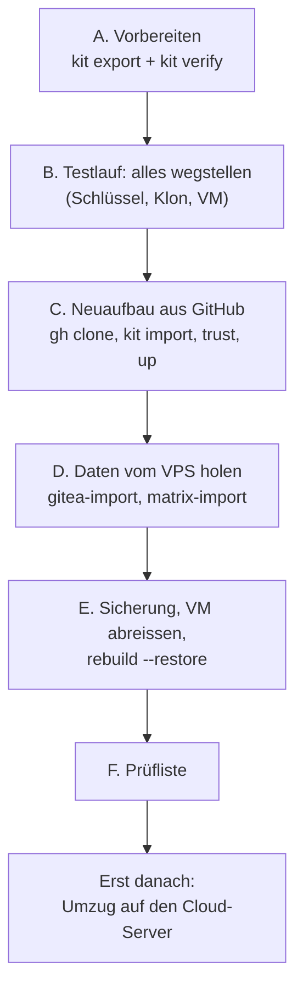

# Notfall-Neuaufbau aus dem Stick und GitHub

**Was du bekommst:** eine Schritt-für-Schritt-Anleitung für den schlimmsten Fall. Der Steuerrechner hat alles verloren
(Schlüssel, Passwörter, Klon, VM), der Git-Server (Gitea auf dem VPS) ist aus. Übrig sind **dein Rechner**, **GitHub**
(Anmeldung mit Passkey) und **ein USB-Stick** mit dem Notfall-Kit. Daraus baust du das Lab komplett neu, holst die Daten
des VPS, sicherst sie, reisst die VM ab und stellst sie aus der Sicherung wieder her. Erst wenn das gelingt, ziehst du auf
den Cloud-Server um.

**Warum der Stick nötig ist:** GitHub hat den **Code**, aber keine **Geheimnisse**. Die liegen nur auf dem Steuerrechner
(Modus 0600, nie in Git, [Geheimnis-Karte](../reference/secrets-map.md)). Ohne den age-Schlüssel sind alle
`*.sops.yaml` im Repo und alle Sicherungen unlesbar. `lab.sh kit export` legt **alle** diese Dateien mit **einem Befehl**
verschlüsselt auf den Stick ([Referenz](../reference/emergency-kit.md), [ADR-0025](../concepts/decisions/0025-emergency-kit.md)).

!!! tip "Eselsbrücke: Schlüsselbund, Haus und Kopf"
    **Der Stick ist der Schlüsselbund, GitHub ist das Haus, die Passphrase ist der Kopf, der den Bund öffnet.**
    Das Haus allein hilft nicht (kein Schlüssel), der Bund allein auch nicht (kein Haus), und ohne Kopf bleibt der
    Bund zu. Darum liegt die Passphrase **nicht** auf dem Stick, sondern im Passwortmanager.

## Merksätze

- **Ein Befehl nimmt alles mit, ein Befehl legt alles zurück:** `kit export`, `kit verify`, `kit import`.
- **Erst `kit verify`, dann glauben.** Ein Stick, den du nie geprüft hast, ist eine Hoffnung, keine Sicherung.
- **Erst die Schlüssel zurück, dann `init`.** `lab.sh init` legt fehlende Geheimnisse **neu** an. Kämen sie vor dem
  Kit, hätten sie andere Werte als die der Sicherungen, und die Sicherungen blieben zu.
- **GitHub muss schon im Zustand `source: github` stehen.** Der Klon enthält nur, was auf `main` in GitHub liegt.
- **Den Klon nur wegstellen, nie löschen**, solange der Test nicht bestanden ist. Alles in dieser Anleitung ist umkehrbar.

## Der Ablauf im Überblick



## Was wo liegt

| Was | Wo | Wozu |
|---|---|---|
| Code, Doku, Skripte, `*.sops.yaml` (verschlüsselt) | GitHub (privates Repo, Anmeldung mit Passkey) | das Haus |
| age-Schlüssel, Passwörter, CA, Signaturschlüssel, Deploy-Keys, Vertrauensanker | **Stick**, verschlüsselt (`k8s-lab-kit.tar.age`) | der Schlüsselbund |
| Passphrase des Sticks | **Passwortmanager** (nicht auf dem Stick, nicht im Repo) | der Kopf |
| Zugang zum alten VPS (SSH-Schlüssel, VPN-Datei) | im Kit, wenn du ihn in `kit-extra.list` einträgst ([Referenz](../reference/emergency-kit.md#kit-extra)); sonst Passwortmanager | Daten holen in Schritt D |
| Primäre Sicherungen (CNPG, K8up) | rustfs auf dem Steuerrechner, `~/k8s-lab-data/backups` | Daten für `rebuild --restore` |
| Kopie der Sicherungen | Replikat-Rechner, Verzeichnis `k8s-lab-replica` ([Backup-Replikat](backup-replica.md)) | Schutz vor dem Ausfall des Steuerrechners |

!!! warning "Der Stick ersetzt die Sicherungen nicht"
    Im Kit liegen **Schlüssel**, keine **Daten**. Die Daten (Datenbanken, Repos, Matrix-Verlauf) liegen in den
    Sicherungen. Bei einem Totalverlust des Steuerrechners kommen sie vom Replikat-Rechner zurück
    (`lab.sh replica restore VERZEICHNIS`, [Backup-Replikat](backup-replica.md)). Im Testlauf dieser Anleitung
    kommen sie vom VPS (Schritt D).

## A. Vorbereiten: das Kit schreiben und prüfen {#vorbereiten}

**Was:** alle Dateien, die nur auf dem Steuerrechner liegen, auf den Stick. **Warum jetzt:** nach dem Verlust ist es
zu spät. **Wie:**

1. Stick einstecken und seinen Einhängepunkt notieren (`lsblk -f`, meist `/media/$USER/STICK`).
2. Vorab prüfen, ob alles da ist (nichts wird geschrieben). `source status` muss `github` zeigen und `gitops/` muss
   dazu passen: Argo CD liest nur Git, und die Adresse des Spiegels muss **signiert auf `main` in GitHub** stehen, sonst
   sucht der Neuaufbau ohne VPS einen Git-Server, den es nicht gibt
   ([Neuaufbau aus GitHub](neuaufbau-github.md), Schritte 1 bis 3):

    ```bash
    cd ~/projects/k8s-lab
    bash scripts/lab.sh source status
    bash scripts/lab.sh preflight
    bash scripts/lab.sh secrets
    ```

3. Eigene Zusätze eintragen, falls es Zugänge gibt, die dieses Repo nicht kennt (zum Beispiel der Schlüssel zum
   alten VPS). Eine Zeile pro Pfad, relativ zu `$HOME`:

    ```bash
    printf '%s\n' '.ssh/id_ed25519_vps' > ~/.config/k8s-lab/kit-extra.list
    chmod 600 ~/.config/k8s-lab/kit-extra.list
    ```

4. **Export:** der Befehl fragt zweimal nach einer Passphrase (`age -p`) und schreibt drei Dateien auf den Stick:

    ```bash
    bash scripts/lab.sh kit export /media/$USER/STICK
    ```

    Fehlt eine Pflichtdatei, listet der Befehl sie auf und schreibt **nichts**. Dann zuerst `lab.sh init` laufen
    lassen oder die Datei zurücklegen. Mit `--allow-missing` schreibt er trotzdem, vermerkt es aber im Manifest.

5. **Prüfen:** entschlüsselt nur im Arbeitsspeicher und vergleicht jede Datei mit dem Manifest:

    ```bash
    bash scripts/lab.sh kit verify /media/$USER/STICK
    ```

    Am Ende muss `VERIFY OK` stehen. Die Passphrase kommt **jetzt** in den Passwortmanager.

6. Den Stick auswerfen und an einen Ort legen, der nicht der Rechner ist. Drucke die Passphrase **nicht** auf den
   Stick-Beutel.

Auf dem Stick liegen danach:

| Datei | Inhalt |
|---|---|
| `k8s-lab-kit.tar.age` | die verschlüsselten Dateien |
| `k8s-lab-kit.manifest` | Pfade, Rechte, Grössen und SHA-256 der Klartextdateien (nie Inhalt), Vertrauensanker, GitHub-Adresse |
| `README-NOTFALL.txt` | die Kurzfassung dieser Anleitung auf Deutsch, mit der GitHub-Adresse |

**Wann wiederholen:** nach jeder Rotation eines Geheimnisses und nach jedem `lab.sh init`, das neue Dateien anlegt.
Der Anker im Kit darf älter sein als der aktuelle `main`: `main` muss nur sein Nachfahre sein.

## B. Testlauf: alles wegstellen

**Was:** den Totalverlust nachstellen, **ohne** etwas zu löschen. Alles wird mit der Endung `.vor-test` zur Seite
gestellt und kann mit `mv` zurückgelegt werden. **Warum:** ein Notfallweg, den du nie durchgespielt hast, bricht im
Ernstfall am ersten unbekannten Schritt.

1. **Lab sauber abbauen** (verlangt einen frischen Export, fragt nach):

    ```bash
    cd ~/projects/k8s-lab
    bash scripts/lab.sh export
    bash scripts/lab.sh down
    ```

2. **Backup-Ziel anhalten und alles wegstellen** (Schlüssel, Passwörter, Sicherungen, Klon):

    ```bash
    systemctl --user stop rustfs
    S=vor-test
    mv ~/.ssh ~/.ssh.$S && mkdir -m 700 ~/.ssh
    mv ~/.config/k8s-lab ~/.config/k8s-lab.$S
    mv ~/.config/sops ~/.config/sops.$S
    mv ~/.config/rustfs ~/.config/rustfs.$S
    mv ~/k8s-lab-data ~/k8s-lab-data.$S
    mv ~/.kube/k3s-lab.kubeconfig ~/.kube/k3s-lab.kubeconfig.$S 2> /dev/null || true
    cd ~ && mv ~/projects/k8s-lab ~/projects/k8s-lab.$S
    ```

    Die Sicherungen (`k8s-lab-data`) werden mit weggestellt, damit der Neuaufbau mit einem **leeren** Backup-Ziel
    beginnt. Blieben sie liegen, bricht `up` mit `Expected empty archive` ab (altes WAL-Archiv).

3. **Ab hier gilt: nur noch der Rechner, GitHub und der Stick.** Das Passwort für den Stick und das GitHub-Konto
   kommen aus dem Passwortmanager.

## C. Neuaufbau aus GitHub

**Was:** Klon holen, Schlüssel zurücklegen, Vertrauensanker prüfen, Lab bauen. **Warum in dieser Reihenfolge:** der Klon
enthält das Skript `kit import`, der Anker schützt vor einem manipulierten GitHub, und `init` darf erst laufen, wenn
die alten Geheimnisse wieder da sind.

1. **Werkzeuge** installieren: `git`, `age`, `gh` (GitHub CLI) und die Programme aus
   [Neuaufbau, Voraussetzungen](rebuild.md#voraussetzungen-und-preflight). Was fehlt, nennt später `lab.sh preflight`.

2. **Bei GitHub anmelden und klonen.** `gh auth login --web` öffnet den Browser; dort meldest du dich mit dem Passkey
   an. Die Adresse des Repos steht in `README-NOTFALL.txt` auf dem Stick.

    ```bash
    gh auth login --web --git-protocol https
    mkdir -p ~/projects && cd ~/projects
    gh repo clone OWNER/REPO k8s-lab
    cd k8s-lab
    ```

    Hat der PC keinen Fingerabdruck-Leser: Passkey per QR-Code mit dem Handy (Bluetooth an beiden Geräten).
    `gh auth login` nicht abbrechen, bis «Logged in as …» erscheint. Die Signatur von `main` im frischen Klon prüfst
    du ohne lokale Git-Einstellungen so:

    ```bash
    git -c gpg.ssh.allowedSignersFile=.gitea/allowed_signers verify-commit HEAD
    ```

    Der Klon hat jetzt `origin` = GitHub und keinen Gitea-Spiegel. Das ist gewollt und wird unten erklärt.

    **Jetzt die Werkzeuge installieren, bevor das Kit geöffnet wird.** Nach einem Rechnerverlust fehlen
    auch age, SOPS und Ansible. Der Host-Installer stellt dieselbe Werkbank wieder her, ohne Schlüssel
    anzulegen oder die VM zu verändern ([Werkzeuge des Steuerrechners](../reference/control-tools.md)):

    ```bash
    export PATH="$HOME/.local/bin:$PATH"
    bash scripts/lab.sh tools install
    bash scripts/lab.sh tools install
    bash scripts/lab.sh tools check
    ```

    Der zweite Lauf muss `changes 0` melden. Nur apt benötigt sudo. **Eselsbrücke:** erst die Werkbank,
    dann den Schlüsselbund zurücklegen, dann das Haus bauen. Gruppen, libvirt-Netz und ufw bewusst
    nach [Voraussetzungen](../tutorials/lab-for-friends.md#voraussetzungen) prüfen.

3. **Kit prüfen und zurücklegen** (Stick einstecken, Passphrase aus dem Passwortmanager):

    ```bash
    bash scripts/lab.sh kit verify /media/$USER/STICK
    bash scripts/lab.sh kit import /media/$USER/STICK
    ```

    `import` stellt jede Datei an ihren Ort zurück (Schlüssel 0600, Verzeichnisse 0700), auch
    `infra/envs/local/lab.local.yaml` im Klon, in dem `source: github` steht. Eine vorhandene, andere Datei
    überschreibt er **nicht** (`--force` legt vorher eine Kopie `*.before-kit-ZEIT` an). `--dry-run` zeigt nur den Plan.

    **Host-Keys:** `~/.ssh/known_hosts` ist bewusst nicht im Kit. `import` trägt aber die drei veröffentlichten
    Schlüssel von `github.com` aus `github_known_hosts` (`infra/envs/local/lab.yaml`) dort ein; vorhandene Zeilen
    bleiben, doppelt wird nichts. Damit fragt der erste `git push` oder Klon über SSH nicht nach einem Fingerabdruck.
    Erwartet sind genau diese, gleich wie in GitHubs offizieller Liste
    ([GitHub-Host-Keys](neuaufbau-github.md#github-host-keys)):

    | Typ | SHA-256-Fingerabdruck |
    |---|---|
    | ED25519 | `SHA256:+DiY3wvvV6TuJJhbpZisF/zLDA0zPMSvHdkr4UvCOqU` |
    | ECDSA | `SHA256:p2QAMXNIC1TJYWeIOttrVc98/R1BUFWu3/LiyKgUfQM` |
    | RSA | `SHA256:uNiVztksCsDhcc0u9e8BujQXVUpKZIDTMczCvj3tD2s` |

    Nachprüfen: `ssh-keygen -lf ~/.ssh/known_hosts | grep github.com`. Fragt SSH trotzdem nach einem anderen
    Fingerabdruck für `github.com`: **abbrechen**, nicht bestätigen. Die Lab-VM braucht keinen Eintrag, sie bekommt beim
    Neuaufbau ohnehin einen neuen Schlüssel, und `lab.sh` verwaltet ihn selbst.

4. **Commit-Signatur einrichten** (die Git-Einstellungen des alten Klons sind weg; der Schlüssel kam aus dem Kit):

    ```bash
    bash scripts/setup-signing.sh
    ssh-add ~/.ssh/k8s-lab-signing
    ```

5. **Vertrauensanker prüfen.** Das Kit bringt `~/.config/k8s-lab/trusted-head` mit:

    ```bash
    bash scripts/lab.sh trust status
    ```

    Fehlt der Anker, setzt du ihn von Hand. Der Commit steht auf dem Stick (`README-NOTFALL.txt`, Manifest) und in
    deinem Passwortmanager; der Befehl verlangt, dass du die ersten 7 Zeichen tippst:

    ```bash
    bash scripts/lab.sh trust init COMMIT
    ```

6. **Vorabprüfung**, dann bauen:

    ```bash
    bash scripts/lab.sh preflight
    bash scripts/lab.sh up
    ```

    `up` dauert etwa 25 Minuten (gemessen, [Lab in 30 Minuten](../tutorials/lab-in-30-minutes.md)). Danach läuft ein **leeres**
    Lab mit den alten Geheimnissen.

### Was der Preflight im Klon aus GitHub tut {#preflight-im-github-klon}

**Was:** Im Modus `source: github` vergleicht der Preflight sonst `main` auf GitHub mit `origin/main` in Gitea. Im frischen
Klon **ist** `origin` GitHub, Gitea gibt es nicht. **Warum das sicher genug ist:** die zwei unabhängigen Quellen fallen
auf eine zusammen, übrig bleiben der **Anker** (`main` muss ein Nachfahre des vertrauten Commits sein) und die
**Signaturen** (jeder Commit von einem Signer des Eltern-Commits). Das ist die Hauptsicherung von
[ADR-0023](../concepts/decisions/0023-signed-main-and-source-trust.md); nur der zweite Vergleich fällt weg.

| Lage | Verhalten |
|---|---|
| `origin` ist GitHub, `fetch` gelingt | Warnung `origin is the GitHub mirror itself`; geprüft werden Anker und Signaturen. Fehlt der Anker: Fehler mit dem Hinweis `trust init COMMIT`. |
| `origin` ist GitHub, `fetch` scheitert (keine Anmeldung, kein Netz) | eigene Warnung; verglichen wird mit dem zuletzt geholten `origin/main`, die Arbeitskopie muss sauber sein. Kein Passwort-Dialog (`GIT_TERMINAL_PROMPT=0`). |
| GitHub ist weiter als der Klon | Fehler mit `gh auth login` und `git pull --ff-only` als Hinweis |
| `origin` ist GitHub, aber `source` steht auf `gitea` | Fehler: `kit import` zurücklegen oder `lab.sh source github` |

!!! tip "Eselsbrücke: ein Zeuge reicht nur mit Ausweis"
    Zwei Zeugen (GitHub und Gitea) bestätigen sich gegenseitig. Steht nur noch einer da, zählt sein **Ausweis**: der
    Anker und die Unterschrift.

## D. Daten vom VPS holen

**Was:** Gitea und Matrix kommen aus den Dumps des VPS ins neue Lab. **Warum jetzt:** der VPS ist nur kurz an; mit
dem leeren Lab haben die Sicherungen noch keinen Inhalt. **Wie:** beide Dumps zuerst holen (verschlüsselt, ohne
Klartext auf Platte), dann den VPS wieder ausschalten, dann einspielen. Die ausführlichen Schritte stehen in
[Gitea-Import](gitea-import.md) und [Matrix-Import](matrix-import.md); hier der Weg in Kurzform.

1. **VPS einschalten**, Zugang prüfen (der Schlüssel kam aus dem Kit, sonst aus dem Passwortmanager):

    ```bash
    export VPS=benutzer@adresse
    export MATRIX_IMPORT_SSH=$VPS
    ssh "$VPS" true
    ```

    Beim ersten Mal fragt SSH nach dem Fingerabdruck des VPS (er steht nicht im Kit). Vergleiche ihn mit dem Wert,
    den du beim Einrichten im Passwortmanager notiert hast, oder lies ihn über die Konsole des Anbieters ab
    (`ssh-keygen -lf /etc/ssh/ssh_host_ed25519_key.pub`). Nur bei Gleichheit mit `yes` bestätigen.

2. **Empfänger ausgeben** (nur lesen) und **Dumps holen**. Die Befehle mit den age-Empfängern gibt der erste Aufruf aus:

    ```bash
    bash scripts/lab.sh gitea-import recipients
    ssh "$VPS" 'bash -s -- --recipient age1...' < scripts/gitea-import-vps-dump.sh > gitea-dump.tar.age
    bash scripts/lab.sh matrix-import recipients
    ssh "$MATRIX_IMPORT_SSH" 'bash -s -- --recipient age1...' < scripts/matrix-import-vps-dump.sh > matrix-dump.age.partial \
      && mv matrix-dump.age.partial matrix-dump.age
    ```

3. **VPS wieder ausschalten.** Die Dumps liegen verschlüsselt im Arbeitsordner.

4. **Matrix-Identität prüfen** (kein Cluster nötig). Liegt `server_name` mit Signaturschlüssel schon in Git, meldet
   `prepare` `SKIP` und nichts ist zu tun. Schreibt es etwas, committe signiert und pushe nach GitHub
   (`git push origin main`), bevor du importierst:

    ```bash
    bash scripts/lab.sh matrix-import prepare matrix-dump.age
    ```

5. **Einspielen** (zuerst jeweils `--dry-run`, wenn du sehen willst, was passiert):

    ```bash
    bash scripts/lab.sh gitea-import gitea-dump.tar.age
    bash scripts/lab.sh matrix-import matrix-dump.age
    ```

6. **Abnahme** der beiden Importe:

    ```bash
    bash scripts/lab.sh gitea-import accept
    MATRIX_IMPORT_VERIFY_LOGIN="alice:PASSWORT" bash scripts/lab.sh matrix-import accept
    ```

    Am Ende der Gitea-Abnahme steht `IMPORT OK`. Ist Keycloak aktiv, gilt zusätzlich der Abschnitt
    [Keycloak](gitea-import.md#keycloak).

## E. Sicherung, VM abreissen, wiederherstellen

**Was:** den Stand mit den importierten Daten sichern, die VM zerstören und aus der Sicherung neu bauen. **Warum:** das
ist der Beweis, dass **Schlüssel (Kit) und Daten (Sicherung)** zusammen reichen. Erst danach lohnt der Umzug.

1. **Frischer Export und frische Backups** (`rebuild --restore` verlangt den Export und nimmt auf einer laufenden VM
   noch einmal eigene Backups; so siehst du Fehler vorher):

    ```bash
    export KUBECONFIG=~/.kube/k3s-lab.kubeconfig
    bash scripts/lab.sh export &&
      bash scripts/lab.sh backup 2>&1 | tee ~/k8s-lab-data/logs/dr-e-backup.log
    bash scripts/lab.sh backup --check 2>&1 | tee ~/k8s-lab-data/logs/dr-e-backup-check.log
    ```

    `export` startet die zuvor laufende VM wieder und wartet begrenzt auf die API, Node Ready,
    Argo CD und gesunde CNPG-Cluster. Erst bei Erfolg startet mit `&&` die Sicherung.
    Bei einem Timeout bleibt der Export erhalten; zuerst die Bereitschaft prüfen und die Sicherung erneut starten.

    `backup --check` meldet nichts Fehlendes und nichts Älteres als `backup_max_age_h`; der WAL-Check bestätigt, dass das
    WAL-Archiv das letzte Backup deckt.

2. **Arbeitskopie sauber, Branch `main`** (sonst verweigert `rebuild --restore`):

    ```bash
    git status --short
    git switch main
    ```

3. **VM zerstören und aus der Sicherung bauen.** Der Befehl fragt zweimal (`restore`, dann `k3s-lab`) und zerstört
   dabei die VM-Platte, **nicht** rustfs:

    ```bash
    bash scripts/lab.sh rebuild --restore
    ```

    Die Dauer liegt etwas über der von `up`, weil Daten zurückgespielt werden. Bleibt der Lauf stehen: [Neuaufbau, Der Lauf blieb halb stehen](rebuild.md#restore-halb).

## F. Prüfliste: ist alles wieder da?

```bash
export KUBECONFIG=~/.kube/k3s-lab.kubeconfig
bash scripts/lab.sh status
kubectl -n argocd get applications            # alle Synced und Healthy
kubectl get clusters.postgresql.cnpg.io -A    # pg-lab, gitea-db, matrix-db, keycloak-db: Cluster in healthy state
bash scripts/lab.sh gitea-import accept       # Benutzer, Repos, Webhooks, Anmeldung
MATRIX_IMPORT_VERIFY_LOGIN="alice:PASSWORT" bash scripts/lab.sh matrix-import accept
bash scripts/lab.sh acceptance
bash scripts/lab.sh trust status
```

| Prüfung | Soll |
|---|---|
| Argo CD | alle Apps `Synced` und `Healthy` |
| Gitea | gleiche Zahl Benutzer und Repos wie im Dump, Anmeldung mit dem alten Passwort geht |
| Matrix | altes Passwort geht, Räume und Verlauf sind da, Schlüssel der Geräte unverändert |
| Backups | `lab.sh backup --check` meldet nichts Fehlendes; der Lauf von `rebuild --restore` legt am Ende selbst `post-restore-*` an |
| Vertrauen | `trust status` zeigt einen Anker, den `preflight` als Vorfahren von `main` bestätigt |

Bestanden? Dann ist der Notfallweg bewiesen. Räume den Testlauf auf: die Verzeichnisse mit der Endung `.vor-test`
(`~/.ssh.vor-test`, `~/.config/*.vor-test`, `~/k8s-lab-data.vor-test`, `~/projects/k8s-lab.vor-test`) darfst du
erst löschen, wenn das Kit auf dem Stick **nach** dem Testlauf noch einmal mit `kit export` und `kit verify`
erneuert ist. Der nächste Schritt ist der Umzug auf den Cloud-Server.

## Wenn etwas hakt

| Meldung oder Lage | Ursache und Abhilfe |
|---|---|
| `kit verify`: `decryption failed (wrong passphrase or damaged archive)` | meist die falsche Passphrase; nochmals tippen, bei Wiederholung den Stick mit dem Manifest vergleichen (`archive-sha256`) |
| `kit verify`: `INCOMPLETE KIT` | das Kit wurde mit `--allow-missing` geschrieben; Manifest zeigt, was fehlt; neu exportieren |
| `kit import`: `DIFFERS` | die Datei besteht schon mit anderem Inhalt; ansehen, dann `--force` (alte Kopie bleibt als `*.before-kit-ZEIT`) |
| `preflight`: `origin is the GitHub mirror itself` | erwartet im Klon aus GitHub, siehe [oben](#preflight-im-github-klon) |
| `preflight`: kein Anker | `trust init COMMIT` mit dem Commit aus `README-NOTFALL.txt` |
| `preflight`: GitHub ist weiter als der Klon | `gh auth login`, dann `git pull --ff-only` |
| `up`: `Expected empty archive` | das Backup-Ziel enthält ein altes WAL-Archiv; im Testlauf wurde `k8s-lab-data` nicht weggestellt |
| `rebuild --restore`: Export zu alt | `bash scripts/lab.sh export`, dann wiederholen |
| Gitea oder Matrix nach dem Import ohne Anmeldung | [Keycloak-Abschnitt](gitea-import.md#keycloak), `matrix-import accept` mit altem Passwort |

## Die Datei-Liste kurz erklärt

Welche Dateien ins Kit gehören und warum, steht in der [Referenz](../reference/emergency-kit.md#was-im-kit-liegt).
Kurz: **Pflicht** ist, was sich **nicht neu erzeugen lässt** (age-Schlüssel, Passwörter der Datenbanken und
Sicherungen, Signaturschlüssel, Lab-CA, Matrix-Signaturschlüssel, Vertrauensanker). **Bequem** ist, was `init`
ersetzen könnte, dessen Verlust aber Arbeit macht (Deploy-Keys, VM-Schlüssel, Alarm- und Replikat-Konfiguration).
