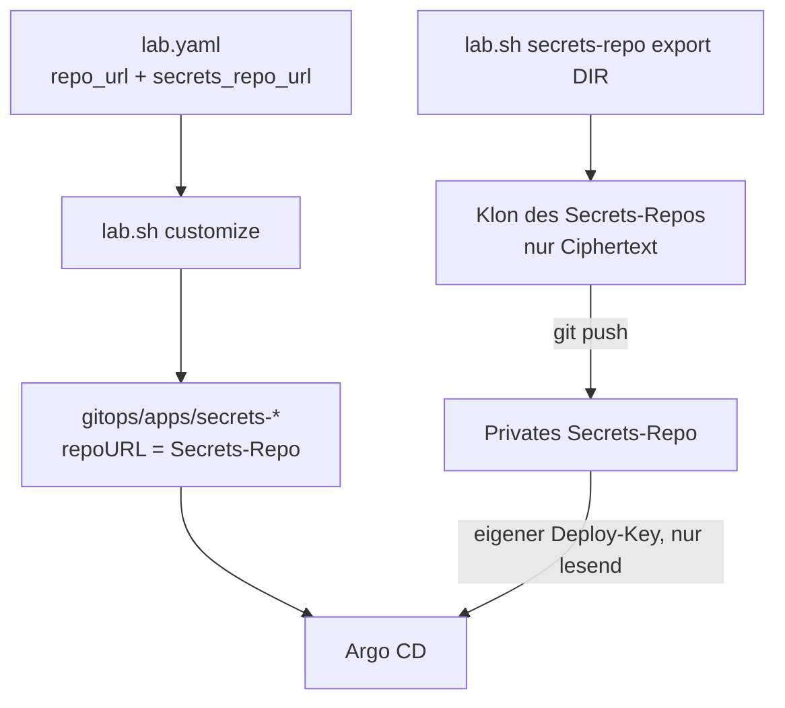

# Privates Secrets-Repo und Neuaufbau aus der öffentlichen Fassung

Der Code kann öffentlich sein, die verschlüsselten Secrets nicht: sie liegen in einem eigenen, **privaten**
Secrets-Repo. Argo CD liest beide Repos. Der age-Schlüssel bleibt lokal. Hintergrund und offene Entscheidung zum
Git-Host: [ADR-0022](../concepts/decisions/0022-private-secrets-repo.md).



## Was wo liegt

| Was | Wo |
|---|---|
| Code, Charts, Ansible, Doku | Code-Repo (`repo_url`), öffentlich möglich |
| `.sops.yaml`, `secrets/<namespace>/*.sops.yaml`, `kustomization.yaml`, `ksops.yaml`, Vorlagen | privates Secrets-Repo (`secrets_repo_url`), gleiche Ordner |
| age-Schlüssel, Deploy-Keys | nur lokal (`~/.config/sops/age/keys.txt`, `~/.ssh/argocd-k8s-lab*`), Passwortmanager |

Das Secrets-Repo muss **denselben Host und Port** wie das Code-Repo haben (die Egress-Regeln lassen einen
Git-Server zu). `lab.sh customize` bricht sonst ab.

## Umstellen (bestehendes Lab)

1. Ein **privates** Repo `k8s-lab-secrets` beim Git-Host des Code-Repos anlegen, leer.
2. Klonen, zum Beispiel nach `~/projects/k8s-lab-secrets`.
3. Füllen, zuerst trocken:

    ```bash
    bash scripts/lab.sh secrets-repo export ~/projects/k8s-lab-secrets --dry-run
    bash scripts/lab.sh secrets-repo export ~/projects/k8s-lab-secrets
    ```

    Das Skript kopiert nur Dateien, deren Werte alle `ENC[...]` sind, und ruft nie `sops` auf. Zweiter Lauf: nur
    `SKIP`. Eine Datei mit Klartext, ein Symlink oder ein falsches Ziel ergibt `ABORT`, nichts wird geschrieben.
4. Im Klon prüfen und hochladen: `git status`, `git add -A`, `git commit`, `git push`.
5. In `infra/envs/local/lab.local.yaml` eintragen:

    ```yaml
    secrets_repo_url: ssh://git@GIT-HOST/KONTO/k8s-lab-secrets.git
    ```

6. `bash scripts/lab.sh init` erzeugt den zweiten Deploy-Key `~/.ssh/argocd-k8s-lab-secrets` (nur bei getrenntem
   Repo). Die `.pub` im Secrets-Repo als Deploy-Key **nur lesend** eintragen.
7. `bash scripts/lab.sh customize` (vorher mit `--dry-run`): die Apps `secrets-*` zeigen jetzt auf das Secrets-Repo.
   `git diff` prüfen, committen, pushen.
8. `cd ansible && ansible-playbook argocd.yml` legt das Repo-Secret `argocd/repo-k8s-lab-secrets` an.
9. `bash scripts/lab.sh preflight` prüft beide Deploy-Keys mit `git ls-remote`; danach in Argo CD alle Apps
   `secrets-*` auf **Synced/Healthy** prüfen.

Wer danach Secrets ändert (`lab.sh init`, [CA-Rotation](ca-rotation.md), Break-Glass), spiegelt mit
`secrets-repo export` (und bei gelöschten Dateien `--prune`) und pusht im Secrets-Repo.

## Neuaufbau aus der öffentlichen Fassung

Voraussetzungen: Zugriff auf das private Secrets-Repo und der age-Schlüssel aus dem Passwortmanager.

1. Öffentliche Fassung klonen, Secrets-Repo daneben klonen.
2. Ciphertext übernehmen: `bash scripts/lab.sh secrets-repo import ../k8s-lab-secrets` (die öffentliche
   `.gitignore` ignoriert `secrets/` vollständig, nichts davon landet im Code-Repo).
3. age-Schlüssel nach `~/.config/sops/age/keys.txt` legen (Modus 600).
4. `lab.local.yaml` mit eigenen Werten (`repo_url`, `secrets_repo_url`, Domain, Netz), dann `lab.sh init`,
   Deploy-Keys eintragen, `lab.sh customize`, committen, pushen.
5. Weiter wie im [Neuaufbau](rebuild.md).

Ohne Secrets-Repo (ganz neues Lab aus der öffentlichen Fassung) legt `lab.sh init` den Ordner `secrets/` aus den
Vorlagen in `secrets.example/` an und erzeugt die SOPS-Dateien neu.

## Fehler

| Meldung | Ursache, Abhilfe |
|---|---|
| `same host and port as repo_url` | Secrets-Repo bei einem anderen Git-Host; heute nicht unterstützt (ADR-0022, Option A3) |
| `secrets_repo_url is still the placeholder` | Wert aus der öffentlichen Fassung, in `lab.local.yaml` setzen |
| `Secrets deploy key cannot reach the secrets repo` | `.pub` nicht oder nicht beim richtigen Repo eingetragen, Host-Key, Netz |
| `ABORT: ... not encrypted` | eine Datei in `secrets/` hat Klartext; mit `sops` verschlüsseln, nie so kopieren |
