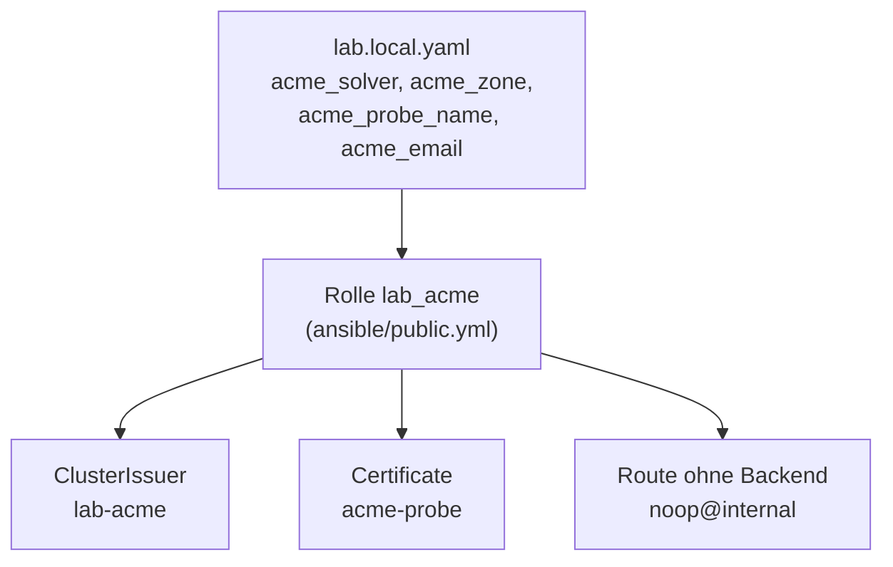
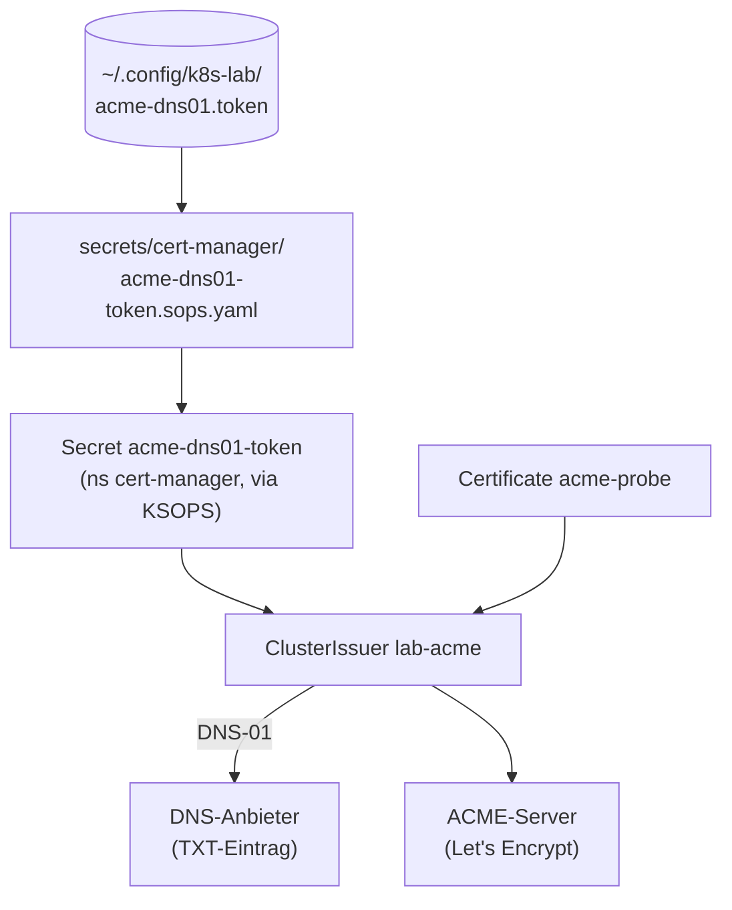

# Öffentliches Zertifikat (optional)

**Ziel:** beweisen, dass die Kette (Traefik, TLS-Optionen, `sniStrict`,
Sicherheits-Header) für ein **echtes, öffentlich vertrautes** Zertifikat
steht. DNS-01 braucht keinen offenen Port: cert-manager legt einen TXT-Eintrag
in deiner DNS-Zone an.

Ohne die Werte unten passiert nichts: `up` bleibt grün, `acceptance` meldet
ein deutliches `SKIP`.

Die Rolle `lab_acme` legt drei Objekte an:



Der Aussteller bekommt das Token über SOPS und beweist per DNS-01, dass die
Zone dir gehört:



## Werte

Nur in `infra/envs/local/lab.local.yaml`, nie in `lab.yaml` (Zone und Namen
sind persönlich):

```yaml
acme_solver: cloudflare            # or digitalocean
acme_zone: example.org
acme_probe_name: lab-probe.example.org
acme_email: du@example.org
# acme_server: https://acme-staging-v02.api.letsencrypt.org/directory   # for practice (staging is NOT publicly trusted)
```

## Token

Eine Zeile, nur Zugriff auf diese Zone, DNS bearbeiten. In die Datei
`~/.config/k8s-lab/acme-dns01.token` schreiben (Modus 600; die Eingabe nie
im Terminal anzeigen, zum Beispiel aus dem Passwort-Manager mit `umask 077`
in die Datei).

Im Git liegt nur die SOPS-Datei `secrets/cert-manager/acme-dns01-token.sops.yaml`.
Fehlt die Token-Datei, legt `lab.sh init` sie mit **leerem** Wert an, damit die
Kustomization der Secret-App immer baut und der Secret-Name feststeht (es gibt
nichts zu schützen). So füllst du sie:

```bash
chmod 600 ~/.config/k8s-lab/acme-dns01.token
# remove the empty version
rm secrets/cert-manager/acme-dns01-token.sops.yaml
# render again, now encrypted with the token
bash scripts/lab.sh init
git add secrets/cert-manager/acme-dns01-token.sops.yaml
git commit -m "ACME-Token eintragen"
git push origin main
```

## Ausrollen und prüfen

```bash
bash scripts/lab.sh up
# or only the role:
cd ansible && ansible-playbook public.yml
```

Die Rolle `lab_acme` legt den ClusterIssuer `lab-acme` an (per Ansible, nicht
Git: persönliche Werte), ein Certificate `acme-probe` für `acme_probe_name`
und eine Route ohne Backend (`noop@internal`, Namespace `traefik`).

`bash scripts/lab.sh acceptance` ruft `verify-public.yml`:

1. Issuer `lab-acme` ist `Ready`.
2. Certificate `acme-probe` ist `Ready`, vom öffentlichen Issuer, nicht von `lab-ca`.
3. Der Probe-Name liegt **ausserhalb** der Lab-Domain (damit ausserhalb der nameConstraints).
4. Das Blatt nennt den Namen und die Lab-CA bestätigt es **nicht**
   (`openssl verify` gegen die Lab-CA schlägt fehl).
5. Die **VM** vertraut dem Zertifikat ohne `--cacert`
   (`curl --resolve`, `ssl_verify_result` 0, System-Truststore).

Der Abnahme-Punkt „öffentliches Zertifikat“ besteht nur mit gesetztem
Probe-Namen. Ohne Werte steht dort `SKIP: oeffentliches Zertifikat NICHT geprueft`.

## Pro Ingress den Issuer wählen

Jedes `Certificate` benennt seinen Issuer selbst (`issuerRef`): Lab-Namen
(`*.lab.example`) stellt `lab-ca` aus, der Probe-Name `lab-acme`. `sniStrict`,
TLSOption `default` und die Sicherheits-Header gelten für beide gleich
(Entrypoint und TLSOption hängen nicht vom Issuer ab). `verify-certmanager.yml`
prüft, dass kein Name ausserhalb der Lab-Domain über `lab-ca` läuft und
umgekehrt.

## Token rotieren

Token beim DNS-Anbieter erneuern, Datei ersetzen, die SOPS-Datei löschen,
`lab.sh init`, committen und pushen.
