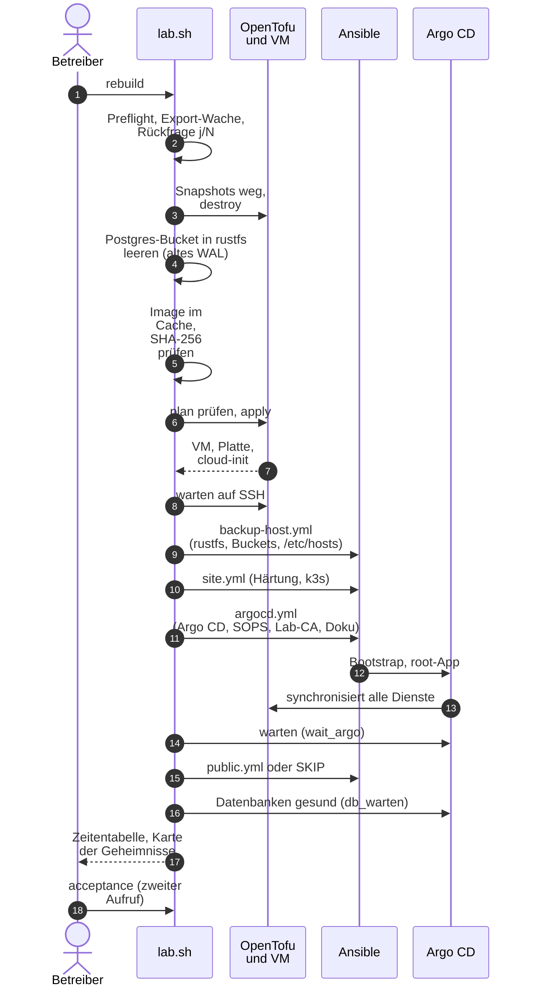

# Neuaufbau: abreissen, neu bauen, abnehmen

**Ziel:** die ganze Lab-VM (`k3s-lab`) mit einem Befehl abreissen und mit einem
Befehl wieder aufbauen, und mit einer Abnahme messen, dass alles wieder da ist.

**Gemessen: `rebuild --restore` auf 8 GiB** (07.11.2026, Ende 23:29:06 Europe/Zurich): VM mit 8192 MiB,
Stand `1dd0b72`, **22 min 12 s**, Exit-Code **0**. Node-Spitze **5332 MiB / 67 %** um 23:28 (erste Backups nach
dem Restore), danach Dauerbetrieb rund **4700 MiB**; kein OOMKilled, keine MemoryPressure. Nach dem Ausrollen der
gesenkten Limits (08.11.2026): Spitze **5191 MiB / 65 %**, Dauerbetrieb rund **4990 MiB**; am Nachmittag des
08.11.2026 mit dem CI-Runner rund **4448 MiB / 56 %**. Budget: 8192 − 1536 = **6656 MiB** für die Limits, Prod im
ungünstigsten Fall 6624 MiB ([Memory-Budget](../reference/memory-budget.md)).

**Früherer Lauf** (07.11.2026, Ende 17:12:56 Europe/Zurich, VM mit rund 10 GiB): `rebuild --restore` auf Stand
`4fa8554`, **27 min 14 s**, Exit 0, alle **26 Ablaufphasen** OK, Restore-Spitze **4970 MiB / 49 %** (17:12:44),
direkt danach 5127 MiB / 51 % (17:13:15).

Beide Läufe sind keine vollständige Datenabnahme: Die Import-Abnahme für Gitea und Matrix war mangels gespeicherter
Baselines **SKIP, nicht PASS**; Logins und Daten wurden von Hand geprüft. Sie ersetzen weder eine neue `acceptance`
noch einen Restore-Test oder Replikat-Test (offen: [Issue 125](https://github.com/tabee/k8s-lab-template/issues/125)).

**Ältere Messung ohne Restore** (2026-10-30, 15:50 Europe/Zurich, damals 11 Abnahmephasen): `lab.sh rebuild`
23 min 36 s (Argo-Sync 18 min 59 s), `up` auf der laufenden VM 1 min 29 s, `acceptance` 11 von 11 Phasen in
4 min 23 s. Heute hat die Abnahme neunzehn Phasen ([Abnahme](acceptance.md)).

!!! danger "`rebuild` ist ein sauberer Neuanfang, keine Wiederherstellung"
    Das neue Lab startet leer. Gitea und `pg-lab` haben nur Daten, die aus Git
    (GitOps) kommen. `rebuild` leert sogar den Postgres-Bucket: Ein neuer
    Cluster mit demselben Namen verweigert sich einem Bucket, in dem das WAL des
    alten Clusters liegt. Wer die Daten zurück will, nimmt
    `bash scripts/lab.sh rebuild --restore` (Git bleibt auf `initdb`,
    [Datenbank wiederherstellen](restore-database.md),
    [Gitea wiederherstellen](restore-gitea.md),
    [Keycloak wiederherstellen](restore-keycloak.md)) oder spielt den
    [Export](export-and-restore-vm.md) zurück.

## Merksätze

- **Abreissen darf nur das Haus, nie der Werkzeugschuppen.** Das Haus ist die
  VM mit allem, was in ihr lebt. Der Werkzeugschuppen ist alles auf dem
  Steuerrechner, das man zum Neubauen braucht: Schlüssel, rustfs, Backups,
  Image-Cache, Exporte, das Repo.
- **Tofu baut das Haus, Ansible richtet es ein.**
  ([ADR-0002](../concepts/decisions/0002-tofu-and-ansible.md))

## Ablauf



Alles bis zur Abnahme ist **ein** Aufruf (`rebuild` oder `up`), die Abnahme
ein zweiter. Nichts Zerstörerisches läuft von allein: `up` verweigert einen
Plan, der Bestehendes ersetzen würde, `down` und `rebuild` fragen, `purge`
fragt doppelt.

## Befehle

```bash
bash scripts/lab.sh preflight   # check only, changes nothing
bash scripts/lab.sh up          # build the VM if missing, set everything up
bash scripts/lab.sh rebuild     # down, then up (with a stopwatch per phase)
bash scripts/lab.sh acceptance     # measure and prove
bash scripts/lab.sh down        # tear the VM down (needs a fresh export)
bash scripts/lab.sh purge       # down plus thorough clean-up, double prompt
bash scripts/lab.sh status      # what exists right now (read only)
bash scripts/lab.sh sync-host   # running VM: Argo CD projects and /etc/hosts follow git
```

Alle Befehle, Optionen und Rückgabewerte: [Referenz `lab.sh`](../reference/lab-sh.md).
Zweimal `up` hintereinander: Der zweite Lauf ändert nichts (`changed=0`).

## Was bleibt, was geht {#was-bleibt-was-geht}

Zur Merkregel: das Haus fällt, der Werkzeugschuppen bleibt. `purge`
räumt zusätzlich den Hof auf (Reste, Zwischenspeicher, Backups), aber
auch hier bleibt der Schuppen mit allem, was nicht neu entstehen kann.

| Was | `down` / `rebuild` | `purge` |
|---|---|---|
| VM, ihre Platte, ihre Snapshots | entfernt | entfernt |
| Daten im Cluster (Gitea, pg-lab, Keycloak, ...) | weg mit der VM | weg mit der VM |
| `known_hosts`-Einträge der VM, lokale Kubeconfig | entfernt | entfernt |
| Backups in rustfs, Bucket der Postgres-Sicherungen (CNPG) | bei `rebuild` geleert (altes WAL stört einen neuen Cluster), bei `down` bleibt er | geleert **und** Bucket gelöscht |
| Backups in rustfs, Bucket der Datei-Sicherungen (K8up) | bleibt | geleert **und** Bucket gelöscht |
| Block in `/etc/hosts` (Ansible) | bleibt | entfernt (`purge-host.yml`) |
| tofu-Zustand und `.terraform/` | bleiben (leer nach `destroy`) | entfernt (`.terraform.lock.hcl` bleibt, sie pinnt den Provider) |
| libvirt-Reste (Domain ohne Zustand, Volumes der VM) | nur, was `destroy` selbst entfernt | entfernt |
| Alte Exporte | bleiben | alle ausser den 2 neuesten entfernt |
| Alte Logs unter `~/k8s-lab-data/logs/` | bleiben | älter als 30 Tage entfernt |
| Ansible-Zwischenspeicher (`~/.ansible/tmp`, `cp`) | bleibt | geleert |
| Image-Cache und libvirt-Basisvolume | bleiben | nur mit `--include-image` |
| rustfs-Dienst und -Datenordner | bleibt | bleibt |
| age-Schlüssel, SSH-Schlüssel, Argo-CD-Deploy-Key | bleiben | bleiben |
| Geheimnis-Dateien (`~/.config/k8s-lab/...`), Lab-CA, Notes-Passwörter | bleiben | bleiben |
| Das Repo `k8s-lab` | bleibt | bleibt |

`purge` läuft so ab: (1) Zusammenfassung dessen, was passiert; (2) das
Wort `purge` eintippen; (3) den Namen der VM eintippen (`k3s-lab`). Jede
andere Antwort bricht ab, ohne etwas zu ändern. `--yes` überspringt das
nicht, und ohne Terminal verweigert `purge` den Dienst. Auch `purge`
verlangt einen frischen Export (oder `--no-export`).

## `rebuild --restore` oder `purge` und `up` {#restore-oder-leer}

`rebuild --restore` baut die VM neu und spielt die Lab-Backups aus rustfs
wieder ein. `purge` und danach `up` wirft diese Backups weg und startet leer.

| | `rebuild --restore` | `purge`, dann `up` |
|---|---|---|
| VM-Platte | wird gelöscht und neu gebaut | wird gelöscht und neu gebaut |
| Postgres-Bucket in rustfs | bleibt; gelesen wird das höchste Archiv, dessen End-WAL auf der Platte liegt | geleert und gelöscht |
| K8up-Dateibackup | bleibt; Dateien aus dem neuesten Snapshot dieses PVC, leeres Volume bricht ab | geleert und gelöscht |
| Git | bleibt `initdb`; Recovery nur im laufenden Cluster | bleibt `initdb`; Cluster entstehen daraus leer |
| Rückfrage | Wort `restore`, dann `k3s-lab` | Wort `purge`, dann `k3s-lab`; `up` fragt nur nach sudo |
| Laufende VM | neues CNPG- und K8up-Backup vor dem Abbau; bei Fehler bleibt die VM | kein solches Backup, die VM ist danach weg |
| Ergebnis | altes Lab mit Daten | leeres Lab, Argo CD zieht Gitea, Matrix und Keycloak frisch aus Git |

Schlüssel, SOPS-Dateien, Lab-CA und die Produktions-Forge
`git.example.org` bleiben bei beiden. Beide entfernen die lokale
Kubeconfig; `up` legt sie wieder an. `purge` entfernt zusätzlich den
Block in `/etc/hosts` und den tofu-Zustand.

### Drei Stolpersteine bei den ersten echten Läufen {#restore-stolpersteine}

Der erste echte `rebuild --restore` (2026-11-02, Abend) blieb bei «Apply CNPG recovery specs» stehen. Den Rest
machte die Hand am 2026-11-03. Der zweite Lauf (2026-11-03, Vormittag) kam bis «Restore Gitea and Matrix files». Drei Ursachen sind
behoben, alle stecken in den Ansible-Playbooks (`lab.sh` ist nur nachgezogen):

| Stolperstein | Was passiert | Was jetzt gilt |
|---|---|---|
| **Webhook-Wettlauf** | Die CRD von CNPG ist `Established`, aber der Operator-Pod ist noch nicht bereit. Der Aufnahme-Webhook `mcluster.cnpg.io` hat dann keinen Endpunkt (`no endpoints available for service "cnpg-webhook-service"`) und das Apply scheitert. | `restore-clusters.yml` wartet vor dem Apply, bis das Deployment des Operators `Available` ist **und** der Service `cnpg-webhook-service` einen bereiten Endpunkt hat (EndpointSlice). Das Apply selbst wiederholt sich bei Webhook-Fehlern bis zu 12-mal. Andere Fehler (zum Beispiel ein ungültiges Manifest) brechen sofort ab. |
| **`root` heilt die Pause weg** | `recover-files.yml --tags pause` nimmt `automated` von `gitea` und `matrix` weg. Die App `root` (App of Apps, `automated` mit `prune` und `selfHeal`) setzt die Kinder innert Minuten auf den Stand aus Git zurück. Argo CD fährt Gitea wieder hoch, `k8s_scale` läuft in den Timeout. | `pause` hält zuerst `root` an, dann `gitea` und `matrix`. `resume` setzt zuerst `gitea` und `matrix` zurück und zuletzt `root`; das passiert in einem `always`-Block, auch wenn ein Kind scheitert. Der Sollwert für `root` steht nur in `argocd_root_automated` (`group_vars/all/argocd.yml`) und kommt damit aus Git. Es wird kein Zustand gespeichert. |
| **Pause vor dem Deployment** | Die Pause lief, als der erste Sync von `gitea` und `matrix` noch lief. `k8s_scale` fand das Deployment nicht (`not found` gilt als in Ordnung), der laufende Sync legte es danach mit einem Replikat an, und der Pod hängte das leere PVC ein. «Delete the file PVC from the new disk» blieb in `Terminating` (Finalizer `kubernetes.io/pvc-protection`) und lief nach 180 s in den Timeout. | `pause` wartet auf einen laufenden Sync, startet **einmal** einen Sync von Hand, falls noch keiner gelungen ist (ohne den fehlt auch das ObjectStore, und die Datenbanken kämen nie hoch), setzt dann das Deployment auf 0 und wartet, bis **kein Pod mehr das PVC einhängt**. `restore` prüft vorher, dass `root`, `gitea` und `matrix` ohne `automated` sind, setzt das Deployment erneut auf 0, nennt jeden Pod, der das PVC noch hält, und wartet auf ein PVC, das schon `Terminating` ist, bevor es löscht. |

Zwei weitere Punkte betreffen den Zustand nach dem Restore:

| Punkt | Was passiert | Was jetzt gilt |
|---|---|---|
| **Plugin-Wettlauf** | Das barman-cloud-Plugin ist ein zweiter Pod im Namespace des Operators und startet unabhängig von ihm. Ein Recovery-Cluster braucht es sofort. Ohne bereiten Endpunkt startet der erste Recovery-Pod nicht. Es braucht zudem zwei TLS-Secrets, die cert-manager erst ausstellt, wenn er selbst läuft. | Das Deployment liegt in der App `cnpg` in Wave 1, hinter Issuer und Zertifikaten (Wave 0): So startet der Pod mit fertigen Secrets. `restore-clusters.yml` wartet in einer Kette auf cert-manager, die Zertifikate `barman-cloud-client` und `barman-cloud-server`, ihre Secrets, das Deployment `plugin-barman-cloud` (`Available`) und einen bereiten Endpunkt des Service `barman-cloud`. Die Kette hat **ein** Zeitbudget (Standard 30 Minuten). Erst danach werden die Recovery-Specs gerendert und angewendet. Details: [Fehlersuche](troubleshooting.md#restore-plugin-tls). |
| **«no completed backup»** | Das neue k3s hat keine `Backup`-Objekte mehr. `lab.sh alert`, `wal_ready` und die `verify-*`-Playbooks melden für die wiederhergestellten Cluster `no completed backup`, bis ein neues Backup existiert. | Als letzte Phase von `rebuild --restore` legt `lab-backup-fresh.py --force-all --prefix post-restore` je Datenbank ein CNPG-Backup und je Volume ein K8up-Backup an (Namen `post-restore-<name>-<Zeitstempel>`) und wartet, bis sie fertig sind. Scheitert das, ist der Restore trotzdem gültig: `lab.sh` warnt deutlich und nennt den Befehl zum Wiederholen. |

`lab.sh` ignoriert `root` beim Warten auf Argo CD, solange die Pause gilt (`ARGO_SKIP`). Bricht ein Lauf zwischen
`pause` und `resume` ab, schreibt `lab.sh` beim Ende eine deutliche Warnung. Dann gilt:

```bash
cd ansible
ansible-playbook recover-files.yml --tags resume   # idempotent: Kinder zuerst, root zuletzt
kubectl -n argocd get applications.argoproj.io -o custom-columns=NAME:.metadata.name,AUTO:.spec.syncPolicy.automated
```

Der genaue Befehl steht in der Warnung von `lab.sh`. Er hängt davon ab, wo der Lauf stehen blieb (die Teile laufen in dieser
Reihenfolge, jeder ist wiederholbar):

| Stehen geblieben bei | Befehl (in `ansible/`) |
|---|---|
| `Pause root, Gitea and Matrix`, oder später vor dem Restore | `ansible-playbook recover-files.yml --tags pause,restore,resume,verify` (nach der Pause nur noch `restore,resume,verify`) |
| `Restore Gitea and Matrix files` | `ansible-playbook recover-files.yml --tags restore,resume,verify` |
| `Resume Gitea, Matrix and root` | `ansible-playbook recover-files.yml --tags resume,verify` |

Hängt das PVC schon in `Terminating`, ist kein Eingriff nötig: `--tags pause` (oder `restore`) setzt das Deployment auf 0, wartet,
bis der Pod weg ist, und das PVC verschwindet von selbst. Steht in der Fehlermeldung ein Pod, der nicht zu `gitea` oder `synapse`
gehört, ist dieser Pod zu löschen, nicht das PVC. Die Phasen von `lab.sh` nach der gescheiterten (Argo CD, Datenbanken) liefen nicht mehr;
sie sind mit `kubectl -n argocd get applications.argoproj.io` und `kubectl get clusters.postgresql.cnpg.io -A` zu prüfen.

### Der Lauf blieb halb stehen: was jetzt? {#restore-halb}

`lab.sh` schreibt vor dem Abbau der VM eine Markierungsdatei (`restore_state_file` in
`ansible/inventory/group_vars/all/restore.yml`, Standard `~/k8s-lab-data/state/restore-in-progress.json`, ohne Geheimnisse). Erst der
letzte Schritt von `recover-files.yml --tags verify` löscht sie, also erst wenn die Dateien zurück sind **und** die Prüfungen
durch sind. Bleibt ein Lauf stehen, bleibt die Markierung.

**Warum das wichtig ist:** Nach einem Abbruch läuft die neue VM, aber ihre Volumes können leer sein. Ein weiterer
`rebuild --restore` würde vor dem Abbau «frische Backups» der laufenden VM nehmen. K8up sichert jede Nacht um 20:30 UTC
(21:30 Zürcher Winterzeit) und sichert dabei auch ein leeres PVC. Mit `keepDaily: 14` behält `prune` pro Tag nur den **neuesten**
Snapshot: ein Snapshot des leeren Volumes könnte den guten desselben Tages ersetzen. Das Risiko ist also real, nicht nur
theoretisch, und es trifft auch ohne `lab.sh`: Läuft eine halb wiederhergestellte VM über 20:30 UTC, sichert der Zeitplan das leere Volume.
Deshalb gilt:

- `rebuild --restore` prüft eine **laufende** VM vor allem anderen («Restore guard»). Es verweigert, wenn die Markierung
  existiert, wenn einer der vier Datenbank-Cluster fehlt, wenn `root`, `gitea` oder `matrix` kein `automated` haben, wenn das Gitea-
  oder Synapse-Deployment keinen bereiten Pod hat, oder wenn das Datei-Volume leer ist (derselbe Test wie beim Restore:
  Repositories bei Gitea, `signing.key` bei Matrix). Es wird dann **nichts** gesichert und nichts angefasst.
- Beim Restore selbst überspringt `recover-files.yml` Snapshots, in denen restic keine Datei gezählt hat
  (`total_files_processed` 0). Sind **alle** leer, bricht der Lauf ab und sagt es. Ein Snapshot ohne diese Angabe gilt als
  unbekannt und bleibt eine gültige Quelle. Der Weg über Snapshot-Objekte des Clusters hat keine Dateizahl und bleibt unverändert.
- Die Markierung wird gesetzt, **nachdem** die Rückfragen beantwortet sind und die frischen Backups liefen, direkt vor dem
  Abbau. Eine VM, die gar nicht läuft, wird nicht geprüft (Wiederholung nach einem Fehler beim Abbau). Ein einfaches
  `rebuild` leert den Bucket absichtlich und löscht die Markierung.

Was tun, wenn die Verweigerung kommt:

| Lage | Befehl |
|---|---|
| Die Dateien fehlen noch, die Datenbanken laufen: den Restore von Hand zu Ende führen (die Teile sind wiederholbar) | `cd ansible && ansible-playbook recover-files.yml --tags pause,restore,resume,verify` |
| Die VM ist unbrauchbar: neu anfangen, **ohne** Backup der kaputten VM (es gelten die Backups, die schon existieren) | `LAB_RESTORE_START_OVER=1 bash scripts/lab.sh rebuild --restore` |
| Fehlalarm, die Daten sind vollständig, es gibt **keine** Markierung | `LAB_RESTORE_GUARD_FORCE=1 bash scripts/lab.sh rebuild --restore` (überspringt nur die Live-Prüfungen) |
| Die Markierung ist veraltet, die Daten sind vollständig | Datei löschen, dann den Befehl normal starten |

`LAB_RESTORE_GUARD_FORCE=1` hebt die Markierung **nie** auf. Wer eine VM mit leeren Volumes weiterbetreibt, bringt die Dateien vor 20:30 UTC zurück (`recover-files.yml`, siehe oben)
oder prüft die Volumes und `kubectl -n argocd get applications.argoproj.io`. Den K8up-Zeitplan automatisch anzuhalten ist bewusst
nicht eingebaut: Argo CD würde die Änderung zurücksetzen.

**Eselsbrücke:** «Erst den Chef, dann die Mitarbeiter anhalten; erst die Mitarbeiter, dann den Chef wieder
loslassen.» Und: «CRD bereit heisst nicht Webhook bereit.» Und: «Ein PVC geht erst, wenn der letzte Pod weg ist.» Und: «Nie ein Backup von einer halb gebauten VM.»

Während `up`, `rebuild`, `down` und `purge` laufen, schweigt der Desktop-Alarm für die fehlende VM (Wartungsmarker,
siehe [Alarm](alerts.md#wartungsmarker)).

Nach `purge` sind die alten Archive weg. `rebuild --restore` kann sie
nicht mehr lesen. Die Inhalte der Produktions-Forge kommen danach über
den [Gitea-Import](gitea-import.md). Entscheidung zum Laufzeit-Restore:
[ADR-0018](../concepts/decisions/0018-recover-from-backup.md).

## Neuer Dienst auf der laufenden VM {#neuer-dienst-auf-der-laufenden-vm}

`up` ist dafür nicht nötig (es würde auch die VM und das Betriebssystem prüfen). Ein neuer Dienst, ein neuer Namespace oder
eine neue Notizbuch-Site braucht auf einer **laufenden** VM zwei Dinge, die Argo CD nicht selbst tut: ein AppProject, das
den neuen Namespace als Ziel kennt (Ansible `argocd.yml`), und den neuen Namen in `/etc/hosts` des Steuerrechners
(Ansible `backup-host.yml`, braucht `sudo`). Beides erledigt ein Befehl:

```bash
bash scripts/lab.sh sync-host
```

Reihenfolge für einen neuen Dienst:

1. Änderung im Git committen. Neue Geheimnisse zuerst mit `bash scripts/lab.sh init` anlegen und die neuen
   `secrets/**/*.sops.yaml` mit einchecken.
2. Pushen (Argo CD liest nur den Zweig, den `argocd_repo_revision` nennt).
3. `bash scripts/lab.sh sync-host`. Der Lauf ist idempotent; `changed=0` heisst, dass nichts Neues da war.
4. Argo CD synchronisieren lassen und das `verify-*.yml` des Dienstes ausführen.

Läuft gerade `rebuild --restore`, wartet man bis zu dessen Ende: der Neuaufbau ruft dieselben Playbooks selbst auf und
legt Projekte und Hosts-Block ohnehin aus dem Stand in Git neu an.

## Voraussetzungen und Preflight

Die Werkzeuge des Steuerrechners werden auf dem Host installiert, damit libvirt,
sudo und SSH-Schlüssel erreichbar bleiben. Nach dem Klonen auf einem leeren PC:

```bash
export PATH="$HOME/.local/bin:$PATH"
bash scripts/lab.sh tools install
bash scripts/lab.sh tools check
```

**Eselsbrücke:** erst die Werkbank (`tools`), dann das Haus (`up`).
[Umfang, Pins und Optionen](../reference/control-tools.md). Der Installer
ändert keine VM und ersetzt nicht die Gruppen-, Netz- und Firewall-Einrichtung.

Auf dem PC: `tofu` (OpenTofu, mindestens 1.8.0, siehe [Versionen](../reference/versions.md)), `ansible` und `ansible-playbook`,
`kubectl`, `helm`, `virsh` und `qemu-img` (libvirt), `ssh`, `ssh-keygen`,
`git`, `python3`, `curl`, `sha256sum`, `awk`, dazu `sops` und `age` (Geheimnisse; `age-keygen` für `init`), `podman` (Backup-Ziel rustfs) und `ufw` (Firewall des Backup-Ziels). Optional: `argocd` (nur für die Befehle in [Argo-CD-Zugang](argocd-access.md#argocd-cli); fehlt es, zeigt der Preflight nur einen Hinweis). Mitglied der Gruppen `kvm` und
`libvirt`. Das libvirt-Netz `default` (192.168.122.0/24) läuft und der
Speicherpool `default` ebenso.

`up`, `rebuild` und `preflight` prüfen **zuerst alles** und melden dann
alle Fehler auf einmal, statt nach dem ersten abzubrechen:

| Prüfung | Fehlermeldung hilft bei |
|---|---|
| Werkzeuge vorhanden (inklusive `sops`, `age`, `age-keygen`, `podman`, `ufw`; `argocd` nur als Hinweis) | fehlendem Programm |
| `/dev/kvm` lesbar, libvirt erreichbar, Netz aktiv, Gateway stimmt mit `lab.yaml`, Pool läuft, Platz im Pool | Rechten, ausgeschaltetem Netz, falscher Adresse |
| Platz für Exporte (mindestens 20 GiB) | vollem Datenträger |
| Arbeitsspeicher der VM gleich wie im Prod-Profil (`memory_mib`, 8192 MiB) | nur Warnung: ein `memory_mib` in `lab.local.yaml` macht das Lab zu keinem 8-GB-Test mehr ([Memory-Budget](../reference/memory-budget.md#prod-paritaet)). Eine Änderung wirkt erst mit `rebuild --restore` |
| SSH-Schlüssel (+ `.pub`), age-Schlüssel (nur Dasein und Modus, Inhalt wird nie gelesen), Deploy-Key, rustfs- und Gitea-Geheimnisdateien | fehlenden Schlüsseln, mit Verweis auf die Doku |
| Branch `main`, `main == origin/main` | Argo CD liest nur `origin`: ungepushte Änderungen sieht es nicht |
| Deploy-Key kann das Repo lesen (`git ls-remote` mit den bekannten Host-Keys) | VPN aus, Key nicht eingetragen, Host-Key geändert |
| Gateway und Netz in den gitops-Dateien passen zu `lab.yaml` | anderem Netz (siehe [Lab für Freunde](../tutorials/lab-for-friends.md#anderes-netz)) |
| Adresse des Git-Servers in den Egress-Regeln (`repo_egress_cidrs`) | erstem Lauf oder neuer Adresse: `bash scripts/lab.sh repo-egress --resolve`, committen, pushen |
| rustfs antwortet | nur Warnung: `backup-host.yml` richtet es in `up` ein |

Gepinnt ist alles, was sich sonst heimlich ändert: das Ubuntu-Image
(URL mit Release-Datum **und** SHA-256, geprüft beim Download und noch
einmal von OpenTofu beim Anlegen), der Provider (Lock-Datei), die
Ansible-Rollen und die Helm-Charts wie bisher.

## Eine Quelle für alle Werte

Alle Werte der VM stehen in `infra/envs/local/lab.yaml`, eigene Abweichungen in
`infra/envs/local/lab.local.yaml` ([ADR-0001](../concepts/decisions/0001-one-source-lab-yaml.md),
[Referenz](../reference/configuration.md)). Dateien unter `gitops/` kann Argo CD
nur aus Git lesen; der Preflight prüft, dass sie zu `lab.yaml` passen, und
`bash scripts/lab.sh customize` schreibt sie (Domain, Repo-Adresse, Gateway,
Netz).

## Geheimnisse und `init`

`bash scripts/lab.sh init` legt fehlende Geheimnisse an und rendert die
`secrets/**/*.sops.yaml` aus den Vorlagen. Es überschreibt nie etwas. Details:
[Geheimnisse](secrets.md). `init`, `rebuild` und `acceptance` drucken am Ende die
Karte der Geheimnisse.

## Zeiten

`lab.sh` schreibt am Ende jedes Laufs eine Tabelle mit der Dauer je Phase und
gesamt, dazu eine Logdatei unter `~/k8s-lab-data/logs/lab-<befehl>-<zeitstempel>.log`
(Modus 0600, ohne Passwörter).

Der Grossteil der Zeit ist Warten auf Paketquellen, Images und den Cluster. Wie sich das
kürzen liesse (unter anderem mit einem vorbereiteten Image), steht in [Issue 40](https://github.com/tabee/k8s-lab-template/issues/40).

## Grenzen

- `rebuild` ist ein sauberer Neuanfang, keine Wiederherstellung (siehe oben).
- Der Weg ist auf libvirt/KVM auf einem Linux-PC gebaut; Windows und macOS gehen
  nicht ([Lab für Freunde](../tutorials/lab-for-friends.md)). Eine Cloud-Variante
  gibt es nicht ([Issue 12](https://github.com/tabee/k8s-lab-template/issues/12)).
- `rebuild --restore` baut nach einem echten Ausfall aus dem Backup, ohne Git zu ändern
  ([ADR-0018](../concepts/decisions/0018-recover-from-backup.md)). Den Wegwerf-Beweis
  liefert `lab.sh restore-drill` ([Restore-Test](restore-drill.md)). Gemessene
  `--restore`-Läufe stehen oben auf dieser Seite.
- Keycloak hat keine Dateien und keinen K8up-Zeitplan; `--restore` stellt nur `keycloak-db` her und braucht dafür
  ein fertiges Basis-Backup. Realm, Clients und Gruppen kommen danach aus Git (Job `keycloak-config`). Benutzer
  und ihre Passwörter stehen in der Datenbank und kommen aus dem Backup
  ([Keycloak](keycloak.md#sicherung-und-wiederherstellung)).
- Fehlermeldungen und Abhilfen: [Fehlersuche](troubleshooting.md#aufbau).

## Totalverlust des Steuerrechners {#totalverlust}

Sind Schlüssel, Klon und VM weg, bleiben GitHub und das Notfall-Kit auf einem Stick:
[Notfall-Neuaufbau](notfall-neuaufbau.md) (Befehl `lab.sh kit`, [Referenz](../reference/emergency-kit.md)).

## Neuaufbau aus einer Kopie (Quellvertrauen)

Liegt `repo_url` bei einem öffentlichen Anbieter oder gibt es einen vertrauten Commit
(`~/.config/k8s-lab/trusted-head`), prüft `lab.sh` vor dem Bau, ob `main` dort der vertraute Commit oder ein
signierter Nachfahre ist, und am Ende noch einmal. Schlägt das fehl, bricht der Lauf ab und ändert nichts.
Während des Laufs liest Argo CD genau den geprüften Commit (Pin) und folgt danach wieder `main`
([Pin](../concepts/source-trust.md#pin-waehrend-des-neuaufbaus)). Endet der Lauf mit dem Alarm «repo_url moved»,
bleibt der Pin: prüfe die neuen Commits auf dem privaten Gitea und löse ihn mit `bash scripts/lab.sh trust release`.
Einrichtung: [Privater GitHub-Spiegel](github-push-mirror.md); Hintergrund: [Quellvertrauen](../concepts/source-trust.md).

## Neuaufbau mit getrenntem Secrets-Repo

Liegen die Secrets in einem eigenen privaten Repo (`secrets_repo_url`, ADR-0022), kommt `secrets/` vor `lab.sh init`
mit `bash scripts/lab.sh secrets-repo import DIR` aus dem Klon des Secrets-Repos. Ablauf und Prüfungen:
[Privates Secrets-Repo](private-secrets-repo.md).

## Optionale Sites und Import-Abnahme

`docs` und Anwendungen mit dem reservierten Namenspräfix `notes-` sind optionale
Sites. `up`, `rebuild --restore`, `export` und `acceptance` zeigen deren Fehler als
Warnung, warten aber nur auf die übrigen Anwendungen. Ein leerer API-Befund zählt
nie als Erfolg. Die optionale Docs-/Notes-Prüfung ist bei einer nicht bereiten Site
**nicht durchgeführt**, nicht bestanden. Die beiden Playbooks können separat laufen:

```bash
cd ansible
ansible-playbook verify-docs.yml
ansible-playbook verify-notes.yml
```

Der Datei-Restore bleibt zwingend: schlägt er fehl, bleiben die Anwendungen pausiert.
Es gibt keinen automatischen Resume im Fehlerpfad. Erst nach erfolgreichem Restore
folgen Resume, Prüfungen und die erneute Trust-Prüfung samt Freigabe des Pins.

Import-Belege (der «Lieferschein») liegen unter `/data/.lab-import-state.json` auf dem
K8up-gesicherten Gitea-/Matrix-Volume und zusätzlich auf dem Steuer-PC unter
`~/k8s-lab-data/import-state/<Bereich>/<gitea|matrix>.json`. Der Bereich wird aus
Kubernetes-Kontext, Namespace und Deployment abgeleitet: Ein anderer Kontext darf
keinen fremden Lieferschein übernehmen. Bei einem neuen Steuer-PC oder umbenannten
Kontext ist deshalb zunächst der Beleg aus dem Volume massgebend. Dateien werden
atomar mit `0600`, die Belegverzeichnisse mit `0700` geschrieben. Belege enthalten
private Namen und öffentliche Prüfschlüssel, aber keine Passwörter oder privaten
Schlüssel. Niemals in Git übernehmen. `LAB_IMPORT_STATE_DIR` kann das lokale
Basisverzeichnis für Tests oder einen anderen Datenträger ersetzen.

Neue Importe und `bash scripts/lab.sh backup` sichern vorhandene Belege. `accept`
nutzt zuerst die ConfigMap, dann den gesicherten Volume-Beleg und nur bei fehlender
Volume-Datei den lokalen Beleg. Bei defekten Belegen oder Kubernetes-Fehlern wird
abgebrochen, nicht still eine andere Quelle gewählt. Wiederhergestellt werden nur
dauerhafte Importdaten, niemals Pause-/Scale-Zustand oder Secrets. Ein Re-Import ist
nicht nötig.

Vor den frischen Sicherungen eines laufenden `rebuild --restore` werden zusätzlich
aktuelle Datenbank-Zählwerte aufgenommen: Gitea-Benutzer, Organisationen und Repos sowie
Matrix-Benutzer, Räume, Events und Medien-Datensätze. Diese `restore_counts` bleiben
in ConfigMap und beiden Belegen erhalten. Die Abnahme vergleicht zuerst diese Werte
und danach weiterhin das ursprüngliche Import-Manifest, inklusive Datei-/HTTP-Prüfungen.
Ein neuer Import verwirft alte Restore-Zählwerte.

!!! note "Abgrenzung zum bisherigen Fingerprint"
    `recover-files.yml --tags verify` regeneriert Hooks und führt den Gitea-Doctor aus;
    es hat bisher **keine** Vorher-Zählwerte auf dem Steuer-PC gespeichert. Der
    Fingerprint im separaten Restore-Drill gilt nur für dessen Testlauf. Die neue
    Aufnahme vor dem Abriss schliesst diese Lücke, statt einen nicht vorhandenen
    Fingerprint vorzutäuschen.

!!! warning "Zählwerte sind kein Vollständigkeitsbeweis"
    Nach dem Resume dürfen neue Benutzer, Events oder Medien hinzukommen. Daher gilt
    «mindestens so viele wie vor dem Abriss», nicht exakte Gleichheit. Weniger Objekte
    lassen `accept` scheitern; neue Objekte könnten verlorene Objekte zahlenmässig
    verdecken. Die ursprünglichen Manifest-, Datei- und HTTP-Prüfungen bleiben nötig.
    Ein Medien-Datensatz allein beweist nicht, dass seine Datei vorhanden ist.

!!! warning "Automatische Abnahme ist nicht fatal"
    Der Restore-Lauf führt beide Import-Abnahmen automatisch aus, wenn ein Beleg
    existiert. Ein Fehler erscheint ausdrücklich als `WARNING` und `NOT accepted`,
    unterbricht aber den bereits wieder laufenden Dienst und die Trust-Freigabe nicht.
    Der erfolgreiche Restore-Exitcode ist deshalb **kein Abnahmebeweis**. Im Log beide
    Ergebnisse prüfen und Fehler mit `bash scripts/lab.sh gitea-import accept` bzw.
    `bash scripts/lab.sh matrix-import accept` nachprüfen; diese manuellen Aufrufe
    liefern bei einem Fehler weiterhin einen Exitcode ungleich null.

!!! warning "Alte Sicherungen ohne Import-Beleg"
    Eine bereits erstellte Sicherung ohne Beleg kann ihn nicht nachträglich liefern.
    Ohne ConfigMap, Volume-Datei und lokalen Beleg meldet der Restore ausdrücklich `SKIP`, keine bestandene
    Import-Abnahme. `gitea-import accept` bzw. `matrix-import accept` bleiben ohne Beleg
    rot. Prüfe dann bekannte Repos, Räume, Nachrichten und Medien sowie beide
    Keycloak-Logins von Hand; die allgemeine `acceptance` prüft zusätzlich den Betrieb.
    Ein Re-Import allein zur Erzeugung eines Belegs ist nicht nötig und kein sicherer
    Ersatz für diesen Vergleich. Bei einem noch laufenden importierten Cluster vor dem
    nächsten Neuaufbau `lab.sh backup` ausführen, um den Beleg in die Sicherung zu übernehmen.

Nach dem Kern-Sync prüft `up` die Gitea-SSO-Quelle `keycloak`. Fehlt sie trotz
vorhandenem OIDC-Secret, startet der Ablauf Gitea genau einmal neu und prüft nochmals.
Bleibt sie aus, endet der Ablauf mit einem klaren Fehler. Der lokale Notfall-Admin
bleibt unabhängig von Keycloak erreichbar.
