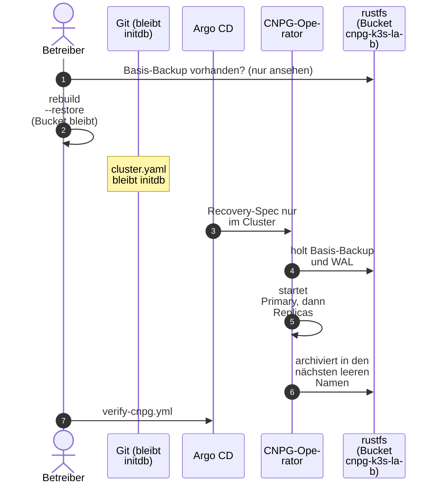

# Datenbank wiederherstellen

**Ziel:** `pg-lab` aus dem S3-Archiv neu aufbauen, mit allen Daten bis zur
letzten archivierten WAL-Datei (oder bis zu einem Zeitpunkt, PITR).

**Fall:** VM oder Platte weg, Namespace `db-lab` weg, aber der Bucket auf dem
Steuerrechner ist da.

!!! danger "`lab.sh rebuild` ist kein Restore"
    `rebuild` leert den Postgres-Bucket ausdrücklich (siehe
    [Neuaufbau](rebuild.md)). Diese Anleitung gilt nur, wenn du die Daten
    **behalten** willst. Der Gitea-Teil steht in
    [Gitea wiederherstellen](restore-gitea.md); die Reihenfolge ist immer
    Datenbank, Dateien, Gitea ([Konzept](../concepts/backup-and-restore.md)).
    Keycloak hat nur eine Datenbank: [Keycloak wiederherstellen](restore-keycloak.md).



## Schritte

1. **Prüfen, dass das Backup da ist** (auf dem Steuerrechner). Der Ordner
   `db-lab/pg-lab/base/` im Bucket hat Einträge; rustfs legt pro Objekt einen
   Ordner an. Nur ansehen, dort nie etwas ändern:

    ```bash
    ls ~/k8s-lab-data/backups/cnpg-k3s-lab/db-lab/pg-lab/base/
    ```

    Ohne Basis-Backup nicht weitermachen. Das Basis-Backup allein reicht
    nicht: im Ordner `wals/` muss das Segment aus `status.endWal` des
    Backups liegen. `lab.sh down`, `lab.sh export` und `lab.sh rebuild --restore` warten darauf
    ([ADR-0017](../concepts/decisions/0017-wal-before-vm-stop.md)). Fehlt
    das Segment, ist das Archiv nicht abspielbar. Ein Cluster ohne
    abgeschlossenes Backup ist ein Fehler: der Stopp findet nicht statt.
    Läuft die VM noch, legt `rebuild --restore` das Basis-Backup und das
    K8up-Backup selbst an und bricht ab, wenn das nicht gelingt.
    `scripts/lab-restore-render.py` prüft dasselbe End-WAL auf der Platte,
    auch wenn die VM schon aus ist. Eine Generation ohne das Segment wird
    nicht gelesen. Ist der Schreibname dieser Generation schon belegt, nennt
    der Abbruch das Präfix.

2. **Git nicht umstellen.** Die vier `cluster.yaml` bleiben auf
   `bootstrap.initdb` und dem ursprünglichen `serverName`. Ein Commit mit
   `bootstrap.recovery` würde die nächste frische Installation und die
   öffentliche Kopie auf ein Archiv zeigen, das es dort nicht gibt
   ([ADR-0018](../concepts/decisions/0018-recover-from-backup.md)).

    Was zur Laufzeit im Cluster landet, nicht in Git, hat diese Form
    (`pg-lab` steht hier für den ursprünglichen Namen; der Befehl wählt
    Quelle und Schreibziel aus den Archiv-Ordnern):

    ```yaml
    bootstrap:
      recovery:
        source: origin
        database: app
        owner: app
    externalClusters:
      - name: origin
        plugin:
          name: barman-cloud.cloudnative-pg.io
          isWALArchiver: false
          parameters:
            barmanObjectName: pg-lab
            serverName: pg-lab-r3     # höchstes Archiv mit Basis-Backup
    plugins:
      - name: barman-cloud.cloudnative-pg.io
        enabled: true
        isWALArchiver: true
        parameters:
          barmanObjectName: pg-lab
          serverName: pg-lab-r4       # nächster leerer Name
    ```

    **Warum ein neuer Name:** CNPG schreibt WAL nie in ein Archiv, das schon
    Dateien hat. Fehler sonst: `Expected empty archive`. Der erste Schritt
    nach `pg-lab` heisst `pg-lab-r2`. In `scheduledbackup.yaml` ändert sich
    nichts.

3. Den Cluster neu aufbauen, **ohne den Postgres-Bucket zu leeren und ohne
   Git zu ändern**:

    !!! warning "Der Schalter heisst `--restore`"
        `lab.sh up` bricht auf einer fehlenden VM ab, wenn im Bucket noch WAL
        liegt (`Expected empty archive`). `rebuild` ohne Schalter leert den
        Bucket und ist kein Restore. `rebuild --restore` lässt den Bucket
        stehen, legt die Recovery-Spec nur im Cluster an und spielt Datenbank
        und Dateien ein
        ([ADR-0018](../concepts/decisions/0018-recover-from-backup.md)).
        `restore-drill` bleibt der Beweis im Wegwerf-Namespace
        ([Restore-Test](restore-drill.md)).

    ```bash
    bash scripts/lab.sh export
    bash scripts/lab.sh rebuild --restore
    ```

    Die Rückfrage ist doppelt (das Wort `restore`, dann der VM-Name). `--yes`
    überspringt sie nicht. `--no-export` gilt nicht. Der gleiche age-Schlüssel
    muss da sein, sonst sind die Secrets nicht lesbar. Danach stehen die
    Cluster-Dateien in Git noch auf `initdb`. Die Applications ignorieren
    `bootstrap`, `externalClusters` und den Schreib-`serverName`, damit Argo
    CD den laufenden Cluster nicht auf `initdb` zurückdreht.
4. Prüfen. `verify-cnpg.yml` liest den `serverName` aus Git, also den
   ursprünglichen Namen. Nach `--restore` schreibt der laufende Cluster
   auf den nächsten leeren Namen. Die Altersprüfung des Backups gilt
   darum dem Git-Namen, nicht dem Schreibziel:

    ```bash
    cd ansible && ansible-playbook verify-cnpg.yml
    ```

5. **Später aufräumen:** Git bleibt auf `initdb`. Der laufende Cluster behält
   sein `bootstrap.recovery`, weil CNPG es nach dem Anlegen nicht mehr liest
   und Argo CD diese Felder ignoriert. Das alte Archiv fällt nicht unter die
   Retention des neuen; nach 14 Tagen von Hand löschen (Root-Schlüssel von rustfs).

## Das App-Passwort nach dem Neuaufbau

Das App-Passwort ist nach dem Neuaufbau neu (Secret `pg-lab-app`), die Rolle
`app` in der Datenbank behält aber ihr altes Passwort aus dem Backup. Laut
CNPG-Doku setzt der Operator bei `recovery` mit `owner` das Passwort aus dem
neuen Secret (im Test bestätigt: der Pooler-Test in `verify-cnpg.yml` meldet
sich nach dem Neuaufbau mit dem neuen Passwort an). Apps, die das Secret lesen,
brauchen nur einen Neustart.

## Übung ohne Desaster

Genau das macht der Restore-Test in `verify-cnpg.yml` mit `pg-lab-verify`,
nur ohne Desaster und mit PITR (Tabelle A: Anzahl und md5 stimmen; Tabelle B,
die erst nach dem Zielzeitpunkt entstand, muss fehlen). Dauer etwa 10 Minuten.

```bash
cd ansible
ansible-playbook verify-cnpg.yml --tags repo,cluster,backup   # without restore
ansible-playbook verify-cnpg.yml                              # with restore test
```
