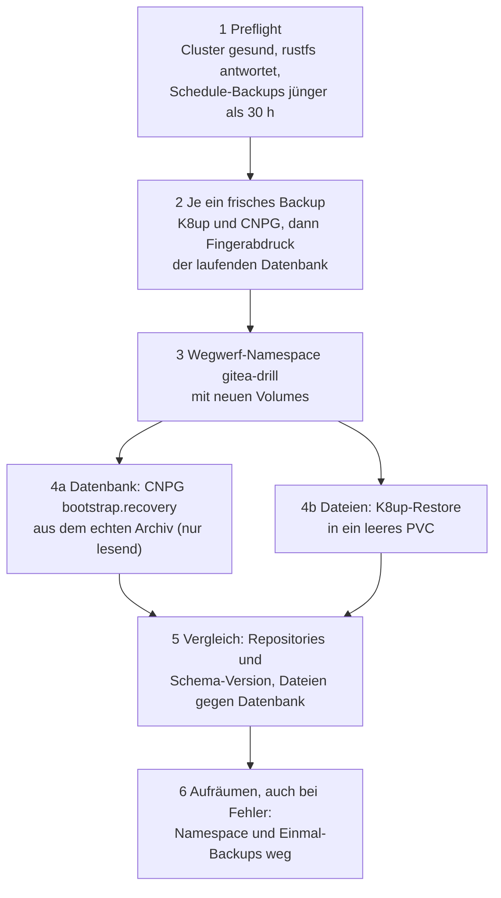
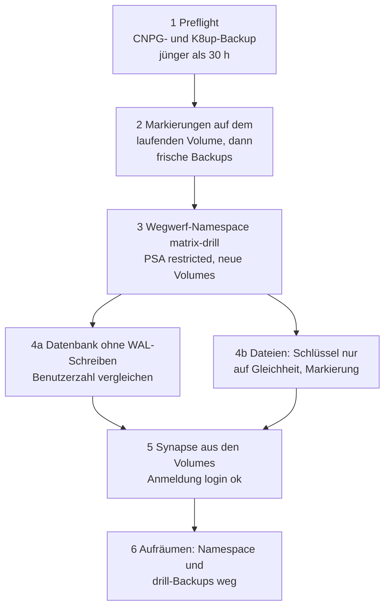

# Restore-Test: Gitea und Matrix nur aus den Backups

**Ziel:** beweisen, dass Gitea (Datenbank **und** Dateien) und danach Matrix allein aus dem Objektspeicher
zurückkommen, ohne die Platte der laufenden VM. Umsetzung von [Issue 4](https://github.com/tabee/k8s-lab-template/issues/4); warum in
einem Wegwerf-Namespace und nicht in den echten Namen:
[ADR-0014](../concepts/decisions/0014-restore-drill-throwaway-namespace.md). Matrix:
[ADR-0016](../concepts/decisions/0016-matrix-federation-off.md).

```bash
bash scripts/lab.sh restore-drill
```

Der Befehl fragt wie `purge` **doppelt** (erst das Wort `restore-drill`, dann den VM-Namen; `--yes` überspringt das
nicht) und verlangt einen **frischen Export** der VM-Platte (Fallschirm). `--no-export` gilt hier nicht. Es wird
nichts Echtes gelöscht, trotzdem soll niemand den Test aus Versehen starten: er belastet die VM einige Minuten.

!!! note "Name des Befehls"
    Das Ticket nannte den Befehl `wiederherstellen`. Das Repo benennt Befehle englisch; ein deutscher Alias wird
    nicht angelegt (deutsche Namen sind nur noch veraltete Aliase, siehe [lab.sh](../reference/lab-sh.md#veraltete-namen)).

## Ablauf



1. **Preflight.** Der Cluster ist gesund, rustfs antwortet, das jüngste fertige Backup **des Zeitplans** (CNPG und K8up)
   ist jünger als `restore_drill_max_age_h` (30 h). Das beweist, dass die täglichen Zeitpläne laufen.
2. **Frische Backups und Fingerabdruck.** Eigene Einmal-Backups (`drill-<Lauf>`) stellen sicher, dass der Vergleich exakt
   ist. Der Fingerabdruck der Datenbank ist `Repositories|Anzahl|Schema-Version`.
3. **Wegwerf-Namespace** `<Namespace von Gitea>-drill` (Suffix in `restore_drill.yml`): Secrets und ObjectStore wie im
   echten Namespace, **neue** Volumes. Von der alten Platte wird nichts benutzt.
4. **Wiederherstellen und messen.** Die Datenbank kommt per `bootstrap.recovery` aus dem echten Archiv (nur
   lesend; der Wegwerf-Cluster archiviert nicht und schreibt nie in das echte Archiv). Die Dateien kommen per K8up-Restore in ein
   leeres PVC. Beides wird in Sekunden gemessen.
5. **Vergleich.** Repositories und Schema-Version der wiederhergestellten gegen die laufende Datenbank; die Repositories
   auf dem wiederhergestellten Volume gegen die wiederhergestellte Datenbank. Ein leeres Gitea würde „korrekt“
   wiederherstellen und nichts beweisen: `restore_drill_min_repos` verlangt eine Mindestzahl (Standard 0: ein leeres
   Gitea wird erlaubt, das Ergebnis nennt dann `repositories 0`). Lege vor dem ersten echten Lauf mindestens ein Repository an.
6. **Aufräumen.** Auch bei einem Fehler. Die Snapshots bleiben bis zur Aufbewahrung.

Am Ende steht eine Zeile `RESTORE-DRILL RESULT …` mit den Zeiten. Für Matrix folgt eine zweite Zeile
(`RESTORE-DRILL RESULT ok: matrix database …`). `lab.sh` kopiert jede solche Zeile in die Nachweise. Scheitert der
Gitea-Lauf, startet der Matrix-Lauf nicht.

Wegen der Wegwerf-Objekte hat dieses Playbook **kein** `changed=0`; ein zweiter Lauf ist ein eigener, sauberer Lauf.

## Matrix



1. **Preflight.** Ein fertiges CNPG-Backup und ein fertiges K8up-Backup von Matrix, jünger als
   `restore_drill_max_age_h` (30 h). Das CNPG-Backup legt der Zeitplan sofort an. Das K8up-Backup legt die Abnahme
   an und **behält** das Objekt `verify-<Lauf>`. Ohne vorherige Abnahme fehlt es.
2. **Markierungen und frische Backups.** Der Lauf schreibt `/data/drill-marker` und
   `/data/media_store/drill-marker` auf das **laufende** Volume (nur die Lauf-Kennung) und sichert dann neu
   (`drill-<Lauf>`). Der Fingerabdruck der Datenbank ist die Zahl der Benutzer und der Admins.
3. **Wegwerf-Namespace** `matrix-drill`. Secrets und ConfigMaps wie im echten Namespace, neue Volumes, keine
   NetworkPolicy (wie bei Gitea: der Wegwerf-Namespace muss S3 und die API erreichen). PSA `restricted` wird
   übernommen.
4. **Vergleich.** Die Datenbank kommt aus dem Archiv und schreibt kein WAL zurück. Die Dateien kommen per
   K8up-Restore. Ein kurzer Pod druckt nur `MATCH` oder `MISMATCH` und `MARKER` oder `MARKER-MISMATCH`, nie den
   Hash des Signaturschlüssels.
5. **Anmeldung.** Synapse startet mit den wiederhergestellten Dateien gegen die wiederhergestellte Datenbank
   (direkt, ohne Pooler) und `check-login.py` muss `login ok` drucken.
6. **Aufräumen.** Namespace `matrix-drill` und die Objekte `drill-<Lauf>`. Das Objekt `verify-*` bleibt.

!!! warning "Zwei Dateien bleiben auf dem laufenden Volume"
    Die Markierungen sind klein und enthalten kein Geheimnis. Sie liegen im nächsten Backup. Der Test löscht sie
    nicht.

## Was der Test beweist, was nicht

| Beweist | Beweist nicht |
|---|---|
| Datenbank und Dateien kommen aus dem Bucket, ohne die Volumes der laufenden VM | den Ausfall der VM-Platte selbst (die VM läuft weiter) |
| die **Zeit** bis dahin (RTO) | dass der Bucket den Ausfall des Steuerrechners überlebt (dafür das [Replikat](backup-replica.md)) |
| das Archiv ist lesbar und vollständig bis zum frischen Basis-Backup | dass Argo CD, Traefik und Zertifikate danach in den echten Namen wieder stehen (das tut `lab.sh up` aus Git, ohne Daten) |

## Keycloak: kein eigener Restore-Test {#keycloak}

Der Test deckt Gitea und Matrix ab, Keycloak nicht. Keycloak hat kein Volume, der gesamte Zustand liegt in
`keycloak-db`. Das Archiv prüft jede Abnahme (Phase 19: ein fertiges Basis-Backup von `keycloak-db`, WAL-Sperre
vor dem VM-Stopp), das Muster der Wiederherstellung ist dasselbe wie bei den anderen Clustern
([Datenbank wiederherstellen](restore-database.md)). Ob ein Wegwerf-Restore von Keycloak gebaut wird, steht in
[Issue 42](https://github.com/tabee/k8s-lab-template/issues/42) (Begründung der Lücke: [ADR-0019](../concepts/decisions/0019-keycloak-sso.md)).

## Replikat {#replikat}

Mit einem [Replikat](backup-replica.md) lässt sich derselbe Test ein zweites Mal **ohne den Primär** fahren (ein echter Lauf dieser Variante
steht noch aus, siehe [Issue 125](https://github.com/tabee/k8s-lab-template/issues/125)):

```bash
bash scripts/lab.sh replica restore ~/rustfs-aus-replikat
# a throwaway rustfs on ANOTHER port serves that directory (same data, credentials from the replica's .rustfs.sys)
# then point the drill at it (backup_s3 endpoint) and make the primary unreachable:
#   sudo ufw deny 9000/tcp     # ... and at the end: sudo ufw delete deny 9000/tcp
bash scripts/lab.sh restore-drill
```

Am Ende muss der Primär wieder erreichbar sein (`lab.sh alert run` meldet `rustfs` grün).

## Gemessen

Die Zeiten echter Läufe (Datenbank, Dateien, gesamt, Repositories, Matrix) trägt [Issue 125](https://github.com/tabee/k8s-lab-template/issues/125) nach; jeder Lauf druckt sie am Ende selbst.

## Wenn es schiefgeht

| Meldung | Ursache |
|---|---|
| `Run 'bash scripts/lab.sh export' first` | der Export ist älter als `export_max_age_h` |
| `rustfs answers …` fehlt | der Primär ist nicht erreichbar: `lab.sh alert run`, `lab.sh status` |
| Wegwerf-Namespace hängt | `kubectl delete ns gitea-drill` oder `kubectl delete ns matrix-drill`; das Playbook räumt beim nächsten Lauf auf |
| K8up-Backup von Matrix fehlt oder ist zu alt | zuerst `bash scripts/lab.sh acceptance` (Phase 18 behält `verify-<Lauf>`) |
