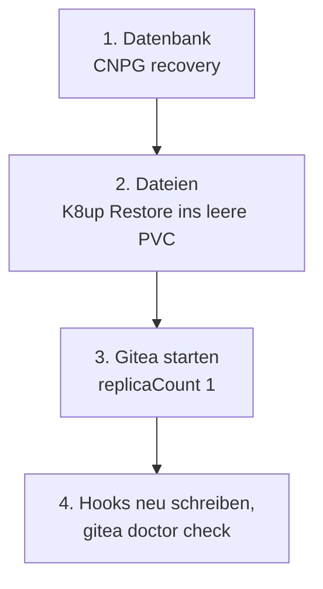

# Gitea wiederherstellen

!!! note "Anmeldung über Keycloak"
    Die Anmeldequelle `keycloak` liegt in der Gitea-Datenbank und wird beim Start aus `values-gitea.yaml` neu
    gesetzt. Nach einer Wiederherstellung funktioniert sie wieder, sobald Keycloak läuft. Das lokale Admin-Konto
    geht immer ([Keycloak](keycloak.md)).

Gitea besteht aus zwei Teilen, die zusammenpassen müssen: der **Datenbank**
(`gitea-db`, CNPG) und den **Dateien** (PVC `gitea-shared-storage`: Repos,
Anhänge, Avatare; K8up). Die Reihenfolge ist immer:



!!! warning "Egress aus `gitea` ist gesperrt"
    Gitea darf im Cluster nicht nach aussen. Die Backup- und
    Restore-Pods (Postgres, Pooler, K8up) erreichen weiter die K8s-API und das S3
    des Backup-Ziels; **Webhooks, Mail und Mirrors** von Gitea sind gesperrt, auch
    nach einem Restore. Nach einem Restore auf **neuer Adresse** des Backup-Ziels
    oder der VM stimmen die Adressen in den Egress-Policies nicht mehr
    (`bash scripts/lab.sh repo-egress --resolve`, dann committen und pushen), und
    der Restore bleibt hängen, bis sie stimmen. Siehe
    [Fehlersuche](troubleshooting.md#egress-gitea).

Gitea liest beim Start die Datenbank und erwartet die Repos, die dort stehen.
Läuft Gitea mit neuer DB und alten Dateien (oder umgekehrt), sieht es Repos,
die es nicht kennt, oder kennt Repos, die fehlen.

**Gleicher Zeitpunkt:** Die DB lässt sich auf jede Sekunde zurückholen (PITR),
die Dateien nur auf einen Snapshot. Darum zuerst den K8up-Snapshot wählen und
die DB auf dessen Zeit setzen (`recoveryTarget.targetTime`). Ohne Angabe holt
CNPG den letzten Stand; dann kann die DB bis zu einem Tag neuer sein als die
Repos (nach dem Restore `gitea doctor check` laufen lassen).

## Desaster: VM weg, Buckets da {#desaster-vm-weg-buckets-da}

`rebuild --restore` macht diesen Fall. Er leert rustfs nicht, lässt Git auf
`initdb`, hält Gitea und Matrix an, bis das neueste K8up-Snapshot
dieses PVC im leeren Volume liegt. Die Restore-Spec pinnt die volle
Snapshot-Id und den Pfad `/data/<claim>`. Die Snapshot-Objekte von K8up
gibt es nur in einem Cluster, der schon ein K8up-Backup gemacht hat. Auf
einer neuen VM fehlen sie, dann fragt ein kurzer Lese-Pod mit
`restic snapshots` das Repository direkt. Fehlt das Snapshot auch dort,
oder ist `git/gitea-repositories` danach leer, bricht der Lauf ab. Danach schreibt
er die Hooks neu und führt `gitea doctor` aus.
Vorher ein frischer Export. Die Rückfrage ist doppelt (das Wort `restore`).

```bash
bash scripts/lab.sh export
bash scripts/lab.sh rebuild --restore
```

Ablauf und Grenzen: [Datenbank wiederherstellen](restore-database.md),
[ADR-0018](../concepts/decisions/0018-recover-from-backup.md).
`replicaCount` nicht von Hand auf 0 setzen: der Befehl nimmt Argo CD den
Auto-Sync für die Dauer der Datei-Wiederherstellung und setzt ihn danach
aus Git zurück.

Nur ansehen, nichts löschen:

```bash
ls ~/k8s-lab-data/backups/cnpg-k3s-lab/gitea/
ls ~/k8s-lab-data/backups/k8up-k3s-lab/
```

!!! note "Gitea-Anmeldung nach dem Neuaufbau"
    Der Gitea-Admin ist mit `initialOnlyNoReset` konfiguriert: Gitea legt ihn
    nur an, wenn er fehlt, und setzt sein Passwort später nicht zurück. Nach
    einem Restore gilt deshalb das Passwort aus dem Datenbank-Backup; das Secret
    `gitea-admin` ist nur der Startwert für eine frische Datenbank. (Folgerung
    aus der Chart-Option, nicht gesondert getestet.)

## Ein Repo aus Versehen gelöscht (Cluster läuft) {#ein-repo-aus-versehen-geloescht}

Nicht ins laufende PVC zurücksichern: Der Restore würde Dateien unter dem
laufenden Gitea tauschen. Stattdessen wie `verify-gitea.yml`:

1. In einen **Wegwerf-Namespace** zurücksichern (ein `Restore` wie oben, aber
   mit eigenem PVC derselben Grösse).
2. Das Repo-Verzeichnis `git/gitea-repositories/<besitzer>/<repo>.git` ansehen.
3. Per `git clone` aus dem Pod holen und neu pushen.

Für die DB-Seite (Issues, Pull Requests) gibt es **keinen Teil-Restore**; das
wäre ein ganzer Restore wie oben.
