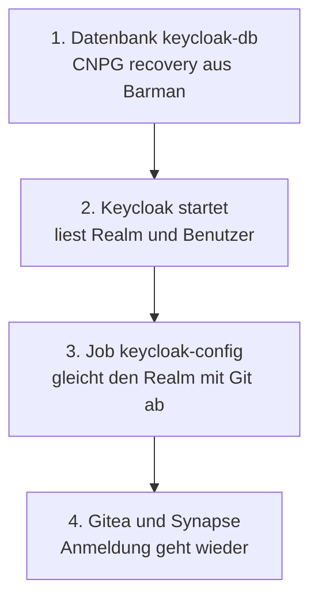

# Keycloak wiederherstellen

Keycloak hat **kein** Volume. Aller Zustand (Realm, Benutzer, Passwort-Hashes, Gruppen, Clients, Signaturschlüssel)
liegt in der Datenbank `keycloak-db` (CNPG, `initdb` im Git). Es gibt darum keinen Datei-Restore und keine
K8up-Sicherung wie bei [Gitea](restore-gitea.md): die Reihenfolge besteht aus einem Schritt weniger.



!!! warning "Die Datenbank muss zurückkommen, ein neuer Realm genügt nicht"
    Gitea und Synapse verknüpfen ein Konto mit der **Benutzer-ID** (`sub`) aus Keycloak, nicht mit dem Namen. Wer den
    Realm neu aus Git aufbaut und die Benutzer von Hand neu anlegt, hat dieselben Namen mit neuen IDs. Gitea
    verknüpft das Konto dann beim ersten Login über den gleichen Namen neu (`ACCOUNT_LINKING: auto`), Synapse
    legt dagegen einen zweiten Benutzer an (aus `@kc-alice:lab` wird `@kc-alice1:lab`). Das wurde auf der Box so
    beobachtet. Mit der wiederhergestellten
    Datenbank passiert das nicht.

## Desaster: VM weg, Buckets da {#desaster-vm-weg-buckets-da}

`rebuild --restore` macht diesen Fall für alle vier Cluster auf einmal (`pg-lab`, `gitea-db`, `matrix-db`,
`keycloak-db`). Er leert rustfs nicht, lässt Git auf `initdb` und rendert die Recovery-Spec erst zur Laufzeit
([ADR-0018](../concepts/decisions/0018-recover-from-backup.md)). Vorher ein frischer Export, danach der Befehl:

```bash
bash scripts/lab.sh export
bash scripts/lab.sh rebuild --restore
```

Die Rückfrage ist doppelt (das Wort `restore`, dann der VM-Name). Für Keycloak ist nichts Zusätzliches zu tun.
`recover-files.yml` hält nur Gitea und Matrix an (Dateien), Keycloak läuft einfach los, sobald seine Datenbank da ist.

### Was `rebuild --restore` für `keycloak-db` vorher prüft

Läuft die VM noch, geht der Befehl in dieser Reihenfolge vor und bricht bei jedem Fehler ab, ohne die VM
anzufassen:

1. **Frisches Basis-Backup.** `scripts/lab-backup-fresh.py --force-all` legt für `keycloak-db` ein CNPG-`Backup`
   (`pre-restore-keycloak-db-…`, Methode `plugin`) an und wartet, bis es `completed` ist, ein `endWal` hat und
   jünger als `backup_max_age_h` ist. `keycloak-db` braucht dafür genau ein `ScheduledBackup` mit Plugin-Methode
   (`gitops/workloads/keycloak/manifests/scheduledbackup.yaml`). Ein K8up-Backup gibt es nicht, Keycloak hat kein Volume.
2. **WAL-Prüfung.** `scripts/lab-wal-ready.py` schaltet das WAL um und wartet, bis das Archiv das `endWal` des neuesten
   abgeschlossenen Backups enthält. Hat `keycloak-db` kein abgeschlossenes Backup, ist das ein Abbruch
   (`FAIL keycloak/keycloak-db no completed backup`), kein Überspringen.
3. **Renderer.** `scripts/lab-restore-render.py` liest nur eine Generation von `keycloak-db`, deren neuestes
   abgeschlossenes Basis-Backup (`status=DONE`, `end_wal` mit 24 Hex-Zeichen) sein Segment unter `wals/` hat.
   Eine höhere Generation ohne dieses Segment wird übersprungen. Ist der Schreibname der gewählten Generation schon
   belegt, bricht der Lauf ab und nennt das Präfix (`write prefix keycloak-db-rN already has files`).

### Vorher prüfen

Ist die VM schon aus, läuft Schritt 1 nicht mehr. Dann zählt nur das Archiv auf der Platte:

```bash
kubectl -n keycloak get backup
ls ~/k8s-lab-data/backups/cnpg-k3s-lab/keycloak/
```

## Danach prüfen

```bash
kubectl -n keycloak get cluster keycloak-db
kubectl -n keycloak get pods
cd ansible && ansible-playbook verify-keycloak.yml
```

Erwartet: `keycloak-db` ist `Cluster in healthy state`, der Pod `keycloak-…` ist `1/1 Running`, der Job
`keycloak-config` ist `Completed`. Danach melden sich bestehende Benutzer über Gitea und Matrix an, mit demselben
Konto wie vor der Zerstörung.

Keycloak startet beim ersten Hochfahren nach dem Restore ein- bis viermal neu, bis die Datenbank Verbindungen
annimmt. Das heilt sich selbst und ist kein Fehler.

!!! note "Synapse liest die Anmeldung nur beim Start"
    Synapse hat keine Prüfsumme der Konfiguration im Pod. Ändert sich die OIDC-Einstellung (zum Beispiel das
    Client-Geheimnis), startet Synapse nicht von selbst neu: `kubectl -n matrix rollout restart deploy/synapse`.

!!! note "Gitea vor Keycloak"
    Beim Neuaufbau starten Gitea und Keycloak gleichzeitig. Keycloak braucht beim ersten Start etwa 1 bis 2 Minuten
    (mehrere Neustarts, bis die Datenbank bereit ist). Läuft Gitea schon, bevor Keycloak da ist, wartet der Init-Container `configure-oidc` höchstens 180 Sekunden und
    startet dann ohne Anmeldequelle. Die Quelle `keycloak` entsteht beim nächsten Start von Gitea. Die Abnahme meldet
    eine fehlende Quelle; Abhilfe: `kubectl -n gitea rollout restart deploy/gitea`.

## Ein Benutzer aus Versehen gelöscht (Cluster läuft)

Es gibt **keinen Teil-Restore** einer einzelnen Tabelle. Zwei Wege:

1. Den Benutzer in der Konsole neu anlegen. Gitea und Synapse sehen ihn als neue Person (siehe oben).
2. Punkt-in-Zeit-Wiederherstellung der ganzen Datenbank in einen Wegwerf-Cluster nach dem Muster von
   [Restore-Test](restore-drill.md), den Benutzer dort nachsehen und von Hand übernehmen.

## Siehe auch

- [Keycloak im Lab](keycloak.md), Abschnitt Sicherung
- [Datenbank wiederherstellen](restore-database.md)
- [ADR-0019](../concepts/decisions/0019-keycloak-sso.md)
