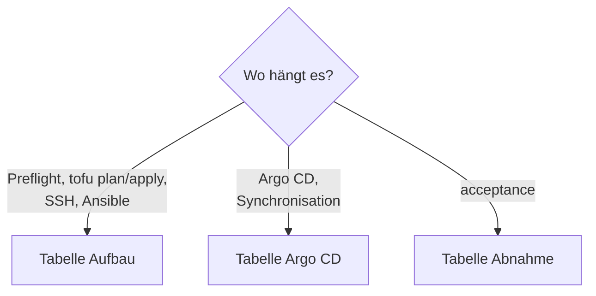

# Fehlersuche

Sortiert nach der Phase, in der der Fehler auftritt. Die Tabellen nennen
Meldung (so wie sie im Terminal steht), Ursache und Abhilfe. Beginne immer mit
dem Log: `~/k8s-lab-data/logs/lab-<befehl>-<zeitstempel>.log`.



## Aufbau (`up`, `rebuild`, `preflight`) {#aufbau}

| Meldung / Symptom | Ursache und Abhilfe |
|---|---|
| Preflight: `Deploy-Key kommt nicht ans Repo` | VPN zum Git-Server aus, Deploy-Key nicht eingetragen oder `repo_known_hosts` veraltet (`bash scripts/lab.sh customize --fetch-host-keys`). |
| Preflight: `main und origin/main sind verschieden` | Argo CD liest `origin/main`. Erst pushen oder pullen. |
| Preflight: `... nennt nicht das Gateway` | Netz in `lab.yaml` weicht von `gitops/` ab: `bash scripts/lab.sh customize` ([anderes Netz](../tutorials/lab-for-friends.md#anderes-netz)). |
| Preflight: `repo_url ist noch der Platzhalter` | `repo_url` in `lab.local.yaml` setzen, dann `customize`. |
| Preflight: `argocd_repo_known_hosts ist leer` | `bash scripts/lab.sh customize --fetch-host-keys`. |
| `SHA-256 des Images stimmt nicht` | Download defekt oder Pin in `lab.yaml` falsch. Es wird nichts verwendet; Datei im Cache löschen, neu versuchen. |
| `Resource precondition failed` in `tofu apply` | Das Image im Cache hat nicht die gepinnte SHA-256 (zweite Prüfung im Tofu-Modul). |
| `ABBRUCH: der Plan würde bestehende Teile der VM zerstören` | `up` zerstört nie von allein. Erst `export`, dann `rebuild`, oder `up --destroy-ok`. |
| `tofu destroy` meldet Snapshots | `down` entfernt sie vorher; von Hand: `virsh -c qemu:///system snapshot-delete k3s-lab NAME --metadata`. |
| `Expected empty archive` (CNPG, oder `up` bricht ab) | Im Bucket `cnpg-k3s-lab` liegt noch WAL. Zurück aus dem Backup: `bash scripts/lab.sh rebuild --restore` (leert nicht, Git bleibt `initdb`). Sauberer Start, Backup weg: `rebuild`. Von Hand leeren, siehe unten. |
| SSH nach 600 s nicht erreichbar | Konsole ansehen: `virsh -c qemu:///system console k3s-lab`. Netz `default` aktiv? IP in `lab.yaml` frei? |
| `host key verification failed` | Alter Eintrag für die IP: `ssh-keygen -R 192.168.122.50` (`down` macht das selbst). |
| `Applications` bleiben `OutOfSync` oder `Progressing` | Siehe [Argo CD](#argo-cd). |

```bash
# empty only the Postgres bucket by hand, then recreate it
cd ansible
ansible-playbook lab-backups-empty.yml -e lab_empty_ok=yes
ansible-playbook backup-host.yml -K
```

## Argo CD {#argo-cd}

```bash
kubectl -n argocd get applications
kubectl -n argocd describe application NAME
```

Fast immer: Deploy-Key oder Repo nicht erreichbar, oder der SOPS-Schlüssel
fehlt. Die weiteren Fälle:

| Symptom | Ursache | Abhilfe |
|---|---|---|
| `argocd.yml` bricht im Preflight ab: Identität nicht in `.sops.yaml` | `keys.txt` und `.sops.yaml` passen nicht zusammen | Öffentlichen Schlüssel mit `age-keygen -y` anzeigen und in `.sops.yaml` eintragen, oder die richtige `keys.txt` nehmen. |
| App `secrets-*` `Unknown`: `error decrypting file ... 0 successful groups required` | Datei für einen anderen Schlüssel verschlüsselt als der im Secret `sops-age` | Nichts geht verloren (Secret bleibt). Empfänger angleichen (`sops updatekeys`), `argocd.yml`. |
| `exec: "ksops": executable file not found` oder `plugins are disabled` | KSOPS fehlt oder `buildOptions` fehlen | `argocd.yml` nochmals; `verify-ksops.yml` zeigt, was fehlt. |
| Direkt nach dem Push kurz `Unknown`: `external plugins disabled; unable to load external plugin 'ksops'` | Argo CD sah den Commit, bevor `argocd.yml` KSOPS eingeschaltet hat | Nichts tun; nach dem Helm-Upgrade löst es sich beim nächsten Abgleich (bis etwa 3 Minuten). |
| `lab_ca` meldet „nicht von Argo CD angelegt“ | App noch nicht synchron (frischer Bootstrap) oder Fehler weiter oben | `kubectl -n argocd get application secrets-cert-manager -o yaml`, dann `argocd.yml` erneut. |
| `yamllint` meckert über `*.sops.yaml` | lange `ENC[...]`-Zeilen, kein `---` (SOPS schreibt so) | Diese Dateien nicht linten. |
| `root` meldet dauernd `OutOfSync` wegen `k8up` | Die zwei `post-delete`-Finalizer fehlen in `gitops/apps/k8up.yaml` | Argo CD hängt sie der Application an, weil das K8up-Chart einen PostDelete-Hook hat. Stehen sie nicht im Git, bleibt `root` `OutOfSync` (Fix `9e0a0bf`). |

### Nach `rebuild --restore`: `keycloak` bleibt `OutOfSync` {#keycloak-outofsync-nach-restore}

Nach dem ersten echten Restore war `keycloak` nur wegen `Cluster keycloak/keycloak-db` `OutOfSync`, während `gitea`,
`matrix` und `db-lab` `Synced` waren. `gitops/apps/keycloak.yaml` trägt dieselben `ignoreDifferences` wie die anderen
drei Applications (`bootstrap`, `externalClusters`, Schreib-`serverName`, plus `RespectIgnoreDifferences=true`); ein
Test prüft das. Der Befund ist damit **nicht** durch eine fehlende Regel im Git erklärt. Erst den Unterschied ansehen:

```bash
kubectl -n argocd get application keycloak -o jsonpath='{.spec.ignoreDifferences}{"\n"}{.spec.syncPolicy.syncOptions}{"\n"}'
kubectl -n argocd get application keycloak \
  -o jsonpath='{range .status.resources[?(@.status=="OutOfSync")]}{.kind}/{.name}{"\n"}{end}'
argocd app diff keycloak          # which field differs (needs the argocd CLI)
```

Fehlen die `ignoreDifferences` in der **lebenden** Application, hat die laufende `root` die aktuelle Datei noch nicht
gezogen (Sync von `root` abwarten oder anstossen). Stehen sie dort, nennt der Diff das Feld, das noch fehlt.

### Nach `rebuild --restore`: das Datei-PVC bleibt `Terminating` {#restore-pvc-terminating}

Symptom: «Restore Gitea and Matrix files» scheitert nach 180 s bei «Delete the file PVC from the new disk» (oder
bei «Wait until a PVC that is already Terminating is gone»). `kubectl -n gitea get pvc gitea-shared-storage` zeigt
`Terminating`, `kubectl -n gitea get pod` einen laufenden Pod, `deploy/gitea` steht auf `1/1`.

Ursache: Ein Pod hängt das PVC noch ein, und der Schutz `kubernetes.io/pvc-protection` hält es, bis der letzte Pod weg ist. Im
ersten Fall (2026-11-03) lief die Pause, als der erste Sync von `gitea` noch lief: Das Deployment war noch nicht da, der Sync legte
es danach mit einem Replikat an. Seither wartet die Pause auf diesen Sync und auf das Ende des Pods
([Neuaufbau](rebuild.md#restore-stolpersteine)).

Abhilfe, wenn der Lauf schon stehen geblieben ist (der Befehl steht auch in der Warnung von `lab.sh`):

```bash
cd ansible
ansible-playbook recover-files.yml --tags pause            # Auto-Sync aus, Deployment auf 0, wartet bis kein Pod das PVC hält
ansible-playbook recover-files.yml --tags restore,resume,verify
kubectl -n argocd get applications.argoproj.io -o custom-columns=NAME:.metadata.name,AUTO:.spec.syncPolicy.automated
```

Nennt die Fehlermeldung einen Pod, der nicht zu `gitea` oder `synapse` gehört, ist dieser Pod die Ursache. Diesen Pod löschen. Den
Finalizer von Hand zu entfernen umgeht den Schutz: Das Volume würde gelöscht, während ein Pod noch darauf schreibt.

### Nach `rebuild --restore`: «Apply CNPG recovery specs» wartet auf das Plugin {#restore-plugin-tls}

Symptom (dritter echter Lauf, 2026-11-03): «Apply CNPG recovery specs» brach nach rund 12 Minuten ab, weil das Deployment
`plugin-barman-cloud` nicht `Available` wurde. Der Pod stand in `ContainerCreating` mit `FailedMount` für die Secrets
`barman-cloud-client-tls` und `barman-cloud-server-tls`. Die cert-manager-Zertifikate wurden erst rund 11 Minuten nach dem
Deployment `Ready`. Operator und Webhook von CNPG waren in Ordnung.

Ursache (am laufenden Lab gemessen, lesend): Das Plugin hängt an zwei Zertifikaten (`barman-cloud-client`, `barman-cloud-server`)
eines eigenen selbstsignierten Issuers. Ohne die Secrets startet der Pod nicht. cert-manager war **nicht** langsam: Der
ClusterIssuer `lab-ca` war um 14:34:35 Z bereit, die Zertifikate wurden aber erst um 14:44:51 Z angelegt (sofort `Ready`), das
Deployment schon um 14:34:07 Z. Das Chart `plugin-barman-cloud` gibt Issuer und Zertifikaten keine Annotationen, alles liegt in
Wave 0. Argo CD wendet innerhalb einer Wave zuerst die bekannten Kinds an (Deployment) und erst danach eigene Ressourcen
(Certificate, Issuer). Das Deployment wartete so rund 600 Sekunden (`progressDeadlineSeconds`), bis Argo CD es als `Degraded`
meldete, der Sync scheiterte und der zweite Versuch die Zertifikate anlegte. Aus dem Quelltext von Argo CD allein ist nicht
zu entscheiden, warum die Zertifikate im ersten Durchgang fehlten (Webhook von cert-manager noch nicht bereit oder die
Zertifikate wurden gar nicht erst angewendet). Das ist für die Behebung egal.

Behebung (`gitops/platform/cnpg/values-plugin.yaml`): `commonAnnotations` setzt `argocd.argoproj.io/sync-wave: "1"` auf
ServiceAccount, Service und Deployment des Plugins. Issuer und Zertifikate bleiben in Wave 0, Argo CD legt das Deployment erst an,
wenn beide Zertifikate `Healthy` (Ready) sind. Der Pod findet beide Secrets beim ersten Start. Fehlen die cert-manager-CRDs oder
der Webhook noch, scheitert der Sync sofort und legt nichts an; die App `cnpg` versucht es bis zu zehnmal (Backoff 10 s bis 3 min).
`tests/argo-waves-tests.sh` prüft die Reihenfolge offline. Gemessen nach dieser Änderung: `rebuild --restore` am 07.11.2026 auf 8 GiB in 22 min 12 s, Exit 0 ([Neuaufbau](rebuild.md)). Prüfen mit:

```bash
kubectl -n cnpg-system get certificate,deployment plugin-barman-cloud -o custom-columns=NAME:.metadata.name,ERSTELLT:.metadata.creationTimestamp
```

Die Zertifikate müssen vor dem Deployment erstellt sein. Andere Apps haben das Muster nicht: Dort mountet kein Pod ein
cert-manager-Secret der eigenen App (geprüft in `tests/argo-waves-tests.sh`).

Die Wartekette in `restore-clusters.yml` bleibt als Netz bestehen, falls cert-manager doch länger braucht.

Was jetzt gilt: `restore-clusters.yml` wartet erst auf die drei Deployments von cert-manager, dann auf beide Zertifikate (`Ready`),
dann auf beide Secrets, dann auf das Deployment. Alles zählt gegen **ein** Budget, `restore_plugin_timeout_min` (Standard 30) in
`ansible/inventory/group_vars/all/restore.yml`. Hilft Warten nicht, greift der Lauf höchstens einmal ein: Ist der Sync von `cnpg`
`Failed`, stösst er ihn an (`restore_plugin_nudge_after_min`). Hängt der Plugin-Pod trotz fertiger Secrets, löscht er ihn einmal
(`restore_plugin_pod_grace_min`), damit der kubelet die Secrets sofort einhängt. Bei Ablauf nennt die Fehlermeldung die Stufe, die
Zustände und den Befehl zum Weitermachen. Die Phasen davor müssen nicht wiederholt werden:

```bash
cd ansible
ansible-playbook restore-clusters.yml                      # wartet erneut, wendet die Recovery-Specs an
ansible-playbook recover-files.yml --tags pause
kubectl wait --for=condition=Ready clusters.postgresql.cnpg.io --all -A --timeout=30m
ansible-playbook recover-files.yml --tags restore,resume,verify
```

Danach stand die VM womöglich schon halb: **nicht** `rebuild --restore` wiederholen, ohne [diesen Abschnitt](rebuild.md#restore-halb)
gelesen zu haben (Markierung, Wächter, leere Snapshots).

### Argo-OutOfSync durch Operator-Defaults {#argo-outofsync-durch-operator-defaults}

**Was passiert:** Argo CD vergleicht ein Manifest mit dem Stand im Cluster. Bei
eingebauten Typen (Deployment, Service, NetworkPolicy) gleicht es
Listeneinträge über ihren Schlüssel ab und ignoriert Felder, die nur im Cluster
stehen. Bei Objekten einer CRD (CNPG `Cluster`, `Pooler`, K8up `Schedule`,
Traefik `IngressRoute`, …) vergleicht es eine Liste als Ganzes. Setzt die CRD
oder ein Webhook in einem Listeneintrag einen Standardwert, den das Git nicht
hat, sind die beiden Einträge verschieden: Die App ist dauerhaft `OutOfSync`.
Selbstheilung hilft nicht, der Operator ergänzt den Wert danach wieder. Erlebt
in Stufe 8b: `plugins[].enabled` im Cluster `pg-lab` (CRD-Standard `true`), Fix
`3140de8`.

**Erkennen:** `verify-gitea.yml` nennt die Ressourcen, sonst von Hand:

```bash
kubectl -n argocd get application gitea \
  -o jsonpath='{range .status.resources[?(@.status=="OutOfSync")]}{.kind}/{.name}{"\n"}{end}'
# compare with the manifest in the repo
kubectl -n gitea get cluster gitea-db -o yaml
```

In der Argo-CD-Oberfläche zeigt „Diff“ an der Ressource den Zusatz.

**Abhilfe:** den Wert aus dem Cluster ausdrücklich ins Manifest schreiben, mit
kurzem Kommentar, commit, push. Der Standardwert steht im CRD-Schema
(`kubectl get crd <name> -o yaml`, Feld `default:` unter `items`).

**Schon ausdrücklich gesetzt:** `plugins[].enabled: true` und `isWALArchiver` im
`gitea-db`-Cluster (und in `pg-lab` seit Stufe 8b), `protocol: TCP` bei den
Ports der NetworkPolicy. `verify-gitea.yml --tags repo` prüft `enabled` und
`isWALArchiver` an jedem Plugin-Eintrag.

**Harmlos (kein Eingriff nötig):**

| Ressource | Liste | Warum kein Standardwert in Einträgen |
|---|---|---|
| Pooler `gitea-db-pooler-rw` | `template.spec.containers[]` | nur `name` und `resources`; im CRD-Schema steht dort kein `default:` für diese Einträge |
| ObjectStore `gitea-db` | `instanceSidecarConfiguration.env[]` | nur `name` und `value` |
| ScheduledBackup | keine Liste | Standardwerte (zum Beispiel `method`, `target`) sind einzelne Felder; Felder, die nur im Cluster stehen, ignoriert Argo CD ausserhalb von Listen |
| K8up `Schedule` | keine Liste im Spec | Retention, Zeiten und Backend sind Objekte; Listen fehlen |
| K8up `PodConfig` | `template.spec.containers[]` | nur `name`, `securityContext`, `resources` |
| Traefik `IngressRoute`, cert-manager `Certificate` | `routes[]`, `dnsNames[]` | gleiche Form wie bei den bereits `Synced` laufenden Apps (Argo CD, docs, whoami): `routes[]` mit `kind: Rule`, `services[]` nur `name` und `port`; Traefik setzt seine Standardwerte im Code, nicht im CRD-Schema; `dnsNames[]` und `usages[]` sind einfache Strings |
| Gitea (Helm) | Deployment, Service, PVC | eingebaute Typen: Argo gleicht Listeneinträge über den Schlüssel ab |

Quellen: CNPG 1.30 (CRD-Schema `clusters.postgresql.cnpg.io`,
`api/v1/cluster_defaults.go`, Webhook `cluster_webhook.go`), Barman-Cloud-Plugin
0.15 (`ObjectStore`-CRD), K8up 2.16 (CRDs im Chart), Traefik-Chart 42.1 und
cert-manager 1.21 (CRDs). Kommt ein neues CRD-Objekt mit einer Liste dazu: erst
im CRD-Schema nach `default:` in den Einträgen suchen.

### Erste Verbindung eines neuen Test-Pods abgewiesen (kube-router) {#kube-router-erste-verbindung}

**Was passiert:** k3s setzt NetworkPolicies über kube-router um, und zwar
verzögert. Ein neuer Pod ist ihm in der ersten Sekunde noch unbekannt,
`default-deny-ingress` (und damit `allow-same-namespace`) weist seine erste
Verbindung ab: „Connection refused“. Gemessen: Der erste `pg_isready`
scheitert, alles ab etwa einer Sekunde geht. Das trifft jeden neuen Pod, der
einen durch eine NetworkPolicy geschützten Dienst im Cluster anspricht, also
auch einen Test-Pod gegen den Pooler.

**Abhilfe:** Der Test-Pod bekommt einen initContainer `warten` (gleiches Image,
gleiche `securityContext` und `resources`), der bis zu 60 Sekunden auf das Ziel
wartet (Fix `6be6a31`):

```yaml
initContainers:
  - name: warten
    image: <same image as the test>
    command: [sh, -c, "for i in $(seq 1 30); do pg_isready -q -t 2 && exit 0; sleep 2; done; exit 1"]
    env:
      - {name: PGHOST, value: <pooler>}
```

So in `verify-cnpg.yml` (Pooler-Test) und `cnpg-failover-drill.sh` (Schreib-Pod).
Für HTTP oder SSH als Ziel dieselbe Schleife mit einem Werkzeug, das im Image
liegt (`curl -fsS`, `nc -z`).

**Nicht nötig bei Gitea:** Der Prüf-Pod im Restore-Test liest nur das PVC. Die
K8up-Pods (Backup, Restore, Check, Prune) sprechen nur rustfs ausserhalb des
Clusters, dort gilt keine Ingress-Regel. Gitea selbst wird vom Steuerrechner per
`curl` über Traefik geprüft, nicht aus einem Pod. Startet Gitea neu, versucht der
Init-Container die DB erneut (kubelet startet ihn nach dem Fehlschlag), das heilt
sich von selbst.

## Gitea und Egress {#egress-gitea}

!!! warning "Gitea darf nicht nach aussen"
    In `gitea` gilt Default-Deny für Egress ([Issue 5](https://github.com/tabee/k8s-lab-template/issues/5)). Erlaubt sind DNS, der eigene Namespace und für die
    Backup-Pods K8s-API und S3. Alles andere läuft in einen Timeout, ohne
    Meldung der Policy.

| Symptom | Ursache und Abhilfe |
|---|---|
| Webhook zeigt in Gitea „Zeitüberschreitung“ oder „Verbindung abgelehnt“ | Egress-NetworkPolicy blockt das Ziel. Ziel erlauben (unten). |
| Gitea schickt keine Mail (SMTP-Timeout im Gitea-Log) | Dieselbe Ursache. SMTP-Server und Port erlauben. |
| Push- oder Pull-Mirror bleibt auf „wartet“ oder meldet Timeout | Dieselbe Ursache. Git-Server des Mirrors erlauben (HTTPS 443 oder SSH-Port). |
| repo-server von Argo CD meldet „Connection timed out“ zum Git-Server nach einer Adressänderung | Die Egress-Policy hängt an der alten Adresse: `bash scripts/lab.sh repo-egress --resolve`, committen, pushen. |
| `up` oder Preflight bricht ab mit Meldung zu `repo-egress` | `repo-egress --resolve` ist nicht gelaufen oder die Policies passen nicht zu `lab.yaml` (`repo-egress --check`). Gewollt; resolve ausführen. |
| Etwas in `docs` oder `notes-*` kommt nicht ins Internet, ausser 443 | Dort ist nur DNS, Git und HTTPS offen. Anderen Port erlauben (unten). |

**Ein einzelnes Ziel erlauben.** kube-router kennt keine Namen, nur
Adressbereiche. Löse den Namen selbst auf und lege eine zusätzliche Policy im
Ordner der App an (für Gitea: `gitops/workloads/gitea/manifests/networkpolicy.yaml`).
Policies addieren sich, es muss nichts entfernt werden:

```yaml
apiVersion: networking.k8s.io/v1
kind: NetworkPolicy
metadata:
  name: allow-egress-gitea-webhook
  namespace: gitea
spec:
  podSelector:
    matchLabels:
      app.kubernetes.io/name: gitea
  policyTypes:
    - Egress
  egress:
    - to:
        - ipBlock:
            cidr: 203.0.113.20/32   # example address of the target
      ports:
        - protocol: TCP
          port: 443
```

Dann committen und pushen; Argo CD wendet sie an. Halte die Regel so eng wie
möglich (eine Adresse, ein Port) und schreibe in den Commit, wofür sie ist. Die
Regel hängt an der Adresse: wechselt sie, bricht der Webhook wieder. Gitea
selbst erlaubt Webhooks an private Adressen nur über die Einstellung
`[webhook] ALLOWED_HOST_LIST`; das ist eine zweite Sperre, unabhängig von der
Policy. `verify-egress.yml` prüft nur die Standardziele; eine eigene Ausnahme
prüfst du von Hand.

## Abnahme {#abnahme}

| Symptom | Ursache und Abhilfe |
|---|---|
| Gitea scheitert beim Restore | K8up-Repo-Passwort geändert oder Bucket `k8up-k3s-lab` geleert: dann gibt es kein Backup zum Zurückspielen. |
| Postgres-Restore dauert lange | Normal, `verify-cnpg.yml` braucht rund 10 Minuten. |
| `verify.yml`: `fs.suid_dumpable: erwartet 0, ist 2` nach einem Neustart | `apport` hat die Werte nach `systemd-sysctl` zurückgesetzt. Siehe [Stufe 3](../learning-path/stage-3-hardening.md). |
| `verify.yml` meldet die Rotationsstufe von `secrets-encrypt` | Eine frische VM startet mit `secretbox` und Stufe `start`; akzeptiert sind `start` oder `reencrypt_finished`, solange `secretbox` der aktive Schlüssel ist und kein AES-CBC-Schlüssel bleibt (Fix `2a88e1d`). |
| `acceptance` Phase `verify-public.yml` zeigt `SKIP` | Gewollt, solange `acme_*` in `lab.local.yaml` fehlt ([öffentliches Zertifikat](public-certificate.md)). |

## Lehren aus dem Neuaufbau-Drill (2026-10-30) {#lehren-neuaufbau-drill}

Der Drill (Neuaufbau mit anschliessender Abnahme) fand vier Fehler. Sie sind
behoben; die Liste dient dazu, ähnliche Fehler wiederzuerkennen.

| Commit | Befund | Lehre |
|---|---|---|
| `1695eb1` | Die Image-Prüfung (`filesha256()` als Precondition auf `libvirt_volume.base`) lief auch beim Abriss und scheiterte, wenn das Basis-Image nicht im Cache lag | Fehlt die Datei, prüft Tofu nicht; `lab.sh up` lädt und prüft das Image vor jedem `apply` selbst |
| `9e0a0bf` | `root` meldete dauerhaft `OutOfSync`, `lab.sh` wartete bis zum Timeout | Die zwei `post-delete`-Finalizer (PostDelete-Hook im K8up-Chart) gehören ins Git (`gitops/apps/k8up.yaml`) |
| `d2c2ec4` | Auf einer frischen VM fehlten die `auditd`-Watches für `/etc/rancher/k3s` und `/var/lib/rancher/k3s/server` bis zum zweiten Lauf; die Abnahme schlug nach `rebuild` fehl | `base` beobachtet nur existierende Pfade und läuft vor `k3s`; darum importiert `post_tasks` in `site.yml` `base/auditd` nochmals |
| `2a88e1d` | `verify.yml` lehnte eine frische VM ab: `reencrypt_finished` gibt es nur nach einer Migration von AES-CBC | siehe Tabelle „Abnahme“ |

**Zwei Ursachen für die Dauer (Deutung des Autors).** Der Neuaufbau am 2026-10-30
(15:50, Europe/Zurich) brauchte 23 min 36 s; der Argo-Sync allein 18 min 59 s.
Der Autor führte das auf zwei Dinge zurück:

- **Barman-Plugin-Wettlauf** (Rennen zwischen dem Barman-Cloud-Plugin und den
  CNPG-Clustern, die es benutzen);
- **Init-Backoff von Gitea** (der Init-Container von Gitea wartet auf die
  Datenbank und versucht es mit wachsendem Abstand erneut).

Beide sind im Repo nicht behoben; das Vorgehen steht in [Issue 40](https://github.com/tabee/k8s-lab-template/issues/40).

!!! warning "Interpretation"
    Beide Mechanismen sind **gemessene Beobachtungen und Deutung**, kein
    Befund aus dem Quelltext. Wer sie ändert, misst die Zeit neu. Die
    Wiederholungs-Grenzen der Apps stehen in `gitops/apps/*.yaml`
    ([ADR-0003](../concepts/decisions/0003-retries-instead-of-sync-waves.md)).

## Kleine Stolpersteine

- `kubectl get backup` zeigt **K8up**-Objekte. CNPG heisst
  `backups.postgresql.cnpg.io`, K8up `backups.k8up.io`.
- Nach jedem Neuaufbau hat Argo CD ein **neues** Initial-Passwort
  ([Argo CD bedienen](argocd-access.md)).
- `kubectl` am Steuerrechner nutzt die Kubeconfig des Labs; stimmt der Kontext
  nicht, zeigt `kubectl config current-context` den Grund.
