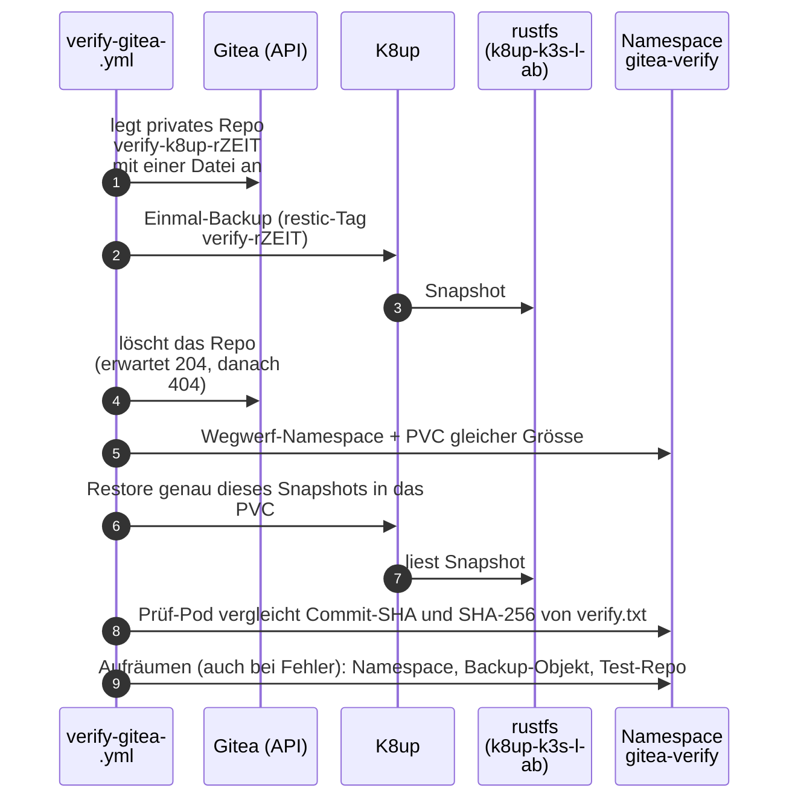

# Gitea-Backup prüfen

**Ziel:** beweisen, dass die Sicherung von Gitea sich **wirklich**
zurückspielen lässt, nicht nur, dass ein Backup-Objekt existiert.

```bash
cd ansible
ansible-playbook verify-gitea.yml --tags repo            # repo files only
ansible-playbook verify-gitea.yml --tags repo,cluster    # without restore
ansible-playbook verify-gitea.yml                        # with restore test
```

## Was der Restore-Test tut



Die Meldung bei Erfolg: `Restore ok: Commit ...`. Der Snapshot bleibt und
fällt mit der Retention weg (14/8/6).

`lab.sh acceptance` ruft das Playbook in Phase 11 auf ([Abnahme](acceptance.md)).

## Von Hand ansehen

```bash
kubectl -n gitea get cluster,pooler,scheduledbackup,schedule,pvc
kubectl -n gitea get backups.k8up.io,snapshots.k8up.io
kubectl -n k8up logs deploy/k8up --tail=50
```

!!! warning "`kubectl get backup` zeigt K8up"
    Ein unqualifiziertes `kubectl get backup` zeigt **K8up**-Objekte. Für CNPG
    heisst es `backups.postgresql.cnpg.io`, für K8up `backups.k8up.io`.

## Wenn der Test scheitert

!!! warning "Egress-Regeln"
    Der Prüf-Pod darf nur ins Ziel, das die Policy `allow-egress-k8up`
    nennt (K8s-API und S3 des Backup-Ziels). Stimmen die Adressen in den Policies
    nicht zu `lab.yaml`, scheitert der Test mit einem Timeout, nicht mit einer
    Fehlermeldung von K8up. Siehe [Fehlersuche](troubleshooting.md#egress-gitea).

- K8up-Repo-Passwort (`k8up-k3s-lab-repo.pw`) geändert oder Bucket
  `k8up-k3s-lab` geleert: Dann gibt es kein Backup zum Zurückspielen.
- Die Prüfung beweist nur, dass **diese** Kopie lesbar ist; sie liegt auf demselben
  Rechner wie die VM-Platte ([Issue 3](https://github.com/tabee/k8s-lab-template/issues/3)).
