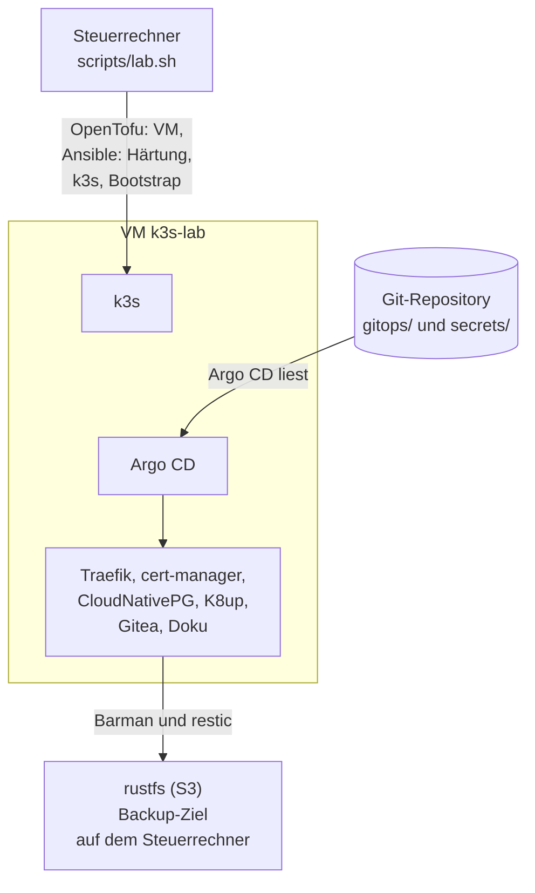

# k8s-lab: ein Kubernetes-Lab, das man mit einem Befehl neu baut

Ein Homelab auf **k3s** in einer libvirt-VM, vollständig als Code: **OpenTofu** baut die VM,
**Ansible** richtet sie ein und härtet sie, **Argo CD** hält den Cluster aus Git
am Laufen, Geheimnisse liegen mit **SOPS/age** verschlüsselt im Repository,
Datenbanken sichert **CloudNativePG** in einen S3-Speicher ausserhalb der VM.
Diese Doku beschreibt den Stand von `main`; sie wird aus dem Repository gebaut, im Cluster
und lokal.

```bash
bash scripts/lab.sh up        # VM, k3s, Argo CD, alle Apps
bash scripts/lab.sh acceptance   # messen und beweisen, dass es trägt
```

!!! success "Gemessen (07.11.2026, Europe/Zurich)"
    `rebuild --restore` auf einer VM mit 8 GiB: **22m12s**, Exit 0, Node-Spitze 5332 MiB / 67 %, kein OOM.
    Ein früherer Lauf auf rund 10 GiB: 27m14s, Exit 0, 26 Ablaufphasen OK, Restore-Spitze 4970 MiB.
    Die Import-Abnahme war dabei **SKIP, nicht PASS** (keine gespeicherten Baselines).
    Alle Werte und älteren Messungen: [Neuaufbau](how-to/rebuild.md).
    [Einordnung und Grenzen](how-to/rebuild.md) dieser Messung: keine neue vollständige Abnahme
    und keine Freigabe für 8 GB Produktion.

## Wo fange ich an?

<div class="grid cards" markdown>

-   :material-rocket-launch-outline: **Ich will es laufen sehen**

    ---

    Von null zum laufenden Lab, mit allen Befehlen und dem, was du dabei siehst.

    [:octicons-arrow-right-24: Lab in 30 Minuten](tutorials/lab-in-30-minutes.md)

-   :material-account-group-outline: **Ich baue es auf meinem Rechner nach**

    ---

    Eigene Schlüssel, eigenes Netz, eigener Name: Schritt für Schritt für Freunde.

    [:octicons-arrow-right-24: Lab für Freunde](tutorials/lab-for-friends.md)

-   :material-wrench-outline: **Ich muss etwas tun**

    ---

    Neuaufbau, Abnahme, CA-Rotation, Restore, Geheimnisse, Fehlersuche.

    [:octicons-arrow-right-24: Anleitungen](how-to/index.md)

-   :material-book-open-variant-outline: **Ich suche eine genaue Angabe**

    ---

    Befehle, Konfigurationsschlüssel, Ports, Versionen, Prüfungen, Glossar.

    [:octicons-arrow-right-24: Referenz](reference/index.md)

-   :material-lightbulb-outline: **Ich will verstehen, warum**

    ---

    Architektur, Bootstrap, Kante, Zertifikate, Geheimnisse, Backup, Entscheidungen.

    [:octicons-arrow-right-24: Konzepte](concepts/index.md)

-   :material-shield-lock-outline: **Ich prüfe die Sicherheit**

    ---

    Bedrohungsmodell, Vertrauensgrenzen und die ehrlichen Restrisiken.

    [:octicons-arrow-right-24: Sicherheitsmodell](concepts/security-model.md)

-   :material-school-outline: **Ich lerne Kubernetes**

    ---

    Der Aufbau in Stufen, von der Härtung bis zu Gitea auf einer replizierten Datenbank.

    [:octicons-arrow-right-24: Lernreise](learning-path/index.md)

-   :material-map-marker-path: **Ich will wissen, was kommt**

    ---

    Offene Punkte, Ideen und der Plan Lab-10 stehen als Issues im Tracker.

    [:octicons-arrow-right-24: Issues](https://github.com/tabee/k8s-lab-template/issues)

</div>

## Das Ganze auf einer Seite



Die Details: [Architektur](concepts/architecture.md), [Bootstrap und GitOps](concepts/bootstrap-and-gitops.md),
[Backup und Restore](concepts/backup-and-restore.md).

## Was das Lab ausmacht

<div class="grid cards" markdown>

-   **Eine Quelle für alle Werte**

    Netz, Namen, Grössen und Schlüsselpfade stehen in `lab.yaml`. OpenTofu, Ansible und
    `lab.sh` lesen dieselbe Datei ([ADR-0001](concepts/decisions/0001-one-source-lab-yaml.md)).

-   **Git ist die Steuerung**

    Nach dem Bootstrap ändert man den Cluster nur noch über Git
    ([Bootstrap und GitOps](concepts/bootstrap-and-gitops.md)).

-   **Geheimnisse nie im Klartext**

    SOPS/age im Repository, KSOPS im Cluster, nur Pfade und Zwecke in der Doku
    ([Geheimnis-Karte](reference/secrets-map.md)).

-   **Backups, die man wiederherstellt**

    Die Abnahme legt Dummy-Daten an, sichert und stellt sie zurück
    ([Abnahme](how-to/acceptance.md)).

-   **Eine ehrliche Grenze**

    Das Lab ist eine Übungsumgebung hinter NAT, keine Produktion. Was es schützt und was
    nicht, steht im [Sicherheitsmodell](concepts/security-model.md).

-   **Austauschbar gebaut**

    Fremde Rechner, eigene Schlüssel: Der Export macht daraus eine öffentliche Kopie
    ohne Persönliches ([Öffentliche Fassung](how-to/public-release.md)).

</div>

## Zu dieser Doku

Die Seiten folgen dem Diátaxis-Schema (Tutorials, Anleitungen, Referenz, Erklärungen).
Alles darin stammt aus dem Repository; Messwerte tragen ihr Datum, Offenes steht auch so
da.

Änderungen: Markdown im Repository bearbeiten, committen, pushen. Die Site baut
sich innerhalb von ein bis zwei Minuten neu ([Doku-Site](how-to/docs-site.md)).
