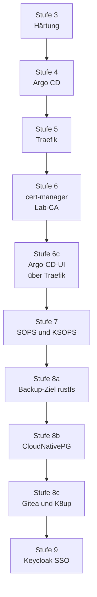

# Lernreise: Stufe für Stufe

Das Lab ist in Stufen gewachsen. Jede Stufe hat ein Runbook, eine Prüfung und einen
Rückweg. Diese Seiten bleiben als **Lernpfad** stehen: Sie zeigen, in welcher
Reihenfolge man ein Kubernetes-Lab sinnvoll aufbaut, warum jede Stufe die nächste
braucht und wo die Stolpersteine lagen. Wer das Lab nur betreiben will, findet
den heutigen Stand in den [Anleitungen](../how-to/index.md),
der [Referenz](../reference/index.md) und den [Erklärungen](../concepts/index.md).

!!! warning "Historie, nicht Betriebsanleitung"
    Die Stufen beschreiben den Weg, wie er gegangen wurde, mit den damaligen
    Messungen und Datumsangaben. Heute baut `bash scripts/lab.sh up` alles in einem
    Lauf; die Stufen sind kein Ablauf mehr, den man von Hand durchgeht. Jede Seite
    nennt oben, wo der heutige Stand steht. Abschnitte mit Messungen und Datum
    bleiben absichtlich unverändert.

| Stufe | Thema | Lerngewinn | Heute gültig |
|---|---|---|---|
| [3](stage-3-hardening.md) | Härtung von VM und k3s | Firewall mit `policy drop`, SSH, sysctl, PSA, Secrets-Verschlüsselung | [Sicherheitsmodell](../concepts/security-model.md), [Abnahme-Prüfungen](../reference/acceptance-checks.md) |
| [4](stage-4-argocd.md) | Argo CD, App-of-Apps | GitOps: Git ist die Steuerung | [Bootstrap und GitOps](../concepts/bootstrap-and-gitops.md) |
| [5](stage-5-traefik.md) | Traefik | Ingress, TLS-Optionen, Header, NetworkPolicy | [Netz-Kante](../concepts/network-edge.md) |
| [6](stage-6-certmanager.md) | cert-manager, Lab-CA | eigene Zertifikatskette | [Zertifikate](../concepts/certificates.md), [CA-Rotation](../how-to/ca-rotation.md) |
| [6c](stage-6c-argocd-ingress.md) | Argo-CD-Oberfläche über Traefik | TLS endet am Ingress | [Zugang zu Argo CD](../how-to/argocd-access.md) |
| [7](stage-7-ksops.md) | SOPS, age, KSOPS | Geheimnisse im Git, verschlüsselt | [Geheimnis-Fluss](../concepts/secret-flow.md), [Geheimnisse](../how-to/secrets.md) |
| [8a](stage-8a-backup-target.md) | Backup-Ziel rustfs | S3 ausserhalb der VM | [Backup und Restore](../concepts/backup-and-restore.md) |
| [8b](stage-8b-cnpg.md) | CloudNativePG | Failover, PITR, Restore-Test | [Datenbank wiederherstellen](../how-to/restore-database.md), [Failover-Übung](../how-to/failover-drill.md) |
| [8c](stage-8c-gitea.md) | Gitea mit K8up | zweite Datenbank, Datei-Backup | [Gitea wiederherstellen](../how-to/restore-gitea.md) |
| [9](stage-9-keycloak.md) | Keycloak als Single Sign-on | eine Anmeldung für mehrere Dienste, Realm als Code | [Keycloak im Lab](../how-to/keycloak.md), [Keycloak wiederherstellen](../how-to/restore-keycloak.md) |

Der Pfad beginnt bei Stufe 3: VM und Basissystem entstehen heute aus `infra/`
und den Rollen `base` und `k3s` (`site.yml`).

!!! note "Skripte der Stufen"
    Die damaligen Hilfsskripte (`welle1-vm.sh`, `welle1-ca-rotation.sh`,
    `stage6-certmanager.sh`, `stufe7.sh`, `stufe7-edits.sh`, `stufe8*-block-*.sh`)
    und die Änderungsprotokolle `AENDERUNGEN-stufe*.md` liegen nicht im
    Repository. Sie sind Historie; was sie taten, steht heute in den Rollen
    und Playbooks.
