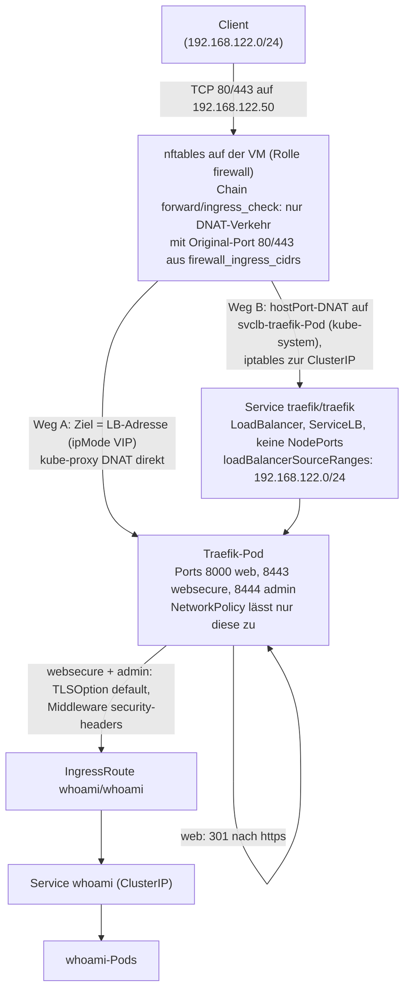
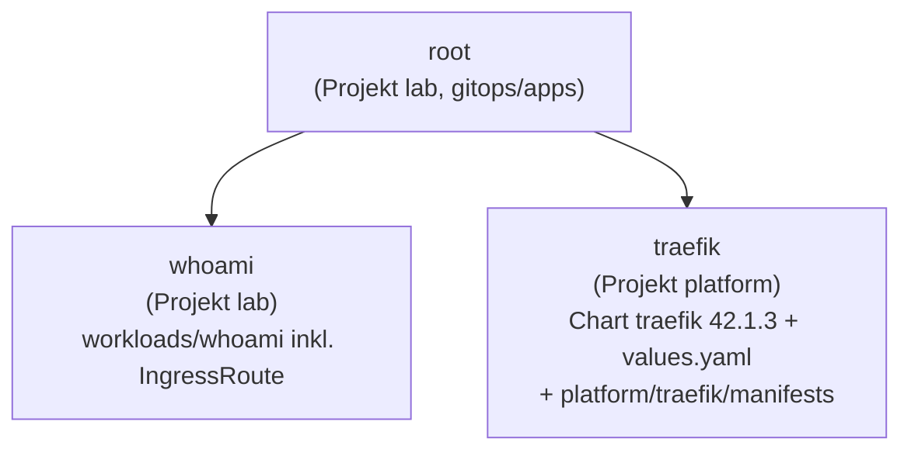

# Stufe 5: Traefik als Ingress

!!! abstract "Lernpfad, Stufe 5"
    Traefik per Argo CD, Sicherheitsentscheide, Projekt-Aufteilung und
    Sync-Reihenfolge. Heute gültig und weitergeführt:
    [Netz-Kante](../concepts/network-edge.md),
    [Ports und Netze](../reference/ports-and-networks.md) und
    [Sicherheitsmodell](../concepts/security-model.md).

## WAS und WARUM

**Was:** Traefik (Chart `traefik/traefik` 42.1.3, Traefik v3.7.16) läuft im
Namespace `traefik`, installiert von Argo CD aus `gitops/apps/traefik.yaml`.
Von aussen sind nur Port 80, 443 und der Admin-Port 8444 offen. Port 80 leitet
dauerhaft auf 443 um. 80/443 sind für die Apps (Gitea, Doku, Notizen) da, 8444
für die Admin-Oberfläche (Argo CD, `whoami`): `whoami` ist über
`https://whoami.lab.example:8444` erreichbar (IngressRoute in
`gitops/workloads/whoami/ingressroute.yaml`, Entrypoint `admin`). Die Host-Firewall
lässt 8444 (wie jeden DNAT-Port ausser 80/443) nur aus den Admin-Netzen durch,
im Profil edge also nur von einer Adresse, siehe
[Netz-Kante](../concepts/network-edge.md). Der Umweg über einen eigenen
Port ist nötig, weil Traefik hinter `externalTrafficPolicy: Cluster` die
Client-IP nicht sieht.

**Warum:** Bisher war jede App nur per `kubectl port-forward` erreichbar.
Ein Ingress-Controller ist die eine Tür ins Cluster: eine Stelle für TLS,
Weiterleitung, Sicherheits-Header und Zugriffslogs, statt pro App einen Port.
Traefik kommt per GitOps (nicht als k3s-Addon), damit Version und Werte im
Git stehen, prüfbar sind und Argo CD Abweichungen zurückdreht.

## Architektur



Argo CD:



Die App `traefik` hat zwei Quellen: das Helm-Chart und dieses Repo. Das Repo
liefert `values.yaml` (`ref: values`) und, weil auch `path` gesetzt ist,
die eigenen Objekte aus `manifests/` (TLSOption, Middleware, NetworkPolicy).
Die CRDs kommen aus dem Chart (Ordner `crds/`); Argo CD legt sie an und
aktualisiert sie (ServerSideApply, die CRDs sind zu gross für
client-seitiges Apply).

## Sicherheitsentscheidungen

| Entscheidung | Warum |
|---|---|
| `externalTrafficPolicy: Cluster` + `allocateLoadBalancerNodePorts: false` | Mit `Local` braucht ServiceLB NodePorts (30000-32767). Die leitet kube-proxy per DNAT weiter, an der forward-Prüfung (nur Original-Port 80/443) vorbei. Ohne NodePorts gibt es diesen Seiteneingang nicht. Preis: Traefik sieht im Zugriffslog eine Knoten-Adresse statt der Client-IP. |
| `loadBalancerSourceRanges: [192.168.122.0/24]` | Zweite Schicht hinter nftables; durchgesetzt im svclb-Pod und von kube-proxy. Spiegel von `edge_ingress_cidrs` (Quelle der Wahrheit: `infra/envs/local/lab.yaml`, `lab.sh customize` schreibt die Marken-Zeilen); `verify-traefik.yml` vergleicht lab.yaml, Git und den Service. |
| Nur 80/443 im Service | Ping/API (8080), Metriken (9100) und Dashboard sind nicht exponiert. |
| `api.dashboard: false` | Kein `api@internal`, also kein Dashboard, auch nicht per Port-Forward. Später mit Authentifizierung wieder einschalten. |
| NetworkPolicy `traefik-ingress` | Eingehend nur TCP 8000/8443 zum Traefik-Pod. Kubelet-Proben funktionieren trotzdem (kube-router erlaubt Verkehr vom eigenen Knoten immer). |
| TLSOption `default` | TLS 1.2+, nur ECDHE + AEAD. In Stufe 5 `sniStrict: false` (nur Traefiks selbst signiertes Zertifikat). Seit Stufe 6 `sniStrict: true` mit Zertifikaten von cert-manager, siehe [Stufe 6](stage-6-certmanager.md). |
| `core.strictTLSOptions: true` | Schliesst GHSA-g55h-rg46-x9c5 (TLSOption-Umgehung bei mehreren Optionen). |
| `defaultTLSResourcesNamespace: traefik` | Nur der Namespace traefik darf die Standard-TLSOption/den TLSStore festlegen, nicht jede App. |
| `allowCrossNamespace: false`, `allowExternalNameServices: false` | Eine IngressRoute darf nur auf Services im eigenen Namespace zeigen, keine ExternalName-Services (sonst Weg nach draussen oder in fremde Namespaces). Der Ingress-Provider hat kein `allowCrossNamespace` (Ingress kann das ohnehin nicht). |
| Middleware `security-headers` auf websecure | HSTS (1 Jahr), nosniff, `X-Frame-Options: DENY`, `Referrer-Policy: no-referrer`, Permissions-Policy, `Server`/`X-Powered-By` entfernt. HSTS sperrt dich nicht aus: Browser ignorieren HSTS bei Zertifikatsfehlern (RFC 6797, 8.1). `stsPreload: false`, `.local` gehört nicht in Preload-Listen. |
| Pod gehärtet | PSA `restricted` (Namespace-Labels per `managedNamespaceMetadata`), non-root 65532, read-only Root-FS, `drop: [ALL]`, seccomp RuntimeDefault, Limits. |
| `aliasHeadersStrategy: delete` auf allen Entrypoints | Header wie `X_Auth_User` (Alias von `X-Auth-User`) werden verworfen; sonst könnte ein Client über CGI/PHP/NGINX-Backends Header fälschen, die Traefik setzt. |
| `safeNaming: true` | Kollisionsfreie Namen für generierte Router/Middlewares (empfohlen für neue Setups). Verweise lauten darum `traefik_security-headers@kubernetescrd` (Unterstrich). |
| Keine Telemetrie | `checkNewVersion` und `sendAnonymousUsage` aus. |
| Gateway API aus | Wird nicht gebraucht; weniger CRDs und RBAC. |

## Projekt-Aufteilung

Bis Stufe 4 gab es ein Projekt `lab` mit `namespace: "*"`. Die folgende Tabelle ist der **Verlauf: Stand Stufe 5**
(angelegt von Ansible, Werte in `ansible/inventory/group_vars/all/argocd.yml`).

!!! note "Heutiger Stand"
    Inzwischen gibt es fünf Projekte: `lab`, `platform`, `root` (nur Application und ApplicationSet), `argocd-ui`
    und `notes`. Die Tabelle unten zeigt nur, wie Stufe 5 die Aufteilung begonnen hat. Der heutige Stand steht in
    [gitops/-Aufbau](../reference/gitops-layout.md) und in `group_vars/all/argocd.yml`.

| Projekt | sourceRepos | Namespaces | cluster-weit |
|---|---|---|---|
| `lab` | dieses Git-Repo | argocd, whoami | Namespace |
| `platform` | dieses Git-Repo, `https://traefik.github.io/charts` | traefik | Namespace, CustomResourceDefinition, ClusterRole, ClusterRoleBinding, IngressClass |

Die cluster-weiten Arten stammen aus `helm template` des Charts mit unseren
Werten. Neue Namespaces oder Charts: dort eintragen und `argocd.yml` laufen
lassen.

**Restrisiken (ehrlich):**

- **Git-Schreibrecht = Cluster-Admin.** Wer auf Branch `main` pushen kann,
  kann in `gitops/apps/` eine Application mit `project: platform` anlegen und
  darüber eine ClusterRoleBinding auf cluster-admin. Die Projekte verhindern
  Fehler und begrenzen Chart-Quellen, sie sind keine Grenze gegen jemanden
  mit Schreibrecht. Schutz: Deploy-Key nur lesend, Push nur für dich;
  signierte Commits und ein geschützter Branch stehen in [Issue 6](https://github.com/tabee/k8s-lab-template/issues/6).
- **Projekt lab darf in argocd jede namespaced Art schreiben** (auch
  AppProject, argocd-rbac-cm). Sauberer wäre ein eigenes Projekt
  nur für die Root-App mit `namespaceResourceWhitelist: Application` ([Issue 6](https://github.com/tabee/k8s-lab-template/issues/6)).
- Das Traefik-Chart bringt 15 zusätzliche `hub.traefik.io`-CRDs mit
  (inaktiv, ohne Traefik Hub). Das separate Chart `traefik-crds` wird
  bewusst nicht genutzt (seine Middleware-CRD weicht ab).
- Löschen der App `traefik` löscht auch die CRDs und damit alle
  IngressRoutes, Middlewares und TLSOptions im Cluster.
- `providers.kubernetesCRD.namespaces` ist nicht eingeschränkt: jede App
  darf eine IngressRoute anlegen (gewollt, aber jede ist dann von aussen
  erreichbar).

## Reihenfolge beim Sync

whoami und traefik kommen im selben Commit. Die IngressRoute braucht die
CRD aus traefik. Darum:

- `argocd.argoproj.io/sync-options: SkipDryRunOnMissingResource=true` an
  IngressRoute, TLSOption und Middleware (sonst bricht der Dry-Run ab).
- `retry` (5 Versuche, bis 3 Minuten) in beiden Apps: der erste whoami-Sync
  darf scheitern, der nächste Versuch klappt, sobald Traefik steht.
- Sync-Waves helfen hier nicht: ohne Health-Anpassung für Application
  wartet die Root-App nicht auf die Gesundheit der Kind-Apps.

## Ausrollen

```bash
cd ~/projects/k8s-lab/ansible
ansible-lint
ansible-playbook argocd.yml --check --diff   # --check does not show the projects (CRD block runs only without check)
ansible-playbook argocd.yml                  # projects lab (narrower) and platform
cd .. && git add -A && git commit && git push   # Argo CD pulls gitops/
```

Argo beobachten (Argo-UI per Port-Forward wie in Stufe 4, oder):

```bash
kubectl -n argocd get applications -w
kubectl -n traefik get pods,svc
kubectl -n kube-system get pods -l svccontroller.k3s.cattle.io/svcname=traefik
```

Für Browser/curl per Name (für verify-traefik.yml nicht nötig):

```bash
echo '192.168.122.50 whoami.lab.example' | sudo tee -a /etc/hosts
curl -kI http://whoami.lab.example/     # 301 to https
curl -k https://whoami.lab.example:8444/     # whoami output (admin port)
```

`-k`, weil das Zertifikat selbst signiert ist (bis cert-manager).

## Prüfen

```bash
cd ~/projects/k8s-lab/ansible
ansible-playbook verify-traefik.yml
ansible-playbook verify.yml          # adapted: only checks that the k3s Traefik add-on is gone
ansible-playbook verify-argocd.yml
```

`verify-traefik.yml` ist nur lesend und prüft: App traefik Synced/Healthy
im Projekt platform, PSA-Labels, genau ein Pod ohne Dashboard/insecure API,
Service (LoadBalancer, keine NodePorts, Policy Cluster, nur 80/443,
sourceRanges = `firewall_ingress_cidrs`), 80 leitet auf https um, 443 liefert
whoami mit allen Sicherheits-Headern, 8080/9000/9100 sind zu, und PSA lehnt
einen privilegierten Pod im Namespace traefik ab (Server-Dry-Run).

## Rückweg

1. Schnell (GitOps): Commit zurücknehmen und pushen:
   `git revert <commit> && git push`. Argo CD entfernt traefik (mit CRDs und
   allen IngressRoutes) und die IngressRoute von whoami. Die Projekte bleiben,
   bis `argocd.yml` mit dem alten Stand läuft.
2. Vollständig: VM-Snapshot `vor-stufe5` zurücksetzen (vorher anlegen!):

   ```bash
   virsh -c qemu:///system snapshot-create-as k3s-lab vor-stufe5 --atomic   # BEFORE rolling out
   virsh -c qemu:///system snapshot-revert k3s-lab vor-stufe5             # way back
   ```

   Danach den Branch auf den Stand vor Stufe 5 bringen, sonst rollt Argo CD
   Stufe 5 gleich wieder aus.

## Eselsbrücke

**"Eine Tür, zwei Schlösser, ein Türsteher."**
Die Tür ist Traefik auf 80/443 (keine Seiteneingänge: keine NodePorts,
kein Dashboard). Die zwei Schlösser sind nftables und
`loadBalancerSourceRanges` (gleiche Liste, Quelle `firewall_ingress_cidrs`).
Der Türsteher ist das AppProject: `platform` darf ins Haus Traefik, `lab`
nur zu den Apps; den Schlüssel zum Projekt hat aber jeder mit Git-Schreibrecht.
