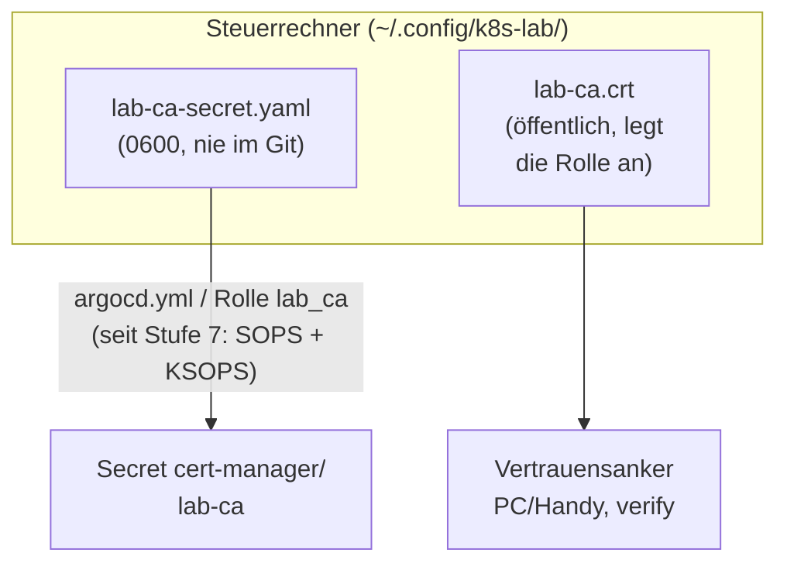
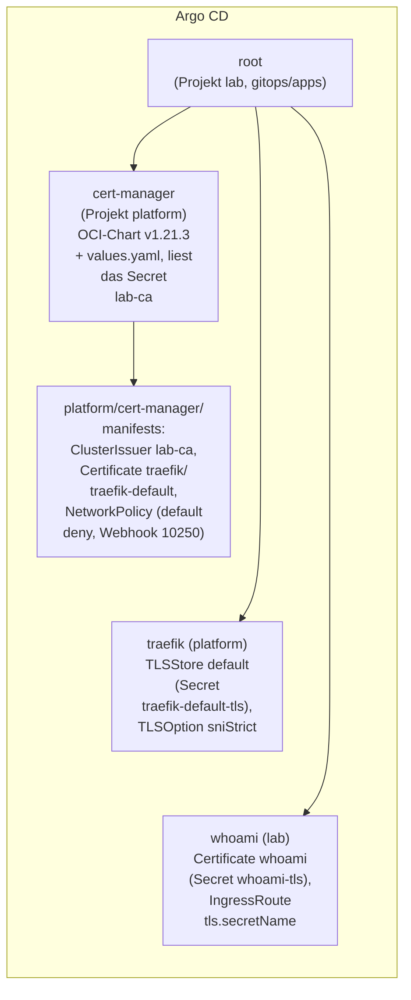
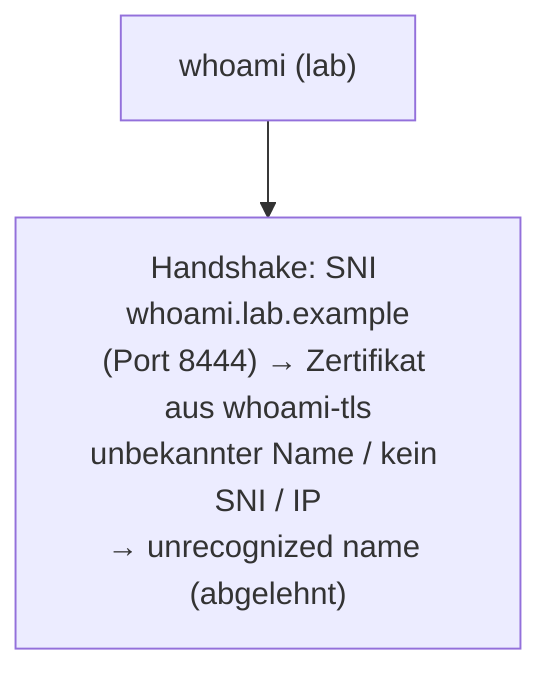

# Stufe 6: cert-manager mit der Lab-CA

!!! abstract "Lernpfad, Stufe 6"
    cert-manager, Lab-CA, Zertifikat pro App und `sniStrict`. Heute gültig und
    weitergeführt: [Zertifikate](../concepts/certificates.md) (Kette und
    nameConstraints), [CA-Rotation](../how-to/ca-rotation.md),
    [Öffentliches Zertifikat prüfen](../how-to/public-certificate.md) und
    [Der Lab-CA vertrauen](../how-to/trust-lab-ca.md).

## WAS und WARUM

**Was:** cert-manager v1.21.3 läuft im Namespace `cert-manager`, installiert
von Argo CD aus `gitops/apps/cert-manager.yaml` (Chart aus der OCI-Quelle
`oci://quay.io/jetstack/charts/cert-manager`). Die bestehende Lab-CA
(`Lab Root CA`, ECDSA P-256) kommt per Ansible als Secret ins
Cluster; die ClusterIssuer `lab-ca` signiert damit Zertifikate. whoami hat
ein eigenes Zertifikat (`whoami.lab.example`, seit dem Netz-Kanten-Umbau auf Port 8444), Traefik ein eigenes
Default-Zertifikat, und `sniStrict: true` lehnt alle Namen ohne Zertifikat ab.

**Warum:** Bisher zeigte Traefik sein selbst signiertes Zertifikat, also
`curl -k` und Browser-Warnungen. Warnungen, die man immer wegklickt, schützen
nicht mehr. Mit der Lab-CA vertraut der PC einmal der CA, danach ist jedes
Lab-Zertifikat gültig, erneuert sich selbst (cert-manager) und Scans auf die
IP oder auf fremde Namen bekommen keinen Handshake.

**Wie (kurz):** Ansible legt Namespace (PSA restricted) und CA-Secret an,
Argo CD installiert cert-manager plus ClusterIssuer, die Apps bestellen ihre
Zertifikate per `Certificate`, Traefik liest die Secrets.

!!! tip "Eselsbrücke"
    *"Ansible bringt den Stempel, Argo baut das Amt, jede App holt ihren Ausweis,
    und wer keinen Ausweis hat, kommt nicht durch die Tür (sniStrict)."*

## Architektur



In Argo CD hängen drei Apps an `root`:



Der Handshake gegen die whoami-App sieht so aus:



Reihenfolge der CRDs: Die Chart-CRDs kommen in Welle 0 (Argo-Standard), die
ClusterIssuer und das Traefik-Zertifikat in Welle 1. Argo wartet innerhalb
einer App, bis Welle 0 gesund ist. Dazu `SkipDryRunOnMissingResource=true`,
damit der Dry-Run beim ersten Sync nicht an der fehlenden CRD scheitert.
Die whoami-App (andere App) fängt die fehlende CRD mit `retry` ab.

## Entscheidungen

| Entscheidung | Warum |
|---|---|
| Chart aus OCI `quay.io/jetstack/charts/cert-manager`, v1.21.3 | Offizielle Empfehlung von Jetstack; die alte Helm-Repo-URL hinkt hinterher. Version nur in `gitops/apps/cert-manager.yaml`. |
| Namespace gehört Ansible (Rolle `lab_ca`), nicht Argo | Ein Besitzer für die PSA-Labels; das CA-Secret muss vor dem Sync da sein und ein Löschen der App darf es nicht mitnehmen. |
| CA-Secret per Ansible, `no_log` + `diff: false` | Kein Secret im Git. Der Schlüssel erscheint nie in der Ausgabe. Seit Stufe 7 ersetzt: verschlüsselt in `secrets/cert-manager/`, Argo CD entschlüsselt ([Stufe 7](stage-7-ksops.md)). |
| Secret neu gebaut statt Export 1:1 | Nur `tls.crt`, `tls.key`, `ca.crt`; alte Labels, Annotationen, uid, namespace fliegen raus. Name und Namespace kommen aus group_vars. |
| `crds.enabled` + `crds.keep` | CRDs kommen mit dem Chart (Updates mit), bleiben aber beim Löschen der App erhalten, sonst wären alle Certificates weg. |
| `ServerSideApply=true` | CRDs sind zu gross für client-seitiges Apply (wie bei Traefik). |
| `ingress-shim` aus | Keine Zertifikate per Ingress-Annotation aus beliebigen Namespaces; nur explizite `Certificate`-Objekte im Git. |
| `startupapicheck` aus | Sonst ein Hook-Job bei jedem Sync; die Gesundheit prüft Argo und `verify-certmanager.yml`. |
| Leader-Election in `cert-manager` statt `kube-system` | Projekt platform darf nicht nach kube-system; weniger Rechte. |
| Prometheus aus | Noch kein Monitoring (später). Die NetworkPolicy sperrt den Metrik-Port ohnehin. |
| NetworkPolicy: default deny Ingress, nur Webhook 10250 offen | Der API-Server muss den Webhook erreichen; sonst braucht niemand eine Verbindung zu den Pods. Egress bleibt offen (API-Server). |
| Traefik-Default-Zertifikat ohne Wildcard (`traefik-default.lab.example`) | Mit sniStrict wird es nie ausgeliefert (im Test bestätigt). Es ersetzt nur Traefiks selbst signiertes Zertifikat. Ein Wildcard wäre ein Schlüssel für alles und würde jeden Namen "gültig" machen. |
| Eigenes Zertifikat pro App | Ein geleakter Schlüssel betrifft nur eine App; unbekannte Namen werden wirklich abgelehnt. |
| Default-Zertifikat liegt in der App cert-manager | Die App traefik hängt so nicht an den cert-manager-CRDs. |
| ECDSA P-256, 90 Tage, Erneuerung 30 Tage vorher, `rotationPolicy: Always` | Passt zur CA, kleine schnelle Handshakes, kurze Laufzeit kostet nichts (automatisch), neuer Schlüssel bei jeder Erneuerung. |
| `enableCertificateOwnerRef: false` (Standard) | Secrets überleben ein kurzes Löschen des Certificate; beim Rückbau von Hand aufräumen (siehe unten). |
| Zwei Commits (6a, 6b) | 6b hängt an CRDs und Secrets aus 6a. Getrennt ist jeder Schritt einzeln prüfbar und rückbaubar. |

## Voraussetzungen

- Export des alten CA-Secrets: `~/.config/k8s-lab/lab-ca-secret.yaml`, gehört dir,
  Modus 0600. Nur so prüfen (Inhalt nie anzeigen):

  ```bash
  stat -c '%a %U %s' ~/.config/k8s-lab/lab-ca-secret.yaml   # 600 <your-user> ~2400
  wc -c ~/.config/k8s-lab/lab-ca-secret.yaml
  ```

  Die Rolle prüft das auch (Datei, Besitzer, 0600, `kind: Secret`,
  `type: kubernetes.io/tls`, `tls.crt` und `tls.key` als PEM) und bricht sonst ab.
- `curl` auf dem Steuerrechner (verify-Playbooks).

## Ausrollen

!!! note "Historisch"
    Stufe 6 wurde damals mit einem einmaligen Hilfsskript (`stage6-certmanager.sh`)
    und einer Änderungsliste (`AENDERUNGEN-stufe6.md`) eingespielt. Beide
    gehören nicht zum Repo; die Dateien, die sie angelegt haben, stehen heute
    unter `gitops/` und `ansible/`. Der Block zeigt die Reihenfolge, nicht die
    Skripte.

```bash
virsh -c qemu:///system snapshot-create-as k3s-lab vor-stufe6 --atomic
cd ~/projects/k8s-lab
# (the helper script created the new files; it overwrote nothing)
git status -uall && git diff
cd ansible
ansible-lint
ansible-playbook argocd.yml --check --diff   # shows namespace + crt file; AppProjects are skipped in check mode (as in stage 4)
ansible-playbook argocd.yml                  # extends project platform; namespace + CA secret + lab-ca.crt
cd ..
# commit 6a (platform)
git push
kubectl -n argocd get applications -w        # cert-manager: Synced/Healthy
kubectl get clusterissuer lab-ca; kubectl -n traefik get certificate   # READY True
# commit 6b (whoami certificate, TLSStore, sniStrict)
git push
kubectl -n argocd get applications -w        # whoami may fail once (retry)
ansible/scripts/lab-ca-trust.sh add ~/.config/k8s-lab/lab-ca.crt
cd ansible && ansible-playbook verify-certmanager.yml && ansible-playbook verify-traefik.yml \
  && ansible-playbook verify-argocd.yml && ansible-playbook verify.yml
```

`argocd.yml` muss VOR dem Push laufen: sonst fehlen Projektrechte, Namespace
und CA-Secret, und die App cert-manager hängt bis zum nächsten Versuch.

Neuaufbau (Cluster leer, alles schon im Git): ein Push genügt. Im Test war
alles nach rund 2.5 Minuten grün, whoami brauchte ein paar Retries. Wenn
eine App nach 5 Versuchen auf "Failed" stehen bleibt: in der UI "Sync" oder
`kubectl -n argocd patch app whoami --type merge -p '{"operation":{"sync":{}}}'`.

## Prüfen

```bash
curl --cacert ~/.config/k8s-lab/lab-ca.crt https://whoami.lab.example:8444/   # whoami output, without -k
curl https://nicht-vorhanden.lab.example/ --resolve nicht-vorhanden.lab.example:443:192.168.122.50
# -> curl: (35) ... unrecognized name   (as intended)
kubectl get certificate -A
```

`verify-certmanager.yml` prüft (nur lesend): App Synced/Healthy im Projekt
platform, PSA-Labels und PSA-Ablehnung, Pods Ready (controller, webhook,
cainjector), keine cert-manager-Rollen in kube-system, CA-Secret nur
Metadaten (Typ, Schlüsselnamen, Label, kein Argo-Tracking), ClusterIssuer
und beide Certificates Ready, sniStrict und TLSStore, HTTPS gültig gegen
`lab-ca.crt`, unbekannte Namen und Aufruf ohne SNI abgelehnt.

## Der CA vertrauen

!!! info "Umgezogen"
    Die Anleitung für Linux, Android und iPhone steht jetzt in
    [Der Lab-CA vertrauen](../how-to/trust-lab-ca.md).

## Rückbau

1. Commit 6b zurück (`git revert <6b>`, push): sniStrict wieder aus, whoami mit Default-Zertifikat.
2. Commit 6a zurück (`git revert <6a>`, push): Argo löscht cert-manager
   (Finalizer). Bleiben bewusst: CRDs (`crds.keep`), Namespace und CA-Secret
   (Ansible), sowie die ausgestellten Secrets.
3. `ansible-playbook argocd.yml` (Projekt platform wieder enger).
4. Von Hand aufräumen, wenn wirklich weg soll:

   ```bash
   kubectl -n whoami delete secret whoami-tls
   kubectl -n traefik delete secret traefik-default-tls
   kubectl get crd -o name | grep cert-manager.io | xargs kubectl delete   # deletes all Certificates!
   kubectl delete namespace cert-manager                                   # incl. CA secret
   ansible/scripts/lab-ca-trust.sh remove ~/.config/k8s-lab/lab-ca.crt
   ```

Notbremse: `virsh -c qemu:///system snapshot-revert k3s-lab vor-stufe6`.

## Namenseinschränkung der Lab-CA (Issue #7)

!!! info "Umgezogen"
    Die kritische `nameConstraints`-Erweiterung, die Frage, wer sie erzwingt,
    und die zweite Sperre (ValidatingAdmissionPolicy `lab-ca-lab-domain-only`)
    stehen jetzt in [Zertifikate](../concepts/certificates.md).

## CA mit nameConstraints einführen (Rotation einer bestehenden CA)

!!! info "Umgezogen"
    Der Ablauf steht jetzt in [CA-Rotation](../how-to/ca-rotation.md).

## Öffentliche Probe (optional: ACME DNS-01)

!!! info "Umgezogen"
    Die Anleitung steht jetzt in [Öffentliches Zertifikat prüfen](../how-to/public-certificate.md).

## Risiken

- **CA ohne nameConstraints:** Eine CA aus der Zeit vor Issue #7 darf für jeden
  Namen signieren. Leakt der Schlüssel, kann jemand jedem Gerät, das ihr
  vertraut, jede Website vorspielen (auch Bank). Neue CAs (`lab.sh init`)
  haben kritische nameConstraints; eine bestehende alte ersetzt `lab.sh ca-rotation`,
  siehe [CA-Rotation](../how-to/ca-rotation.md). `verify-certmanager.yml`
  ist rot, solange die CA keine hat.
- **CA-Schlüssel im Cluster:** liegt im Secret (etcd, verschlüsselt mit
  secretbox; der Schlüssel dafür liegt auf demselben Knoten). Wer
  Cluster-Admin ist, kann ihn lesen. Seit Stufe 7 ist die Quelle
  `secrets/cert-manager/lab-ca.sops.yaml` (verschlüsselt); die
  alte Klartext-Datei auf dem Steuerrechner ist nur noch Backup (0600).
- **Android-Apps** vertrauen der Nutzer-CA nicht (siehe oben).
- **sniStrict:** Clients ohne SNI (alte Tools, Aufruf per IP) bekommen keine
  Verbindung mehr. Gewollt; Monitoring später per Namen.
- **Neue App vergessen:** Ohne `tls.secretName` und `Certificate` ist eine
  neue IngressRoute per HTTPS nicht erreichbar (sniStrict). Fehlerbild:
  `unrecognized name`.
- **HSTS** (siehe oben).

## Folgen für Stufe 7

- CA-Secret mit SOPS+age verschlüsselt im Repo (`lab_ca_secret_path` entfällt),
  siehe [Stufe 7](stage-7-ksops.md).
- Let's Encrypt (DNS-01) oder Mischbetrieb für Prod: [Issue 7](https://github.com/tabee/k8s-lab-template/issues/7).

## Wo liegt was (Steuerrechner)

| Was | Wo | Geheim? |
|---|---|---|
| CA-Secret (Zertifikat + privater Schlüssel) | `secrets/cert-manager/lab-ca.sops.yaml` (verschlüsselt, seit Stufe 7) | JA, Werte verschlüsselt |
| Backup der Klartext-Quelle (bis Stufe 6) | `~/.config/k8s-lab/lab-ca-secret.yaml` (0600) | JA, nie anzeigen, nie ins Git |
| Öffentliches CA-Zertifikat | `~/.config/k8s-lab/lab-ca.crt` (legt `argocd.yml` an) | nein |
| System-Vertrauen (curl, Python) | `/usr/local/share/ca-certificates/lab-ca.crt` | nein |
| Chromium/Chrome | `~/.pki/nssdb` | nein |
| Firefox | je Profil unter `~/.mozilla/firefox/*/cert9.db` | nein |
| Im Cluster | Secret `cert-manager/lab-ca`, Zertifikate als Secrets `whoami/whoami-tls`, `traefik/traefik-default-tls` | ja |

Prüfen ohne Inhalt: `stat -c '%a %U %s' ~/.config/k8s-lab/lab-ca-secret.yaml`.

## Zertifikate neu machen

**Server-Zertifikate (whoami, traefik-default):** erneuern sich selbst 30 Tage
vor Ablauf (90 Tage gültig). Sofort neu ausstellen: Secret löschen,
cert-manager stellt es innert Sekunden neu aus.

```bash
kubectl -n whoami delete secret whoami-tls
kubectl -n whoami wait certificate whoami --for=condition=Ready --timeout=120s
```

**Lab-CA selbst (gültig bis 2036):** bei Verdacht auf Leck oder um eine alte CA ohne
nameConstraints zu ersetzen: `bash scripts/lab.sh ca-rotation`, Ablauf und Reihenfolge in
[CA-Rotation](../how-to/ca-rotation.md). Neue CA auf Handys/Notebooks nachtragen, Browser neu starten.

Seit Stufe 7 liegt das CA-Secret SOPS-verschlüsselt im Git statt als Klartext-Datei
([Stufe 7](stage-7-ksops.md)).
