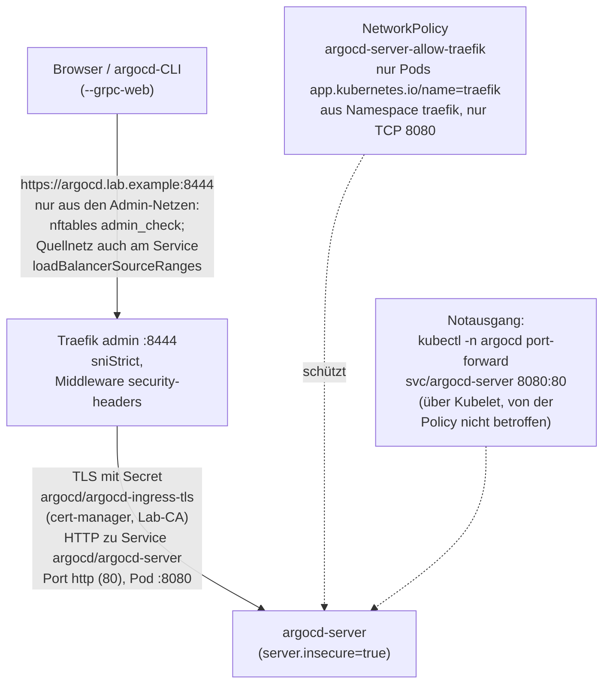
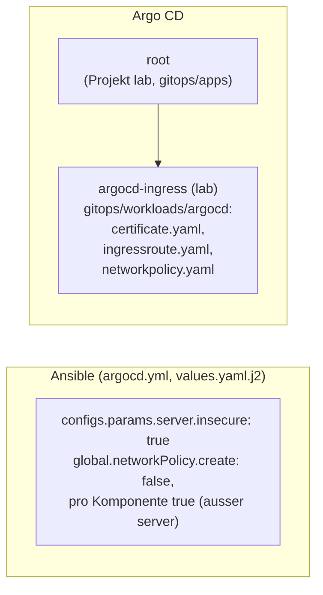

# Stufe 6c: Argo-CD-UI über Traefik

!!! abstract "Lernpfad, Stufe 6c"
    Die Argo-CD-Oberfläche unter `argocd.lab.example:8444`. Heute gültig:
    [Netz-Kante](../concepts/network-edge.md) (Admin-Port 8444) und
    [Argo CD erreichen](../how-to/argocd-access.md) (Zugang, Notausgang).

## WAS und WARUM

**Was:** Die Argo-CD-UI (und die API für die `argocd`-CLI) ist unter
https://argocd.lab.example:8444 erreichbar, über den eigenen Traefik
(Entrypoint `admin`, Port 8444; seit dem Netz-Kanten-Umbau nicht mehr `websecure`,
siehe [Netz-Kante](../concepts/network-edge.md)) mit einem Zertifikat der Lab-CA (cert-manager,
ClusterIssuer `lab-ca`). Traefik beendet TLS, `argocd-server` spricht intern
nur noch HTTP (`server.insecure`). Eine NetworkPolicy lässt nur Traefik an
`argocd-server` (Port 8080).

**Warum:** Bisher ging die UI nur per `kubectl port-forward` mit selbst
signiertem Zertifikat und Browser-Warnung. Jetzt gilt dasselbe wie für
whoami: ein Name, ein gültiges Zertifikat, keine Warnung, gleiche
Sicherheits-Header (HSTS, frameDeny) und gleiche Firewall
(`firewall_ingress_cidrs`). Der Port-Forward bleibt als Notausgang, falls
Traefik oder cert-manager kaputt sind.

!!! tip "Eselsbrücke"
    *"Port-Forward = Schlüssel zur Hintertür, IngressRoute = Haupteingang mit
    Badge-Kontrolle."* Die Hintertür hat nur, wer Cluster-Zugang (Kubeconfig)
    hat; am Haupteingang kontrolliert Traefik den Badge (SNI + Zertifikat,
    Firewall, Header), dahinter fragt Argo CD nach Login.

**Wie (kurz):** Ansible setzt `server.insecure` und stellt die
Chart-NetworkPolicies auf "pro Komponente" um (`argocd.yml`). Argo CD synct
die neue App `argocd-ingress` (`gitops/workloads/argocd`): Certificate,
IngressRoute, NetworkPolicy.

## Architektur





## Entscheidungen

| Entscheidung | Warum |
|---|---|
| TLS endet an Traefik, `server.insecure: true` | Ein Zertifikat (Lab-CA) und eine Stelle für TLS, Header und Firewall, wie bei whoami. Re-Encrypt zu argocd-server hätte Traefik dem selbst signierten Argo-Zertifikat vertrauen lassen müssen (`insecureSkipVerify` oder eigene CA) - mehr Teile ohne Gewinn auf einem Single-Node. |
| `server.insecure` per Ansible (values.yaml.j2), nicht per Argo | Argo CD selbst gehört Ansible (Helm). Ein zweiter Besitzer für `argocd-cmd-params-cm` wäre ein Konflikt. |
| Chart-NetworkPolicy für argocd-server aus, eigene aus Git | Die Chart-Policy lässt alles zu (`ingress: - {}`). Policies addieren sich, eine strengere eigene wäre wirkungslos. `global.networkPolicy.create` lässt sich pro Komponente nicht abschalten, darum global aus und controller, repoServer, redis, applicationSet einzeln an. Kein Default-Deny im Namespace (Chart-Standard `defaultDenyIngress: false` bleibt). |
| Kein Chart-Ingress (`server.ingress`), sondern Traefik-IngressRoute | Gleiches Muster wie whoami (CRD, `tls.secretName`). |
| Eine Route für UI und CLI, CLI mit `--grpc-web` | Ohne eigene gRPC-Route (h2c) und ohne zweiten Namen. gRPC-Web läuft über normales HTTPS. |
| Secret `argocd-ingress-tls`, nicht `argocd-server-tls` | `argocd-server-tls` liest Argo CD selbst für sein eigenes TLS. |
| Keine Annotation `link.argocd.argoproj.io/external-link`, kein `url` in `argocd-cm` | `url` braucht es erst für SSO (Keycloak/OIDC, [Issue 32](https://github.com/tabee/k8s-lab-template/issues/32)). So steht der Name nicht an noch einer Stelle. |
| Hostname literal in `certificate.yaml` und `ingressroute.yaml` | Wie whoami. Ohne neues Werkzeug (kein Kustomize, kein Templating in gitops/). `verify-argocd.yml` spiegelt den Namen (`verify_ui_host`), wie `verify-traefik.yml` für whoami. |
| `retry.limit: 10` (whoami: 5) | Auf einem frischen Server kommen die CRDs (traefik, cert-manager) und die ClusterIssuer erst nach ein paar Minuten. Nach dem letzten Fehlversuch wartet Argo CD auf den nächsten Commit. 10 Versuche mit Backoff 10s x2 bis 3 Min. decken rund 20 Minuten ab. |
| Keine Sync-Wellen zwischen den Apps | Wellen wirken nur innerhalb einer App; zwischen Kind-Apps wartet Argo CD nicht auf Health (Application-Health ist aus). `SkipDryRunOnMissingResource` + `retry` reicht. |
| AppProject `lab` unverändert | Namespace `argocd` ist schon Ziel, namespaced Kinds (Certificate, IngressRoute, NetworkPolicy) sind nicht eingeschränkt. |

## Henne und Ei (frischer Server)

Ablauf bei `k3s` neu + einmal `ansible-playbook argocd.yml` (gitops/ ist im Git):

1. Ansible installiert Argo CD schon mit `server.insecure` und den
   Policies pro Komponente. Port-Forward (`8080:80`, http) geht sofort.
2. Die Root-App legt alle Kind-Apps gleichzeitig an. `argocd-ingress`
   kann zuerst nur die NetworkPolicy anlegen (CRDs von Traefik/cert-manager
   fehlen, später fehlt kurz die ClusterIssuer). Dank
   `SkipDryRunOnMissingResource` gibt es "Partial sync", der Rest folgt
   per Retry mit Backoff.
3. Sobald traefik und cert-manager laufen, synct `argocd-ingress`,
   cert-manager stellt das Zertifikat aus, die URL geht. Ohne Handgriff.
4. Zweiter Lauf von `argocd.yml`: `changed=0`.

Gemessen (Test-Cluster, frisches k3s, Images nicht im Cache):
`argocd.yml` fertig nach 35 s, alle fünf Apps Synced/Healthy und
`curl --cacert` HTTP 200 nach 66 s (ab Start von `argocd.yml`). Keine App
war unterwegs Degraded oder Failed. Auf der VM mit langsamerem Netz
kann es einige Minuten dauern; der Retry deckt rund 20 Minuten ab.

Kommt eine App doch über alle Versuche nicht hinweg (z. B. Registry lange
weg): `kubectl -n argocd patch app argocd-ingress --type merge -p '{"operation":{"sync":{}}}'`
oder in der UI (per Port-Forward) "Sync".

## PROD mit eigener Domain

Der Name steht im Git an genau zwei Stellen derselben App
(`gitops/workloads/argocd/certificate.yaml` `dnsNames`,
`ingressroute.yaml` `Host(...)`) plus im Spiegel `verify_ui_host`
(`verify-argocd.yml`). Für PROD:

- Eigener Branch (z. B. `prod`) mit eigener Domain in diesen zwei Dateien,
  wie bei whoami. Die App zeigt per `targetRevision` auf den Branch.
- Öffentliche Domain: ClusterIssuer für Let's Encrypt (DNS-01) statt
  `lab-ca` in `certificate.yaml` (Stufe 7+).
- Erst wenn mehrere Umgebungen denselben Branch nutzen sollen, lohnt sich
  Kustomize (Overlay mit Patch auf Host und dnsNames). Heute nicht.
- `verify_ui_host` per Inventory/Extra-Vars überschreiben
  (`-e verify_ui_host=argocd.example.ch`).

## Voraussetzungen

- Stufe 6 ausgerollt (traefik, cert-manager, ClusterIssuer `lab-ca`,
  `~/.config/k8s-lab/lab-ca.crt`), siehe [Stufe 6](stage-6-certmanager.md).
- Auf dem Steuerrechner in `/etc/hosts`:

  ```text
  192.168.122.50 argocd.lab.example
  ```

- Optional für die CLI: `argocd` in derselben Version wie der Server
  (v3.5.6).

## Ausrollen

Historisch lag dafür ein Bündel mit Änderungsliste (`AENDERUNGEN-stufe6c.md`, nicht im Repo) vor.
Reihenfolge: zuerst `argocd.yml` (server.insecure), dann pushen.
Direkt nach "Certificate Ready" braucht Traefik ein paar Sekunden, bis er
das Secret geladen hat (kurz `unrecognized name`); der Befehlsblock
wartet darum in einer Schleife auf HTTP 200. Andersrum
zeigt die IngressRoute kurz auf einen Server, der noch TLS spricht
(Fehler 500/Bad Gateway), bis `argocd.yml` gelaufen ist; es heilt sich selbst.
Beim Lauf von `argocd.yml` startet argocd-server neu: ein offener
Port-Forward bricht ab und muss neu gestartet werden (jetzt `8080:80`).

## Benutzen

```bash
# browser
xdg-open https://argocd.lab.example:8444
# CLI (the password is prompted, never on the command line)
argocd login argocd.lab.example:8444 --grpc-web --username admin
argocd app list
```

Die `argocd`-CLI ist optional und nicht vorinstalliert (`argocd: command not found`):
[CLI installieren](../how-to/argocd-access.md#argocd-cli). Die Oberfläche braucht sie nicht.

Die CLI vertraut der Lab-CA über den System-Speicher
(`ansible/scripts/lab-ca-trust.sh add ...`, Stufe 6). Ohne den:
`SSL_CERT_FILE=~/.config/k8s-lab/lab-ca.crt argocd login ...`.
Admin-Passwort (erst einmal, danach in der UI ändern):

```bash
kubectl -n argocd get secret argocd-initial-admin-secret -o jsonpath='{.data.password}' | base64 -d | wl-copy   # or xclip; never into the terminal log
```

## Notausgang (Port-Forward)

Wenn Traefik, cert-manager oder DNS/hosts nicht gehen:

```bash
export KUBECONFIG=~/.kube/k3s-lab.kubeconfig
kubectl -n argocd port-forward svc/argocd-server 8080:80
# browser: http://localhost:8080
```

CLI im Notfall (baut ihren eigenen Tunnel, ohne den kubectl-Befehl oben):

```bash
argocd login --port-forward --port-forward-namespace argocd --plaintext --username admin
argocd app list --port-forward --port-forward-namespace argocd --plaintext
```

`argocd login localhost:8080 --plaintext` über den kubectl-Tunnel geht
nicht: der Server setzt die gRPC-Verbindung zurück und `kubectl
port-forward` bricht ab. Für den Browser ist der kubectl-Tunnel gut.

HTTP ist hier ok: der Tunnel läuft verschlüsselt über die k8s-API und ist
nur auf `127.0.0.1` offen. Die NetworkPolicy blockiert ihn nicht (kubectl
geht über das Kubelet direkt in den Pod).

## Prüfen

```bash
curl --cacert ~/.config/k8s-lab/lab-ca.crt -sS -o /dev/null -w '%{http_code}\n' https://argocd.lab.example:8444/   # 200, without -k
curl https://nicht-vorhanden.lab.example/ --resolve nicht-vorhanden.lab.example:443:192.168.122.50
# -> curl: (35) ... unrecognized name   (as intended)
kubectl -n argocd get application argocd-ingress    # Synced Healthy
kubectl -n argocd get certificate argocd-ingress    # READY True
kubectl -n argocd get networkpolicy                 # without argocd-server, with argocd-server-allow-traefik
cd ansible && ansible-playbook verify-argocd.yml
```

Optional, von Hand: die Policy wirkt (Pod aus Namespace whoami darf nicht
an argocd-server). Erwartet: Connection refused oder Timeout (kube-router
lehnt geblockte Verbindungen meist sofort ab). Räumt sich selbst weg (`--rm`).

```bash
kubectl -n whoami run np-test --rm -i --restart=Never --image=docker.io/library/busybox:1.37@sha256:a7dbc319b1438115a207e11930dc4bb3e643dcb3ec0bdd694bb36cd8fad289ec \
  --overrides='{"spec":{"securityContext":{"runAsNonRoot":true,"runAsUser":65534,"seccompProfile":{"type":"RuntimeDefault"}},"containers":[{"name":"np-test","image":"docker.io/library/busybox:1.37@sha256:a7dbc319b1438115a207e11930dc4bb3e643dcb3ec0bdd694bb36cd8fad289ec","command":["wget","-T","5","-qO-","http://argocd-server.argocd.svc/"],"securityContext":{"allowPrivilegeEscalation":false,"capabilities":{"drop":["ALL"]}}}]}}'
# -> wget: can't connect to remote host (...): Connection refused
#    or: wget: download timed out   (both are as intended)
```

`verify-argocd.yml` prüft zusätzlich (nur lesend): `server.insecure` in
`argocd-cmd-params-cm`, App `argocd-ingress` Synced/Healthy, Certificate
Ready für den Namen, nur die eigene Policy vor argocd-server, HTTPS per
`curl --cacert` mit `--resolve` (HTTP 200, Seitentitel "Argo CD", HSTS).

## Rückbau

1. `git revert <Commit 6c>` und `git push`. Die Root-App löscht die
   Application `argocd-ingress`, deren Finalizer räumt Certificate,
   IngressRoute und NetworkPolicy ab. Der Revert stellt auch
   `values.yaml.j2` zurück.
2. `cd ansible && ansible-playbook argocd.yml`: server spricht wieder TLS,
   die Chart-Policies kommen wieder global (inkl. argocd-server).
3. Von Hand: `kubectl -n argocd delete secret argocd-ingress-tls`
   (cert-manager setzt keinen Owner, `enableCertificateOwnerRef: false`).
   Zeile in `/etc/hosts` entfernen.
4. UI wieder per `kubectl -n argocd port-forward svc/argocd-server 8080:443`
   und https://localhost:8080 (Stand Stufe 4).

Der Rückbau ist so getestet (App weg nach 2 s, danach `argocd.yml`
`changed=1`, zweiter Lauf `changed=0`, Port-Forward `8080:443` HTTP 200).

Notbremse: `virsh -c qemu:///system snapshot-revert k3s-lab vor-stufe6c`.

## Risiken

- **Die UI ist fast Cluster-Admin.** Wer als `admin` drin ist, kann über
  Argo CD alles anlegen, was die Projekte erlauben (Projekt platform:
  cluster-weite Objekte), Secrets in Manifesten sehen und Apps löschen.
  Darum: nur aus `firewall_ingress_cidrs` erreichbar (nftables auf dem Host
  plus `loadBalancerSourceRanges` am Traefik-Service), nie ins Internet
  freigeben (PROD: nur über VPN oder mit Allow-List).
- **Admin-Login mit Passwort** bis OIDC für Argo CD ([Issue 32](https://github.com/tabee/k8s-lab-template/issues/32)). Initial-Passwort
  ändern, danach `argocd-initial-admin-secret` löschen. Argo CD hat eine
  eingebaute Bremse gegen Passwort-Raten, aber keine 2FA.
- **Intern HTTP:** Zwischen Traefik und argocd-server läuft Klartext im
  Pod-Netz (gleicher Knoten). Die NetworkPolicy lässt nur Traefik zu. Wer
  einen Pod im Namespace argocd oder traefik kontrolliert, sieht den Verkehr.
- **Port-Forward umgeht Traefik und Firewall:** wer die Kubeconfig hat,
  braucht die UI ohnehin nicht (er ist schon Cluster-Admin).
- **HSTS** für `argocd.lab.example`: Browser merken sich HTTPS. Beim
  Rückbau nur per Port-Forward weiter, das betrifft `localhost` nicht.
- **Neue Chart-Version:** Wenn das Chart die Schalter für NetworkPolicies
  ändert, kann die allow-all-Policy für argocd-server zurückkommen.
  `verify-argocd.yml` fällt dann auf (Prüfung "nur die eigene Policy").
