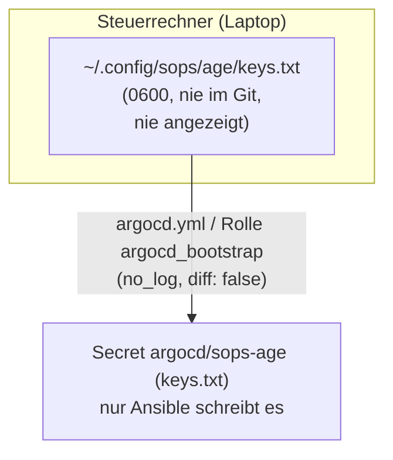
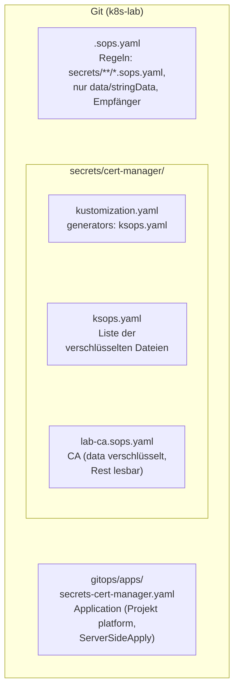
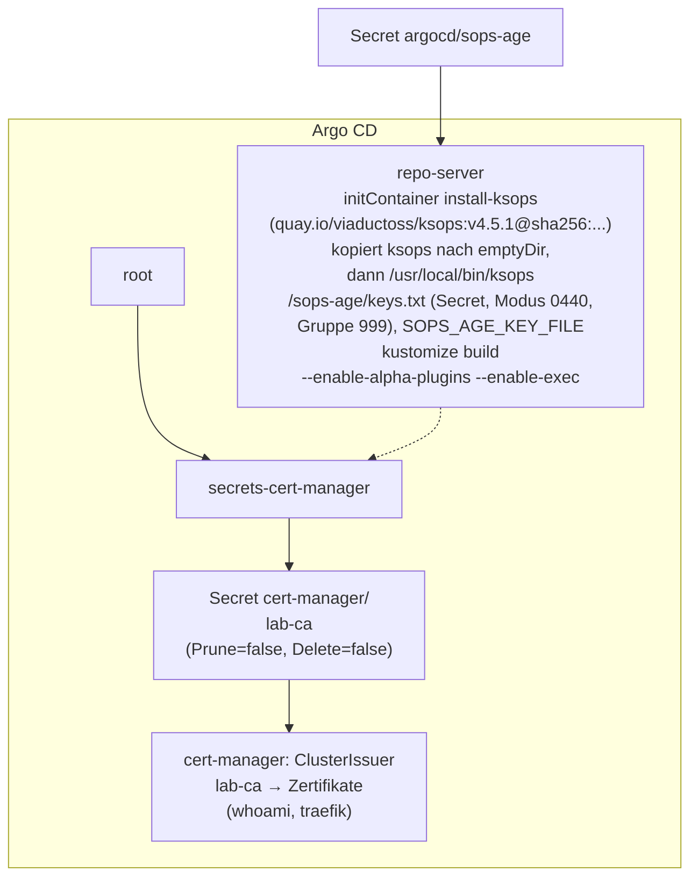
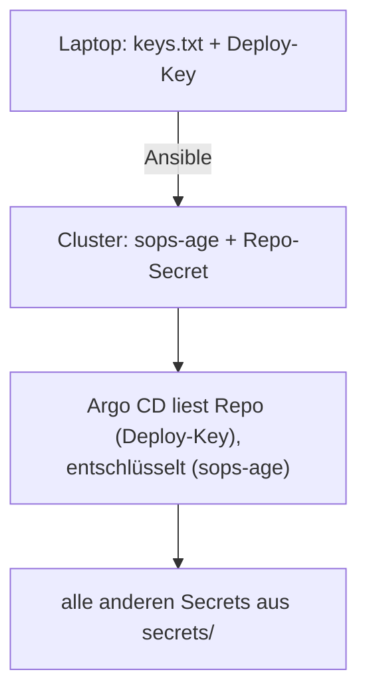

# Stufe 7: Secrets im Git mit SOPS + age (KSOPS)

!!! abstract "Lernpfad, Stufe 7"
    Verschlüsselte Secrets im Repo, von Argo CD per KSOPS entschlüsselt. Heute
    gültig: [Secret-Fluss](../concepts/secret-flow.md) (Erklärung),
    [Geheimnisse anlegen und rotieren](../how-to/secrets.md) (Anleitung) und
    [Geheimnis-Karte](../reference/secrets-map.md) (Referenz).

## WAS und WARUM

**Was:** Secrets liegen verschlüsselt im Repo unter `secrets/` (Dateien
`*.sops.yaml`, verschlüsselt mit SOPS für den age-Schlüssel des Betreibers). Argo CD
entschlüsselt sie selbst: der repo-server hat das Programm **KSOPS** (ein
Kustomize-Generator) und den privaten age-Schlüssel als Secret
`argocd/sops-age`. Als erstes Secret ist die Lab-CA (`cert-manager/lab-ca`)
umgezogen; Ansible legt sie nicht mehr an, sondern wartet nur darauf.

**Warum:** Bis Stufe 6 lag die CA als Klartext-Datei auf dem Steuerrechner
(`~/.config/k8s-lab/lab-ca-secret.yaml`), und nur Ansible konnte sie ins
Cluster bringen. Das heisst: ein Secret ohne Versionsgeschichte, ohne Review
und ohne Selbstheilung. Mit SOPS ist das Secret Teil von Git (wer hat wann
was geändert), Argo CD stellt es wieder her, wenn jemand es verändert, und
für einen frischen Cluster braucht es nur noch einen einzigen geheimen
Gegenstand: den age-Schlüssel.

**Wie (kurz):** `.sops.yaml` sagt SOPS, *was* verschlüsselt wird (nur
`data`/`stringData`) und *für wen* (öffentlicher age-Schlüssel des Betreibers).
Ansible legt den privaten Schlüssel als Secret in `argocd` ab und gibt dem
repo-server per Init-Container das gepinnte KSOPS. Die Application
`secrets-cert-manager` rendert `secrets/cert-manager/` mit Kustomize, KSOPS
entschlüsselt dabei im Speicher, Argo CD wendet das Secret per
Server-Side Apply an.

!!! tip "Eselsbrücke"
    *"Das Schloss hängt im Git, den Schlüssel bringt Ansible, Argo schliesst
    auf, und wer den Schlüssel verliert, hat nur noch das, was schon im Haus
    ist."*

## Architektur

Der Schlüssel bleibt auf dem Steuerrechner, Ansible legt ihn als Secret an:



Im Git liegen nur die verschlüsselten Dateien und die Regeln:



In Argo CD entschlüsselt der repo-server beim Rendern:



Klartext gibt es nur an zwei Orten: im Speicher des repo-servers beim
Rendern und im Cluster selbst (wie jedes Kubernetes-Secret).

## Entscheidungen

| Frage | Entscheid | Grund |
|---|---|---|
| Werkzeug | KSOPS (SOPS + age) | `.sops.yaml` war schon vorbereitet; kein zusätzlicher Controller wie bei Sealed Secrets oder External Secrets; Dateien lassen sich auch ohne Cluster lesen (`sops decrypt`). |
| KSOPS ins Argo CD | Init-Container mit gepinntem Image (Tag + Digest) | Kein eigenes repo-server-Image; Update = ein neuer Pin in `group_vars/all/sops.yml`. |
| Was wird verschlüsselt | nur `data`/`stringData` | Name, Namespace, Labels und Annotationen bleiben lesbar: Argo CD, Review und `verify-ksops.yml` brauchen sie. |
| Empfänger | ein age-Schlüssel des Betreibers (einer) | Ein Schlüssel für Laptop und Cluster, einfach zu sichern. Alternative mit eigenem Cluster-Schlüssel: siehe unten. |
| Wie kommt der Schlüssel ins Cluster | nur Ansible (`argocd.yml`), `no_log`, `diff: false` | Henne-Ei: ohne Schlüssel kann Argo CD nichts entschlüsseln, also kann er nicht selbst aus dem Git kommen. |
| Anwenden | Server-Side Apply (`ServerSideApply=true`) | Sonst schreibt Argo CD das ganze Secret (Werte nur base64) zusätzlich in die Annotation `last-applied-configuration`, und jeder mit `get secret`-Rechten oder `kubectl describe` sieht es doppelt. |
| Löschen | `Prune=false,Delete=false` an jedem Secret | Argo CD legt an und aktualisiert, löscht aber nie. Eine gelöschte Datei oder App reisst keine Zertifikatskette ab. |
| Ordnung | ein Ordner pro Namespace, eine App pro Ordner | Ein Fehler (z.B. falscher Schlüssel) trifft nur diesen Namespace; die App sieht man einzeln in der UI. |
| Ablage | alles Verschlüsselte nur unter `secrets/` plus `gitops/apps/secrets-*.yaml` | Für die öffentliche Kopie einfach abtrennbar (siehe unten). |
| Prüfen | `verify-ksops.yml`, nur lesend | Wie alle anderen Stufen. |

## Welche Secrets wohin

| Secret | Wo | Warum |
|---|---|---|
| `cert-manager/lab-ca` (Lab-CA) | **SOPS** (`secrets/cert-manager/`) | Einmalig, von Hand gemacht, nicht reproduzierbar: genau dafür ist Git mit Verlauf gut. |
| `argocd/sops-age` (age-Schlüssel) | **Ansible** | Henne-Ei (siehe oben). |
| Repo-Secret von Argo CD (Deploy-Key `k8s-lab`) | **Ansible** | Henne-Ei: ohne Deploy-Key liest Argo CD das Repo nicht, also auch kein verschlüsseltes Secret darin. |
| `docs/docs-repo` (Deploy-Key der Doku-Site) | **Ansible** | Derselbe Key wie das Repo-Secret von Argo CD. Eine Quelle (Datei auf dem Laptop) statt zwei Kopien, die auseinanderlaufen. |
| Notiz-Sites: Deploy-Keys und Basic-Auth | **vorerst Ansible** | Die Rolle `notes_sites` erzeugt Key und Passwort pro Eintrag in `gitops/sites.yaml` selbst (nur wenn neu). Ein neues Notizbuch braucht so nur eine Zeile. Mit SOPS bräuchte jedes neue Notizbuch einen Handgriff mehr. Umzug später möglich, Muster unten. |
| CNPG, Gitea, Backup (später) | **SOPS** | Muster unten. |

Faustregel: **Was Argo CD braucht, um überhaupt zu starten (Repo-Zugang,
age-Schlüssel), bleibt bei Ansible. Alles andere kommt verschlüsselt aus
dem Git.**

## Voraussetzungen

Auf dem Laptop (Steuerrechner):

- age-Schlüssel in `~/.config/sops/age/keys.txt`, Modus 0600, gehört dem Betreiber.
  Der private Teil wird nie angezeigt; den öffentlichen zeigt
  `age-keygen -y ~/.config/sops/age/keys.txt` (beginnt mit `age1`).
- Dieser öffentliche Schlüssel steht in `.sops.yaml` unter `age:`.
  Der Preflight in `argocd.yml` bricht ab, wenn eine Identität in
  `keys.txt` dort fehlt (es kommt also nie ein fremder Schlüssel ins
  Cluster).
- `sops` (getestet v3.13.3) und `age-keygen` (age v1.3.2) im `PATH`.
  Fehlen sie, installierte damals ein Hilfsblock beide nach `~/.local/bin`
  (mit SHA-256-Prüfung, ohne sudo); heute prüft `lab.sh preflight` auf sie.
- Stufe 6 läuft: CA-Secret im Cluster, `verify-certmanager.yml` grün.

## Ausrollen

!!! note "Historisch"
    Stufe 7 wurde mit Hilfsblöcken einer Änderungsliste (`AENDERUNGEN-stufe7.md`,
    `stufe7.sh`, `stufe7-edits.sh`; nicht im Repo) eingespielt. Heute leistet
    das `lab.sh init` zusammen mit `ansible/scripts/sops-secret.sh`.

Die Blöcke taten genau das:

1. **Block A:** Snapshot `vor-stufe7` (nur wenn es ihn noch nicht gibt),
   neue Dateien (`stufe7.sh`), Edits (`stufe7-edits.sh`), Hash des
   CA-Secrets merken (`~/.config/k8s-lab/stufe7-ca-vorher.sha256`),
   CA-Secret aus dem Cluster verschlüsseln:

   ```bash
   ansible/scripts/sops-secret.sh export cert-manager lab-ca
   ```

   Der Klartext geht dabei nur durch eine Pipe, nie auf die Platte. Danach
   wird die neue Datei entschlüsselt und per Hash mit dem Cluster
   verglichen.
2. **Block B:** Lint, Commit, Push, `ansible-playbook argocd.yml`
   (age-Secret, KSOPS im repo-server, Rolle `lab_ca` wartet bis 10 Minuten
   auf das Secret von Argo CD), warten auf alle Apps, Hash-Vergleich,
   ein Zertifikat neu ausstellen lassen, alle verify-Playbooks.

Die Übernahme ist nahtlos: Argo CD wendet dasselbe Secret (gleiche Werte)
auf das bestehende Objekt an und setzt nur Label, Annotationen und die
Tracking-ID. Der Hash vorher und nachher ist gleich, cert-manager merkt
nichts.

Frischer Bootstrap (neuer Cluster): `ansible-playbook argocd.yml` reicht.
Das age-Secret kommt vor dem Helm-Chart, der repo-server startet schon mit
Schlüssel und KSOPS, die Root-App synct `secrets-cert-manager`, und
`lab_ca` wartet, bis das CA-Secret da ist.

## Benutzen

Ein Secret ändern (öffnet den Klartext im `$EDITOR`, SOPS schreibt dafür
kurz eine temporäre Datei mit Modus 0600):

```bash
cd ~/projects/k8s-lab
sops edit secrets/cert-manager/lab-ca.sops.yaml
git add secrets && git commit -m "..." && git push
```

Ein bestehendes Secret aus dem Cluster übernehmen (wie bei der CA):

```bash
ansible/scripts/sops-secret.sh export NAMESPACE NAME
# -> secrets/NAMESPACE/NAME.sops.yaml, then add it to ksops.yaml
```

Ein neues Secret erzeugen, ohne dass Klartext auf die Platte kommt
(Beispiel Passwort für eine Datenbank):

```bash
( set -euo pipefail
  cd ~/projects/k8s-lab
  mkdir -p secrets/cnpg
  PW=$(openssl rand -base64 24)
  kubectl create secret generic app-db -n cnpg --type=kubernetes.io/basic-auth \
      --from-literal=username=app --from-literal=password="$PW" --dry-run=client -o json \
    | kubectl label --local -f - -o json app.kubernetes.io/managed-by=argocd \
    | kubectl annotate --local -f - -o json argocd.argoproj.io/sync-options=Prune=false,Delete=false \
    | sops encrypt --input-type json --output-type yaml \
        --filename-override secrets/cnpg/app-db.sops.yaml /dev/stdin \
    > secrets/cnpg/app-db.sops.yaml
)
```

Hash vergleichen (zeigt nie Werte):

```bash
ansible/scripts/sops-secret.sh hash-cluster cert-manager lab-ca
ansible/scripts/sops-secret.sh hash-datei secrets/cert-manager/lab-ca.sops.yaml
```

## Muster für CNPG, Gitea und Backup

Für jeden neuen Namespace mit Secrets dasselbe Muster wie bei cert-manager:

1. `secrets/<ns>/kustomization.yaml` und `secrets/<ns>/ksops.yaml`
   (Kopie aus `secrets/cert-manager/`, Liste unter `files:` anpassen).
2. Secrets als `secrets/<ns>/<name>.sops.yaml` (siehe Benutzen), immer mit
   `Prune=false,Delete=false`.
3. `gitops/apps/secrets-<ns>.yaml` (Kopie von `secrets-cert-manager.yaml`,
   `path` und `namespace` anpassen, `ServerSideApply=true` bleibt).
4. Den Namespace legt der Besitzer an (Ansible oder die App mit
   `CreateNamespace`); `secrets-<ns>` legt keinen an und versucht es per
   `retry` erneut, bis er da ist.
5. `verify_secret_apps` in `verify-ksops.yml` um die App ergänzen.

Konkret:

- **CNPG:** `kubernetes.io/basic-auth`-Secret für `bootstrap.initdb.secret`
  (Benutzer + Passwort) und eines mit den S3-Zugangsdaten für Barman.
  Der Cluster (CR `Cluster`) verweist nur per Name darauf.
- **Gitea:** Admin-Zugang, `SECRET_KEY`/`INTERNAL_TOKEN` und das
  DB-Passwort. Das Helm-Chart bekommt nur `existingSecret`-Namen; Werte
  nie in `values.yaml`.
- **Backup (restic/Velero):** Repository-Passwort und S3-Schlüssel.
  Wichtig: das restic-Passwort zusätzlich offline sichern, sonst ist das
  Backup bei einem verlorenen age-Schlüssel wertlos.

## Rotation (neuer age-Schlüssel)

!!! info "Umgezogen"
    Siehe [Geheimnisse anlegen und rotieren](../how-to/secrets.md#age-schluessel-rotieren).

## Schlüssel verloren

!!! info "Umgezogen"
    Siehe [Geheimnisse anlegen und rotieren](../how-to/secrets.md#age-schluessel-verloren).

## Rückbau

Notbremse: VM-Snapshot zurücksetzen
(`virsh -c qemu:///system snapshot-revert k3s-lab vor-stufe7`) und im Repo
den Stufe-7-Commit zurücknehmen. Sauberer geht es ohne Snapshot (damals Block R der Änderungsliste):

1. Klartext-Backup `~/.config/k8s-lab/lab-ca-secret.yaml` muss noch da sein
   (die alte Rolle `lab_ca` liest es wieder). Schon gelöscht? Vor dem
   Revert aus dem Git wiederherstellen (ohne es anzuzeigen):
   `(umask 077; sops decrypt secrets/cert-manager/lab-ca.sops.yaml > ~/.config/k8s-lab/lab-ca-secret.yaml)`
2. `git revert` des Stufe-7-Commits, Push. Die Root-App löscht die App
   `secrets-cert-manager`; das CA-Secret bleibt (`Delete=false`).
3. Argo-Spuren am Secret entfernen (sonst hält `verify-certmanager.yml`
   es für Argo-eigen):
   `kubectl -n cert-manager annotate secret lab-ca argocd.argoproj.io/tracking-id- argocd.argoproj.io/sync-options-`
4. `ansible-playbook argocd.yml`: repo-server ohne KSOPS, Label wieder
   `managed-by: ansible`.
5. `kubectl -n argocd delete secret sops-age` (Schlüssel raus aus dem
   Cluster).
6. verify-Playbooks.

## Fehlerbilder

| Symptom | Ursache | Abhilfe |
|---|---|---|
| `argocd.yml` bricht im Preflight ab: Identität nicht in `.sops.yaml` | `keys.txt` und `.sops.yaml` passen nicht zusammen | Öffentlichen Schlüssel mit `age-keygen -y` anzeigen und in `.sops.yaml` eintragen, oder richtige `keys.txt` nehmen. |
| App `secrets-cert-manager` `Unknown`, Meldung `error decrypting file ... 0 successful groups required` | Datei für einen anderen Schlüssel verschlüsselt als der im Secret `sops-age` | Nichts geht verloren (Secret bleibt). Empfänger angleichen (`sops updatekeys`), `argocd.yml`. |
| Meldung `exec: "ksops": executable file not found` oder `plugins are disabled` | KSOPS fehlt oder `buildOptions` fehlen | `argocd.yml` nochmals; `verify-ksops.yml` zeigt, was fehlt. |
| Direkt nach dem Push kurz `Unknown`: `external plugins disabled; unable to load external plugin 'ksops'` | Argo CD hat den neuen Commit gesehen, bevor `argocd.yml` KSOPS eingeschaltet hat | Nichts tun: nach dem Helm-Upgrade löst es sich beim nächsten Abgleich (bis ca. 3 Minuten), `lab_ca` wartet so lange. Getestet. |
| `lab_ca` meldet "nicht von Argo CD angelegt" | App noch nicht gesynct (frischer Bootstrap) oder Fehler oben | `kubectl -n argocd get application secrets-cert-manager -o yaml`, dann `argocd.yml` erneut. |
| `yamllint` meckert über `*.sops.yaml` | lange `ENC[...]`-Zeilen, kein `---` (SOPS schreibt so) | Diese Dateien nicht linten; Block B lintet nur den Rest. |

## Öffentliche Kopie (GitHub)

!!! warning "Überholt"
    Dieser Abschnitt beschreibt den ersten Entwurf. Heute erzeugt
    `bash scripts/lab.sh public` die öffentliche Fassung (mit Wächter,
    Ersetzungen und Link-Prüfung), und in der Fassung bleiben die
    `.sops.yaml.example`-Vorlagen statt eines leeren `secrets/`-Ordners.
    Siehe [Öffentliche Fassung](../how-to/public-release.md). Der Abschnitt
    bleibt als Begründung der Grundregel stehen: keine Secrets in der
    öffentlichen Kopie, auch keine verschlüsselten.

Das öffentliche Repo soll **keine** Secrets enthalten, auch keine
verschlüsselten (Verschlüsselung kann irgendwann schwächer werden, und
die Metadaten verraten trotzdem viel). Deshalb liegt alles Verschlüsselte
an genau zwei Orten:

- `secrets/` (ganzer Ordner)
- `gitops/apps/secrets-*.yaml`

Öffentliche Kopie = Stand ohne diese Pfade und **ohne Git-Verlauf** (im
Verlauf stecken die alten verschlüsselten Dateien):

```bash
( set -euo pipefail
  rm -rf /tmp/k8s-lab-public && mkdir /tmp/k8s-lab-public
  cd ~/projects/k8s-lab
  git archive HEAD | tar -x -C /tmp/k8s-lab-public
  cd /tmp/k8s-lab-public
  rm -rf secrets gitops/apps/secrets-*.yaml
  if grep -rIlE 'ENC\[AES256_GCM|AGE-SECRET-KEY-1[0-9A-Z]{20}|BEGIN [A-Z ]*PRIVATE KEY-----' .; then
    echo "ABORT: the files above contain secrets, do not publish." >&2; exit 1
  fi
  echo "OK: /tmp/k8s-lab-public is free of secrets (without git history)."
)
```

`.sops.yaml` darf bleiben (nur der öffentliche Schlüssel). Wer die Kopie
benutzt, legt eigene Secrets an; die Rolle `lab_ca` wartet dann vergeblich
auf das CA-Secret und sagt das klar.

## Alternative: eigener Cluster-Schlüssel

Statt des Schlüssels des Betreibers im Cluster könnte der Cluster einen eigenen
age-Schlüssel haben (beide stehen als Empfänger in `.sops.yaml`). Vorteil:
geht der Cluster verloren, ist der Schlüssel des Betreibers nicht betroffen. Nachteil:
zwei Schlüssel sichern. Für ein Lab mit einer Person bewusst nicht
gewählt; Umstellen = Rotation (oben) mit zwei Empfängern als Endzustand.

## Prüfen

```bash
cd ~/projects/k8s-lab/ansible
ansible-playbook verify-ksops.yml
```

Prüft (nur lesend): KSOPS-Image gepinnt (Digest), Init-Container gelaufen,
`buildOptions`, age-Secret von Ansible, Apps unter `secrets/` Synced/Healthy,
CA-Secret von Argo CD mit `Prune=false,Delete=false` und ohne
`last-applied`-Annotation, ClusterIssuer bereit, jede `*.sops.yaml` liegt
unter `secrets/`, ist verschlüsselt und hat genau die Empfänger aus
`.sops.yaml`, und nirgends im Repo liegt ein privater Schlüssel.

## Henne-Ei auf einen Blick



