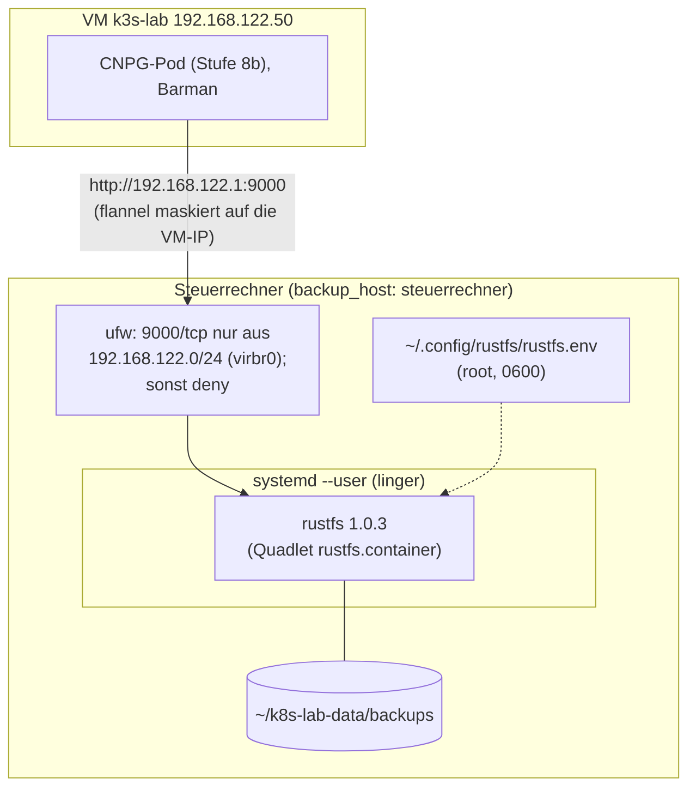
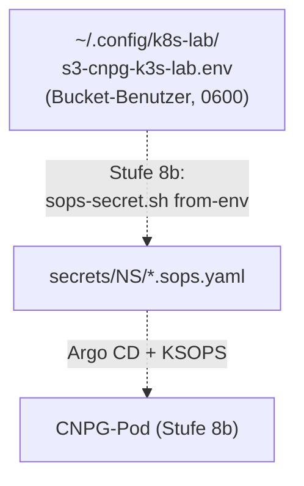

# Stufe 8a: Backup-Ziel rustfs

!!! abstract "Lernpfad, Stufe 8a"
    rustfs (S3-kompatibel) als rootless Podman-Quadlet auf dem Steuerrechner,
    ein Bucket pro Zweck. Heute gültig: [Backup und Restore](../concepts/backup-and-restore.md)
    (Erklärung), [Ports und Netze](../reference/ports-and-networks.md) und
    [Fehlersuche](../how-to/troubleshooting.md).

## WAS und WARUM

**Was:** rustfs (S3-kompatibler Speicher) läuft auf deinem PC, im
gleichen Ordner `~/k8s-lab-data/backups` und mit der gleichen
Schlüssel-Datei `~/.config/rustfs/rustfs.env` wie bisher. Neu: ein Bucket
`cnpg-k3s-lab` mit eigenem Benutzer, den Stufe 8b für CloudNativePG (CNPG)
nimmt. Die VM `k3s-lab` startet nach einem Stromausfall von selbst.

**Geschichte:** rustfs lief schon für minikube (Altlast, Tag
`minikube-final`). Stufe 8a löst es davon: die ufw-Freigabe für das
minikube-Netz 192.168.39.0/24 wird entfernt, Block C räumt minikube
danach ganz weg (Programme, VM, Netz, `~/.minikube`, alte Buckets).

**Warum auf dem PC und nicht in der VM:** Ein Backup in derselben VM wie
die Datenbank ist keins. Läuft der Cluster bei einem Cloud-Anbieter,
bleiben die Backups hier (Gruppe `backup_host` = `steuerrechner`), nur ein
WireGuard-Netz kommt in die Freigabe.

**Warum neu aufgesetzt:** Die alte Quadlet-Datei band rustfs an die
Adresse einer Bridge. Gibt es die Bridge beim Boot (noch) nicht, startet
rustfs nicht. Neu hört rustfs auf allen Adressen, `ufw` entscheidet, wer
hinkommt. Ein Stromausfall ist damit kein Drama: PC startet, linger
startet rustfs ohne Anmeldung, libvirt startet die VM (`virsh autostart`),
CNPG holt nach.

**Wie (kurz):**

- Playbook `ansible/backup-host.yml`, Rolle `backup_s3`, alle Werte in
  `ansible/inventory/group_vars/all/backup_s3.yml`.
- rustfs als rootless Podman-Quadlet (`systemd --user`, linger), Image
  per Digest gepinnt, Healthcheck mit `HealthOnFailure=kill` und
  `Restart=always`, `StartLimitIntervalSec=0` (gibt nie auf).
- ufw: Port 9000 nur aus dem VM-Netz (`virbr0`, 192.168.122.0/24), sonst
  `deny`. Regeln für 192.168.39.0/24 (minikube) oder mit "minikube" im
  Kommentar löscht die Rolle bei jedem Lauf.
- VM `k3s-lab` und ihr Netz `default` mit libvirt-Autostart.
- Bucket `cnpg-k3s-lab` mit Versionierung, Lifecycle (alte Versionen nach
  14 Tagen weg), Benutzer `cnpg-k3s-lab` mit Policy nur für diesen
  Bucket. Schlüssel in `~/.config/k8s-lab/s3-cnpg-k3s-lab.env` (0600).
- `ansible/verify-backup-s3.yml` prüft PC, VM und einen Pod im Cluster.

## Architektur

Der Datenpfad vom CNPG-Pod zum Backup-Ziel:



Die Zugangsdaten für den Bucket-Benutzer gelangen so zum Pod:



```text
~/.config/containers/systemd/rustfs.container   <- Quadlet (from Ansible, template in the role)
~/.config/rustfs/rustfs.env                     <- root key, never overwritten
~/.config/k8s-lab/s3-cnpg-k3s-lab.env           <- key for CNPG (only bucket cnpg-k3s-lab)
~/.config/k8s-lab/backup/rustfs.container.before-stage8a  <- old Quadlet file (way back)
~/k8s-lab-data/backups/                         <- data (bucket cnpg-k3s-lab)
~/k8s-lab-data/rustfs-logs/                     <- rustfs logs
```

Bucket `cnpg-k3s-lab`, ein Ordner pro CNPG-Cluster (Stufe 8b):
`s3://cnpg-k3s-lab/<namespace>/<cluster>/{base,wals}`.

## Entscheidungen

| Thema | Entscheid | Warum |
|---|---|---|
| Wo hört rustfs | `0.0.0.0:9000` + ufw | Kein Warten auf `virbr0` beim Boot; `192.168.122.1` gibt es erst, wenn libvirt das Netz gestartet hat. ufw regelt den Zugriff, für neue Netze (WireGuard) nur eine Regel mehr. |
| Netz beim Boot | `ExecStartPre` wartet auf Standardroute + Adresse; Watchdog prüft von aussen | pasta liest das Host-Netz nur beim Start; ein Start vor dem Netz bleibt kaputt, ohne dass der Healthcheck im Container es merkt (Vorfall 2026-10-28). Siehe *Warten auf das Netz und Watchdog* |
| Bind an `192.168.122.1` | nein | Startet rustfs vor libvirt (Boot, Stromausfall), scheitert der Bind; `Restart=always` hilft zwar, aber nur mit Glück und Lärm im Log. |
| minikube | weg (Entscheid 2026-10-26) | Wird nicht mehr gebraucht. Die Rolle löscht jede ufw-Regel für 192.168.39.0/24 oder mit "minikube" im Kommentar (`backup_s3_ufw_purge_cidrs`, `backup_s3_ufw_purge_comment_regex`), auch wenn es keine gibt (dann nichts). Den Rest räumt Block C weg. |
| IPv6 | podman 4.9 hört auf `*:9000` (auch IPv6) | ufw sperrt mit der `deny`-Regel auch v6 (bei `IPV6=yes` in `/etc/default/ufw`, Standard). Freigaben gibt es nur für IPv4. |
| Konsole | nur `127.0.0.1:9001` | Admin-Oberfläche nie im Netz. Ob sie läuft: `RUSTFS_CONSOLE_ENABLE` in `rustfs.env`. |
| Benutzer pro Bucket | ja, `cnpg-k3s-lab` mit eigener Policy | rustfs 1.0.3 kann IAM-Benutzer und Policies (Admin-API `/rustfs/admin/v3`). Getestet: Schlüssel sieht nur seinen Bucket, `403` auf jeden anderen Namen (auch nicht vorhandene). Ein geleakter CNPG-Schlüssel trifft nur diesen Bucket. |
| Versionierung | an, alte Versionen nach 14 Tagen weg | Wer mit dem CNPG-Schlüssel löscht (Retention, Fehler, Angreifer), erzeugt nur einen Löschmarker; die Daten bleiben 14 Tage holbar (mit root). Barman schreibt nur neue Namen, Versionen kosten fast nichts. |
| Image | `rustfs/rustfs:1.0.3@sha256:...` | Gleiche Version wie bisher, Digest verhindert stilles Update. Das Image zieht die Rolle; beim Boot wird nie gezogen (`Pull=missing`). |
| Dateibesitz | `UserNS=keep-id:uid=10001,gid=10001`, Volume `:U` | Daten gehören dir (uid 1000) statt einer subuid (110000): Backup des Ordners mit deinen Rechten möglich. `:U` gleicht den Besitz einmal an. |
| `rustfs.env` | nie überschrieben | Nur anlegen, wenn sie fehlt (zufällige Schlüssel, 0600). Inhalt nie im Log (`no_log`, `diff: false`). |
| Autostart der VM | `backup_s3_vm_autostart: true` (Entscheid 2026-10-26) | Nach einem Stromausfall startet sonst nur rustfs. libvirt startet `k3s-lab` und das Netz `default` beim Boot (`virsh -c qemu:///system autostart`, ohne sudo). `false`: die Rolle ändert nichts (schaltet auch nichts ab). |
| sudo | nur für ufw und linger | Rest rootless, auch virsh (`qemu:///system`, Gruppe libvirt). Darum `ansible-playbook backup-host.yml -K`. |

## Voraussetzungen

- podman >= 4.5 (Ubuntu 24.04: 4.9.3) mit `/usr/libexec/podman/quadlet`.
- ufw installiert und **aktiv**. Sonst bricht die Rolle vorher ab, ohne
  etwas zu ändern (rustfs auf `0.0.0.0` ohne Firewall wäre im LAN offen).
- Python 3 (für den S3-Helfer `rustfs-s3.py`, ohne Zusatzpakete).

### ufw einschalten

Nur falls `sudo ufw status` `inactive` meldet. Zuerst SSH erlauben (falls du
per SSH auf den PC kommst), dann einschalten:

```bash
sudo ufw allow OpenSSH
sudo ufw enable
sudo ufw status verbose
```

Standard von ufw: eingehend `deny`, ausgehend `allow`, geroutet `deny`.
Die VM läuft trotzdem: libvirt setzt eigene Regeln für das Routing
seines Netzes. Prüfe danach einmal, ob die
VM ins Internet kommt (`ssh k3s-lab curl -sI https://github.com`).

## Ausrollen

!!! note "Historisch"
    Die drei Blockskripte (`~/stufe8a-block-a.sh`, `-b.sh`,
    `-c-minikube-weg.sh`) lagen im Home-Verzeichnis des Autors und gehören
    nicht zum Repo. Heute läuft die Rolle über `lab.sh up` (`backup-host.yml`).

Drei Skripte, alle als Datei ausführen (nicht in ble.sh einfügen), der
Reihe nach, C erst wenn B grün ist:

```bash
bash ~/stufe8a-block-a.sh               # new files, edits
bash ~/stufe8a-block-b.sh               # lint, docs, commit, push, --check, apply, again, verify
bash ~/stufe8a-block-c-minikube-weg.sh  # once: remove minikube completely (asks first)
```

Block B fragt viermal nach deinem sudo-Passwort (`-K` bei jedem
`ansible-playbook`: `--check`, echt, nochmal, prüfen). Einzeln:

```bash
cd ~/projects/k8s-lab/ansible
ansible-playbook backup-host.yml -K --check --diff
ansible-playbook backup-host.yml -K
ansible-playbook verify-backup-s3.yml -K
```

Was der erste Lauf ändert: ufw-Regeln (neu: deny + VM-Netz, weg: eine
allfällige minikube-Regel), VM- und Netz-Autostart, Ordner-Rechte, Schlüssel-Datei
für `cnpg-k3s-lab`, Quadlet-Datei (die alte Datei wird vorher einmal nach
`~/.config/k8s-lab/backup/rustfs.container.before-stage8a` kopiert, nur wenn
sie nicht schon von Stufe 8a ist), Neustart
von rustfs (einige Sekunden ohne S3), Bucket, Versionierung, Lifecycle,
Policy, Benutzer. Der zweite Lauf: `changed=0`.

## Block C: minikube weg

Einmalig, erst nach einem grünen Block B. Das Skript zeigt zuerst genau,
was es noch gibt und löscht (mit Grösse), und löscht erst, wenn du
genau `minikube weg` tippst. Vorher bricht es ab, wenn Block B fehlt (Quadlet
nicht von Stufe 8a, ufw-Sperre fehlt, ufw-Regel für 192.168.39.0/24 noch
da, Bucket `cnpg-k3s-lab` fehlt) oder die VM `k3s-lab` nicht läuft.

Weg kommen:

1. `minikube delete --all --purge` (mit `KUBECONFIG=~/.kube/config`).
2. Falls noch da: libvirt-Domain `minikube` (stoppen, `undefine`, ihre
   Disks, nur wenn sie unter `~/.minikube` liegen oder "minikube" heissen).
3. libvirt-Netz `mk-minikube` (`net-destroy`, `net-undefine`).
4. `~/.minikube`, die minikube-Einträge in `~/.kube/config` (`kubectl config
   delete-*`). Ist die Datei danach leer, kommt sie weg; dann in `~/.bashrc`:
   `export KUBECONFIG=~/.kube/k3s-lab.kubeconfig` (das Skript ändert
   `~/.bashrc` nicht).
5. `~/k8s-lab-data/site`, die alten Buckets `cnpg-backups`,
   `k8up-lab-dev`, `k8up-lab-ref` samt allen Versionen (S3 mit
   dem root-Schlüssel, nie ausgegeben), in `~/.config/k8s-lab/`:
   `gitea-dev-admin.pw`, `gitea-ref-admin.pw`, `k8up-repo-dev.pw`,
   `k8up-repo-ref.pw`.
6. `sudo rm /usr/local/bin/minikube /usr/local/bin/helmfile`.

Bleibt: VM `k3s-lab`, Netz `default`, Images `k3s-lab*`/`ubuntu-24.04*`,
`helm`, `kubectl`, `~/.kube/k3s-lab.kubeconfig`, Bucket `cnpg-k3s-lab`,
Git-Tag `minikube-final`, in `~/.config/k8s-lab/` alles andere (`lab-ca*`,
`notes-notes.passwort`, `stufe7-ca-vorher.sha256`, `s3-cnpg-k3s-lab.env`,
`backup/`). Nochmals laufen lassen: "Nichts zu tun".

## Prüfen

`ansible-playbook verify-backup-s3.yml -K` prüft:

1. **PC:** Dienst `rustfs.service` aktiv (aus dem Quadlet-Generator),
   linger an, Container `healthy` mit dem gepinnten Digest, Port 9000 auf
   `0.0.0.0`/`*`, `/health` meldet 1.0.3, ufw aktiv mit genau den
   Freigaben vor der Sperre, keine Regel für 192.168.39.0/24 (oder mit
   "minikube" im Kommentar), Schlüssel-Dateien 0600, Bucket, Policy und
   Benutzer wie konfiguriert (ohne Änderung), `virsh -c qemu:///system
   dominfo k3s-lab` zeigt `Autostart: enable`, Netz `default` `Autostart: yes`.
2. **VM:** `/health` über `http://192.168.122.1:9000`, Roundtrip
   (PUT/GET/LIST/DELETE) mit dem CNPG-Schlüssel, ListBuckets zeigt nur
   `cnpg-k3s-lab`, ein fremder Bucket-Name ist gesperrt (`403`), Hinweis
   zur ausgehenden Firewall der VM.
3. **Pod:** Wegwerf-Namespace `stage8a-verify` (PSA restricted), Pod mit
   curl macht dasselbe wie in 2. aus dem Pod-Netz. Namespace wird
   danach gelöscht. Ohne Pod-Test: `ansible-playbook verify-backup-s3.yml -K --skip-tags pod`.
4. **Aufräumen:** alle Versionen unter `stage8a-verify/` endgültig weg.

Von Hand:

```bash
systemctl --user status rustfs
podman ps --filter name=rustfs
curl -s http://127.0.0.1:9000/health
sudo ufw status numbered
journalctl --user -u rustfs -n 50
virsh -c qemu:///system dominfo k3s-lab | grep Autostart
```

## Stromausfall

Was nach dem Wiedereinschalten passiert:

1. PC bootet, ufw lädt die Regeln (vor dem Netz).
2. systemd startet deinen Benutzer-Manager (linger), der startet rustfs
   ohne Anmeldung. Das Image ist lokal, es braucht kein Internet. rustfs
   wartet auf keine Bridge, aber (`ExecStartPre`, bis 90 s) auf die
   Standardroute des Hosts; der Watchdog fängt den Rest ab.
3. libvirt startet das Netz `default` und die VM `k3s-lab` (Autostart).
   Ohne Autostart: `virsh -c qemu:///system start k3s-lab`.
4. **CNPG:** Konnte PostgreSQL ein WAL-Segment nicht ablegen (rustfs weg,
   VM lief noch, z.B. PC im Standby), bleibt es in `pg_wal` und wird
   immer wieder versucht, bis es klappt. Es geht nichts verloren, nur
   `pg_wal` wächst (Platz in der VM im Auge behalten). Danach holt
   Barman die Warteschlange der Reihe nach ab.
5. **CNPG `ScheduledBackup`:** Ist der Termin während des Ausfalls
   verstrichen, legt der Operator beim nächsten Abgleich **sofort einen**
   Backup an (einmal, nicht für jeden verpassten Termin). Scheitert
   dieser (rustfs noch nicht da), wird er nicht wiederholt, sondern erst
   der nächste Termin.

Daten: rustfs schreibt Objekte erst fertig, dann meldet es OK. Ein Objekt
mitten im Upload fehlt nach dem Ausfall ganz; Barman lädt es nochmals
hoch. Getestet: Container hart abgeschossen (`kill -9`), Objekt davor
noch lesbar, rustfs nach einigen Sekunden wieder gesund.

## Warten auf das Netz und Watchdog

**Vorfall 2026-10-28:** Nach dem Neustart des PCs (21:11) nahm rustfs auf
`192.168.122.1:9000` Verbindungen der VM an, antwortete aber nie. Von
`127.0.0.1` ging alles, der Healthcheck im Container (`127.0.0.1`) blieb
grün. CNPG-Backups und WAL-Archiv scheiterten zwei Tage still;
`systemctl --user restart rustfs` behob es sofort.

**Ursache (wahrscheinlich, aus Quellen; auf dem PC nicht nachgestellt):**
Der rootless Container hat sein Netz über *pasta*. pasta liest Schnittstelle,
Adresse und Route des Hosts **einmal beim Start** und beobachtet später keine
Änderung; Portweiterleitungen von ausserhalb des Hosts (VM über `virbr0`)
nutzen genau diese Daten, Verbindungen über `127.0.0.1` nicht. Startet
rustfs vor der Standardroute, bleibt die Konfiguration falsch bis zum
nächsten Start. Podman hängt zwar jede Quadlet-User-Unit an
`podman-user-wait-network-online.service`, doch der fragt nur das **System**-Ziel
`network-online.target` ab; das ist auf vielen Rechnern nie "online" (Wartezeit
90 s läuft ab) oder sagt nichts über die Route. Eine User-Unit kann nicht
selbst auf eine System-Unit warten.

| Quelle | Aussage |
|---|---|
| podman PR 24305: <https://github.com/containers/podman/pull/24305> | pasta braucht das fertige Netz, um die Schnittstelle aus den Routen zu wählen; darum die Wait-Unit |
| podman Issues 24796 / 26134: <https://github.com/containers/podman/issues/24796>, <https://github.com/containers/podman/issues/26134> | Wait-Unit fragt nur `network-online.target` ab, Zeitablauf nach 90 s; Abhilfe `[Quadlet] DefaultDependencies=false` oder eigene Unit |
| passt Bug 141: <https://bugs.passt.top/show_bug.cgi?id=141> | pasta beobachtet Änderungen von Adressen und Routen nicht (kein Netlink-Monitor) |
| podman Quadlet-Handbuch: <https://docs.podman.io/en/latest/markdown/podman-systemd.unit.5.html> (Abschnitt *Implicit network dependencies*) | Quadlet-User-Units hängen an `podman-user-wait-network-online.service`; abschaltbar mit `DefaultDependencies=false` |

**Gegenmittel (Rolle `backup_s3`, Werte `group_vars/all/backup_s3.yml`):**

1. `ExecStartPre=rustfs-wait-net.sh`: wartet bis zu `backup_s3_wait_net_timeout`
   Sekunden auf Standardroute und globale Adresse auf deren Schnittstelle
   (`/proc/net/route`), startet danach **in jedem Fall** (ein Backup-Ziel
   ohne Netz ist besser als keins).
2. `rustfs-watchdog.timer` (systemd `--user`, linger, alle
   `backup_s3_watchdog_interval` Sekunden): fragt `backup_s3_probe_url`
   (`http://192.168.122.1:9000/health`, die Adresse der VM-Seite) ab. Der
   Healthcheck im Container kann das nicht: er läuft im Netz des Containers
   und sieht den Pfad von aussen nie. Bei Fehler (3 Anfragen) schreibt der
   Watchdog Route, Adressen, Port und pasta ins Journal und startet
   `rustfs.service` neu; nach 5 erfolglosen Neustarten in Folge gibt er auf
   (kein Neustart-Sturm). Er tut nichts, solange rustfs jünger als die
   Karenz ist oder die Bridge-Adresse noch nicht auf dem Host liegt.

Prüfen und Fehlersuche:

```bash
systemctl --user list-timers rustfs-watchdog.timer
journalctl --user -u rustfs-watchdog.service -n 30
journalctl --user -u rustfs.service -b | grep rustfs-wait-net
ansible-playbook verify-backup-s3.yml -K     # prueft Probe, Timer, ExecStartPre
```

## Cluster bei einem Cloud-Anbieter

Diese Variante ist nicht gebaut. Der Plan (Backups bleiben auf dem PC, WireGuard dazwischen) steht in
[Issue 12](https://github.com/tabee/k8s-lab-template/issues/12).

## Übergabe an Stufe 8b (CNPG)

Umgesetzt in [Stufe 8b](stage-8b-cnpg.md) (mit dem Barman-Cloud-Plugin,
Namespace `db-lab`). Der ursprüngliche Plan:

1. **Secret:** aus der env-Datei verschlüsselt ins Git (nie Klartext):

    ```bash
    cd ~/projects/k8s-lab
    ansible/scripts/sops-secret.sh from-env NS backup-s3-creds ~/.config/k8s-lab/s3-cnpg-k3s-lab.env
    ```

    Ergibt `secrets/NS/backup-s3-creds.sops.yaml` mit den Schlüsseln
    `ACCESS_KEY_ID` und `ACCESS_SECRET_KEY`. Danach das
    Muster aus Stufe 7 (`kustomization.yaml`, `ksops.yaml`, App
    `secrets-NS`).
2. **Cluster-CR** (Auszug):

    ```yaml
    backup:
      retentionPolicy: 14d
      barmanObjectStore:
        destinationPath: s3://cnpg-k3s-lab/NS
        endpointURL: http://192.168.122.1:9000
        s3Credentials:
          accessKeyId: { name: backup-s3-creds, key: ACCESS_KEY_ID }
          secretAccessKey: { name: backup-s3-creds, key: ACCESS_SECRET_KEY }
        wal:
          compression: gzip
    ```

    Oder mit dem Barman-Cloud-Plugin (`ObjectStore`-CR): gleiche Werte.
    Mit boto3 ab 1.36 und einem Plugin/Image, das noch meckert:
    `AWS_REQUEST_CHECKSUM_CALCULATION=when_required` und
    `AWS_RESPONSE_CHECKSUM_VALIDATION=when_required` als env
    (beim Plugin in `instanceSidecarConfiguration`). Getestet mit
    barman 3.20.1 / boto3 1.43 gegen rustfs 1.0.3: geht auch ohne.
3. **Netz:** Hat der Namespace eine NetworkPolicy mit Egress-Regeln:
   `192.168.122.1/32` Port 9000 TCP erlauben.
4. **Leerer Pfad:** CNPG prüft beim Start, dass das WAL-Archiv unter
   `destinationPath/<cluster>` leer ist. Neuer Cluster mit gleichem Namen:
   anderer Pfad oder `serverName`.
5. **Prüfen:** `ansible-playbook verify-backup-s3.yml -K` vor dem ersten CNPG-Cluster.

## Fehlerbilder

| Symptom | Ursache | Abhilfe |
|---|---|---|
| `backup-host.yml` bricht ab: "ufw fehlt oder ist nicht aktiv" | ufw aus | Abschnitt [ufw einschalten](#ufw-einschalten), dann nochmals. Es wurde nichts geändert. |
| `Missing sudo password` / `sudo: a password is required` | `-K` vergessen | `ansible-playbook backup-host.yml -K` |
| Aus der VM: `curl: (28) ... timed out` auf 192.168.122.1:9000 | ufw-Regel fehlt oder `virbr0` heisst anders | `sudo ufw status numbered`; Interface in `backup_s3_ufw_sources` anpassen. |
| Aus der VM: `Connection refused` | rustfs läuft nicht | `systemctl --user status rustfs`, `journalctl --user -u rustfs` |
| `503 Service not ready: waiting for iam` | rustfs startet noch (`/health` ist schon 200) | Einige Sekunden warten; der Helfer wartet bis 90 s. |
| `403 AccessDenied` mit dem CNPG-Schlüssel | anderer Bucket oder Pfad ausserhalb `cnpg-k3s-lab` | `destinationPath` prüfen; der Schlüssel darf nur dort. |
| `SignatureDoesNotMatch` / `XAmzContentSHA256Mismatch` | boto3 >= 1.36 sendet neue Checksummen | env `AWS_REQUEST_CHECKSUM_CALCULATION=when_required`, `AWS_RESPONSE_CHECKSUM_VALIDATION=when_required` |
| CNPG: `Expected empty archive` | Pfad enthält schon WAL eines früheren Clusters | anderer `serverName` oder Pfad, alten nicht löschen ohne Absicht |
| Nach Reboot läuft rustfs nicht, `loginctl show-user $USER` zeigt `Linger=no` | linger aus | `backup-host.yml -K` (schaltet linger ein) |
| `Permission denied` unter `~/k8s-lab-data/backups` | Daten noch von der subuid (110000) | Einmal `backup-host.yml -K`; `:U` gleicht beim Start an. |
| CNPG: Backup/WAL scheitert, `curl 192.168.122.1:9000` aus der VM hängt, lokal geht es | pasta mit altem Host-Netz (Start vor der Route), Healthcheck im Container sieht das nicht | `systemctl --user restart rustfs`; der Watchdog macht es selbst (`journalctl --user -u rustfs-watchdog.service`) |
| Container `unhealthy`, startet immer neu | rustfs hängt oder Platte voll | `df -h ~`, `journalctl --user -u rustfs`; Health killt, systemd startet neu (ohne Limit). |
| `virsh: ... authentication failed` / `permission denied` bei `virsh -c qemu:///system` | Benutzer nicht in Gruppe `libvirt` | `groups` prüfen; `sudo usermod -aG libvirt $USER`, neu anmelden. |
| Block C: "ABBRUCH: ... Erst Block B" | Block B fehlt oder war nicht grün | `bash ~/stufe8a-block-b.sh`, dann Block C nochmals. |
| Speicher wächst trotz Retention | Versionierung: alte Versionen bleiben 14 Tage | `backup_s3_noncurrent_days` kleiner, oder warten. |

## Rückweg

1. Neuen Dienst stoppen und die alte Quadlet-Datei zurück:

    ```bash
    systemctl --user stop rustfs
    cp ~/.config/k8s-lab/backup/rustfs.container.before-stage8a ~/.config/containers/systemd/rustfs.container
    systemctl --user daemon-reload
    systemctl --user start rustfs
    ```

    Die alte Datei hatte kein `keep-id`: rustfs sieht die Daten dann als
    fremd. Mit `:U` (stand auch in der alten Datei) gleicht podman den
    Besitz beim Start wieder an. Achtung: die alte Datei band rustfs an die
    minikube-Bridge; nach Block C gibt es die nicht mehr, dann besser den
    neuen Dienst behalten.
2. ufw-Regeln weg (Nummern aus `sudo ufw status numbered`, von hinten
   löschen, Kommentar `k8s-lab backup_s3`): `sudo ufw delete NUMMER`.
3. VM-Autostart aus: `virsh -c qemu:///system autostart --disable k3s-lab`
   (und vorher `backup_s3_vm_autostart: false`, sonst schaltet der nächste
   Lauf ihn wieder ein).
4. Bucket `cnpg-k3s-lab` und Benutzer bleiben einfach liegen (stören
   nicht).
5. Im Repo: `git revert` des Stufe-8a-Commits, pushen.
6. Block C ist endgültig (minikube, alte Buckets). minikube käme nur
   neu installiert zurück (Stand im Git-Tag `minikube-final`).

## Eselsbrücke

*"rustfs hört allen zu, ufw lässt nur die VM rein, und wer mit dem
CNPG-Schlüssel löscht, hinterlässt nur einen Zettel (Löschmarker)."*
