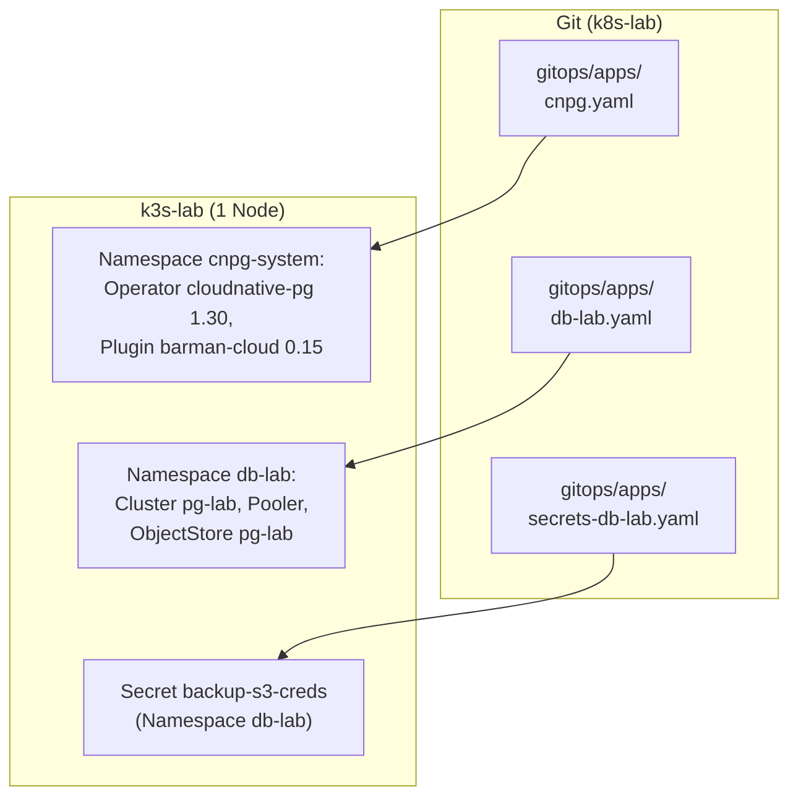
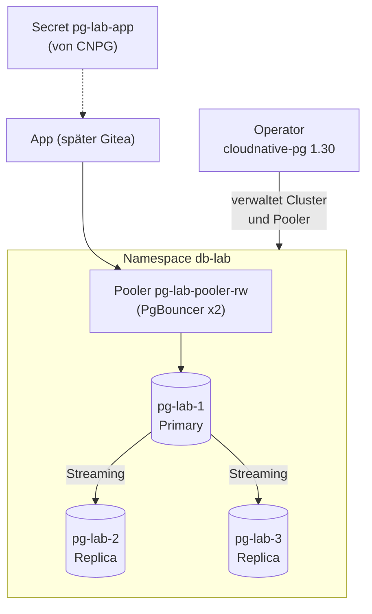
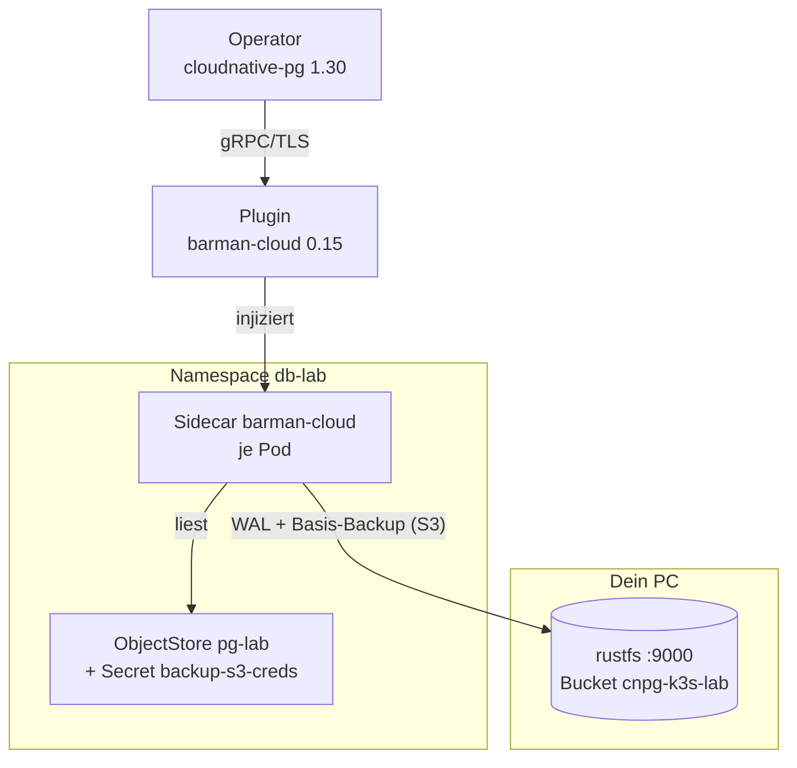
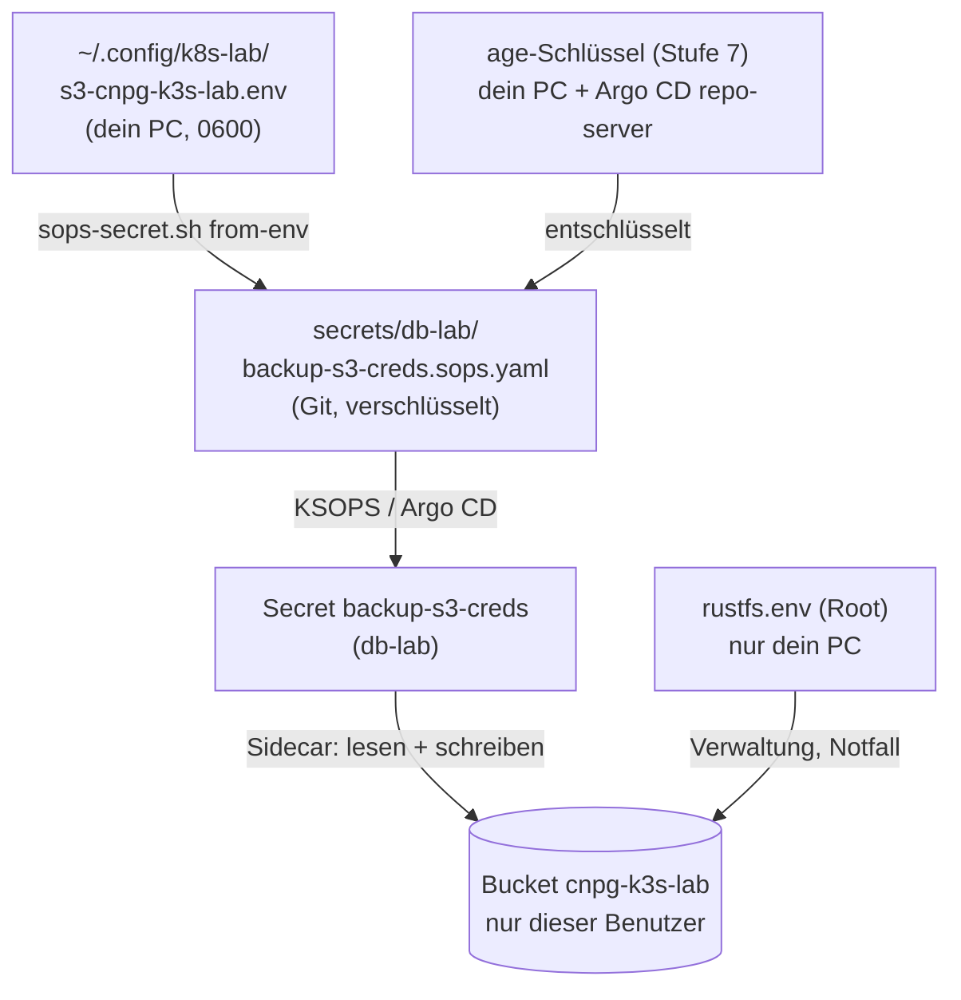
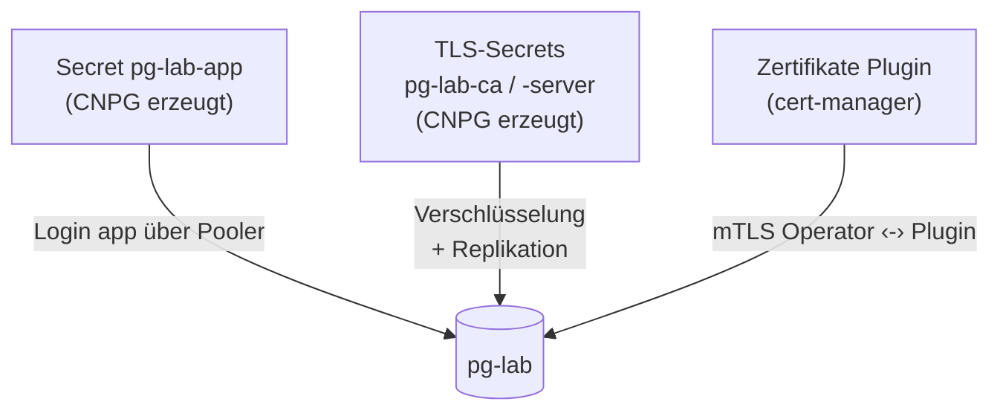
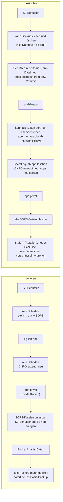
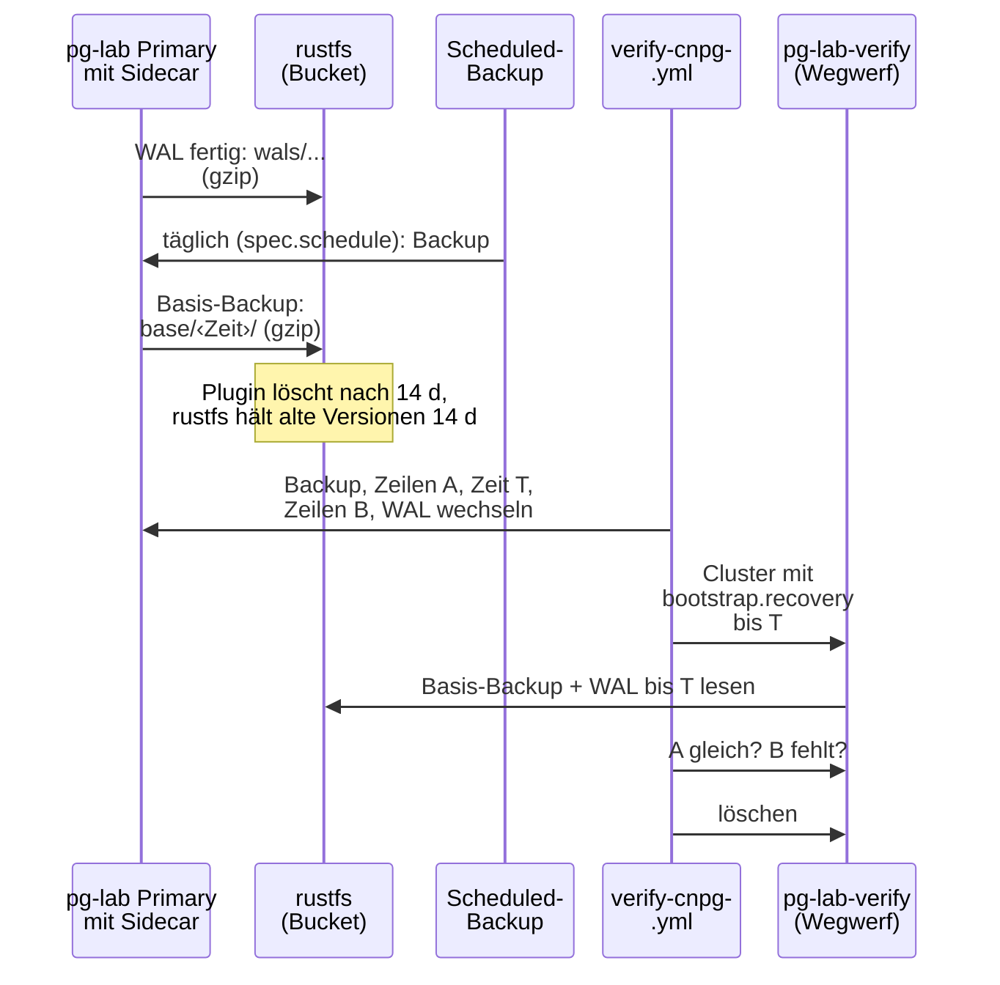

# Stufe 8b: CloudNativePG

!!! abstract "Lernpfad, Stufe 8b"
    Postgres mit Backup nach S3: Operator, Barman-Cloud-Plugin, Pooler und
    Restore-Test. Heute gültig: [Backup und Restore](../concepts/backup-and-restore.md),
    [Datenbank wiederherstellen](../how-to/restore-database.md) (Desaster-Neuaufbau),
    [Failover-Übung](../how-to/failover-drill.md) und [Versionen](../reference/versions.md).

## WAS und WARUM

**Was:** Postgres läuft im k3s-Cluster, verwaltet vom Operator
CloudNativePG (CNPG). Dazu kommt das Barman-Cloud-Plugin, das WAL-Dateien
und Basis-Backups in den Bucket `cnpg-k3s-lab` auf deinem PC schreibt
(rustfs aus Stufe 8a). Alles kommt per Argo CD aus dem Git:

- Operator und Plugin im Namespace `cnpg-system` (App `cnpg`, 2 Helm-Charts).
- Übungs-Datenbank `pg-lab` im Namespace `db-lab` (App `db-lab`):
  3 Instanzen, ein PgBouncer-Pooler für Schreibzugriffe, tägliches
  Basis-Backup, WAL laufend, Aufbewahrung 14 Tage.
- S3-Zugang als KSOPS-Secret `secrets/db-lab/backup-s3-creds.sops.yaml`
  (App `secrets-db-lab`).
- `verify-cnpg.yml` prüft alles und spielt bei jedem Lauf einen echten
  Restore mit Point-in-Time-Recovery (PITR) in einen Wegwerf-Cluster durch.
- `cnpg-failover-drill.sh` löscht den Primary und misst die Ausfallzeit.

**Warum:** Gitea (Stufe 8c) braucht eine Datenbank, die einen Pod-Absturz
übersteht und sich nach einem Totalverlust aus dem Backup neu aufbauen
lässt. `pg-lab` ist der Übungsplatz dafür: Backup, Restore und Failover
werden hier geuebt und gemessen, bevor echte Daten drin sind.

**Warum CNPG:** Der Operator kennt Postgres (Primary-Wahl, Replikation,
Switchover, Backup, Restore) und wird nur mit Kubernetes-Objekten bedient,
also passt er zu GitOps. Kein Patroni, kein etcd, kein StatefulSet von Hand.

**Warum das Plugin und nicht `spec.backup.barmanObjectStore`:** Der in den
Cluster eingebaute Barman-Teil ist seit CNPG 1.26 abgekündigt. Das Plugin ist der Nachfolger und hat ein eigenes Objekt
(`ObjectStore`), das man prüfen und wiederverwenden kann.

**Was es nicht kann:** 3 Instanzen auf einem Node schützen gegen einen
abgestürzten Pod oder Prozess, nicht gegen einen kaputten Node oder eine
kaputte Platte. Dafür gibt es das Backup in S3 und den
[Desaster-Neuaufbau](../how-to/restore-database.md).

## Komponenten

Drei Apps aus dem Git legen die Teile an:



Im Namespace `db-lab` laufen Pooler und drei Instanzen. Der Operator
verwaltet sie:



Das Backup läuft über das Plugin und einen Sidecar je Pod:



## Entscheidungen

| Thema | Entscheid | Warum |
|---|---|---|
| Versionen | Chart `cloudnative-pg` 0.29.1 (Operator 1.30.1), Chart `plugin-barman-cloud` 0.8.1 (Plugin 0.15.1), Postgres 18.6 `minimal-trixie` per Digest | Stand 2026-10-27, neueste stabile; Plugin 0.15 braucht CNPG >= 1.26. Digest: gleiches Image nach jedem Neustart |
| Eine App für Operator + Plugin | `gitops/apps/cnpg.yaml` mit 3 Quellen | beide müssen im gleichen Namespace `cnpg-system` laufen (Plugin-Doku), werden zusammen aktualisiert |
| Plugin-Zertifikate | cert-manager (aus Stufe 6), eigener selbstsignierter Issuer des Charts | Operator und Plugin reden per mTLS; nicht die Lab-CA, die ist für Menschen |
| Namespace | `db-lab` für die Übung, Gitea bekommt in 8c seinen eigenen Cluster in `gitea` | Ein Cluster pro App: eigenes Backup, eigener Restore, eigener Rückweg. `db-lab` kann man jederzeit wegwerfen |
| Instanzen | 3, Anti-Affinity `preferred` | `required` liesse auf einem Node 2 Pods hängen; `preferred` verteilt automatisch, sobald es mehr Nodes gibt |
| Ressourcen | Postgres 256Mi/512Mi, Sidecar 64Mi/512Mi, PgBouncer 32Mi/128Mi, Operator 128Mi/512Mi, Plugin 64Mi/256Mi | Lab-VM; Summe pg-lab etwa 1 GiB angefragt |
| App-Passwort | **von CNPG erzeugt** (Secret `pg-lab-app`), nicht KSOPS | nie im Git, nie bei dir auf der Platte, Apps lesen es per `secretKeyRef`. Nach einem Neuaufbau erzeugt CNPG ein neues, die Apps lesen das neue Secret. KSOPS lohnt sich erst, wenn ein Mensch oder etwas ausserhalb des Clusters das Passwort braucht (offene Frage für Gitea in 8c) |
| Superuser | aus (`enableSuperuserAccess: false`) | kein `postgres`-Passwort im Cluster; Verwaltung per `kubectl exec ... psql` über den Socket |
| S3-Zugang | KSOPS, aus der env-Datei von 8a (`sops-secret.sh from-env`) | gleicher Weg wie Stufe 7; nur der Bucket-Benutzer, nie der rustfs-Root |
| Endpoint, Bucket | einzige Stelle: `ansible/inventory/group_vars/all/backup_s3.yml` | Kopie in `objectstore.yaml`, weil Argo CD keine Ansible-Variablen liest. `verify-cnpg.yml` vergleicht Repo **und** Cluster mit Ansible, Abweichung = Abbruch |
| Namen | einzige Stelle: die Manifeste unter `gitops/` | `verify-cnpg.yml` und das Failover-Skript lesen Namespace, Cluster, Pooler, ObjectStore daraus |
| Aufbewahrung | `retentionPolicy: 14d` | passt zu den 14 Tagen Versionierung in rustfs (8a): was Barman löscht, liegt noch 14 Tage als alte Version da |
| Backup-Zeit | täglich abends, Uhrzeit nur in `scheduledbackup.yaml` (`spec.schedule`, UTC), `immediate: true` | abends läuft dein PC mit rustfs sicher; UTC kennt keine Sommerzeit, die Lokalzeit springt also im Sommer eine Stunde nach hinten; `immediate` macht das erste Backup gleich nach dem Anlegen |
| Pooler | `rw`, 2 Instanzen, `session` | `session` ist mit allen Clients kompatibel (Gitea nutzt Prepared Statements); 2 Pods, damit ein Pooler-Neustart nicht alles trennt |
| NetworkPolicy | `db-lab`: nur eigener Namespace und Operator (5432, 8000); `cnpg-system`: Webhook vom API-Server, Plugin nur vom Operator | gleiches Muster wie die anderen Namespaces |
| CRDs | vom Chart, `ServerSideApply` | CNPG-CRDs sind zu gross für client-seitiges Apply (Annotation-Limit) |

## Welcher Schlüssel wofür

Der Weg des S3-Zugangs vom PC bis zum Bucket:



Die Zugänge zur Datenbank selbst:



| Schlüssel | Wo | Wofür |
|---|---|---|
| age privat | dein PC, Argo CD repo-server | entschlüsselt alle `*.sops.yaml` |
| S3-Benutzer `cnpg-k3s-lab` | env-Datei, SOPS-Datei, Secret `backup-s3-creds` | nur Bucket `cnpg-k3s-lab` lesen/schreiben |
| rustfs-Root | `rustfs.env` auf deinem PC | alles in rustfs, auch alte Versionen holen |
| `pg-lab-app` | nur im Cluster | Login der App |
| `pg-lab-ca`, `-server`, `-replication` | nur im Cluster | TLS und Replikation, CNPG erneuert selbst |

## Was, wenn ein Schlüssel gestohlen wird oder verloren geht



Merke: **Wer den S3-Benutzer hat, hat die Datenbank** (Backups sind nicht
zusätzlich verschlüsselt). Darum nur verschlüsselt im Git, nur 0600 auf
dem PC, Port 9000 nur aus dem VM-Netz (8a). Ein gelöschtes Backup ist noch
14 Tage als alte Version in rustfs, holbar nur mit dem Root-Schlüssel.

## Backup und Restore



- **WAL** (Write-Ahead-Log): jede Änderung, laufend archiviert, Datei für
  Datei. Damit kann man auf jede Sekunde zurück (PITR).
- **Basis-Backup**: Kopie der ganzen Datenbank, täglich. Restore =
  Basis-Backup + alle WAL danach bis zum Zielzeitpunkt.
- **Ablage**: `s3://cnpg-k3s-lab/db-lab/pg-lab/base/...` und `.../wals/...`.

## Voraussetzungen

- Stufe 7 (KSOPS) und Stufe 8a (rustfs, Bucket, env-Datei) laufen,
  `verify-backup-s3.yml` ist grün.
- cert-manager (Stufe 6) läuft (für die Plugin-Zertifikate).
- Freier Speicher in der VM: 3 x 2 GiB für pg-lab plus 1 GiB für den
  Wegwerf-Cluster beim Restore-Test.

## Ausrollen

!!! note "Historisch"
    Die Skripte lagen damals im Home-Verzeichnis des Autors und gehören nicht
    zum Repo. Heute rollt `lab.sh up` bzw. `lab.sh rebuild` alles aus
    (Argo CD synct die drei Apps, `verify-cnpg.yml` prüft).

Dateien nach `~/` kopieren: `stufe8b.sh`, `stufe8b-edits.sh`,
`stufe8b-block-a.sh`, `stufe8b-block-b.sh`, optional `stufe8b-block-c.sh`.

```bash
bash ~/stufe8b-block-a.sh   # new files, edits, git status
bash ~/stufe8b-block-b.sh   # secret, lint, docs, argocd.yml, commit, push, verify
bash ~/stufe8b-block-c.sh   # optional: failover drill
```

Block B in Kurzform:

1. Abbruch, wenn Stufe 8a fehlt (Rolle `backup_s3`, env-Datei).
2. `sops-secret.sh from-env db-lab backup-s3-creds <env-Datei>`: legt die
   SOPS-Datei an (gleich = SKIP, anders = ABBRUCH). Zeigt nie Werte.
3. Lint, `verify-cnpg.yml --tags repo`, Doku-Build.
4. `argocd.yml`: Projekte erlauben `db-lab`, `cnpg-system` und das
   Chart-Repo. **Vor** dem Push, sonst lehnt Argo CD die neuen Apps ab.
5. Commit, Push, Argo CD synct (Operator, Secret, dann pg-lab).
6. `verify-ksops.yml`, `verify-cnpg.yml` (mit Restore-Test, etwa 10 Min.).

Reihenfolge im Cluster: Argo CD legt alle drei Apps gleichzeitig an. Bis
der Operator läuft, schlägt `db-lab` fehl (CRD fehlt) und versucht es
wieder (Retry). Bis der Namespace da ist, wartet `secrets-db-lab`. Das
erste Backup (`immediate`) kann scheitern, wenn das Secret noch fehlt; das
nächste klappt. `verify-cnpg.yml` macht darum vor dem Altertest ein eigenes
Backup.

## Prüfen

```bash
cd ~/projects/k8s-lab/ansible
ansible-playbook verify-cnpg.yml                    # everything, with restore test
ansible-playbook verify-cnpg.yml --tags repo,cluster  # fast: health, backup age
ansible-playbook verify-cnpg.yml --tags repo        # repo only, without cluster
```

Was `verify-cnpg.yml` prüft:

| Bereich | Prüfung |
|---|---|
| Repo | Endpoint/Bucket-Kopie = `backup_s3.yml`; Namen passen zusammen; Image per Digest; Superuser aus; Projekte erlauben Namespaces und Chart-Repo; SOPS-Datei verschlüsselt, richtiger Name, `Prune=false,Delete=false`, in `ksops.yaml` |
| Apps | `cnpg`, `secrets-db-lab`, `db-lab` Synced und Healthy |
| Operator | Deployments `cloudnative-pg` und `plugin-barman-cloud` bereit |
| Secret | `backup-s3-creds` von Argo CD, nie löschen, nur Schlüssel-Namen |
| Cluster | `Cluster in healthy state`, alle Instanzen bereit, Primary = Ziel-Primary |
| WAL | `pg_stat_archiver`: mindestens eine Datei, letzter Versuch erfolgreich |
| ObjectStore | im Cluster = Repo = `backup_s3.yml` |
| Pooler | Deployment bereit; Test-Pod verbindet über den Pooler mit TLS und landet auf dem Primary |
| Backup-Plan | `ScheduledBackup` hat ausgelöst |
| Restore + PITR | Backup, A, T, B, WAL archiviert; Wegwerf-Cluster bis T: A gleich (Anzahl + md5), B = 0; danach alles weg |
| Backup-Alter | letztes erfolgreiches Basis-Backup jünger als 26 h, Wiederherstellungsfenster vorhanden |

Selber nachsehen:

```bash
export KUBECONFIG=~/.kube/k3s-lab.kubeconfig
kubectl -n db-lab get cluster,pooler,scheduledbackup,backup,objectstore
kubectl -n db-lab get pods -L role
kubectl -n db-lab get objectstore pg-lab -o jsonpath='{.status.serverRecoveryWindow}'; echo
kubectl -n db-lab exec pg-lab-1 -c postgres -- psql -XAt -c 'select * from pg_stat_archiver'
```

## Failover-Übung

!!! info "Umgezogen"
    Ablauf und Messwerte (geordnet 0 ms, hart 30.6 s) stehen jetzt in
    [Failover-Übung](../how-to/failover-drill.md).

## Desaster-Neuaufbau

!!! info "Umgezogen"
    Der Ablauf steht in [Datenbank wiederherstellen](../how-to/restore-database.md).
    Git bleibt auf `initdb`. `rebuild --restore` setzt den `serverName` nur im Cluster.

## Fehlerbilder

| Zeichen | Ursache | Abhilfe |
|---|---|---|
| App `db-lab` "one or more synchronization tasks are not valid" | CRDs noch nicht da | warten, Retry; sonst `cnpg` prüfen |
| App `cnpg` "not permitted in project" | `argocd.yml` nicht gelaufen | `cd ansible && ansible-playbook argocd.yml` |
| `secrets-db-lab` "namespace not found" | `db-lab` noch nicht da | warten (Retry 10x) |
| `secrets-db-lab` Fehler beim Rendern | SOPS-Datei fehlt oder age-Schlüssel fehlt | `verify-ksops.yml`, [Stufe 7](stage-7-ksops.md) |
| Cluster bleibt "Setting up primary" | PVC hängt (Platte voll) oder Image-Pull | `kubectl -n db-lab describe pod pg-lab-1-initdb...` |
| `pg_stat_archiver.failed_count` steigt | S3 nicht erreichbar, falscher Schlüssel | Logs: `kubectl -n db-lab logs pg-lab-1 -c plugin-barman-cloud`; auf dem PC `verify-backup-s3.yml -K` |
| Replica bleibt 1/2 bereit, Plugin-Log endet bei "Checking backup destination" oder "Restoring WAL file", `archived_count` 0, Backup bleibt `started` | Pods erreichen rustfs gar nicht (Paket kommt nie an, kein Fehler, nur Warten) | aus einem Pod testen: `kubectl -n db-lab exec pg-lab-1 -c postgres -- timeout 5 bash -c 'exec 3<>/dev/tcp/192.168.122.1/9000' && echo open`; Firewall auf dem PC (Port 9000 für das VM-Netz) prüfen. Im Box-Test war es eine DROP-Regel im Host |
| `Expected empty archive` | `serverName` hat schon Dateien (Neuaufbau ohne neuen Namen) | `serverName` wechseln (siehe [Datenbank wiederherstellen](../how-to/restore-database.md)) |
| Backup `failed`, "connection refused" vom Plugin | NetworkPolicy oder Plugin-Zertifikat | `kubectl -n cnpg-system get certificate,pods`; Policy `barman-cloud-allow-operator` |
| Pooler-Test "SSL required"/Timeout | Pooler-Pods nicht bereit | `kubectl -n db-lab get pods -l cnpg.io/poolerName` |
| Restore-Test bleibt bei "recovery" hängen | WAL bis T noch nicht archiviert | Playbook wartet; sonst `pg_stat_archiver` ansehen |

## Rückweg

1. App `db-lab` zuerst weg: `gitops/apps/db-lab.yaml` löschen, commit,
   push. Argo CD löscht Cluster, Pooler, PVCs (**Daten in der VM weg**),
   das Backup in S3 bleibt. Namespace `db-lab` bleibt (`Delete=false`).
2. Dann `gitops/apps/secrets-db-lab.yaml` und `gitops/apps/cnpg.yaml`
   löschen, commit, push. Das Secret bleibt (`Delete=false`), die CRDs
   bleiben (`helm.sh/resource-policy: keep`).
3. Von Hand: `kubectl delete ns db-lab` (Secret mit), bei Bedarf
   `kubectl delete crd -l app.kubernetes.io/name=cloudnative-pg` und die
   Barman-CRD `objectstores.barmancloud.cnpg.io`.
4. `git revert` des Stufe-8b-Commits (Projekte, Doku), push,
   `cd ansible && ansible-playbook argocd.yml`.
5. Optional Bucket leeren: auf dem PC mit dem Root-Schlüssel
   (`rustfs-s3.py purge`, Stufe 8a). Erst wenn du die Backups sicher nicht
   mehr willst.

## Eselsbrücke

*"Der Operator ist der Hausmeister, der Pooler die Tür, das Plugin der
Postbote: jede WAL-Seite geht sofort zur Bank (rustfs), einmal am Tag das
ganze Buch. Wer zurück will, holt das Buch und blättert bis T."*

## Folgestufe 8c

Umgesetzt in [Stufe 8c](stage-8c-gitea.md): CNPG-Cluster `gitea-db` im
  Namespace `gitea` (gleiches Muster, eigener ObjectStore, eigener
  `serverName`, Pooler), Repos auf einem PVC, gesichert mit K8up/restic in
  den eigenen Bucket `k8up-k3s-lab`, Restore-Test in `verify-gitea.yml`.
