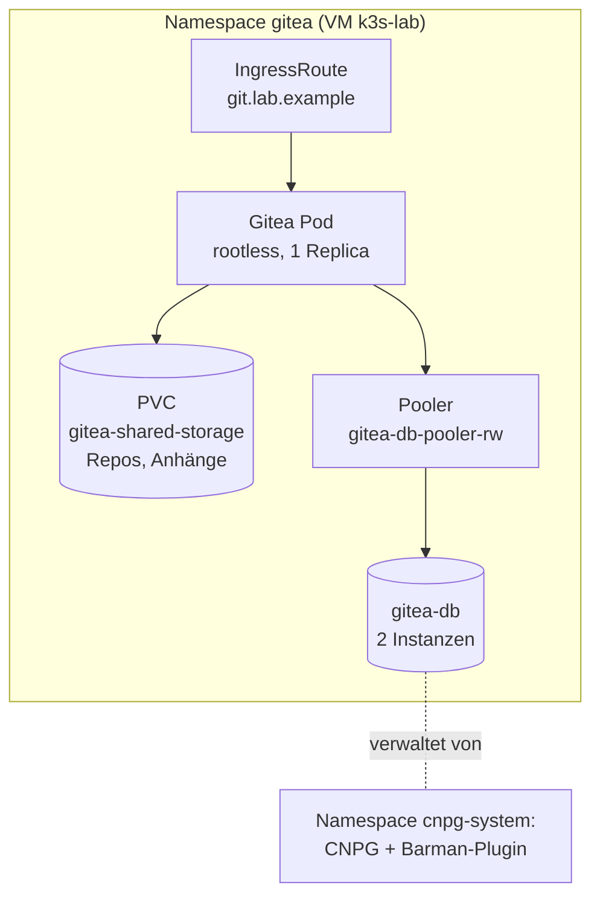
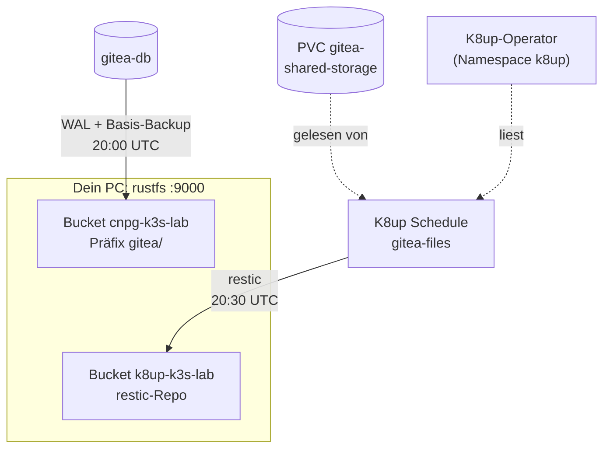
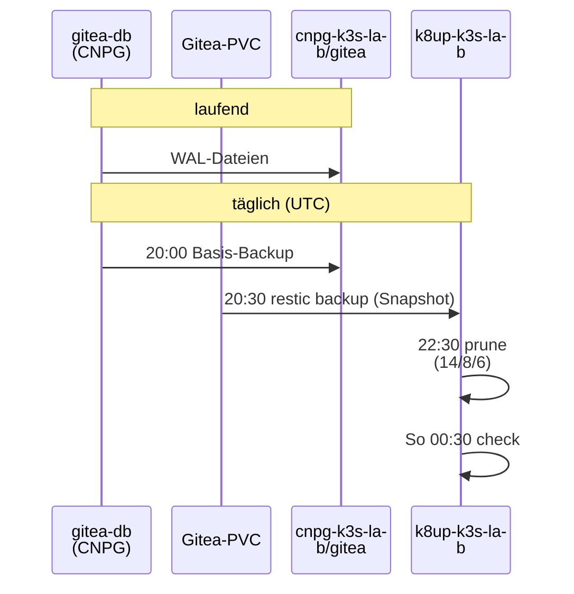

# Stufe 8c: Gitea im Cluster

!!! abstract "Lernpfad, Stufe 8c"
    Gitea mit eigenem CNPG-Cluster `gitea-db` und K8up/restic für die Repo-Dateien.
    Heute gültig: [Backup und Restore](../concepts/backup-and-restore.md),
    [Gitea wiederherstellen](../how-to/restore-gitea.md),
    [Gitea-Backup prüfen](../how-to/verify-gitea-backup.md) und
    [Fehlersuche](../how-to/troubleshooting.md).

## WAS und WARUM

**Was:** Ein zweites Gitea läuft im k3s-Cluster, ausgerollt von Argo CD
aus diesem Repo. Es ist ein Übungs- und Ziel-System; das Gitea auf
deinem PC (`git.example.org`) bleibt unverändert und ist weiter die
Quelle für Argo CD.

- App `gitea` (Projekt `lab`): offizielles Helm-Chart `gitea` 12.7.0,
  Image 1.27.3 rootless (Digest gepinnt), ohne die Postgres- und
  Valkey-Teile des Charts. Dazu aus diesem Repo die Manifeste unter
  `gitops/workloads/gitea/manifests/`: eigener CNPG-Cluster `gitea-db`
  mit Pooler, ObjectStore und täglichem Basis-Backup, K8up-Schedule für
  die Repos, NetworkPolicies. Zertifikat der Lab-CA und IngressRoute
  stehen in `extraDeploy` von `values-gitea.yaml` (Hostname nur einmal).
- App `secrets-gitea` (Projekt `lab`): 5 KSOPS-Secrets aus
  `secrets/gitea/` (S3 für CNPG, DB-Besitzer, Admin, S3 für K8up,
  restic-Passwort).
- App `k8up` (Projekt `platform`): K8up-Operator v2.16.1 (Chart 4.10.1)
  mit CRDs im Namespace `k8up`. K8up sichert PVCs mit restic.
- Rolle `backup_s3` (Stufe 8a) bekommt einen zweiten Bucket
  `k8up-k3s-lab` mit eigenem Benutzer und eigener Policy.
- `verify-gitea.yml` prüft alles und spielt bei jedem Lauf einen echten
  Restore der Repo-Dateien in einen Wegwerf-Namespace durch.
- Erreichbar unter `https://git.lab.example/` (Lab-CA wie Argo CD).

**Warum:** Gitea hat zwei Arten von Daten, und beide müssen zurück,
wenn die VM weg ist:

1. *Datenbank* (Benutzer, Issues, Pull Requests, Rechte): liegt in
   Postgres, gesichert von CNPG (WAL laufend + Basis-Backup), wie in
   Stufe 8b geuebt.
2. *Dateien* (die Git-Repos selbst, Anhänge, Avatare): liegen auf dem
   PVC `gitea-shared-storage`. Das sieht CNPG nie. Dafür K8up.

Nur beide zusammen ergeben ein ganzes Gitea. Darum gehört der
Restore-Test der Dateien zur Stufe, nicht nur das Backup.

**Was es nicht kann:** Ein Node, ein PVC (`local-path`), keine zweite
Gitea-Instanz. Fällt der Node aus, ist Gitea weg, bis die VM wieder
läuft oder aus den Backups neu gebaut ist. SSH ist aus, Git nur über
HTTPS. Keine Mails.

## Komponenten

Im Cluster läuft die Anfrage vom Ingress bis in die Datenbank:



Gesichert wird in zwei getrennten Pfaden auf den PC (`gitea-db`, PVC und
Schedule liegen im Namespace `gitea`):



## Entscheidungen

| Frage | Entscheid | Warum |
|---|---|---|
| Datenbank | eigener CNPG-Cluster `gitea-db` (2 Instanzen) statt pg-lab mitbenutzen | pg-lab ist zum Üben (Failover, Restore-Tests); Gitea soll davon nichts merken. 2 statt 3: auf einem Node schützt die zweite Instanz gegen Pod-Absturz, die dritte bringt nichts ausser RAM |
| Zugriff auf die DB | über Pooler `gitea-db-pooler-rw` (1 Instanz) | Gitea zeigt immer auf den Primary, auch nach einem Failover, ohne Neustart. 1 Instanz reicht für einen Benutzer |
| DB-Passwort | per KSOPS (`gitea-db-owner`) statt von CNPG erzeugt | Gitea braucht ein festes Passwort. Nach einem Recovery setzt CNPG das Passwort aus genau diesem Secret wieder, also passt alles ohne Handarbeit |
| CNPG-Bucket | gemeinsamer Bucket `cnpg-k3s-lab`, Präfix `gitea/` | Gleicher Schlüssel, gleiche Versionierung und Retention wie db-lab; ein Bucket pro Cluster-Umgebung ist einfacher zu überblicken. Getrennt sind die Daten trotzdem (eigener Präfix, eigener `serverName`) |
| Datei-Backup | K8up (restic) in **eigenen** Bucket `k8up-k3s-lab` mit eigenem Benutzer | restic verschlüsselt und dedupliziert; K8up ist ein Operator mit CRDs (passt zu GitOps). Eigener Benutzer: ein geklauter K8up-Schlüssel kommt nicht an die DB-Backups und umgekehrt. `verify-backup-s3.yml` prüft das in beide Richtungen (403) |
| Zeiten | DB 20:00 UTC, Dateien 20:30 UTC, Prune 22:30 UTC, Check So 00:30 UTC | 21:00 Zürcher Winterzeit (im Sommer 22:00) wie besprochen; Dateien danach, damit der Datei-Stand nie älter ist als das DB-Basis-Backup |
| Aufbewahrung Dateien | 14 täglich, 8 wöchentlich, 6 monatlich | 14 Tage wie CNPG; Repos ändern sich langsam, restic dedupliziert, längere Stände kosten kaum Platz |
| Was K8up sichert | nur PVCs mit `k8up.io/backup: "true"` (`skipWithoutAnnotation`) | Die Postgres-PVCs sichert CNPG richtig (konsistent); eine Datei-Kopie davon wäre unbrauchbar |
| Cache, Session, Queue | Cache `memory`, Session `db`, Queue `level` (Datei auf dem PVC) | Kein Valkey nötig (spart RAM). Session in der DB: Anmeldungen überleben einen Pod-Neustart. Queue `level` ist Gitea-Standard ohne Valkey |
| Repo-Ablage | PVC `local-path` 5Gi, Strategie `Recreate`, `helm.sh/resource-policy: keep` | RWO-PVC: zwei Pods gleichzeitig gingen nicht. `keep`: Löschen der App löscht die Repos nicht |
| Admin | Secret `gitea-admin`, `passwordMode: initialOnlyNoReset` | Das Chart legt den Admin beim ersten Start an; danach änderst du das Passwort in Gitea, und ein Neustart setzt es nicht zurück |
| SSH | aus | Ein weiterer offener Port (Traefik TCP), den du im Lab nicht brauchst. HTTPS reicht |
| Host | `git.lab.example`, Zertifikat der Lab-CA | Gleiches Muster wie Argo CD (Stufe 6c). Der Name steht nur einmal: `gitea.config.server.DOMAIN` in `values-gitea.yaml`; `ROOT_URL`, Zertifikat und IngressRoute leiten ihn davon ab (siehe *Hostname ändern*) |
| Standardwerte in Listen | in Manifesten von CRDs jeden Standardwert in Listeneinträgen ausdrücklich setzen (z. B. `plugins[].enabled: true`) | Argo CD vergleicht Listen von CRDs als Ganzes; was die CRD oder ein Webhook im Cluster ergänzt, steht nicht im Git und die App bliebe dauernd OutOfSync. Siehe Fehlerbild unten; `verify-gitea.yml --tags repo` prüft es für `plugins` |

## Welcher Schlüssel wofür

Alle Werte liegen genau einmal auf deinem PC (Modus 0600) und als
SOPS-Datei im Repo. Die Orte stehen in
`ansible/inventory/group_vars/all/gitea.yml`; Block B legt fehlende
Dateien an (zufällig, nie angezeigt).

| Datei auf dem PC | SOPS-Secret (`secrets/gitea/`) | Wer braucht es |
|---|---|---|
| `~/.config/k8s-lab/s3-cnpg-k3s-lab.env` (Stufe 8a) | `backup-s3-creds` | Barman-Plugin: WAL und Basis-Backup |
| `~/.config/k8s-lab/gitea-k3s-lab-db.pw` | `gitea-db-owner` (`kubernetes.io/basic-auth`) | CNPG setzt es, Gitea meldet sich an |
| `~/.config/k8s-lab/gitea-k3s-lab-admin.user` + `.pw` | `gitea-admin` | Chart legt den ersten Admin an; `verify-gitea.yml` meldet sich an |
| `~/.config/k8s-lab/s3-k8up-k3s-lab.env` (neu, Rolle `backup_s3`) | `k8up-s3-creds` | K8up: Zugang zum Bucket `k8up-k3s-lab` |
| `~/.config/k8s-lab/k8up-k3s-lab-repo.pw` | `k8up-repo` | restic: verschlüsselt das Repo |

**Wichtig:** Ohne `k8up-k3s-lab-repo.pw` sind die Datei-Backups wertlos
(restic kann nichts mehr entschlüsseln). Lege eine Kopie in deinen
Passwort-Manager. Gleiches gilt für den age-Schlüssel (Stufe 7).

SOPS-Dateien erzeugen (Block B macht das, hier für später):

```bash
d=$HOME/.config/k8s-lab
ansible/scripts/sops-secret.sh from-files gitea gitea-admin Opaque username=@$d/gitea-k3s-lab-admin.user password=@$d/gitea-k3s-lab-admin.pw
```

`from-files` liest die Werte nur aus Dateien (Modus 0600, genau eine
Zeile), nie von der Befehlszeile; es überschreibt nichts (gleicher Inhalt
= SKIP, anderer = ABBRUCH).

**Schlüssel wechseln:** Datei auf dem PC ändern, alte SOPS-Datei
löschen, `from-files`/`from-env` wieder ausführen, commit, push. Für
das DB-Passwort reicht das (CNPG setzt es neu, Gitea danach neu starten:
`kubectl -n gitea rollout restart deploy/gitea`). Das Admin-Passwort
ändert der Wechsel **nicht** (`initialOnlyNoReset`): in Gitea selbst
ändern und danach die Datei anpassen, sonst scheitert `verify-gitea.yml`
an der Anmeldung. Das restic-Passwort nie einfach tauschen: restic kennt
dann das alte Repo nicht mehr (`restic key add` ist ein eigenes Thema).

**Gestohlen?** S3-Schlüssel: Stufe 8a, Runbook "Schlüssel wechseln"
(Rolle erzeugt neu, wenn die env-Datei fehlt). DB-Passwort: wie oben. Ein
geklauter restic-Schlüssel allein nützt ohne S3-Zugang nichts und
umgekehrt.

## Backup und Restore



**Restore-Reihenfolge (immer so):** zuerst die **Datenbank** mit CNPG,
dann die **Dateien** mit K8up, erst danach Gitea starten. Gitea liest beim
Start die Datenbank und erwartet die Repos, die dort stehen. Läuft Gitea
mit neuer DB und alten Dateien (oder umgekehrt), sieht es Repos, die es
nicht kennt, oder kennt Repos, die fehlen.

**Gleicher Zeitpunkt:** Die DB lässt sich auf jede Sekunde
zurückholen (PITR), die Dateien nur auf einen Snapshot. Darum zuerst den
K8up-Snapshot wählen und die DB auf dessen Zeit setzen
(`recoveryTarget.targetTime`). Ohne Angabe holt CNPG den letzten Stand;
dann kann die DB bis zu einem Tag neuer sein als die Repos (nach dem
Restore `gitea doctor check` laufen lassen, siehe unten).

### Desaster: VM weg, Buckets da

!!! info "Umgezogen"
    Der Ablauf steht jetzt in [Gitea wiederherstellen](../how-to/restore-gitea.md).

### Ein Repo aus Versehen gelöscht (Cluster läuft)

!!! info "Umgezogen"
    Siehe [Gitea wiederherstellen](../how-to/restore-gitea.md#ein-repo-aus-versehen-geloescht).

## Voraussetzungen

- Stufe 8a (rustfs, Rolle `backup_s3`) und 8b (CNPG) laufen; Block B
  prüft beides.
- `~/.config/k8s-lab/lab-ca.crt` (Stufe 6c) für den HTTPS-Test.
- `sudo` für `backup-host.yml` (neuer Bucket, wie in 8a: `-K`).

## Ausrollen

Damals legte Block A neue Dateien an und machte die Edits; Block B machte den Rest
(damals mit einer Änderungsliste `AENDERUNGEN-stufe8c.md`, nicht im Repo).

1. `backup-host.yml -K`: Bucket `k8up-k3s-lab`, Benutzer, Policy, Datei
   `s3-k8up-k3s-lab.env`.
2. Fehlende Passwort-Dateien anlegen (zufällig, 0600), SOPS-Dateien
   erzeugen.
3. Lint, `verify-gitea.yml --tags repo`, Doku bauen.
4. `argocd.yml` (Projekte: Namespaces `gitea`, `k8up`, Chart-Repos),
   commit, push, Root-App auffrischen.
5. `verify-backup-s3.yml -K`, `verify-ksops.yml`, `verify-gitea.yml`.

Zugriff im Browser: Lab-CA im Browser vertraut (wie Argo CD). Die Namen
stehen in `/etc/hosts` auf dem PC, siehe [Namen in /etc/hosts](#namen-in-etchosts).

## Prüfen

```bash
cd ansible
ansible-playbook verify-gitea.yml --tags repo            # repo only
ansible-playbook verify-gitea.yml --tags repo,cluster    # without restore
ansible-playbook verify-gitea.yml                        # with restore test
```

Der Restore-Test legt ein privates Repo `verify-k8up-r<zeit>` mit einer
Datei an, macht ein Einmal-Backup (restic-Tag `verify-r<zeit>`), holt
genau diesen Snapshot in den Wegwerf-Namespace `gitea-verify` und
vergleicht Commit und SHA-256 der Datei. Danach (auch bei Fehler):
Namespace, Backup-Objekt und Test-Repo weg. Der Snapshot bleibt und
fällt mit der Retention weg.

Von Hand:

```bash
kubectl -n gitea get cluster,pooler,scheduledbackup,schedule,pvc
kubectl -n gitea get backups.k8up.io,snapshots.k8up.io
kubectl -n k8up logs deploy/k8up --tail=50
```

## Hostname ändern

Der Name steht **einmal**: `gitea.config.server.DOMAIN` in
`gitops/workloads/gitea/values-gitea.yaml`. Davon leiten sich ab:

| Wo | Wie |
|---|---|
| `ROOT_URL` (app.ini) | `"https://%(DOMAIN)s/"`: Gitea setzt den ini-Verweis selbst ein (mit dem Image 1.27.3 geprüft, Log: `AppURL(ROOT_URL): https://<DOMAIN>/`). Das Chart wertet `gitea.config` nicht als Template aus, darum kein Helm-Template |
| Zertifikat `gitea` (dnsNames), IngressRoute `gitea` (Host-Regel) | stehen in `extraDeploy` derselben Datei; das Chart rendert sie mit Helm-Template (`{{ .Values.gitea.config.server.DOMAIN }}`). Gleiche Namen, gleiches Secret `gitea-tls`: Argo CD behandelt sie weiter als Objekte der App `gitea` (die Dateien unter `manifests/` sind weg) |
| `verify-gitea.yml` | liest DOMAIN aus den Werten und prüft, dass `extraDeploy` darauf zeigt |
| `/etc/hosts` auf dem PC | Rolle `lab_hosts` liest DOMAIN aus den Werten |

Umbenennen (Beispiel `gitea` -> `git`, 2026-10-30): Zeile ändern, committen,
pushen, `backup-host.yml -K` (Hosts-Block). Auf einem laufenden Gitea ist das
unkritisch: `ROOT_URL` wechselt mit dem Pod-Neustart, cert-manager stellt das
Zertifikat für den neuen Namen aus (Secret `gitea-tls` wird neu beschrieben),
der alte Name verschwindet aus Route und Zertifikat. Danach gilt: alte
Lesezeichen und `git remote` mit dem alten Namen gehen nicht mehr, `git remote
set-url` anpassen. Repo-Daten, DB und Benutzer bleiben unverändert.

## Namen in /etc/hosts

Die Rolle `lab_hosts` (Play 2 von `backup-host.yml`, läuft mit demselben
`-K`) pflegt auf dem PC **einen** verwalteten Block in `/etc/hosts`:

```text
# BEGIN k8s-lab (Ansible lab_hosts, do not edit by hand)
192.168.122.50 argocd.lab.example docs.lab.example git.lab.example notes.lab.example whoami.lab.example
# END k8s-lab (Ansible lab_hosts, do not edit by hand)
```

- **IP:** `ansible_host` von `k3s-lab` (Inventory), nicht doppelt gepflegt.
- **Namen:** aus dem Repo gelesen, nicht von Hand: `dnsNames` aller
  `gitops/workloads/*/certificate.yaml`, `DOMAIN` von Gitea (steht in den
  Werten, nicht in einer Certificate-Datei), `host` aus `gitops/sites.yaml`
  (Notizbücher). Nur Namen aus `lab.example` (`lab_hosts_domain`). Ein
  neuer Dienst mit Certificate taucht beim nächsten Lauf von selbst auf.
- **Altlasten weg:** die Zeile des alten minikube (`10.100.96.102 dev...`)
  und handgeschriebene Zeilen `192.168.122.50 <ein Name>` (auch der alte
  Name `gitea.lab.example`). Die Regeln stehen in
  `group_vars/all/lab_hosts.yml` (`lab_hosts_stale_regexps`).
- Der Block hat immer mindestens zwei Namen in einer Zeile; die Regel gegen
  handgeschriebene Zeilen trifft nur Zeilen mit genau einem Namen, darum
  löscht Ansible nie seinen eigenen Block (idempotent, zweiter Lauf
  `changed=0`).
- Nur `sudo` für diese eine Datei. Vor dem ersten Lauf:
  `ansible-playbook backup-host.yml -K --check --diff` zeigt die Änderung.

## Fehlerbilder

| Zeichen | Ursache | Abhilfe |
|---|---|---|
| App `gitea` "not permitted in project" | `argocd.yml` nicht gelaufen (Chart-Repo, Namespace) | `cd ansible && ansible-playbook argocd.yml` |
| Schedule/PodConfig "could not find kind" | App `k8up` (CRDs) noch nicht da | warten (Retry); App `k8up` prüfen |
| Gitea-Pod bleibt bei Init `configure-gitea` | DB oder Secret fehlt | `kubectl -n gitea get cluster`, App `secrets-gitea` |
| Gitea-Log "password authentication failed" | DB-Passwort-Secret geändert, Gitea alt | `kubectl -n gitea rollout restart deploy/gitea` |
| `verify-gitea.yml`: Anmeldung 401 | Admin-Passwort in Gitea geändert, Datei alt | Datei anpassen (siehe Schlüssel wechseln) |
| Backup-Pod "PodSecurity violation" | PodConfig fehlt oder falsch | `kubectl -n gitea get podconfig k8up-restricted` |
| Backup "wrong password" / "repository not found" | restic-Passwort passt nicht zum Repo | Datei `k8up-k3s-lab-repo.pw` mit Passwort-Manager vergleichen; nie das Repo löschen, ohne zu verstehen warum |
| Backup "Access Denied" (403) | falscher S3-Schlüssel oder Policy | `verify-backup-s3.yml -K` |
| Backup hängt ohne Fehler | Pod erreicht rustfs nicht (Firewall) | wie Stufe 8b: `/dev/tcp/192.168.122.1/9000` aus einem Pod testen |
| Restore-Test: "FEHLT owner/repo.git" | Snapshot hat das Repo nicht (Backup lief vor dem Commit) | Log des Prüf-Pods zeigt die gefundenen Ordner |
| App dauerhaft `OutOfSync`, obwohl nichts zu ändern ist; `verify-gitea.yml` bricht bei "Applications sind Synced und Healthy" ab und nennt die Ressource | Argo-OutOfSync durch Operator-Defaults: CRD oder Webhook ergänzt Standardwerte in einem Listeneintrag (z. B. `plugins[].enabled: true` im CNPG-Cluster); Argo CD vergleicht Listen von CRDs als Ganzes | Wert ausdrücklich ins Manifest, siehe unten |
| Erste Verbindung eines neuen Test-Pods "Connection refused", jede weitere nach etwa einer Sekunde geht | kube-router setzt NetworkPolicies verzögert um: ein neuer Pod ist ihm die erste Sekunde unbekannt, `default-deny-ingress` weist ihn ab | Test-Pod mit initContainer `warten`, siehe unten |

### Argo-OutOfSync durch Operator-Defaults

!!! info "Umgezogen"
    Erkennen, Abhilfe und die Tabelle der harmlosen Fälle stehen jetzt in
    [Fehlersuche](../how-to/troubleshooting.md#argo-outofsync-durch-operator-defaults).

### Erste Verbindung eines neuen Test-Pods abgewiesen (kube-router)

!!! info "Umgezogen"
    Siehe [Fehlersuche](../how-to/troubleshooting.md#kube-router-erste-verbindung).

## Rückweg

1. App `gitea` weg: `gitops/apps/gitea.yaml` löschen, commit, push.
   Argo CD löscht Gitea, `gitea-db` (**DB-PVCs weg**, Backup bleibt) und
   den Schedule. Das Repo-PVC bleibt (`resource-policy: keep`), ebenso der
   Namespace.
2. `gitops/apps/secrets-gitea.yaml` und `gitops/apps/k8up.yaml`
   löschen, commit, push (Secrets und CRDs bleiben).
3. Von Hand: `kubectl delete ns gitea k8up`, bei Bedarf
   `kubectl delete crd -l app.kubernetes.io/name=k8up`.
4. `git revert` des Stufe-8c-Commits, push, `ansible-playbook argocd.yml`.
   Bucket `k8up-k3s-lab` und Benutzer bleiben in rustfs, bis du sie mit
   dem Root-Schlüssel löschst (`rustfs-s3.py drop-bucket`, Stufe 8a).
5. Passwort-Dateien unter `~/.config/k8s-lab/` erst löschen, wenn du
   die Backups sicher nicht mehr brauchst.

## Eselsbrücke

*"Gitea ist ein Büro mit Kartei (Datenbank) und Aktenschrank (PVC).
CNPG kopiert die Kartei jede Minute, K8up fotografiert den Schrank jeden
Abend um halb. Beim Umzug zuerst die Kartei einräumen, dann die Akten,
dann die Tür aufschliessen."*
