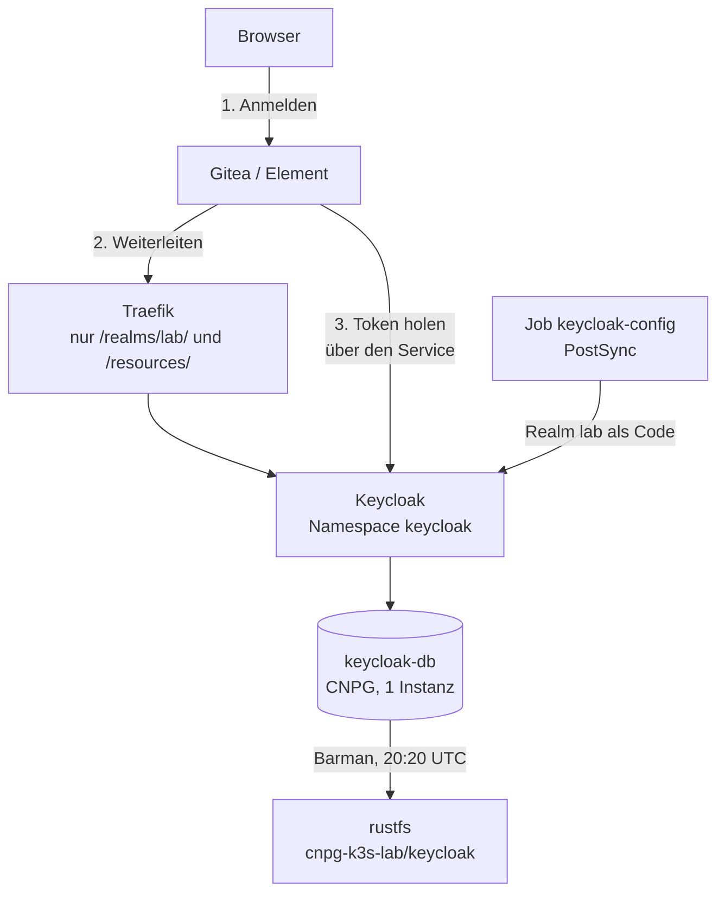

# Stufe 9: Keycloak als Single Sign-on

!!! abstract "Lernpfad, Stufe 9"
    Ein zentraler Anmeldedienst (OIDC) für Gitea und Matrix, mit dem Realm als Code und einer eigenen CNPG-Datenbank.
    Heute gültig: [Keycloak im Lab](../how-to/keycloak.md),
    [Keycloak wiederherstellen](../how-to/restore-keycloak.md),
    [ADR-0019](../concepts/decisions/0019-keycloak-sso.md) und
    [Fehlersuche](../how-to/troubleshooting.md).

## WAS und WARUM

**Was:** Keycloak läuft im Namespace `keycloak`, ausgerollt von Argo CD aus diesem Repo. Gitea und Synapse (Matrix)
fragen es, wer jemand ist. Konten und Rechte (Gruppe `lab-users`) liegen an einer Stelle. Die lokalen Admin-Konten von
Gitea und Matrix bleiben als Notzugang.

- App `keycloak` (Projekt `lab`): Deployment mit gepinntem Image, eigener CNPG-Cluster `keycloak-db` (eine Instanz,
  `initdb` im Git, Barman-Backup nach rustfs), NetworkPolicies, Zertifikat der Lab-CA und IngressRoute
  `https://sso.<domain>/`, die nur `/realms/lab/` und `/resources/` durchlässt.
- Realm `lab` als Code: ConfigMap im Chart `gitops/charts/keycloak`, angewendet von `keycloak-config-cli` als
  PostSync-Job nach jedem Sync. Dazu `realm-master.json` für das eine Attribut, das der Realm `master` für die
  Admin-Konsole braucht.
- Geheimnisse (Admin, Datenbank, zwei Client-Geheimnisse) legt `lab.sh init` an; sie liegen als SOPS-Dateien im Git.
- `verify-keycloak.yml` prüft Repo, Cluster, Discovery und beide Anmeldeketten; die Abnahme (Phase 19) wartet auf das
  erste Basis-Backup.

**Warum:** Zwei Dienste mit zwei Passwortlisten sind zwei Stellen zum Pflegen und zwei zum Vergessen. Mit einem
Anmeldedienst gilt: ein Konto, eine Gruppe, eine Sperre. Und Keycloak ist die Übung, einen Dienst über den **ganzen**
Lebenslauf zu führen: Aufbau, Backup, Neuaufbau mit Daten, Alarm, Prüfung, Doku.

**Was es nicht kann:** Ein Pod, eine Datenbankinstanz, kein Hochverfügbarkeits-Cluster. Fällt Keycloak aus, geht
keine neue SSO-Anmeldung, schon angemeldete Sitzungen und die lokalen Admin-Konten laufen weiter. Keine Selbstregistrierung,
kein E-Mail-Versand, keine Gruppen-zu-Admin-Zuordnung.

## Komponenten

Der Browser sieht nur den öffentlichen Namen. Die Dienste im Cluster reden über `http://keycloak.keycloak.svc:8080`
(`KC_HOSTNAME_BACKCHANNEL_DYNAMIC`), und die Admin-Konsole gibt es nur per Port-Forward auf `http://localhost:8080`
(`KC_HOSTNAME_ADMIN`).

## Entscheidungen

| Frage | Entscheid | Warum |
|---|---|---|
| Realm einrichten | `keycloak-config-cli` als PostSync-Job, nicht `--import-realm` | `--import-realm` legt nur einen fehlenden Realm an und aktualisiert nie. Der Job ist idempotent und löscht nichts Handgemachtes (`no-delete`) |
| Konsole | nicht öffentlich, nur Port-Forward | Die Konsole und der Realm `master` sind das mächtigste, was Keycloak hat; Traefik lässt sie nicht durch |
| Admin-Konsole und Hostname | `frontendUrl` von `master` auf `http://localhost:8080`, im Code | Sonst prüft die Konsole per iframe den öffentlichen Namen, Traefik blockt ihn, und sie meldet *"Timeout when waiting for 3rd party check iframe message"* |
| Datenbank | eigener Cluster `keycloak-db`, 1 Instanz | Wie Gitea, aber ohne Pooler: Keycloak hat einen eigenen Pool. Auf einem Knoten und im überbuchten Budget bringt eine zweite Instanz nichts |
| Backup | nur Datenbank, kein K8up | Keycloak hat kein Volume; aller Zustand liegt in der Datenbank |
| Gitea-Quelle | eigener Init-Container, wartet höchstens 180 s | Das Chart bricht hart ab, wenn Keycloak fehlt, und mit ihm fiele der Break-Glass-Admin aus |
| Synapse | feste Endpunkte, `skip_verification` | Die Endpunkte im Cluster sind `http`; Synapse verlangt sonst `https` |
| Knopf-Name | überall *Keycloak* | Ein Wert (`oidcDisplayName`); der Name der Quelle in Gitea bleibt `keycloak`, er steckt in der Rückruf-Adresse |
| Zugang | Gruppe `lab-users`, keine Rechte über Gruppen | Wer Admin sein soll, wird es in der App, nicht über Keycloak |

## Welcher Schlüssel wofür

| Datei auf dem PC (`~/.config/k8s-lab/`) | SOPS-Datei | Wer braucht es |
|---|---|---|
| `keycloak-k3s-lab-db.pw` | `secrets/keycloak/keycloak-db-owner.sops.yaml` | CNPG und Keycloak (Datenbank) |
| `keycloak-k3s-lab-admin.user` und `.pw` | `secrets/keycloak/keycloak-admin.sops.yaml` | erster Admin; gilt nur beim ersten Start |
| `keycloak-k3s-lab-gitea-client.secret` | `secrets/keycloak/keycloak-oidc-clients.sops.yaml` und `secrets/gitea/gitea-oidc.sops.yaml` | Realm-Job und Gitea (dasselbe Geheimnis) |
| `keycloak-k3s-lab-synapse-client.secret` | `secrets/keycloak/keycloak-oidc-clients.sops.yaml` und `secrets/matrix/matrix-oidc.sops.yaml` | Realm-Job und Synapse |
| `s3-cnpg-k3s-lab.env` (Stufe 8a) | `secrets/keycloak/backup-s3-creds.sops.yaml` | Barman-Plugin |

Alle Werte erzeugt `lab.sh init` zufällig und zeigt sie nie. Die Orte stehen einmal in
`ansible/inventory/group_vars/all/keycloak.yml`. Übersicht: [Geheimnis-Karte](../reference/secrets-map.md).

## Backup und Restore

Das Muster ist das von Stufe 8b: WAL laufend und ein Basis-Backup täglich 20:20 UTC über das Barman-Plugin nach
`cnpg-k3s-lab/keycloak`. `lab.sh rebuild --restore` baut die VM neu und liest die Datenbank zurück; Realm und Benutzer
sind danach da, weil sie in der Datenbank liegen. Vorher muss einmal ein Basis-Backup gelaufen sein
(`immediate: true` löst es beim Anlegen aus). Ein Dateibackup gibt es nicht, ein eigener Restore-Drill auch nicht.

## Stolpersteine

| Zeichen | Ursache | Abhilfe |
|---|---|---|
| Pods von Keycloak, Gitea oder Matrix hängen beim ersten Mal | die SOPS-Secrets fehlen im Git | `lab.sh init`, Dateien einchecken, pushen |
| Admin-Konsole: *"Timeout when waiting for 3rd party check iframe message"* | `frontendUrl` von `master` fehlt | der Job setzt ihn; `verify-keycloak.yml` zeigt, ob er stimmt |
| Der Job endet beim ersten Lauf nach der Änderung mit 401 | der Aussteller von `master` wechselt | warten, der Job wiederholt von selbst |
| Anmeldung klappt, die App weist ab | Konto nicht in `lab-users` | Gruppe in der Konsole setzen |
| Konto will bei der ersten Anmeldung ein neues Passwort | *Temporary* stand auf On | Passwort neu setzen, *Temporary* Off |
| Der Knopf in Element heisst anders als in Gitea | Synapse liest die Konfiguration nur beim Start | `kubectl -n matrix rollout restart deploy/synapse` |
| Neuer Dienst: *"not permitted in project"* oder Name nicht auflösbar | `argocd.yml` und `/etc/hosts` nicht nachgezogen | `bash scripts/lab.sh sync-host` |

Die ausführliche Fassung steht in [Keycloak im Lab](../how-to/keycloak.md).

## Rückweg

1. `gitops/apps/keycloak.yaml` und `gitops/apps/secrets-keycloak.yaml` löschen, commit, push. Argo CD entfernt Keycloak und `keycloak-db` (**Datenbank-PVC weg**,
   Backup bleibt in rustfs).
2. Die Anmeldequelle in Gitea und den Block `oidc_providers` in der Synapse-Konfiguration entfernen; die lokalen
   Admin-Konten melden sich weiter mit Passwort an.
3. Passwortdateien unter `~/.config/k8s-lab/` erst löschen, wenn die Backups sicher nicht mehr gebraucht werden.

## Eselsbrücke

*"Keycloak ist die Pförtnerin: Sie kennt alle Gesichter und stempelt den Besucherausweis. Gitea und Element prüfen nur noch
den Stempel. Fällt die Pförtnerin aus, kommen Stammgäste mit Hausschlüssel (Break-Glass) noch hinein."*
