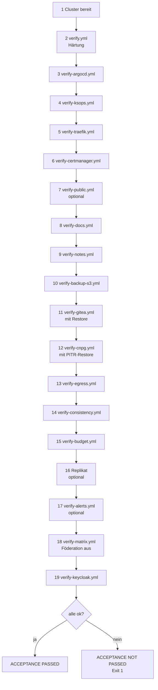

# Referenz: Abnahme-Prüfungen

Was `bash scripts/lab.sh acceptance` im Einzelnen prüft: neunzehn Phasen (7, 16 und 17 optional), in der
Reihenfolge, in der `lab.sh` sie aufruft. Die Zahlen sind die der Prüfpunkte
(`assert`-Aufgaben) im Playbook; sie wachsen mit dem Lab. Ablauf und Messwerte:
[Abnahme](../how-to/acceptance.md). Die Playbooks im Überblick:
[Verify-Playbooks](verify-playbooks.md).

!!! note "Weitere Prüfungen ausserhalb der Phasen"
    Dazu kommen die Kanten-Prüfungen in `verify.yml` (NodePort-Test, Forward-Kette), die
    nameConstraints in `verify-certmanager.yml` und die optionale Phase
    „Öffentliches Zertifikat“. Die gemessenen Zeiten stammen von einer früheren Abnahme mit 11 Phasen
    (2026-10-30, 15:50 Europe/Zurich; neuere Läufe: [Neuaufbau](../how-to/rebuild.md)).

Ein Fehler in einer Phase stoppt die übrigen nicht. Am Ende steht die Zahl der
fehlgeschlagenen Phasen; Details stehen im Log.

## Phase 1: Cluster bereit (ohne Playbook) {#phase-1}

`kubectl get nodes`, Warten bis alle Argo-CD-Applications `Synced` und
`Healthy` sind (bis 600 s) und die Postgres-Cluster gesund sind.

## Phase 2: Härtung der VM (`verify.yml`) {#phase-2}

| Bereich | Prüfpunkte |
|---|---|
| Firewall | Tabelle `host_filter` lesbar; Kette `input` mit `policy drop`; Kette `forward` aktiv, `policy accept` (k3s-Forwarding läuft durch); die Prüfketten für Ingress und DNAT-Ports sind da; Persistenz ohne `flush ruleset`, Dienst aktiviert, kein offener Totmann-Timer; Kubelet-Port 10250 vom Steuerrechner aus gesperrt, API-Port 6443 erreichbar |
| NodePort-Test (Tag `nodeport`) | Wegwerf-Service mit NodePort im Bereich 30000–32767; vom Steuerrechner (Admin-Netz) offen; aus einer **Nicht-Admin-Adresse** (Testnetz mit Namespace und `veth`) bleibt er zu; Aufräumen; ein Pod löst einen Namen über CoreDNS auf (Pod-zu-Pod läuft nach DNAT weiter) |
| SSH | effektive `sshd`-Werte stimmen mit der Härtung; `sshd` hört nur auf der Listen-Adresse |
| sysctl (Tag `sysctl`) | Werte stimmen; gelten auch nach einem Neustart (Dateien in Boot-Reihenfolge); `apport` maskiert, kein Core-Dump-Umleiter |
| auditd, AppArmor | Audit-Regeln geladen; AppArmor aktiv und erzwingt Profile |
| k3s | `config.yaml` entspricht dem Inventory; kein eingebautes k3s-Traefik; PSA `restricted` greift in `default` (privilegierter Pod wird abgelehnt, ein konformer Pod geht durch; Dry-Run); Secrets-Verschlüsselung aktiv, aktiver Schlüssel ist `secretbox`; Audit-Log vorhanden, Verzeichnis nur für root; Kubelet-Argumente wirksam; anonymer Zugriff auf API und Kubelet abgewiesen |

!!! warning "Secretbox auf einer frischen VM"
    Eine frisch gebaute VM startet mit `secretbox` (Rotationsstufe `start`, nie mit
    einem AES-CBC-Schlüssel). Der alte Hinweis „der Check ist erst nach manueller
    Migration grün“ gilt nur für eine VM, die vor dem Wechsel von AES-CBC auf
    `secretbox` angelegt wurde: [Stufe 3](../learning-path/stage-3-hardening.md).

## Phase 3: Argo CD (`verify-argocd.yml`) {#phase-3}

Namespace `argocd` erzwingt PSA `restricted`; alle Pods Ready; das UI-Theme ist
ausgerollt; das Repo-Secret existiert mit dem richtigen Label (nur Metadaten);
`root` und `whoami` sind `Synced` und `Healthy`; alle Quellen aus diesem
Repo zeigen auf `argocd_repo_revision`; der `whoami`-Pod läuft im Namespace
`whoami`; `server.insecure` ist an (TLS endet an Traefik); das Certificate für
den UI-Namen ist Ready; vor `argocd-server` steht nur die eigene
NetworkPolicy; die Oberfläche antwortet über HTTPS mit Kette gegen die Lab-CA;
auf Port 443 liefert Traefik die Argo-CD-Seite **nicht** (sie liegt auf 8444);
unsichere Pods werden in beiden Namespaces abgelehnt (PSA-Nachweis).

## Phase 4: SOPS/KSOPS (`verify-ksops.yml`) {#phase-4}

Zusätzlich eine PSA-Probe: ein privilegierter Pod wird in den Namespaces von Argo CD und cert-manager per Dry-Run abgelehnt (`tasks/psa-probe.yml`).

Der Repo-Server hat KSOPS (gepinntes Image) und den age-Schlüssel; der
KSOPS-Init-Container lief sauber; Kustomize darf KSOPS ausführen (alpha plugins
und exec); das age-Secret existiert und gehört Ansible (nicht Argo CD; nur
Metadaten); die Secret-Applications sind `Synced` und `Healthy`; das CA-Secret
kommt von Argo CD und wird nie gelöscht; der ClusterIssuer ist Ready; SOPS-Dateien
liegen nur unter `secrets/` (trennbar für die öffentliche Fassung); jede
SOPS-Datei ist verschlüsselt und nutzt die Empfänger aus `.sops.yaml`; kein privater
Schlüssel im Klartext im Repo.

## Phase 5: Traefik (`verify-traefik.yml`) {#phase-5}

Application `Synced`, `Healthy` und im Projekt `platform`; PSA `restricted`; der Pod
ist Ready und ohne Dashboard; Drift-Prüfung: `values.yaml` in Git passt zu
`lab.yaml`; der Service ist auf die Ingress-Netze begrenzt, hat die Ports
80/443/Admin und keine NodePorts; vor `whoami` steht nur die eigene NetworkPolicy
(nur Traefik, nur Port 8080); Port 80 leitet permanent auf HTTPS um; die
Antwort kommt von `whoami` und trägt die Sicherheits-Header; unsichere Pods
werden abgelehnt.

## Phase 6: cert-manager (`verify-certmanager.yml`) {#phase-6}

| Bereich | Prüfpunkte |
|---|---|
| Betrieb | Application im Projekt `platform`; PSA `restricted`; Controller, Webhook und CA-Injector Ready; cert-manager legt nichts in `kube-system` an |
| Kette | CA-Secret ist ein TLS-Secret und gehört Argo CD; ClusterIssuer Ready und nutzt das Secret aus `lab_ca_secret_name`; alle Certificates Ready, von `lab-ca`, mit dem erwarteten Secret; `SniStrict` an und der `TLSStore` nutzt `traefik-default`; die Antwort kommt von `whoami` (Kette gegen Lab-CA gültig); `SniStrict` lehnt unbekannte und fehlende SNI-Namen ab; PSA-Nachweis |
| nameConstraints | die Lab-CA hat **kritische** nameConstraints (nur Namen unter der Lab-Domain, keine IPs); die Policy ist an die Lab-Domain gebunden und typgeprüft; Ablehnungen kommen von der Policy, nicht von einem anderen Fehler; ein Blatt in der Zone ist gültig; Lab-Namen kommen von `lab-ca`, andere Namen nie; ausserhalb der Lab-Domain stellt nur der öffentliche Issuer aus. Dafür entstehen Wegwerf-Zertifikate `verify-nc-*`, die immer gelöscht werden |

## Phase 7: Öffentliches Zertifikat (`verify-public.yml`, optional) {#phase-7}

Mit gesetzten `acme_*`-Werten gehört eine PSA-Probe im Namespace der Probe dazu (`tasks/psa-probe.yml`).

Ohne `acme_*` in `lab.local.yaml`: deutliches `SKIP` (Exit 0, kein Nachweis).
Mit Werten gilt **alles oder nichts**, vier Prüfpunkte im Playbook (fünf
Eigenschaften): der Probe-Name liegt ausserhalb der Lab-Domain; das Certificate
`acme-probe` ist Ready, vom öffentlichen Issuer und nicht von `lab-ca`; es nennt
den Probe-Namen; die VM vertraut ihm ohne `--cacert`. Nur das öffentliche
`tls.crt` wird gelesen. Ablauf: [Öffentliches Zertifikat](../how-to/public-certificate.md).

## Phase 8: Doku-Site (`verify-docs.yml`) {#phase-8}

PSA `restricted`; Application `Synced`, `Healthy`, Projekt `lab`; Doku-Pod Ready
(Builder und Web); Certificate Ready für den Doku-Namen; vor dem Pod steht
nur die eigene NetworkPolicy; Port 80 leitet auf HTTPS um; die Startseite ist die
Doku und trägt die Sicherheits-Header; der Wissensgraph ist da und hat Seiten und
Verweise (nur private Fassung); PSA-Nachweis. Dazu: die Content-Security-Policy im
Modus Report-Only ist im Header (Standardwerte `default-src 'none'`, `frame-ancestors 'none'`);
die Startseite bindet Mermaid selbst ein (Skript unter `assets/vendor/mermaid/` mit
`integrity="sha384-…"`), und die ausgelieferte Datei ist grösser als
`verify_docs_mermaid_min_bytes` (1 000 000 Byte). Mit `-e verify_docs_mermaid=false`
entfällt der Mermaid-Teil (Build mit `MERMAID_SELF_HOST=0`).

## Phase 9: Notiz-Sites (`verify-notes.yml`) {#phase-9}

Je Eintrag in `gitops/sites.yaml`: Application `Synced`,
`Healthy`, Projekt `notes`; Certificate von `lab-ca` für den Host; nur die
eigenen NetworkPolicies (bei `auth: sso` vier, bei `auth: basic` zwei); bei `auth: sso`
(Vorgabe, [ADR-0021](../concepts/decisions/0021-notes-sso.md)) leitet die Adresse ohne Sitzung mit **302** zu
`sso.<domain>` weiter, `/oauth2/auth` antwortet **401**, und der Pod `notes-oauth2-proxy` ist gehärtet
(kein Volume, kein Token). Optional der volle Durchlauf mit einem Konto der Gruppe `lab-users`
(`NOTES_SSO_PASSWORD` in der Umgebung, `-e verify_notes_sso_user=<konto>`): Anmelden, Seite **200**,
Abmelden, Keycloak fragt wieder nach dem Passwort. Bei `auth: basic`: ohne Passwort **401**, die Passwort-Datei ist da
und nur für den Benutzer lesbar, mit Passwort **200**. Der Graph hat Seiten und
Titel, und `AGENTS.md` fehlt. Je Site gehört eine PSA-Probe dazu (ein unsicherer Pod wird per Dry-Run abgelehnt, siehe
[Verify-Playbooks](verify-playbooks.md#psa-nachweis)). Nur eine Site: `-e verify_notes_only=<site>`.

## Phase 10: Backup-Ziel rustfs (`verify-backup-s3.yml`) {#phase-10}

Der Dienst läuft und startet beim Boot (linger, `default.target`) und gibt nie
auf; das gepinnte Image läuft, der Healthcheck ist gesund, das Quadlet ist
unverändert; der S3-Port hört auf allen Adressen; Warten aufs Netz beim Start
und Watchdog sind eingerichtet; ufw ist aktiv, die erlaubten Quellen stehen vor
der Sperre, keine fremde Freigabe, keine Altlast; die Schlüssel-Dateien sind
0600 und gehören dem Benutzer; VM-Autostart und VM-Netz starten mit libvirt;
Roundtrip (Schreiben, Lesen, Löschen) für beide Buckets ohne Schlüssel in der
Ausgabe; ein Pod aus der VM erreicht rustfs, der Roundtrip klappt, **fremde Buckets sind
gesperrt (403)**. `-K` nötig, `--skip-tags pod` überspringt den Pod-Test.

## Phase 11: Gitea (`verify-gitea.yml`) {#phase-11}

Repo-Prüfungen (Kopien von Endpoint und Buckets stimmen mit `backup_s3.yml`; Gitea,
Datenbank, Pooler und Backups zeigen aufeinander; Datei-Backup läuft nach dem
DB-Backup; Secrets sind verschlüsselt und stehen in `ksops.yaml`; Passwort-Dateien
nur für den Benutzer lesbar), Cluster-Prüfungen (Applications `Synced`, Datenbank
gesund, Admin-Anmeldung klappt) und der Restore-Test:
Dummy-Repo anlegen, Datei committen, Backup erfolgreich, Repo löschen (204), Original
weg (404), Restore, Commit und SHA-256 der Datei stimmen. Etwa 10 Minuten.

## Phase 12: Postgres (`verify-cnpg.yml`) {#phase-12}

Dazu eine PSA-Probe im Namespace der Datenbank und in dem des Operators (`tasks/psa-probe.yml`).

Repo-Prüfungen (Endpoint und Bucket stimmen; Cluster, Pooler und Backup-Plan
zeigen aufeinander; die Argo-CD-Projekte erlauben die Namespaces und das
Chart-Repo; das S3-Secret im Repo ist verschlüsselt), Cluster-Prüfungen (alle
Instanzen bereit, WAL-Archivierung läuft, der Pooler führt zum Primary, das
ScheduledBackup hat schon einmal ausgelöst, das letzte Backup ist jünger als 26
Stunden) und der **PITR-Restore-Test** (Zeilen A, Zeitpunkt T, Zeilen B, WAL
archivieren, Wegwerf-Cluster bis T wiederherstellen: A gleich nach Anzahl und
`md5`, B gleich 0). Etwa 10 Minuten.

## Phase 13: Egress-Regeln (`verify-egress.yml`) {#phase-13}

Je Namespace mit Egress-Policy schickt ein Wegwerf-Pod (PSA `restricted`) TCP-Verbindungen los: was die Policies
erlauben, muss verbinden, alles andere nicht. Ein Kontroll-Pod in einem Namespace ohne Policy beweist, dass die
geblockten Ziele überhaupt erreichbar sind. Ablauf und Gründe: [Sicherheitsmodell](../concepts/security-model.md#egress-gitea).

## Phase 14: Konsistenz von `gitops/` (`verify-consistency.yml`) {#phase-14}

Argo CD liest nur Git, deshalb stehen Gateway, Repo-CIDRs und -Port, S3-Port, Domain, Image-Pins und der Branch in
`lab.yaml` oder `group_vars` **und** in `gitops/`. Dieser Lauf vergleicht beide Seiten (Logik in
`scripts/consistency-check.py`, ohne Cluster). Rot heisst: eine Kopie ist veraltet. Abhilfe: `bash scripts/lab.sh customize`
oder `bash scripts/lab.sh repo-egress`, dann committen..

## Phase 15: Speicherbudget (`verify-budget.yml`) {#phase-15}

Liest alle Pods des Clusters, addiert die **echten** Memory-Limits der Arbeits-Pods und vergleicht mit
`memory_mib` minus `memory_reserve_mib`. Rot, wenn die Summe zu gross ist (`OVERBUDGET`), ein Container kein Limit hat
(`NOLIMIT`), der Knoten Speicherdruck meldet (`PRESSURE`) oder in einem Arbeits-Namespace die `LimitRange` `lab-memory`
fehlt. Die Tabelle von `kubectl top` landet im Log. Die Phase läuft zuletzt, damit der Backup- und der Restore-Pod der
vorigen Phasen schon gelaufen sind. Hintergrund und Abhilfe: [Memory-Budget](memory-budget.md).

## Phase 16 und 17: Replikat und Alarme (optional) {#phase-16-17}

Phase 16 ruft `lab.sh replica verify` ([Backup-Replikat](../how-to/backup-replica.md)): Alter des letzten
Spiegel-Laufs und Prüfsummen. Phase 17 ist `verify-alerts.yml` ([Alarm](../how-to/alerts.md)): Timer aktiv, die
echten Prüfungen grün, ein nachgebauter Fehler alarmiert genau einmal und löst eine Entwarnung aus. Beide melden `SKIP`
(Exit 0, **kein Nachweis**), solange sie nicht installiert oder abgeschaltet sind.

## Phase 18: Matrix (`verify-matrix.yml`) {#phase-18}

Prüft den Stand im Git (eine Quelle für `server_name`, Föderation aus, Registrierung aus, Pins, Zeitpläne,
NetworkPolicy ohne `0.0.0.0/0`) und im Cluster: Applications `matrix` und `secrets-matrix` sind `Synced` und
`Healthy`, der Client antwortet, die Föderations-Version ist 404 mit `M_UNRECOGNIZED`,
`/.well-known/matrix/server` ist 404, eine Registrierung wird abgewiesen, Element antwortet, der Admin meldet
sich an (`login ok`, kein Geheimnis im Log), der Signaturschlüssel liegt auf dem Volume (nur die Grösse), ein
CNPG-Backup von `matrix-db` ist fertig. Eine Markierung im Medien-Store wird per K8up gesichert und im
Wegwerf-Namespace `matrix-verify` (PSA `restricted`) wieder gelesen. Der Namespace wird gelöscht. Das erfolgreiche
Backup-Objekt `verify-<Lauf>` **bleibt**, damit der Restore-Test ein frisches K8up-Backup sieht. Ältere
`verify-*` löscht der nächste Lauf. Danach die Egress-Proben des Namespace.

## Phase 19: Keycloak (`verify-keycloak.yml`) {#phase-19}

Prüft den Stand im Git (Realm-Datei, Registrierung aus, nur `initdb`, eigener Backup-Zeitpunkt, Pins) und im
Cluster: Applications `keycloak` und `secrets-keycloak` sind `Synced` und `Healthy`, die Pod Security des
Namespace ist `restricted`, `keycloak-db` ist gesund und hat ein **fertiges** Basis-Backup (die Phase wartet
darauf), das Deployment ist bereit, der Job `keycloak-config` ist erfolgreich. Von aussen über Traefik: die
OIDC-Discovery von `sso.<domain>` liefert den Realm `lab`, die Anmeldeseite hat keinen Link zur Registrierung, die
Admin-Konsole, der Realm `master`, die Admin-API, `/metrics` und `/health` antworten 404. In Gitea steht die
Anmeldequelle `keycloak` (nur Name, Typ und Status, nie ein Geheimnis). Danach die Egress-Proben des Namespace.
Der Stand der Wiederherstellung steht in [Keycloak](../how-to/keycloak.md#sicherung-und-wiederherstellung).

## Nachweise am Ende {#nachweise}

`lab.sh acceptance` sammelt aus dem Log die Zeilen mit `Restore ok: `, `PITR bis ` und
`Restore-Test` und druckt sie als „Nachweise aus den Prüfungen“. Danach folgt
die [Geheimnis-Karte](secrets-map.md) (Karte nicht lesbar: nur eine Meldung, der
Exit-Code bleibt 0).
