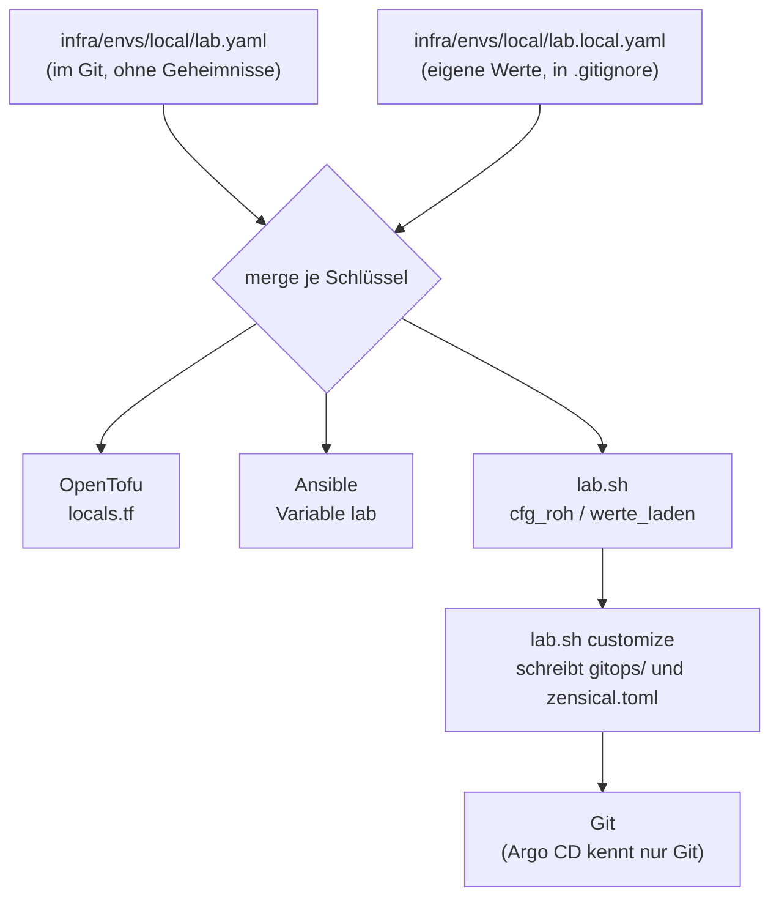

# Referenz: `lab.yaml` und `lab.local.yaml`

**Eine Quelle für alle Werte der Lab-VM** ([ADR-0001](../concepts/decisions/0001-one-source-lab-yaml.md)):

| Leser | Datei | Wie |
|---|---|---|
| OpenTofu | `infra/envs/local/locals.tf` | `yamldecode` beider Dateien, `merge()` |
| Ansible | `ansible/inventory/group_vars/all/lab.yml` | Variable `lab`; leitet `lab_edge_*` und `lab_values` ab |
| `scripts/lab.sh` | `cfg_roh()` | flache Schlüssel, eine Zeile je Wert |



Es gibt keine zweite Kopie als Variable oder Tfvars-Datei: In `infra/envs/local/` fehlen
`variables.tf` und `local.auto.tfvars` (gelöscht; `locals.tf` sagt es im Kopf). Nur das Modul
`infra/modules/libvirt-vm/variables.tf` beschreibt seine Eingaben, mit Vorgaben, die
`main.tf` aus `lab.yaml` überschreibt. Die einzige Ausnahme sind Dateien unter `gitops/`:
Argo CD liest nur Git, `lab.yaml` erreicht sie nicht. Der Preflight prüft, dass sie zu
`lab.yaml` passen; geschrieben werden sie von `lab.sh customize`.

## Regeln für `lab.local.yaml`

- Die Datei **überschreibt** Schlüssel von `lab.yaml`, ganz oder gar nicht **je
  Schlüssel** (eine Liste ersetzt die ganze Liste). Sie steht in `.gitignore`;
  Vorlage: `lab.local.yaml.example`.
- Nur `schlüssel: wert` in **einer Zeile**. Listen in eckigen Klammern. Kein
  Mehrzeiler, kein Anker.
- Ein **unbekannter Schlüssel** bricht `lab.sh` ab. Ein Tippfehler scheitert laut
  (kein `try()`); er wird nicht still ignoriert.
- `lab.sh` verlangt diese Pflichtschlüssel (aus `lab.yaml` oder `lab.local.yaml`):
  `vm_name`, `domain`, `vcpu`, `memory_mib`, `disk_gb`, `network_name`, `vm_ip`,
  `vm_cidr`, `gateway`, `libvirt_uri`, `ssh_user`, `ssh_key`, `repo_url`,
  `image_url`, `image_sha256`, `image_file`, `image_cache_dir`, `export_dir`,
  `log_dir`, `wait_ssh`, `wait_argo`, `export_max_age_h`, `matrix_server_name`.
- Argo CD kennt die Datei nicht. Werte, die auch in `gitops/` stehen (Domain,
  Repo-Adresse, Gateway, VM- und Ingress-Netz), schreibt `bash scripts/lab.sh customize`
  dorthin; danach committen und pushen.

## VM

| Schlüssel | Standard | Bedeutung |
|---|---|---|
| `vm_name` | `k3s-lab` | Name der libvirt-Domain; Ansible-Host |
| `domain` | `lab.example` | Domain der öffentlichen Namen (`argocd.<domain>`, `git.<domain>`, `matrix.<domain>`, `element.<domain>`, `sso.<domain>`, …); Teil des FQDN der VM. Der Matrix-`server_name` folgt ihr nicht |
| `vcpu` | `4` | virtuelle CPUs |
| `memory_mib` | `8192` | Arbeitsspeicher der VM (MiB). Gleich wie im Prod-Profil (`infra/envs/prod/lab.yaml`); der Preflight warnt bei einer Abweichung ([Memory-Budget](memory-budget.md#prod-paritaet)) |
| `memory_reserve_mib` | `1536` | Speicher, der für `kube-system`, Betriebssystem, kubelet und einen Backup-/Restore-Pod frei bleibt. Die Summe der Limits aller Arbeits-Pods plus dieser Wert muss in `memory_mib` passen ([Memory-Budget](memory-budget.md)). `lab.sh budget --apply` darf ihn nach einer Messung anheben, nie senken |
| `disk_gb` | `60` | Grösse der Systemplatte (GB) |
| `matrix_server_name` | `lab.dev` | Identität des Matrix-Servers. Einzige Quelle. Eine frische Instanz nutzt einen Namen unter der Lab-Domain (`matrix.<domain>`). Öffentliche Namen folgen `domain`, dieser Wert nicht. `lab.sh customize` schreibt ihn nach `serverName` in `gitops/charts/matrix/values.yaml`. `matrix-import prepare` setzt die Zeile auf den Namen des importierten Servers. Die öffentliche Version ersetzt sie durch `matrix.lab.example` (gleich wie `serverName` der Chart) |

## Netz

| Schlüssel | Standard | Bedeutung |
|---|---|---|
| `network_name` | `default` | libvirt-Netz (`default` = `virbr0`, NAT) |
| `vm_ip` | `192.168.122.50` | feste Adresse der VM (`ansible_host`) |
| `vm_cidr` | `192.168.122.0/24` | Netz der VM; die Präfixlänge liest Tofu daraus |
| `gateway` | `192.168.122.1` | Gateway; zugleich Adresse des Hosts, unter der die VM rustfs erreicht (`http://<gateway>:9000`) |
| `dns_servers` | `["192.168.122.1"]` | DNS der VM (Liste) |
| `libvirt_uri` | `qemu:///system` | libvirt-Verbindung |

## Netz-Kante {#netz-kante}

Wer darf wohin. Ausführlich: [Netz-Kante einstellen](../how-to/edge-profile.md),
[Erklärung](../concepts/network-edge.md). Listen sind Komma-Text; die Wörter
`vm_cidr`, `gateway` und `vm_ip` stehen für die Werte oben; eine einzelne Adresse
wird `/32` (IPv6 `/128`).

| Schlüssel | Standard | Bedeutung |
|---|---|---|
| `edge_profile` | `default` | `default`: Admin-Netz ist `edge_admin_cidrs` (Lab im LAN). `edge`: Admin-Netz ist nur `edge_profile_admin`. Probelauf: `ansible-playbook site.yml -e edge_profile=edge` |
| `edge_admin_cidrs` | `vm_cidr` | SSH (22), Kubernetes-API (6443), NodePorts/hostPorts und die Admin-Oberfläche (Port 8444). Der Steuerrechner muss hier liegen |
| `edge_ingress_cidrs` | `vm_cidr` | Apps über Traefik auf 80/443 und `loadBalancerSourceRanges` am Service. Wird nach `gitops/` geschrieben (`lab.sh customize`) |
| `edge_profile_admin` | `gateway` | die eine Adresse (oder das Netz), die im Profil `edge` Admin ist |

## Öffentliche Probe (optional)

Aktiv nur, wenn alle vier Werte (`acme_solver`, `acme_zone`, `acme_probe_name`,
`acme_email`) gesetzt sind; sonst ist die Phase `SKIP`. **Nicht** in `lab.yaml`
eintragen, sondern in `lab.local.yaml` (Zone und Namen sind persönlich). Der
API-Token steht nie hier, sondern in `~/.config/k8s-lab/acme-dns01.token` (Modus
600, eine Zeile) und als SOPS-Datei ([Geheimnis-Karte](secrets-map.md)). Ablauf:
[Öffentliches Zertifikat](../how-to/public-certificate.md).

| Schlüssel | Standard | Bedeutung |
|---|---|---|
| `acme_solver` | `""` | DNS-Anbieter der Zone: `cloudflare` oder `digitalocean` |
| `acme_zone` | `""` | Zone beim Anbieter (z. B. `example.org`); `acme_probe_name` liegt darin, **nie** unter `domain` |
| `acme_probe_name` | `""` | ein Name, den nur die Probe benutzt |
| `acme_email` | `""` | Kontakt für den ACME-Konto (Ablaufwarnungen) |
| `acme_server` | Let's Encrypt Produktion (`https://acme-v02.api.letsencrypt.org/directory`) | ACME-Verzeichnis |

## Zugang

| Schlüssel | Standard | Bedeutung |
|---|---|---|
| `ssh_user` | persönlich (Beispiel: `kollege`) | Benutzer in der VM (cloud-init legt ihn an) |
| `ssh_key` | persönlich (Beispiel: `~/.ssh/id_ed25519`) | **privater** Schlüssel; der öffentliche heisst gleich mit `.pub` und kommt per cloud-init in die VM |

## Git-Server

| Schlüssel | Standard | Bedeutung |
|---|---|---|
| `repo_url` | persönlich (`ssh://git@git.example.org/YOUR-NAME/k8s-lab.git`) | Adresse **deines** Repos (SSH-Port nur angeben, wenn er nicht 22 ist: `ssh://git@host:PORT/...`). Ein Port in Beispielen anderer Seiten gehört zum externen Git-Server des Autors, **nicht** zu Gitea im Lab (das hat kein SSH). Steht zusätzlich fest in `gitops/apps/*.yaml` (`lab.sh customize` schreibt sie dorthin) |
| `source_trust` | `auto` | Quellvertrauen beim Neuaufbau ([Konzept](../concepts/source-trust.md), [ADR-0023](../concepts/decisions/0023-signed-main-and-source-trust.md)): `auto` prüft, sobald ein vertrauter Commit eingetragen ist oder `repo_url` bei github.com, gitlab.com, codeberg.org oder bitbucket.org liegt; `on` prüft immer; `off` nie (der Preflight warnt dann bei einem öffentlichen Anbieter). Der vertraute Commit liegt in `~/.config/k8s-lab/trusted-head`, nicht in Git. Ist die Prüfung an, bindet `lab.sh` Argo CD beim Bau mit `-e argocd_pin_revision=COMMIT` an den geprüften Commit (Standard in `group_vars`: leer = folgt dem Branch) |
| `source` | `gitea` | Quelle von Argo CD: `gitea` (`repo_url`) oder `github` (`github_repo_url`, der private GitHub-Spiegel). Nicht von Hand ändern, sondern mit `bash scripts/lab.sh source github` oder `source gitea`, dann committieren, signieren und auf `main` bringen ([ADR-0024](../concepts/decisions/0024-github-as-switchable-source.md), [Anleitung](../how-to/neuaufbau-github.md)). Im Modus `github`: Quellvertrauen immer an, `secrets_repo_url` leer, GitHub-Commit gleich `origin/main` des Git-Servers |
| `github_repo_url` | persönlich (`ssh://git@github.com/YOUR-NAME/k8s-lab.git`) | Spiegel auf GitHub; nur `github.com`, Port 22, nur wirksam bei `source: github` |
| `github_known_hosts` | die drei Schlüssel von `github.com` | feste Host-Keys für den Modus `github`; ihre Fingerabdrücke stehen in der [Anleitung](../how-to/neuaufbau-github.md#github-host-keys) und werden getestet |
| `github_egress_cidrs` | `140.82.112.0/20,192.30.252.0/22` | Egress-Bereiche für `github.com` (Liste in einer Zeile, Präfix mindestens /20); Port 22 |
| `repo_known_hosts` | persönlich | öffentliche Host-Keys des Git-Servers (Format `known_hosts`, Liste in einer Zeile). Holen: `bash scripts/lab.sh customize --fetch-host-keys`. **Leer: der Preflight von `argocd.yml` bricht ab** (kein Blindvertrauen) |

## Basis-Image (gepinnt)

Neues Image = alle drei Werte zusammen ändern. Die Prüfsumme prüft `lab.sh`
beim Laden und das Tofu-Modul beim Plan ein zweites Mal.

| Schlüssel | Standard | Bedeutung |
|---|---|---|
| `image_url` | Ubuntu 24.04 (noble), feste Ausgabe `release-20261017` | Quelle; die Prüfsummen stehen in `SHA256SUMS` daneben |
| `image_sha256` | Prüfsumme der Ausgabe | SHA-256 des Images |
| `image_file` | `ubuntu-24.04-noble-20261017.img` | Dateiname im Cache |

## Ablage auf dem PC (ausserhalb des Repos)

| Schlüssel | Standard | Bedeutung |
|---|---|---|
| `image_cache_dir` | `~/k8s-lab-data/images` | Image-Cache |
| `export_dir` | `~/k8s-lab-data/vm-export` | Exporte der VM-Platte (Modus 0700) |
| `log_dir` | `~/k8s-lab-data/logs` | Logs von `lab.sh` (Modus 0600) |

## Zeitlimits (Sekunden, ausser `export_max_age_h`)

| Schlüssel | Standard | Bedeutung |
|---|---|---|
| `wait_ssh` | `600` | bis die VM nach Tofu per SSH antwortet und cloud-init fertig ist |
| `wait_argo` | `1800` | bis alle Argo-CD-Applications `Synced` und `Healthy` sind |
| `export_max_age_h` | `24` | so alt (in Stunden) darf der letzte Export sein, bevor `down`, `rebuild` und `purge` abbrechen |

## Beispiel `lab.local.yaml`

```yaml
# Only keys that differ from lab.yaml. Example for another PC with a different
# libvirt network and its own SSH key.
ssh_user: friend
ssh_key: ~/.ssh/id_ed25519
vm_ip: 192.168.123.50
vm_cidr: 192.168.123.0/24
gateway: 192.168.123.1
dns_servers: ["192.168.123.1"]
memory_mib: 6144

# Edge profile: only if you want to separate the admin and ingress networks.
edge_profile: edge                # admin = only edge_profile_admin
edge_profile_admin: gateway       # one address, e.g. 10.8.0.2
edge_ingress_cidrs: vm_cidr      # comma list ("vm_cidr, 203.0.113.0/24")

# Public probe (real certificate via ACME DNS-01); the token never goes here.
acme_solver: cloudflare          # or digitalocean
acme_zone: example.org
acme_probe_name: lab-probe.example.org
acme_email: you@example.org
```

Netz und Gateway stehen zusätzlich fest in einigen Dateien unter `gitops/`. Die
Liste und die Anleitung stehen im Abschnitt
[Anderes Netz](../tutorials/lab-for-friends.md#anderes-netz) des Tutorials.

## Abgeleitete Werte (nur Ansible)

`group_vars/all/lab.yml` leitet aus den Schlüsseln ab:

| Variable | Herkunft |
|---|---|
| `lab_edge_profile` | `-e edge_profile=…` oder `lab.edge_profile` |
| `lab_edge_admin_cidrs` | `edge_profile_admin` im Profil `edge`, sonst `edge_admin_cidrs`; die Wörter werden ersetzt |
| `lab_edge_ingress_cidrs` | aus `edge_ingress_cidrs` |
| `lab_values` | alles, was `lab.sh` ausserhalb von `lab.yaml` wissen muss: `vm_name`, `vm_ip`, `fqdn`, `gateway`, die rustfs-Env-Dateien, die Bucket-Namen, die Geheimnis-Dateien und die Dateien in `gitops/`, die zu `lab.yaml` passen müssen (`gitops_gateway_files`, `gitops_cidr_files`; der Preflight prüft sie). `backup_max_age_h` ist derselbe Wert wie `restore_drill_max_age_h`. `restore_state_file` ist der Pfad der Markierung eines unfertigen `rebuild --restore` (siehe `group_vars/all/restore.yml`, dort auch die Wartezeiten des Plugin-Wartens) |
